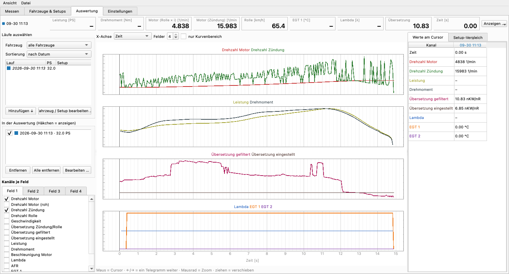
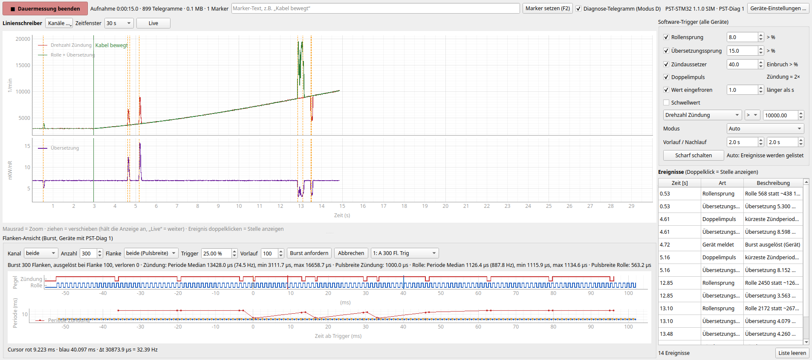
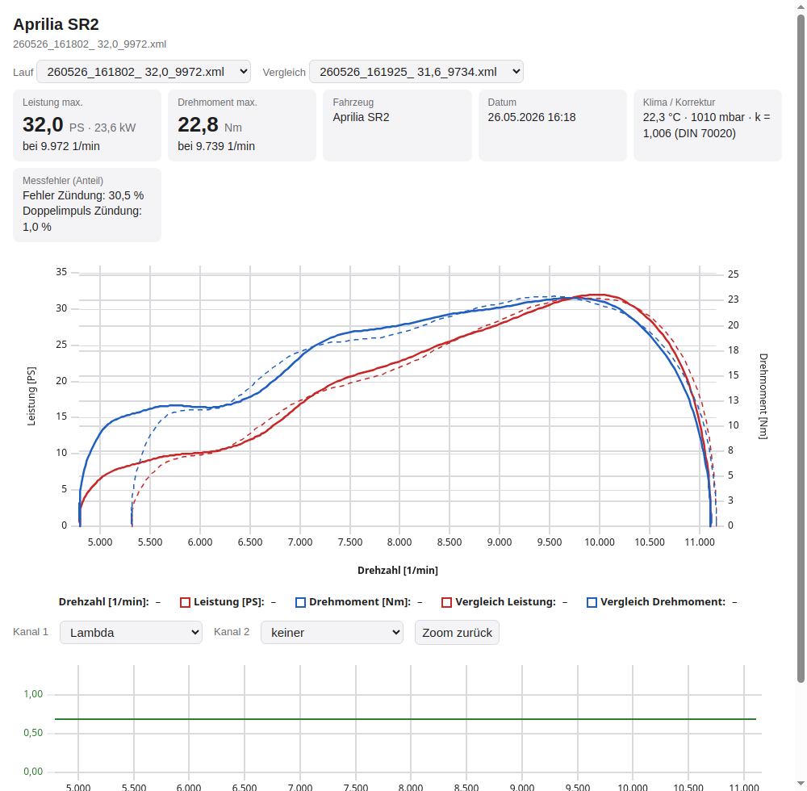

# PyST 1.3

Einfaches Prüfstandsprogramm zum Testen der neuen PST-STM32-Firmware – ohne Windows und ohne LabVIEW.
Läuft auf **Mac**, **Linux/Raspberry Pi** (und Windows).

- steuert die Messelektronik: Klima lesen (`e`), Messung starten (`m`) und stoppen (`s`)
- Lauf mit **fester Übersetzung**, Start bei *n vom Gas*, Ende bei **n Stop** (z.B. 8000 1/min) oder beim Gaswegnehmen
- Prüfstandsdaten: Rollengeber, Rollenumfang, Trägheit, Zündimpulse, Filter, Verlustmoment
- Übersetzung einmessen aus Zündsignal oder rusEFI-Drehzahl (Verlauf, getrimmter Mittelwert, von Hand anpassbar)
- **rusEFI-Steuergerät** als zweite Datenquelle (Reiter „ECU“), Kanäle frei wählbar und mit jedem Lauf gespeichert
- Live-Anzeige (Motor berechnet und gemessen, km/h, Messfrequenz, verlorene Telegramme), Live-Kurve
- **Rechnet exakt wie LabVIEW 3.2.1.** Geprüft an sechs echten Läufen vom 26.05.26: gleiche Pmax auf 0,1 PS, gleiche n(Pmax).
- Speichert jeden Lauf als CSV, JSON, PNG und **LabVIEW-XML** (öffnet in LabVIEW-Recalc)
- lädt LabVIEW-Läufe und PyST-Läufe zum Vergleich (Überlagerung und Tabelle)
- eingebauter **Simulator**, um ohne Prüfstand zu testen (auch mit Störungen und als alter Mega 3.0.0)
- **Messwerkzeug „Oszi / Dauermessung“**: Dauermessung, Linienschreiber, Software-Trigger auf Störungen,
  Flanken-Ansicht (Logikanalysator) und Geräte-Einstellungen über **PST-Diag 1** (Mega ab 3.1.0, F446 ab 1.1.0)
- **Fehlerkanäle** „Fehler Rolle“, „Fehler Zündung“, „Doppelimpuls Zündung“, „Wert eingefroren“ – auch für alte Läufe
- **Läufe weitergeben**: `.pyst`-Datei (öffnet in PyST) oder **HTML-Ansicht** (öffnet in jedem Browser, offline)
- **Import von Rohmitschnitten** (TeraTerm/Terminal) von Mega und F446

Testablauf für den Vergleich alt/neu: siehe [TESTPLAN.md](TESTPLAN.md).



## Oberfläche

| Reiter | Inhalt |
|---|---|
| **Messen** | Status (GO / Messung / GAS WEG), Live-Werte (Motor, Zündung, km/h, EGT 1/2, λ, TPS, Messfrequenz, COM), Leistungsdiagramm (PS/Nm oben, λ/EGT unten), Laufliste mit Häkchen zum Ein-/Ausblenden, Cursor-Tabelle (Werte aller sichtbaren Läufe bei der Drehzahl unter der Maus) |
| **Fahrzeuge & Setups** | Datenbank: Hersteller, Modell, Vergaser/EFI; je Setup Motor (Hubraum, CR, Steuerzeiten), Vergaser (Düsen, Nadel, Clip …), ECU/Tune, Zündung, Antrieb (Übersetzung, Vario, Rollen, Federn), Ein-/Auslass, Kraftstoff. Setups kopieren, „für neue Läufe verwenden“. |
| **Auswertung** | Fahrzeug wählen → Läufe nach Datum oder nach Setup gruppiert → **Hinzufügen**, dann nächstes Fahrzeug. Fahrzeug/Setup direkt bearbeiten (auch Rechtsklick: Setup zuordnen, neues Setup). Log-Viewer wie MegaLogViewer: bis 4 Felder, beliebige Kanäle (gleiche Einheit = gleiche Skala), Cursor mit Maus und ←/→, X-Achse Zeit oder Drehzahl, beliebig viele Läufe (Farbe je Lauf, Linienart je Kanal). **Setup-Vergleich** mit markierten Unterschieden. Kanal „Übersetzung Zündung/Rolle“. |
| **Oszi / Dauermessung** | Messwerkzeug für die Fehlersuche (Zündung oder Rolle?), siehe unten |
| **Zange · Netz · Steckdosen** | PyST-Basis mit Funk-Zündzange, WLAN der Basis, WLAN-Steckdosen, Zange per USB – siehe unten |
| **Einstellungen** | Verbindung, Prüfstand, Lauf, Filter & Verluste, Klima, Anzeige (λ oder AFR) |

- Während eines Laufs bleibt die Skalierung wie beim vorherigen Lauf stehen; danach wird neu skaliert.
- Achsgrenzen über dem Diagramm: Drehzahl von/bis, PS von/bis, Nm von/bis (z.B. ab 5000 1/min und ab 5 PS);
  „auto“ = aus den Kurven, „Achsen auto“ setzt alles zurück. Gilt auch für den PDF-Bericht.
- Filter in Sekunden (Standard 1,75 s / 0,75 s) passen sich der Messfrequenz an; Modus „Messpunkte (wie LabVIEW)“
  für den direkten Vergleich mit LabVIEW. LabVIEW-Läufe im Simulator schalten automatisch auf Messpunkte.
- Nm-Achse mit runder Teilung, die PS-Achse wird so gelegt, dass ihre Striche auf denselben Gitterlinien liegen.
- Läufe bleiben in der Datenbank (`~/PyST/pyst.db`, Messdaten in `~/PyST/messungen/`;
  Datenordner älterer Versionen werden beim ersten Start automatisch übernommen).
  Rechtsklick auf einen Lauf: Notiz, Farbe, Fahrzeug/Setup zuordnen, mit aktuellen Einstellungen neu rechnen, CSV, löschen.
- **Import** von LabVIEW-XML und PyST-Läufen, **Export** als PDF-Bericht (sichtbare Läufe + Setup-Daten) und CSV (Excel deutsch oder international).
- **Verbinden** direkt im Messen-Reiter (neben START). Das Messboard wird alle 5 s gesucht und automatisch
  verbunden (abschaltbar in den Einstellungen); Abziehen wird erkannt. Nach „Trennen“ von Hand bleibt es getrennt.
- **Anzeigen und Diagramme** frei belegbar über vier Menüs: „Anzeigen …“ (oben), „Kurven ▾“ im Leistungs-
  und im unteren Diagramm (links/rechts, ausblendbar), „Spalten …“ an der Cursor-Tabelle (zuklappbar).
  Achsgrenzen direkt an den Achsenden (fett = fest, grau = automatisch).
- Fenster, Aufteilungen, Spalten und Reiter werden beim Beenden gespeichert; im Auswerter speicherbare Layouts.
- **Übersetzung einmessen** (Knopf unten rechts): Quelle Zündabnehmer oder rusEFI, Verlauf über der Messzeit,
  rote Linie = Mittelwert, ziehen/klicken/eintippen zum Anpassen.
- **rusEFI** (Reiter „ECU“): Das Steuergerät wird per USB parallel zum Prüfstand gelesen (5–200 Hz, Standard 50 Hz).
  - Die Kanalnamen stehen nicht im Steuergerät, sondern in der TunerStudio-`.ini` zur jeweiligen Firmware.
    PyST holt sie automatisch vom USB-Laufwerk „RUSEFI“ (`rusefi.ini.7z`) und legt sie unter
    `~/PyST/rusefi_ini/` ab. Alternativ „Datei wählen …“. Passt die Signatur nicht, warnt PyST.
  - Aufgezeichnet werden **nur die gewählten Kanäle** („Kanäle hinzufügen …“ durchsucht die ganze .ini).
    Die Auswahl samt Abtastrate lässt sich als **Kanal-Setup** unter einem Namen speichern und als Datei
    exportieren/importieren.
  - Beim Speichern eines Laufs: Spalten `rusefi_<Kanal>` in `roh.csv` (auf die Prüfstands-Telegramme gelegt),
    Originalabtastung in `rusefi.csv`, Signatur und Einheiten in `lauf.json`. Im Auswerter erscheinen die
    Kanäle in der Gruppe „rusEFI“ (z.B. „TPS (ECU)“).
  - Messen → „Anzeigen …“: jeder aufgezeichnete Kanal als Anzeige (live, am Cursor der Wert des Laufs) und
    bis zu 4 Kanäle „im Diagramm“: ohne eigene Achse über die Leistungskurve gelegt (Farbe = Lauf,
    Punkt-/Strichpunkt-Muster = Kanal, Bereich in der Legende oben links, Werte in der Cursor-Tabelle).
  - Zum Entpacken der `.7z` wird `py7zr` benutzt, ersatzweise `bsdtar`/`7z` (Mac und Windows haben `tar` dabei,
    auf Linux ggf. `pip install py7zr` oder `apt install p7zip-full`).
- Weitere Messkanäle (später WSB) sind zusätzliche Spalten in `roh.csv` und
  erscheinen automatisch im Auswerter und im CSV-Export.

## Oszi / Dauermessung (ab 1.3)



Kurz: **Verbinden → Reiter „Oszi / Dauermessung“ → „● Dauermessung starten“ → bei Bedarf Marker (F2,
z.B. „Kabel bewegt“) → Ereignisse in der Liste doppelklicken → „Dauermessung beenden“** (landet als Lauf
„Dauer“ in der Laufliste und in der Auswertung).

- **Dauermessung** unabhängig vom Leistungslauf, ohne Zeitgrenze. Sie wird fortlaufend gesichert
  (`~/PyST/messungen/JJMMTT_hhmmss_Dauermessung/teil_NNNN.csv`, alle 2 s auf die Platte, je Minute ein Abschnitt);
  nach einem Absturz fehlen höchstens Sekunden, der Ordner lässt sich trotzdem importieren.
  Beim Beenden: `roh.csv` + `lauf.json` (+ `marker.csv`, `ereignisse.csv`, `bursts/`).
- **Linienschreiber**: Kanäle frei wählbar („Kanäle …“): Drehzahl Zündung, Drehzahl Rolle, Rolle × Übersetzung,
  Übersetzung, Messfrequenz, AFR, EGT 1/2 und – mit PST-Diag 1 – Flanken je Telegramm, kürzeste/längste Periode,
  verworfene Flanken, Geräte-Flags. Je Einheit ein Feld, Zeitfenster 10 s … alles, Mausrad/Ziehen hält an, „Live“.
- **Software-Trigger** (für alle Geräte, auch alter Mega 3.0.0 – arbeitet nur mit den Telegrammen):
  Rollensprung (> x % vom gleitenden Median), Übersetzungssprung, Zündaussetzer/Timeout, Doppelimpuls
  (Zündung ≈ 2×), eingefrorener Wert, Schwellwert auf einen Kanal. Modi **Auto** (nur Liste),
  **Normal** (Anzeige springt zu jedem Ereignis), **Einzelschuss** (danach angehalten), Vor-/Nachlauf.
  Alle Ereignisse stehen in der Liste (Doppelklick = Stelle anzeigen) und in `ereignisse.csv`.
- **Flanken-Ansicht** (nur Geräte mit PST-Diag 1): Kanal (Zündung/Rolle/beide), Anzahl, Flanke (fallend/steigend/
  beide = Pulsbreite), Trigger % (Periode weicht vom Mittel der 8 vorigen ab), Vorlauf → „Burst anfordern“.
  Oben Logikanalysator-Spuren, unten Periode je Flanke (und Pulsbreite), zwei Cursor mit Δt und 1/Δt.
- **Geräte-Einstellungen …** liest `#GET` und zeigt alle Einstellungen des Geräts (Flanke, Timeouts,
  Doppelimpulsfilter, Sperrzeiten …); „Übernehmen“ (`#SET`, flüchtig), „Im Gerät speichern“ (`#SAVE`,
  Ausgabe wird dafür kurz angehalten), „Standardwerte“ (`#DEFAULTS`). Kein Neu-Flashen nötig.
- Während der Dauermessung schaltet PyST Geräte mit PST-Diag 1 in **Modus D** (Diagnose-Telegramm), danach
  zurück in den Normalmodus. Leistungsläufe laufen wie bisher im Normalmodus (LabVIEW-identisches Telegramm).

**Protokoll** (Spezifikation `docs/04_PST_Diag_1.md`): beim Verbinden sendet PyST `#?`. Antwortet das Gerät
binnen 300 ms mit `#CAP`, sind Modus D, Bursts und Einstellungen verfügbar; sonst (Mega 3.0.0, F446 1.0.0)
nur die normalen Telegramme. Zeilenende `\n`, `\r` oder `\r\n`; unbekannte Zeilen/Felder werden ignoriert.

**Simulator** (Port-Auswahl in den Einstellungen):

| Port | verhält sich wie |
|---|---|
| `SIM` | F446 1.1.0 mit PST-Diag 1, synthetischer Motor |
| `SIM:stoerung` | dasselbe mit Störungen: Doppelimpuls und Aussetzer der Zündung, Rollensprünge, Wackelkontakt |
| `SIM:mega` | Mega-Sketch 3.1.0 mit PST-Diag 1 |
| `SIM:mega300`, `SIM:mega300:stoerung` | alter Mega 3.0.0 ohne `#CAP` (nur Software-Trigger), optional mit Störungen |

Die Störungen sind im Simulator Geräte-Einstellungen (`sim_doppel`, `sim_aussetzer`, `sim_rollensprung`,
`sim_wackel` = Ereignisse pro Minute) und lassen sich im Dialog „Geräte-Einstellungen …“ live ändern.
Mit `ign_lockout_pct` (z.B. 50) filtert der Simulator Doppelimpulse wie die Firmware („verworfen“ zählt mit).

## PyST-Basis, Funk-Zange und Steckdosen

Protokoll: `../docs/04_PST_Diag_1.md` §10. Ohne Hardware vorführbar mit den Simulator-Ports `SIM:basis`,
`SIM:basis:stoerung`, `SIM:basis:ohne` und `SIM:zange` sowie dem Knopf „Demo-Steckdosen (Simulator)“.

- **Verbinden**: Basis per USB wie bisher, oder **per WLAN**: Port `tcp://192.168.4.1:2323` (Basis als Access Point)
  bzw. `tcp://<name>.local:2323` (Werkstattnetz, mDNS) – oder Knopf „PC per WLAN verbinden“. Ein Abriss der
  WLAN-Verbindung wird erkannt.
- **Zange** (Reiter „Zange · Netz · Steckdosen“, Kurzfassung rechts in der Statusleiste): Akku, Signal, Sync,
  Funken, Blitz φ. **Koppeln …** öffnet das Kopplungsfenster (an der Zange T1 + T2 gleichzeitig 3 s halten),
  **Markieren (F3)** setzt einen Marker (erscheint wie die Tasten der Zange im Oszi und im Lauf),
  **Einstellungen …** liest/schreibt die Zangen-Schlüssel (`imp_per_rev_x10`, `deadtime_us`, `blitz_phi_x10` …).
- **Zündstärke** (`ign_peak_mv`): Kanal im Linienschreiber und im Auswerter (Gruppe „Zange“). Mit gekoppelter Zange
  laufen auch Leistungsläufe im Diagnose-Telegramm, damit die Zündstärke mitgespeichert wird.
- **Ereignisse** der Basis (Marker, Zange verbunden/verloren, Steckdose an/aus) stehen in der Oszi-Ereignisliste,
  in `marker.csv`/`ereignisse.csv` von Lauf und Dauermessung und als Linien im Auswerter.
- **Netzwerk**: WLAN der Basis als Access Point (Kanal, SSID, Passwort), im Werkstatt-WLAN oder aus.
- **Steckdosen** über die Basis oder **direkt vom PC** (gleiches Netz, ohne Basis): Shelly Gen2/3/4 und Gen1,
  Tasmota, ESPHome. Suchen (mDNS), Hinzufügen (Typ wird erkannt, Einschaltzustand nach Stromausfall = aus,
  Shelly mit Passwort oder ohne Relais wird abgewiesen), Ein/Aus, Leistung, Totmann-Zeit („fällt aus“ = Rückfallzeit,
  laufend erneuert; „bleibt an“), **Automatik**: z.B. Gebläse/Absaugung beim Laufstart (bzw. bei Dauermessung) ein,
  nach dem Ende + Nachlaufzeit aus. Empfohlen: Shelly Plug S/M Gen3; ESPHome kennt keine Rückfallzeit.
  **Komfortfunktion, keine Sicherheitsfunktion, kein Not-Aus.**
- **Zange per USB** (zum Auslesen/Testen, **galvanische Verbindung** – PyST warnt deutlich): Port der Zange wählen
  und verbinden (nie automatisch). Oszi/Dauermessung/Burst nur mit Kanal Zündung. **Log auslesen …** holt das Log
  der Zange und legt es als Dauermessung ab (Laufliste/Auswertung), auf Wunsch gleich als `.pyst`.

## Fehlerkanäle (ab 1.3)

Für jeden Lauf und jede Dauermessung – auch für alte Läufe und LabVIEW-Dateien – berechnet PyST aus Rolle und Zündung:

| Kanal | Bedeutung |
|---|---|
| Fehler Rolle | Rolle weicht mehr als 5 % vom gleitenden Median (±0,12 s) ab – die Masse der Rolle macht das unmöglich |
| Fehler Zündung | Zündung weicht mehr als 12 % von Rolle × *gleitender* Übersetzung (±1 s) **und** vom eigenen gleitenden Median ab |
| Doppelimpuls Zündung | dabei Zündung ≈ 1,7…2,3 × erwartet |
| Wert eingefroren | Rolle oder Zündung ≥ 1 s exakt gleich, während sich die andere Drehzahl um > 3 % ändert |
| Abweichung Rolle / Zündung | die Abweichung in % (zum Ansehen) |

Weil die Übersetzung gleitend bestimmt wird, gibt ein Vario (stetig veränderliche Übersetzung) keinen Fehlalarm.
Der **Fehleranteil** (% der Telegramme, in denen sich etwas dreht) steht in der Laufliste (Spalte „Fehler“,
Tooltip mit Details), im PDF-Bericht und in der HTML-Ansicht.

## Läufe weitergeben (ab 1.3)

**Datei → Läufe weitergeben (.pyst) …** (Strg+S): markierte, sichtbare, alle des Fahrzeugs oder alle eines Tages –
als eine `.pyst`-Datei, als Ordner mit je einer `.pyst` pro Lauf oder als HTML-Ansicht.

- **`.pyst`** = ZIP mit `inhalt.json` (Fahrzeug, Setup, Notiz, Farbe, Parameter, Fehleranteile) und je Lauf dem
  Laufordner (`roh.csv`, `lauf.json`, `kurve.csv`, `marker.csv`, `bursts/` … bzw. LabVIEW-XML).
  Öffnen: Datei → Öffnen, Doppelklick/Kommandozeile `./start_linux.sh datei.pyst` (Windows: `start_windows.bat datei.pyst`)
  oder per **Drag & Drop** ins Fenster. Fahrzeug und Setup werden beim Empfänger angelegt, doppelte Läufe nicht doppelt.
- **HTML-Ansicht** (Strg+H): **eine** Datei (~110–140 KB für 2–4 Läufe), öffnet offline in jedem Browser, auch am Handy,
  hell/dunkel. Oben Pmax (PS/kW), Mmax, Fahrzeug, Datum, Klima/DIN-Korrektur, Fehleranteile; ein Diagramm
  Leistung + Drehmoment über Drehzahl, darunter bis zu zwei zuschaltbare Kanäle (λ/AFR, EGT, Zündung …),
  Werte unter dem Cursor, Zoom (Bereich ziehen) und „Zoom zurück“, Lauf-Auswahl und optional ein Vergleichslauf.
  Die Diagramm-Bibliothek [uPlot](https://github.com/leeoniya/uPlot) 1.6.31 (MIT-Lizenz, `pyst/data/uplot/LICENSE`)
  ist samt Lizenztext eingebettet.



**Nur ansehen:** PyST startet ohne Messelektronik direkt als Auswerter (kein Verbindungsdialog; verbunden wird
nur automatisch, wenn ein PST-Messboard steckt). Für Kunden genügt: PyST installieren, `.pyst`-Datei öffnen –
oder ganz ohne PyST die HTML-Datei.

## Import von Rohmitschnitten

**Datei → Öffnen / importieren** nimmt auch Mitschnitte aus TeraTerm, HTerm & Co. (`.log`, `.txt`, `.csv`) vom
Mega (3.x) und der F446: mit oder ohne Zeitstempel `[yyyy-mm-dd hh:mm:ss.fff]`, Zeilenende `\r` oder `\n`,
mit `v`-/`e`-Antworten davor (Firmware-Version und Klima werden übernommen), auch D-Telegramme.
Weil ein Mitschnitt keine Prüfstandsdaten enthält, fragt PyST Rollengeber, Umfang, Trägheit, Zündimpulse und
Übersetzung ab (vorbelegt mit den aktuellen Einstellungen). Ohne Oberfläche (`pyst recalc mitschnitt.log`) gelten
die PyST-Standardwerte mit Hinweis in `lauf.json`.

## Start

**Mac:** Doppelklick auf `start_mac.command` (beim ersten Mal wird alles eingerichtet), oder im Terminal:

```bash
cd PST-PyST
./start_mac.command            # mit Prüfstand
./start_mac.command --sim      # Simulator: spielt den echten Lauf 161802 (26.05.26) ab
./start_mac.command --sim --synth   # Simulator mit synthetischem Motor
```

Der Nucleo erscheint als `/dev/cu.usbmodem…` in der Port-Liste.

**Windows:** `start_windows.bat` doppelklicken (Python 3 von python.org, „Add to PATH“).

**Messelektronik:** PST-STM32-Firmware (Nucleo-F446RE) oder Arduino-Mega-Sketch 3.0.0 – wird beim
Verbinden erkannt. Installation und Flashen: [../INSTALL.md](../INSTALL.md).

**Raspberry Pi (Raspberry Pi OS 64 bit, Desktop):**

```bash
sudo apt install python3-venv libxcb-cursor0
sudo usermod -aG dialout $USER     # einmalig, danach ab- und wieder anmelden
./start_linux.sh
```

Der Nucleo erscheint als `/dev/ttyACM0`.

## Kommandozeile (ohne Oberfläche)

```bash
./.venv/bin/python -m pyst ports                              # Ports anzeigen
./.venv/bin/python -m pyst run --port SIM --n-stop 8000       # Lauf im Terminal
./.venv/bin/python -m pyst recalc ../*.xml                    # LabVIEW-Läufe nachrechnen
./.venv/bin/python -m pyst compare A.xml B.xml ~/PyST/messungen/*/lauf.json
./.venv/bin/python -m pyst recalc kunde.pyst teraterm.log     # auch .pyst und Rohmitschnitte
./.venv/bin/python -m pyst datei.pyst                         # Oberfläche, Datei gleich in der Auswertung
```

Alle Prüfstandsparameter lassen sich überschreiben, z.B. `--ratio 6.85 --inertia 13.5 --n-min 4000`.

## Bedienung

1. Port wählen → **Verbinden**. Die Firmware-Version erscheint unter dem Knopf.
2. Prüfstand- und Laufdaten prüfen. Sie werden in `~/PyST/einstellungen.json` gespeichert.
3. Drehzahl unter *n vom Gas* halten → **START (F1)** → Klima wird gelesen → **GO – Vollgas!**
4. Über *n vom Gas* beginnt die Messung (gelb), ab *n Stop* erscheint **GAS WEG!** (rot).
5. Ergebnis wird angezeigt und (Auto-Speichern) unter `~/PyST/messungen/` abgelegt.
6. **Abbrechen (Esc)** jederzeit.

*n vom Gas* muss über der Haltedrehzahl liegen. Sonst erkennt die Auswertung (wie LabVIEW) schon
beim Halten ein „Laufende“, weil die Drehzahl dort schwankt.

## Rechenweg (aus LabVIEW 3.2.1 übernommen)

- nRolle = 60 · f_Rolle / Inkr, dT = 1 / Messfrequenz
- Rolle geglättet: Dreieck-Mittelwert, Halbbreite ⌊MA/2⌋; dT: Rechteck, Halbbreite dq
- n = nRolle · i, ω = n · 2π/60, a = zentraler Differenzenquotient über ±dq Punkte
- M = k · J / i² · a + Mv / i, P = ω · M, PS = 0,00135962 · P
- k (DIN 70020) = 1013 / p · √((T + 273,15) / 293,15)
- *n vom Gas* ist nur die Schwelle für die Ende-Erkennung: Der Lauf endet bei der ersten fallenden Drehzahl
  oberhalb von *n vom Gas* (oder bei *n Stop*). Unter der Schwelle wird nichts abgeschnitten. Entfernt wird nur
  der Vorlauf bis zur letzten fallenden Drehzahl unterhalb der Schwelle (das Halten vor dem Gasgeben).

Details und Quellenhinweise stehen in `pyst/physics.py`.

## Tests

```bash
./.venv/bin/python -m unittest discover -s tests -v      # oder: python -m pytest tests
PYST_KUNDEN_LOGS=/pfad/zu/den/mitschnitten python -m pytest tests -k kunden   # echte Mitschnitte, nur lokal
```

## Aufbau

```
pyst/physics.py   Auswertung (LabVIEW-identisch)
pyst/link.py      serielle Verbindung (STM32-Firmware, Arduino-Mega-Sketch, PST-Diag 1)
pyst/diag.py      PST-Diag 1: Bursts (Flanken), Software-Trigger/Ereigniserkennung
pyst/oszi.py      Reiter „Oszi / Dauermessung“, Dialog Geräte-Einstellungen
pyst/recorder.py  Dauermessung (fortlaufend in Abschnitten gesichert)
pyst/htmlexport.py HTML-Ansicht zum Weitergeben (uPlot eingebettet)
pyst/share_ui.py  Dialoge Weitergeben und Import von Mitschnitten
pyst/runner.py    Ablauf eines Laufs
pyst/storage.py   Speichern/Laden (CSV, JSON, LabVIEW-XML, .pyst, Terminal-Mitschnitte)
pyst/lvxml.py     LabVIEW-Datenspeicher lesen/schreiben
pyst/sim.py       Simulator (Firmware + Motor + Rolle, PyST-Basis mit Zange, Zange per USB)
pyst/basis.py     PyST-Basis: Parser und Befehle (#ZANGE, #NET, #DOSE, #PAIR, #LOG, E;…, L;…)
pyst/plugs.py     WLAN-Steckdosen (Shelly/Tasmota/ESPHome per HTTP, Automatik, Simulator)
pyst/zange.py     Log der Zange -> Dauermessung
pyst/mdns.py      einfaches mDNS (Basis und Steckdosen im Netz finden)
pyst/hw_page.py   Reiter „Zange · Netz · Steckdosen“
pyst/gui.py       Oberfläche (PySide6 + pyqtgraph)
pyst/plots.py     Leistungsdiagramm mit ausgerichteten Achsen und Cursor
pyst/viewer.py    Auswerter (MegaLogViewer-Stil)
pyst/db.py        Datenbank Fahrzeuge / Setups / Läufe (SQLite)
pyst/channels.py  Messkanäle eines Laufs (roh + abgeleitet + Zusatzkanäle + Fehlerkanäle)
pyst/report.py    PDF- und CSV-Export
pyst/widgets.py   Anzeigen (live und am Cursor)
pyst/dialogs.py   Eingabemasken Fahrzeug/Setup, Bearbeiten-Dialog
```
