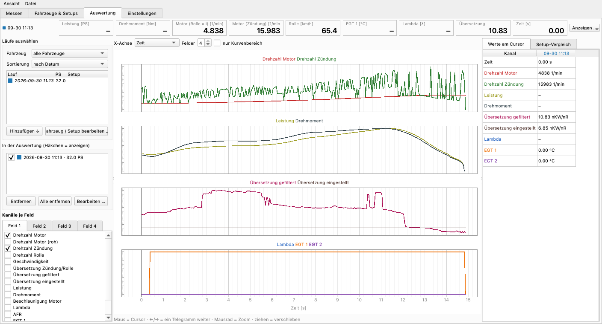
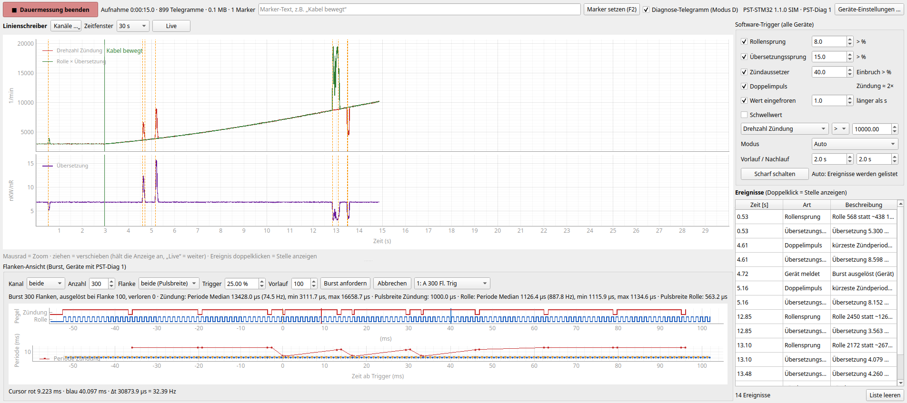

# PyST 1.4.1

Einfaches Prüfstandsprogramm zum Testen der neuen PST-STM32-Firmware – ohne Windows und ohne LabVIEW.
Läuft auf **Mac**, **Linux/Raspberry Pi** (und Windows).

- steuert die Messelektronik: Klima lesen (`e`), Messung starten (`m`) und stoppen (`s`)
- Lauf mit **fester Übersetzung**, Start bei *n vom Gas*, Ende bei **n Stop** (z.B. 8000 1/min) oder beim Gaswegnehmen
- Prüfstandsdaten: Rollengeber, Rollenumfang, Trägheit, Zündimpulse, Filter, Verlustmoment
- **Ausrollversuch** (Reiter „Kalibrierung“): nach dem Lauf Kupplung ziehen, aus dem Ausrollen der Rolle das
  Verlustmoment bestimmen – Ergebnis Radleistung und Motorleistung getrennt
- Übersetzung einmessen aus Zündsignal oder rusEFI-Drehzahl (Verlauf, getrimmter Mittelwert, von Hand anpassbar)
- **rusEFI-Steuergerät** als zweite Datenquelle (Reiter „ECU“), Kanäle frei wählbar und mit jedem Lauf gespeichert
- Live-Anzeige (Motor berechnet und gemessen, km/h, Messfrequenz, verlorene Telegramme), Live-Kurve
- **Rechnet exakt wie LabVIEW 3.2.1.** Geprüft an sechs echten Läufen vom 26.05.26: gleiche Pmax auf 0,1 PS, gleiche n(Pmax).
- Speichert jeden Lauf als CSV, JSON, PNG und **LabVIEW-XML** (öffnet in LabVIEW-Recalc)
- lädt LabVIEW-Läufe und PyST-Läufe zum Vergleich (Überlagerung und Tabelle)
- eingebauter **Simulator**, um ohne Prüfstand zu testen (auch mit Störungen und als alter Mega 3.0.0)
- **Messwerkzeug „Oszi / Dauermessung“**: Dauermessung, Linienschreiber, Software-Trigger auf Störungen,
  Flanken-Ansicht (Logikanalysator) und Geräte-Einstellungen über **PST-Diag 1** (Mega ab 3.1.0, F446 ab 1.1.0)
- **Fehlerkanäle** „Fehler Rolle“, „Fehler Zündung“, „Doppelimpuls Zündung“, „Wert eingefroren“ – auch für alte Läufe
- **Läufe weitergeben**: `.pyst`-Datei (öffnet in PyST) oder **HTML-Ansicht** (öffnet in jedem Browser, offline)
- **Import von Rohmitschnitten** (TeraTerm/Terminal) von Mega und F446

Testablauf für den Vergleich alt/neu: siehe [TESTPLAN.md](TESTPLAN.md).



## Oberfläche

| Reiter | Inhalt |
|---|---|
| **Messen** | Status (GO / Messung / GAS WEG), Live-Werte (Motor, Zündung, km/h, EGT 1/2, λ, TPS, Messfrequenz, COM), Leistungsdiagramm (PS/Nm oben, λ/EGT unten), Laufliste mit Häkchen zum Ein-/Ausblenden, Cursor-Tabelle (Werte aller sichtbaren Läufe bei der Drehzahl unter der Maus) |
| **Fahrzeuge & Setups** | Datenbank: Hersteller, Modell, Vergaser/EFI; je Setup Motor (Hubraum, CR, Steuerzeiten), Vergaser (Düsen, Nadel, Clip …), ECU/Tune, Zündung, Antrieb (Übersetzung, Vario, Rollen, Federn), Ein-/Auslass, Kraftstoff. Setups kopieren, „für neue Läufe verwenden“. |
| **Auswertung** | Fahrzeug wählen → Läufe nach Datum oder nach Setup gruppiert → **Hinzufügen**, dann nächstes Fahrzeug. Fahrzeug/Setup direkt bearbeiten (auch Rechtsklick: Setup zuordnen, neues Setup). Log-Viewer wie MegaLogViewer: bis 4 Felder, beliebige Kanäle (gleiche Einheit = gleiche Skala), Cursor mit Maus und ←/→, X-Achse Zeit oder Drehzahl, beliebig viele Läufe (Farbe je Lauf, Linienart je Kanal). **Setup-Vergleich** mit markierten Unterschieden. Kanal „Übersetzung Zündung/Rolle“. |
| **Oszi / Dauermessung** | Messwerkzeug für die Fehlersuche (Zündung oder Rolle?), siehe unten |
| **ECU** | rusEFI-Steuergerät, siehe unten |
| **Kalibrierung** | Ausrollversuch ein/aus, Ergebnis (Verlustleistung bzw. Verlustmoment über der Drehzahl, Messpunkte + Fit, M0/M1/m2, Fit-Güte), **Übernehmen**, aktuell gültige Verluste – siehe unten |
| **Einstellungen** | Unterreiter **Allgemein** (Prüfstand, Lauf, Filter & Verluste, Klima, Anzeige λ oder AFR), **Verbindung** (Port, Verbinden, Live-Anzeige, automatisches Verbinden), **Zange · Netz · Steckdosen** (PyST-Basis mit Funk-Zündzange, WLAN der Basis, WLAN-Steckdosen, Zange per USB), **Tasten** (Tasten-Setup der Zange), **Prüfen**, **Firmware** – siehe unten |

- Während eines Laufs bleibt die Skalierung wie beim vorherigen Lauf stehen; danach wird neu skaliert.
- Achsgrenzen über dem Diagramm: Drehzahl von/bis, PS von/bis, Nm von/bis (z.B. ab 5000 1/min und ab 5 PS);
  „auto“ = aus den Kurven, „Achsen auto“ setzt alles zurück. Gilt auch für den PDF-Bericht.
- Filter in Sekunden (Standard 1,75 s / 0,75 s) passen sich der Messfrequenz an; Modus „Messpunkte (wie LabVIEW)“
  für den direkten Vergleich mit LabVIEW. LabVIEW-Läufe im Simulator schalten automatisch auf Messpunkte.
- Nm-Achse mit runder Teilung, die PS-Achse wird so gelegt, dass ihre Striche auf denselben Gitterlinien liegen.
- Läufe bleiben in der Datenbank (`~/PyST/pyst.db`, Messdaten in `~/PyST/messungen/`;
  Datenordner älterer Versionen werden beim ersten Start automatisch übernommen).
  Rechtsklick auf einen Lauf: Notiz, Farbe, Fahrzeug/Setup zuordnen, mit aktuellen Einstellungen neu rechnen, CSV, löschen.
- **Import** von LabVIEW-XML und PyST-Läufen, **Export** als PDF-Bericht (sichtbare Läufe + Setup-Daten) und CSV (Excel deutsch oder international).
- **Verbinden** direkt im Messen-Reiter (neben START). Das Messboard wird alle 5 s gesucht und automatisch
  verbunden (abschaltbar in den Einstellungen); Abziehen wird erkannt. Nach „Trennen“ von Hand bleibt es getrennt,
  nach dem Flashen wird wieder gesucht. Die Basis per USB wird nicht gesucht, sie verbindest du von Hand. Reißt die
  WLAN-Verbindung zur Basis ab (auch bei jedem Neustart der Basis), verbindet PyST neu und meldet sich neu an; eine
  abgelehnte Anmeldung wiederholt es nicht, jeder Fehlversuch verlängert die Sperre der Basis (1 bis 60 s).
- **Anzeigen und Diagramme** frei belegbar über vier Menüs: „Anzeigen …“ (oben), „Kurven ▾“ im Leistungs-
  und im unteren Diagramm (links/rechts, ausblendbar), „Spalten …“ an der Cursor-Tabelle (zuklappbar).
  Achsgrenzen direkt an den Achsenden (fett = fest, grau = automatisch).
- Fenster, Aufteilungen, Spalten und Reiter werden beim Beenden gespeichert; im Auswerter speicherbare Layouts.
- **Übersetzung einmessen** (Knopf unten rechts): Quelle Zündabnehmer oder rusEFI, Verlauf über der Messzeit,
  rote Linie = Mittelwert, ziehen/klicken/eintippen zum Anpassen.
- **rusEFI** (Reiter „ECU“): Das Steuergerät wird per USB parallel zum Prüfstand gelesen (5–200 Hz, Standard 50 Hz).
  - Die Kanalnamen stehen nicht im Steuergerät, sondern in der TunerStudio-`.ini` zur jeweiligen Firmware.
    PyST holt sie automatisch vom USB-Laufwerk „RUSEFI“ (`rusefi.ini.7z`) und legt sie unter
    `~/PyST/rusefi_ini/` ab. Alternativ „Datei wählen …“. Passt die Signatur nicht, warnt PyST.
  - Aufgezeichnet werden **nur die gewählten Kanäle** („Kanäle hinzufügen …“ durchsucht die ganze .ini).
    Die Auswahl samt Abtastrate lässt sich als **Kanal-Setup** unter einem Namen speichern und als Datei
    exportieren/importieren.
  - Beim Speichern eines Laufs: Spalten `rusefi_<Kanal>` in `roh.csv` (auf die Prüfstands-Telegramme gelegt),
    Originalabtastung in `rusefi.csv`, Signatur und Einheiten in `lauf.json`. Im Auswerter erscheinen die
    Kanäle in der Gruppe „rusEFI“ (z.B. „TPS (ECU)“).
  - Messen → „Anzeigen …“: jeder aufgezeichnete Kanal als Anzeige (live, am Cursor der Wert des Laufs) und
    bis zu 4 Kanäle „im Diagramm“: ohne eigene Achse über die Leistungskurve gelegt (Farbe = Lauf,
    Punkt-/Strichpunkt-Muster = Kanal, Bereich in der Legende oben links, Werte in der Cursor-Tabelle).
  - Zum Entpacken der `.7z` wird `py7zr` benutzt, ersatzweise `bsdtar`/`7z` (Mac und Windows haben `tar` dabei,
    auf Linux ggf. `pip install py7zr` oder `apt install p7zip-full`).
- Weitere Messkanäle (später WSB) sind zusätzliche Spalten in `roh.csv` und
  erscheinen automatisch im Auswerter und im CSV-Export.

## Ausrollversuch (Reiter „Kalibrierung“)

Bestimmt die Verluste von Rolle, Rad, Kette und Getriebeausgang. Damit weist PyST neben der Radleistung die
**Motorleistung** aus.

**Ablauf für den Fahrer**

1. Im Reiter „Kalibrierung“ **Ausrollversuch nach jedem Lauf** einschalten (bleibt gespeichert). Ausgeschaltet
   läuft alles exakt wie bisher.
2. Lauf wie immer. Bei *n Stop* zeigt die Statuszeile **GAS WEG – KUPPLUNG ZIEHEN!**
3. Gas weg und **gleich die Kupplung ziehen**, gezogen halten, nicht bremsen, nicht schalten. Nach dem Laufende
   steht **KUPPLUNG ZIEHEN – ausrollen lassen** (blau), die Aufzeichnung läuft weiter.
4. Das Ausrollen endet bei der eingestellten Motordrehzahl (Rolle × i, Vorgabe 3000 1/min, 0 = bis Stillstand),
   nach der Höchstdauer (Vorgabe 120 s), wenn die Drehzahl wieder steigt, keine Daten mehr kommen oder mit
   **Ausrollen beenden (Esc)**. Der Lauf ist dann schon fertig und wird wie immer ausgewertet und gespeichert
   (das Ausrollen steht mit in `roh.csv`, das Ergebnis unter `"ausrollen"` in `lauf.json`).
5. Im Reiter „Kalibrierung“ Kurve und Fit-Güte prüfen und **Übernehmen** drücken. Erst dann werden M0, M1, n1 und
   m2 in die Einstellungen (Filter & Verluste) eingetragen; der Lauf des Versuchs wird damit neu gerechnet.
   „Markierten Lauf auswerten“ wertet das Ausrollen eines gespeicherten Laufs nachträglich aus.

**Formel**

- Ohne Antrieb gilt an der Rolle J · dω/dt = −Mv(n), also Verlustmoment Mv = −J · dω/dt, Verlustleistung
  Pv = Mv · ω (n = Rollendrehzahl, ω = n · 2π/60).
- Modell (wie LabVIEW, um einen quadratischen Anteil erweitert, Vorgabe m2 = 0):
  Mv(n) = M0 + n · (M1 − M0)/n1 + m2 · (n/1000) · ((n − n1)/1000). M0 und M1 bleiben die Werte bei 0 und n1.
- Fit ohne numerische Ableitung: ω(t) = ω0 − 1/J · Σ c_k ∫ φ_k(n) dt mit φ = 1, n/n1, (quadratisch) – lineare
  kleinste Quadrate über alle Messpunkte. n1 = eingestellter Wert (über 100 1/min), sonst die obere Drehzahl
  des Ausrollens.
- Erkennung: ab dem Laufende das Drehzahlmaximum, die Kupplung über das Zündsignal (Motor dreht langsamer als
  Rolle × i) oder ohne Zündsignal über die Verzögerung. Der Übergang am Anfang (Motorbremse, Kupplung schleift)
  und Bremsen am Ende werden verworfen, bis das Modell ω(t) im Randfenster (0,5 s) trifft.
- Messpunkte im Diagramm: lokale Steigung (±0,25 s) → Mv, nach Drehzahl in Klassen gemittelt. Fit-Güte = R² und
  RMS dieser Klassenmittel gegen den Fit.
- Motorleistung = Radleistung + Verlustleistung bei gleicher Rollendrehzahl:
  M_Motor = k · J / i² · a + Mv / i (wie bisher), Radanteil = k · J / i² · a. Ergebnis-Zeile, PDF-Bericht,
  `lauf.json` und die Kanäle „Leistung Rad“ / „Verlustleistung“ im Auswerter weisen beides getrennt aus und
  nennen die Herkunft der Verluste (Ausrollversuch mit Datum und R², oder „von Hand eingetragen“).

**Grenzen**

- J ist die Rollenträgheit. Die Trägheit von Rad und Getriebeausgang fehlt beim Beschleunigen wie beim Ausrollen.
- Die DIN-70020-Korrektur wirkt wie in LabVIEW nur auf den Radanteil, nicht auf die Verluste.
- Erfasst werden nur Verluste hinter der Kupplung (Rolle, Reifen, Kette, Getriebeausgang), nicht Getriebeeingang,
  Primärtrieb und Kupplung selbst. Die Verluste hängen von Reifendruck, Anpressung und Temperatur ab: nach
  Änderungen neu messen.
- Fehlt der untere Drehzahlbereich, ist M0 hochgerechnet (Hinweis im Reiter). Ein quadratischer Anteil
  (m2 ≠ 0) lässt sich im LabVIEW-XML nicht abbilden; dort stehen nur M0/M1.
- Meldungen statt Ergebnis bei: keine Ausrolldaten, zu kurz (unter 3 s), Drehzahlbereich zu klein
  (unter 20 %), Rolle beschleunigt, Kupplung nicht gezogen erkennbar, Verlustmoment negativ.
- Simulator: Port `SIM:ausrollen` (Kupplung 0,8 s nach dem Gaswegnehmen gezogen, Verlust von Rad/Kette).

## Oszi / Dauermessung (ab 1.3)



Kurz: **Verbinden → Reiter „Oszi / Dauermessung“ → „● Dauermessung starten“ → bei Bedarf Marker (F2,
z.B. „Kabel bewegt“) → Ereignisse in der Liste doppelklicken → „Dauermessung beenden“** (landet als Lauf
„Dauer“ in der Laufliste und in der Auswertung).

- **Dauermessung** unabhängig vom Leistungslauf, ohne Zeitgrenze. Sie wird fortlaufend gesichert
  (`~/PyST/messungen/JJMMTT_hhmmss_Dauermessung/teil_NNNN.csv`, alle 2 s auf die Platte, je Minute ein Abschnitt);
  nach einem Absturz fehlen höchstens Sekunden, der Ordner lässt sich trotzdem importieren.
  Beim Beenden: `roh.csv` + `lauf.json` (+ `marker.csv`, `ereignisse.csv`, `bursts/`).
- **Linienschreiber**: Kanäle frei wählbar („Kanäle …“): Drehzahl Zündung, Drehzahl Rolle, Rolle × Übersetzung,
  Übersetzung, Messfrequenz, AFR, EGT 1/2 und – mit PST-Diag 1 – Flanken je Telegramm, kürzeste/längste Periode,
  verworfene Flanken, Geräte-Flags. Je Einheit ein Feld, Zeitfenster 10 s … alles, Mausrad/Ziehen hält an, „Live“.
- **Software-Trigger** (für alle Geräte, auch alter Mega 3.0.0 – arbeitet nur mit den Telegrammen):
  Rollensprung (> x % vom gleitenden Median), Übersetzungssprung, Zündaussetzer/Timeout, Doppelimpuls
  (Zündung ≈ 2×), eingefrorener Wert, Schwellwert auf einen Kanal. Modi **Auto** (nur Liste),
  **Normal** (Anzeige springt zu jedem Ereignis), **Einzelschuss** (danach angehalten), Vor-/Nachlauf.
  Alle Ereignisse stehen in der Liste (Doppelklick = Stelle anzeigen) und in `ereignisse.csv`.
- **Flanken-Ansicht** (nur Geräte mit PST-Diag 1): Kanal (Zündung/Rolle/beide), Anzahl, Flanke (fallend/steigend/
  beide = Pulsbreite), Trigger % (Periode weicht vom Mittel der 8 vorigen ab), Vorlauf → „Burst anfordern“.
  Oben Logikanalysator-Spuren, unten Periode je Flanke (und Pulsbreite), zwei Cursor mit Δt und 1/Δt.
- **Geräte-Einstellungen …** liest `#GET` und zeigt alle Einstellungen des Geräts (Flanke, Timeouts,
  Doppelimpulsfilter, Sperrzeiten …); „Übernehmen“ (`#SET`, flüchtig), „Im Gerät speichern“ (`#SAVE`,
  Ausgabe wird dafür kurz angehalten), „Standardwerte“ (`#DEFAULTS`). Kein Neu-Flashen nötig.
- Während der Dauermessung schaltet PyST Geräte mit PST-Diag 1 in **Modus D** (Diagnose-Telegramm), danach
  zurück in den Normalmodus. Leistungsläufe laufen wie bisher im Normalmodus (LabVIEW-identisches Telegramm).

**Protokoll** (Spezifikation `docs/04_PST_Diag_1.md`): beim Verbinden sendet PyST `#?`. Antwortet das Gerät
binnen 300 ms mit `#CAP`, sind Modus D, Bursts und Einstellungen verfügbar; sonst (Mega 3.0.0, F446 1.0.0)
nur die normalen Telegramme. Zeilenende `\n`, `\r` oder `\r\n`; unbekannte Zeilen/Felder werden ignoriert.

**Simulator** (Port-Auswahl in den Einstellungen):

| Port | verhält sich wie |
|---|---|
| `SIM` | F446 1.1.0 mit PST-Diag 1, synthetischer Motor |
| `SIM:stoerung` | dasselbe mit Störungen: Doppelimpuls und Aussetzer der Zündung, Rollensprünge, Wackelkontakt |
| `SIM:mega` | Mega-Sketch 3.1.0 mit PST-Diag 1 |
| `SIM:mega300`, `SIM:mega300:stoerung` | alter Mega 3.0.0 ohne `#CAP` (nur Software-Trigger), optional mit Störungen |

Die Störungen sind im Simulator Geräte-Einstellungen (`sim_doppel`, `sim_aussetzer`, `sim_rollensprung`,
`sim_wackel` = Ereignisse pro Minute) und lassen sich im Dialog „Geräte-Einstellungen …“ live ändern.
Mit `ign_lockout_pct` (z.B. 50) filtert der Simulator Doppelimpulse wie die Firmware („verworfen“ zählt mit).

## Inbetriebnahme: Prüfen und Firmware

**Einstellungen › Prüfen:** „Alles prüfen“ bewertet das verbundene Gerät mit Sollwerten, ohne Terminal. Basis: Takt, Spannungen,
Sensoren, Klimawerte, ESP-Link, WLAN, Zange per Funk. Zange per USB: Firmware, Zähler, Kopplung. Dazu „Funken zählen“ mit
optionaler Sollfrequenz, „Log prüfen“ und bei der Zange per USB „Ein Blitz“ (einzelner TRIG-Puls, 1–25 µs). „Protokoll
kopieren“ legt das Ergebnis als Text in die Zwischenablage.

**Einstellungen › Firmware:** flasht Zange (USB-C: Update-Datei über `#UPD`, Erstflash per esptool), Basis-STM32 (USB über den
Bootloader der Basis), Basis-ESP (USB: Update-Datei über `#ESPUPD` und den STM, Erstflash per esptool über die ESP-Brücke),
den Lambda-Controller F042 (über die Basis per CAN) und für die Erstprogrammierung den STM32 per ST-Link an J10. Die Firmware der eigenen Hardware liegt nicht in diesem
Repository: Man wählt die Datei oder den Ordner des Builds, PyST prüft, ob sie zum Ziel passt.

„Basis STM32“ nimmt eine Update-Datei (`.pystfw`, siehe [Firmware-Updates der Basis](#firmware-updates-der-basis)) und braucht
weder Treiber noch Zusatzprogramm (reines Python mit pyserial).
PyST trennt die Verbindung, schickt `#UPDATE`, wartet auf den Bootloader, überträgt mit Fortschrittsanzeige, wartet auf die
neue Anwendung und vergleicht die Version. Steckt die Basis schon im Bootloader, geht es dort weiter. Einstellungen bleiben
erhalten. Bricht die Übertragung ab, bleibt die alte Firmware unberührt oder die Basis wartet im Bootloader: Nochmals flashen.
Es darf nur eine Basis am USB stecken.

„Lambda (F042) per CAN“ nimmt `wideband_image_with_bl.bin` aus dem Release von
[mck1117/wideband](https://github.com/mck1117/wideband) oder die Anwendung allein (25 600 Byte). PyST prüft Größe, Vektortabelle
und Prüfsumme und überträgt nur die Anwendung; Bootloader und Konfiguration des F042 bleiben unberührt. Das geht ab Basis-Firmware
0.2.1 und nur, wenn weder Messung noch Lambda-Heizung laufen. Die Basis bestätigt jeden Block gegen den F042-Bootloader, prüft am
Ende, dass 0x190-Telegramme mit Version 0xA0 wiederkommen, und hält den F042 danach wieder im Reset. Die Sonde bleibt kalt. Abbruch
vor dem Löschen lässt die alte Anwendung stehen; danach wartet der F042-Bootloader und der nächste Versuch holt ihn zurück.

„Zange per USB (Update-Datei)“ nimmt eine `.pystfw` für das Ziel `zange-c3` (ab Zangen-Firmware 0.4.0), auch über
„Herunterladen“ (Manifest-Eintrag `zange`). Reines Python wie bei der Basis: PyST fragt `#UPD INFO` (Version, Schlüssel,
Rollback, Partition), prüft vorab Ziel, Schlüssel, Rollback und Größe, schickt `#UPD BEGIN` mit dem Kopf (die Zange prüft
die Signatur), dann `#UPD DATA` in Blöcken zu 256 Byte (Base64, verlorene Antworten werden wiederholt), `#UPD END` (die
Zange prüft Inhalt und Version) und `#UPD BOOT`. Nach dem Neustart vergleicht PyST die Version und wartet, bis die Zange die
neue Firmware nach 15 s als gültig markiert (`ota=gueltig`). Startet die Zange vorher neu, kehrt sie zur alten Firmware
zurück. Gewertet werden nur Zeilen mit `#UPD;` und `#ERR;UPD;`, das ESP-Log stört nicht. Abbrechen schickt `#UPD ABORT`,
die alte Firmware bleibt. Die Zange sperrt das Update bei Aufnahme, Blitzmodus, Funken in den letzten 5 s und solange sie
mit einer Basis gekoppelt und synchron ist (Fehler 20: Basis ausschalten), ohne USB-Spannung bei Akku unter 3,6 V
(Fehler 21). Fehler 11 heißt Signatur oder Schlüssel passen nicht, 12 Rückfall gesperrt. **Die Zange nie am laufenden
Motor per USB anschließen:** Sie ist dann galvanisch mit dem PC verbunden.

„Zange Erstflash per esptool (Build-Ordner)“ ist der bisherige Weg mit dem ganzen Build (Bootloader, Partitionstabelle,
OTA-Daten, App). Ihn braucht jede Zange einmal für 0.4.0, weil sich der Bootloader ändert (App-Rollback), danach geht es
mit der Update-Datei weiter. Ein bis PyST 1.4 unter „Zange“ eingetragener Build-Ordner wandert von selbst in diese Zeile.

„Basis-ESP per USB (Update-Datei)“ nimmt eine `.pystfw` für das Ziel `basis-esp32c3` (Basis-Firmware ab 0.4.0 mit
`espupd=1` in `#CAP`, Basis-ESP ab 0.4.0), auch über „Herunterladen“ (Manifest-Eintrag `basis_esp`). Der Weg ist derselbe wie
bei der Zange, nur mit dem Präfix `ESPUPD` und über den Messport der Basis (USB-CDC wie die normale Verbindung, nicht der
Brückenport): Der STM reicht jede Zeile an den ESP weiter, PyST wartet bei BEGIN und END bis 12 s, sonst 5 s auf die Antwort
und schickt vorher keine neue Zeile. Über WLAN lehnt die Basis ab (`nur_usb`), PyST sucht ohnehin nur den USB-Port. Nach
`#ESPUPD BOOT` startet nur der ESP neu, die Verbindung bleibt: PyST fragt `#NET`, bis `esp=1`, `esp_neustarts` gestiegen ist
und `esp_fw` die neue Version zeigt, dann `#ESPUPD INFO`, bis die neue Firmware nach 30 s mit stehendem Link `ota=gueltig`
meldet (PyST wartet bis 60 s). Startet der ESP vorher neu, kehrt er zur alten Firmware zurück. Fehler 20: Die Basis misst
(Ausgabe, Burst, Aufnahme der Zange; PyST beendet vorher nur die eigene Ausgabe mit `#RUN 0`), 30: ESP antwortet nicht
(Brücke aktiv?), 31: Antwort zu spät (PyST wiederholt), 32: ESP neu gestartet (auf BOOT normal), 33: Basis-ESP vor 0.4.0.

„Basis-ESP Erstflash per Brücke (Build-Ordner)“ ist der bisherige esptool-Weg über die ESP-Brücke (PyST schaltet sie mit
`#ESP BRIDGE 1` ein). Ihn braucht jede neue Platine und jeder Basis-ESP vor 0.4.0 einmal, danach geht es mit der
Update-Datei weiter. Ein bis PyST 1.4 unter „Basis ESP“ eingetragener Build-Ordner wandert von selbst in diese Zeile.

Eine neue Basis: erst per ST-Link die Gesamtdatei `pyst-basis-gesamt.bin` (Bootloader + Anwendung, an 0x08000000), dann den
Basis-ESP per Erstflash über die Brücke. Die ST-Link-Zeile lehnt die Anwendung allein ab, weil sie ab 0x08008000 gelinkt ist. ST-Link braucht `st-flash` (Mac
`brew install stlink`, Linux `apt install stlink-tools`), `esptool` kommt mit `requirements.txt`.

### Firmware-Updates der Basis

Update-Dateien gibt es in zwei Formaten, jeder Bootloader nimmt genau eines:

| Bootloader | Protokoll | Datei | Inhalt |
|---|---|---|---|
| 1.0.0 | 1 | Format 1 | Abbild im Klartext, unsigniert |
| 2.0.0 | 2 | Format 2 | Ed25519-signiert, Nutzdaten AES-256-CTR verschlüsselt |

PyST fragt den Bootloader und sagt vor jeder Übertragung, wenn Datei und Bootloader nicht zusammenpassen. Bootloader 2.0.0
kommt einmal per ST-Link auf die Basis (Gesamtdatei an J10), über USB lässt er sich nicht tauschen. Die Anzeige zeigt zu
jeder Datei Format, Schlüssel und Rollback-Zähler.

Die Signatur prüft PyST vorab, dafür braucht es das Paket `cryptography` aus `requirements.txt`. Bestehende Installationen
holen es mit `pip install -r requirements.txt` nach oder indem man den Ordner `.venv` löscht. Die bekannten öffentlichen
Schlüssel stehen in `pyst/fw_keys.py`:

- **Aus dem Netz** geladene Dateien brauchen einen bekannten Schlüssel und eine gültige Signatur, die auch zum Eintrag im
  Manifest passt. Sonst lehnt PyST sie ab und löscht sie. Geflasht wird nur auf Knopfdruck.
- **Von Hand** gewählte Dateien: Bei bekanntem Schlüssel muss die Signatur stimmen. Bei unbekanntem Schlüssel geht es mit
  deutlichem Hinweis weiter, dann entscheidet der Bootloader.

Das letzte Wort hat immer der Bootloader. Er prüft beim Start Signatur und Rollback, das dauert einige Sekunden (PyST wartet
bis 30 s), und löscht erst danach den Zwischenspeicher. Eine abgelehnte Datei zerstört nichts: Die Basis startet ihre
vorhandene Firmware wieder. Den Klartext sieht nur der Bootloader, am Ende der Übertragung vergleicht er dessen SHA-256 mit dem
Kopf. PyST kann den Inhalt nicht nachrechnen, die Signatur am PC belegt nur den Kopf der Datei.

„Rückfall gesperrt“ heißt: Die Datei hat einen kleineren Rollback-Zähler als die Firmware auf der Basis. Für Zange und
Basis-ESP gilt dasselbe Format 2 mit Ziel `zange-c3` bzw. `basis-esp32c3`, `load_addr` 0 und je einem eigenen, von der
Schlüsseldatei abgeleiteten AES-Schlüssel; die Regeln für Signatur und Download sind gleich, Inhalt und Rollback prüft das
Gerät selbst. Der Lambda-Controller ist davon nicht betroffen.

**Zange und Basis-ESP: einmal Erstflash, danach Update-Datei.** Beide brauchen einmal den ganzen Build per esptool
(„Zange Erstflash per esptool“ bzw. „Basis-ESP Erstflash per Brücke“) mit 0.4.0 oder neuer, weil erst damit Bootloader,
Partitionen und App-Rollback stimmen. Danach kommen Updates nur noch als `.pystfw` über USB („Zange per USB“ bzw. „Basis-ESP
per USB“), signiert und verschlüsselt, mit Probezeit nach dem Neustart (Zange 15 s, Basis-ESP 30 s mit Link). Ältere Firmware
meldet PyST mit diesem Hinweis (Zange: kein `upd=1`, Basis-ESP: Fehler 33).

**Statusleiste:** „● Zange verbunden“ (grün), „● Zange nicht verbunden“ (rot) oder „● Zange per USB“ (orange).

## PyST-Basis, Funk-Zange und Steckdosen

Lambda-Heizung: Knopf „Lambda ein/aus“ unter Einstellungen › Zange · Netz · Steckdosen oder an der Zange (Standard T4 lang). „Bereit“ heißt nur
Vorheizen, volle Heizung erst mit Motor (Rolle oder Zündfunken). Ohne Motor schaltet die Basis nach `lambda_off_min` (Standard
3 min) selbst ab, auch wenn PC oder USB ausfallen. Zustand auch in der Statusleiste und unter Einstellungen › Prüfen.

**Tasten der Zange** (Einstellungen › Tasten, Zange ab 0.1.3, Basis ab 0.2.3): Fest in der Firmware und ohne PC nutzbar sind Einschalten, T1
lang aus, T1 + T2 koppeln, T2 lang Blitzmodus und im Blitzmodus Marker, Aufnahme und φ. Sechs Gesten sind außerhalb des Blitzmodus frei
belegbar, Standard: T1 kurz Marker, T2 kurz Aufnahme, T3 kurz Neuer Lauf, T3 lang Übersetzung messen, T4 kurz nichts, T4 lang Lambda.
Das Setup liegt in den PyST-Einstellungen. PyST schickt es beim Verbinden, wenn sich die Zange neu meldet und bei jeder Änderung. Die
Zange speichert es nicht, ohne PC gilt der Standard. Marker heißen im Lauf und in der Aufzeichnung „Marker 1, 2, 3 …“, je Lauf bzw.
Aufzeichnung von vorn; aus dem Log der Zange gelesene zeigen die Taste dazu, z. B. „Marker 1 (Taste T1)“.
- **Neuer Lauf** wirkt wie START. Während eines Laufs, einer Oszi-Aufnahme, einer Prüfung, des Flashens oder mit offenem Dialog gibt
  es einen Hinweis im Band über den Reitern und das Fehlerbild an der Zange. Abbrechen per Taste gibt es nicht.
- **Übersetzung messen** braucht Ruhe und gehaltene Drehzahl: Die Taste startet 5 s Messung, das Band zeigt groß neu und bisher, erst ein
  zweiter Druck innerhalb von 30 s übernimmt den Wert. Bei unruhiger Drehzahl oder doppelt zählender Zange (Abweichung zu rusEFI, oder genau
  das Doppelte bzw. Halbe von bisher) gibt es nichts zu übernehmen, nur eine Meldung. Eine wirklich verdoppelte Übersetzung trägt man im Dialog ein.

Protokoll: `../docs/04_PST_Diag_1.md` §10. Ohne Hardware vorführbar mit den Simulator-Ports `SIM:basis`,
`SIM:basis:stoerung`, `SIM:basis:ohne`, `SIM:basis:wlan` (TCP-Port mit Anmeldung, Schlüssel vorher über `SIM:basis`
holen) und `SIM:zange` sowie dem Knopf „Demo-Steckdosen (Simulator)“.

- **Verbinden**: Basis per USB wie bisher, oder **per WLAN**: Port `tcp://192.168.4.1:2323` (Basis als Access Point)
  bzw. `tcp://<name>.local:2323` (Werkstattnetz, mDNS) – oder Knopf „PC per WLAN verbinden“. Ein Abriss der
  WLAN-Verbindung wird erkannt.
- **Anmeldung per WLAN** (Basis ab 0.3.0): USB ist das Koppeln. Beim Verbinden per USB holt PyST den Schlüssel der
  Basis und legt ihn in `~/PyST/schluessel.json` ab (nur für den Benutzer lesbar). Per WLAN meldet sich PyST damit an;
  ohne Schlüssel oder bei falschem Schlüssel steht in der Meldung, was zu tun ist. Fehlversuche sperren die Basis
  immer länger. Der Knopf „Neuer Schlüssel“ (nur per USB) sperrt alle anderen PCs aus.
- **Zange** (Einstellungen › Zange · Netz · Steckdosen, Kurzfassung rechts in der Statusleiste): Akku, Signal, Sync,
  Funken, Blitz φ. **Koppeln …** öffnet das Kopplungsfenster (an der Zange T1 + T2 gleichzeitig 3 s halten),
  **Markieren (F3)** setzt einen Marker (erscheint wie die Tasten der Zange im Oszi und im Lauf),
  **Einstellungen …** liest/schreibt die Zangen-Schlüssel (`imp_per_rev_x10`, `deadtime_us`, `blitz_phi_x10` …).
- **Zündstärke** (`ign_peak_mv`): Kanal im Linienschreiber und im Auswerter (Gruppe „Zange“). Mit gekoppelter Zange
  laufen auch Leistungsläufe im Diagnose-Telegramm, damit die Zündstärke mitgespeichert wird.
- **Ereignisse** der Basis (Marker, Zange verbunden/verloren, Steckdose an/aus) stehen in der Oszi-Ereignisliste,
  in `marker.csv`/`ereignisse.csv` von Lauf und Dauermessung und als Linien im Auswerter.
- **Netzwerk**: WLAN der Basis als Access Point (Kanal, SSID, Passwort), im Werkstatt-WLAN oder aus. Für den Access
  Point schlägt PyST ein Passwort vor, ein offenes WLAN wird abgelehnt.
- **Steckdosen** über die Basis oder **direkt vom PC** (gleiches Netz, ohne Basis): Shelly Gen2/3/4 und Gen1,
  Tasmota, ESPHome. Suchen (mDNS), Hinzufügen (Typ wird erkannt, Einschaltzustand nach Stromausfall = aus,
  Shelly mit Passwort oder ohne Relais wird abgewiesen), Ein/Aus, Leistung, Totmann-Zeit („fällt aus“ = Rückfallzeit,
  laufend erneuert; „bleibt an“), **Automatik**: z.B. Gebläse/Absaugung beim Laufstart (bzw. bei Dauermessung) ein,
  nach dem Ende + Nachlaufzeit aus. Empfohlen: Shelly Plug S/M Gen3; ESPHome kennt keine Rückfallzeit.
  **Komfortfunktion, keine Sicherheitsfunktion, kein Not-Aus.**
- **Zange per USB** (zum Auslesen/Testen, **galvanische Verbindung** – PyST warnt deutlich): Port der Zange wählen
  und verbinden (nie automatisch). Oszi/Dauermessung/Burst nur mit Kanal Zündung. **Log auslesen …** holt das Log
  der Zange und legt es als Dauermessung ab (Laufliste/Auswertung), auf Wunsch gleich als `.pyst`.

## Fehlerkanäle (ab 1.3)

Für jeden Lauf und jede Dauermessung – auch für alte Läufe und LabVIEW-Dateien – berechnet PyST aus Rolle und Zündung:

| Kanal | Bedeutung |
|---|---|
| Fehler Rolle | Rolle weicht mehr als 5 % vom gleitenden Median (±0,12 s) ab – die Masse der Rolle macht das unmöglich |
| Fehler Zündung | Zündung weicht mehr als 12 % von Rolle × *gleitender* Übersetzung (±1 s) **und** vom eigenen gleitenden Median ab |
| Doppelimpuls Zündung | dabei Zündung ≈ 1,7…2,3 × erwartet |
| Wert eingefroren | Rolle oder Zündung ≥ 1 s exakt gleich, während sich die andere Drehzahl um > 3 % ändert |
| Abweichung Rolle / Zündung | die Abweichung in % (zum Ansehen) |

Weil die Übersetzung gleitend bestimmt wird, gibt ein Vario (stetig veränderliche Übersetzung) keinen Fehlalarm.
Der **Fehleranteil** (% der Telegramme, in denen sich etwas dreht) steht in der Laufliste (Spalte „Fehler“,
Tooltip mit Details), im PDF-Bericht und in der HTML-Ansicht.

## Läufe weitergeben (ab 1.3)

**Datei → Läufe weitergeben (.pyst) …** (Strg+S): markierte, sichtbare, alle des Fahrzeugs oder alle eines Tages –
als eine `.pyst`-Datei, als Ordner mit je einer `.pyst` pro Lauf oder als HTML-Ansicht.

- **`.pyst`** = ZIP mit `inhalt.json` (Fahrzeug, Setup, Notiz, Farbe, Parameter, Fehleranteile) und je Lauf dem
  Laufordner (`roh.csv`, `lauf.json`, `kurve.csv`, `marker.csv`, `bursts/` … bzw. LabVIEW-XML).
  Öffnen: Datei → Öffnen, Doppelklick/Kommandozeile `./start_linux.sh datei.pyst` (Windows: `start_windows.bat datei.pyst`)
  oder per **Drag & Drop** ins Fenster. Fahrzeug und Setup werden beim Empfänger angelegt, doppelte Läufe nicht doppelt.
- **HTML-Ansicht** (Strg+H): **eine** Datei (~110–140 KB für 2–4 Läufe), öffnet offline in jedem Browser, auch am Handy,
  hell/dunkel. Oben Pmax (PS/kW), Mmax, Fahrzeug, Datum, Klima/DIN-Korrektur, Fehleranteile; ein Diagramm
  Leistung + Drehmoment über Drehzahl, darunter bis zu zwei zuschaltbare Kanäle (λ/AFR, EGT, Zündung …),
  Werte unter dem Cursor, Zoom (Bereich ziehen) und „Zoom zurück“, Lauf-Auswahl und optional ein Vergleichslauf.
  Die Diagramm-Bibliothek [uPlot](https://github.com/leeoniya/uPlot) 1.6.31 (MIT-Lizenz, `pyst/data/uplot/LICENSE`)
  ist samt Lizenztext eingebettet.


**Nur ansehen:** PyST startet ohne Messelektronik direkt als Auswerter (kein Verbindungsdialog; verbunden wird
nur automatisch, wenn ein PST-Messboard steckt). Für Kunden genügt: PyST installieren, `.pyst`-Datei öffnen –
oder ganz ohne PyST die HTML-Datei.

## Import von Rohmitschnitten

**Datei → Öffnen / importieren** nimmt auch Mitschnitte aus TeraTerm, HTerm & Co. (`.log`, `.txt`, `.csv`) vom
Mega (3.x) und der F446: mit oder ohne Zeitstempel `[yyyy-mm-dd hh:mm:ss.fff]`, Zeilenende `\r` oder `\n`,
mit `v`-/`e`-Antworten davor (Firmware-Version und Klima werden übernommen), auch D-Telegramme.
Weil ein Mitschnitt keine Prüfstandsdaten enthält, fragt PyST Rollengeber, Umfang, Trägheit, Zündimpulse und
Übersetzung ab (vorbelegt mit den aktuellen Einstellungen). Ohne Oberfläche (`pyst recalc mitschnitt.log`) gelten
die PyST-Standardwerte mit Hinweis in `lauf.json`.

## Start

**Mac:** Doppelklick auf `start_mac.command` (beim ersten Mal wird alles eingerichtet), oder im Terminal:

```bash
cd PST-PyST
./start_mac.command            # mit Prüfstand
./start_mac.command --sim      # Simulator: spielt den echten Lauf 161802 (26.05.26) ab
./start_mac.command --sim --synth   # Simulator mit synthetischem Motor
```

Der Nucleo erscheint als `/dev/cu.usbmodem…` in der Port-Liste.

**Windows:** `start_windows.bat` doppelklicken (Python 3 von python.org, „Add to PATH“).

**Messelektronik:** PST-STM32-Firmware (Nucleo-F446RE) oder Arduino-Mega-Sketch 3.0.0 – wird beim
Verbinden erkannt. Installation und Flashen: [../INSTALL.md](../INSTALL.md).

**Raspberry Pi (Raspberry Pi OS 64 bit, Desktop):**

```bash
sudo apt install python3-venv libxcb-cursor0
sudo usermod -aG dialout $USER     # einmalig, danach ab- und wieder anmelden
./start_linux.sh
```

Der Nucleo erscheint als `/dev/ttyACM0`.

## Kommandozeile (ohne Oberfläche)

```bash
./.venv/bin/python -m pyst ports                              # Ports anzeigen
./.venv/bin/python -m pyst run --port SIM --n-stop 8000       # Lauf im Terminal
./.venv/bin/python -m pyst recalc ../*.xml                    # LabVIEW-Läufe nachrechnen
./.venv/bin/python -m pyst compare A.xml B.xml ~/PyST/messungen/*/lauf.json
./.venv/bin/python -m pyst recalc kunde.pyst teraterm.log     # auch .pyst und Rohmitschnitte
./.venv/bin/python -m pyst datei.pyst                         # Oberfläche, Datei gleich in der Auswertung
```

Alle Prüfstandsparameter lassen sich überschreiben, z.B. `--ratio 6.85 --inertia 13.5 --n-min 4000`.

## Bedienung

1. Port wählen → **Verbinden**. Die Firmware-Version erscheint unter dem Knopf.
2. Prüfstand- und Laufdaten prüfen. Sie werden in `~/PyST/einstellungen.json` gespeichert.
3. Drehzahl unter *n vom Gas* halten → **START (F1)** → Klima wird gelesen → **GO – Vollgas!**
4. Über *n vom Gas* beginnt die Messung (gelb), ab *n Stop* erscheint **GAS WEG!** (rot).
5. Ergebnis wird angezeigt und (Auto-Speichern) unter `~/PyST/messungen/` abgelegt.
6. **Abbrechen (Esc)** jederzeit. Mit Ausrollversuch: nach dem Laufende Kupplung ziehen (siehe „Ausrollversuch“);
   Esc beendet dann nur das Ausrollen, der Lauf bleibt.

*n vom Gas* muss über der Haltedrehzahl liegen. Sonst erkennt die Auswertung (wie LabVIEW) schon
beim Halten ein „Laufende“, weil die Drehzahl dort schwankt.

## Rechenweg (aus LabVIEW 3.2.1 übernommen)

- nRolle = 60 · f_Rolle / Inkr, dT = 1 / Messfrequenz
- Rolle geglättet: Dreieck-Mittelwert, Halbbreite ⌊MA/2⌋; dT: Rechteck, Halbbreite dq
- n = nRolle · i, ω = n · 2π/60, a = zentraler Differenzenquotient über ±dq Punkte
- M = k · J / i² · a + Mv / i, P = ω · M, PS = 0,00135962 · P
- k (DIN 70020) = 1013 / p · √((T + 273,15) / 293,15)
- *n vom Gas* ist nur die Schwelle für die Ende-Erkennung: Der Lauf endet bei der ersten fallenden Drehzahl
  oberhalb von *n vom Gas* (oder bei *n Stop*). Unter der Schwelle wird nichts abgeschnitten. Entfernt wird nur
  der Vorlauf bis zur letzten fallenden Drehzahl unterhalb der Schwelle (das Halten vor dem Gasgeben).

Details und Quellenhinweise stehen in `pyst/physics.py`.

## Tests

```bash
./.venv/bin/pip install -r requirements-dev.txt          # pytest
./.venv/bin/python -m pytest tests                       # oder: python -m unittest discover -s tests -v
PYST_KUNDEN_LOGS=/pfad/zu/den/mitschnitten python -m pytest tests -k kunden   # echte Mitschnitte, nur lokal
```

## Aufbau

```
pyst/physics.py   Auswertung (LabVIEW-identisch)
pyst/link.py      Verbindung (seriell, TCP): Lesethread, Antwortzuordnung, Basis, Zange, STM32-Firmware, Mega-Sketch
pyst/auth.py      Anmeldung am TCP-Port der Basis, Schlüssel, Fehlertexte der Basis
pyst/felder.py    Schlüssel=Wert-Felder und tolerante Zahlen
pyst/bg.py        Gerätebefehle im Hintergrund (Bg, wait_in_thread)
pyst/kv_dialog.py gemeinsamer Dialog für Geräte-Einstellungen
pyst/farben.py    Zustandsfarben der Oberfläche
pyst/runcache.py  begrenzter Speicher geöffneter Läufe
pyst/diag.py      PST-Diag 1: Bursts (Flanken), Software-Trigger/Ereigniserkennung
pyst/oszi.py      Reiter „Oszi / Dauermessung“, Dialog Geräte-Einstellungen
pyst/recorder.py  Dauermessung (fortlaufend in Abschnitten gesichert)
pyst/htmlexport.py HTML-Ansicht zum Weitergeben (uPlot eingebettet)
pyst/share_ui.py  Dialoge Weitergeben und Import von Mitschnitten
pyst/runner.py    Ablauf eines Laufs (mit Ausrollen)
pyst/ausrollen.py Ausrollversuch: Erkennung, Fit des Verlustmoments, Prüfungen (ohne Oberfläche)
pyst/kalib_page.py Reiter „Kalibrierung“
pyst/storage.py   Speichern/Laden (CSV, JSON, LabVIEW-XML, .pyst, Terminal-Mitschnitte)
pyst/lvxml.py     LabVIEW-Datenspeicher lesen/schreiben
pyst/sim.py       Simulator (Firmware + Motor + Rolle, PyST-Basis mit Zange, Zange per USB, Fake-Zange für das Update ZangeUpdSimDevice, Fake-Basis für das ESP-Update BasisEspUpdSimDevice)
pyst/basis.py     PyST-Basis: Parser und Befehle (#ZANGE, #NET, #DOSE, #PAIR, #LOG, #LAMBDA, E;…, L;…)
pyst/plugs.py     WLAN-Steckdosen (Shelly/Tasmota/ESPHome per HTTP, Automatik, Simulator)
pyst/zange.py     Log der Zange -> Dauermessung
pyst/mdns.py      einfaches mDNS (Basis und Steckdosen im Netz finden)
pyst/hw_page.py   Unterreiter „Zange · Netz · Steckdosen“
pyst/tasten.py    Tasten-Setup der Zange, Neuer Lauf und Übersetzung (ohne Oberfläche); tasten_page.py Unterreiter „Tasten“
pyst/pruef.py     Prüfungen für die Inbetriebnahme mit #STAT (ohne Oberfläche); pruef_page.py Unterreiter „Prüfen“
pyst/flash.py     Firmware flashen: Prüfung, Befehlszeilen, USB-Update Basis, Zange (#UPD) und Basis-ESP (#ESPUPD, gemeinsamer Ablauf UpdFlasher), F042 per CAN; flash_page.py Unterreiter „Firmware“
pyst/bootproto.py Bootloader der Basis: Rahmen, Update-Datei Format 1 und 2, auch für die ESP-Ziele (Simulator: sim.py BootSimDevice, BootSim2Device)
pyst/fw_keys.py   Bekannte öffentliche Firmware-Schlüssel, Signaturprüfung am PC
pyst/gui.py       Oberfläche (PySide6 + pyqtgraph)
pyst/plots.py     Leistungsdiagramm mit ausgerichteten Achsen und Cursor
pyst/viewer.py    Auswerter (MegaLogViewer-Stil)
pyst/db.py        Datenbank Fahrzeuge / Setups / Läufe (SQLite)
pyst/channels.py  Messkanäle eines Laufs (roh + abgeleitet + Zusatzkanäle + Fehlerkanäle)
pyst/report.py    PDF- und CSV-Export
pyst/widgets.py   Anzeigen (live und am Cursor)
pyst/dialogs.py   Eingabemasken Fahrzeug/Setup, Bearbeiten-Dialog
```
