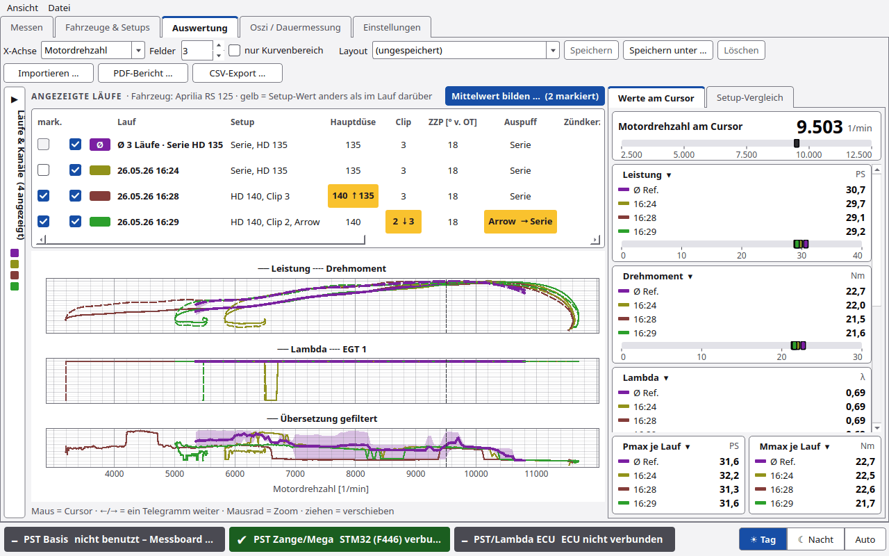
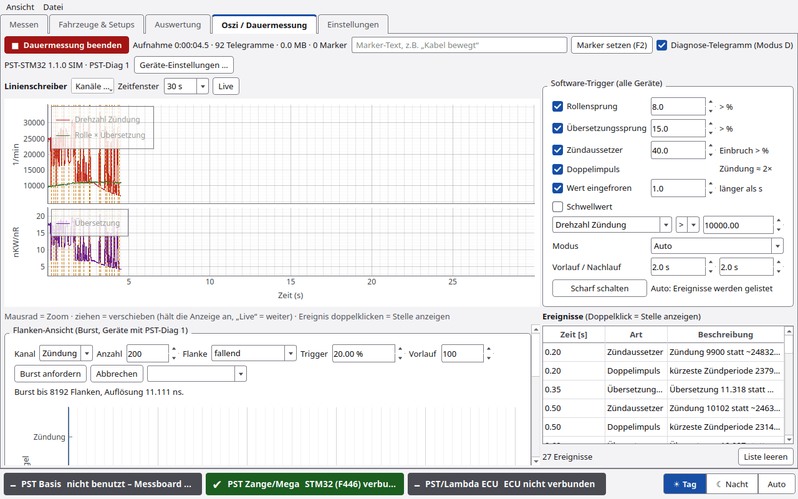
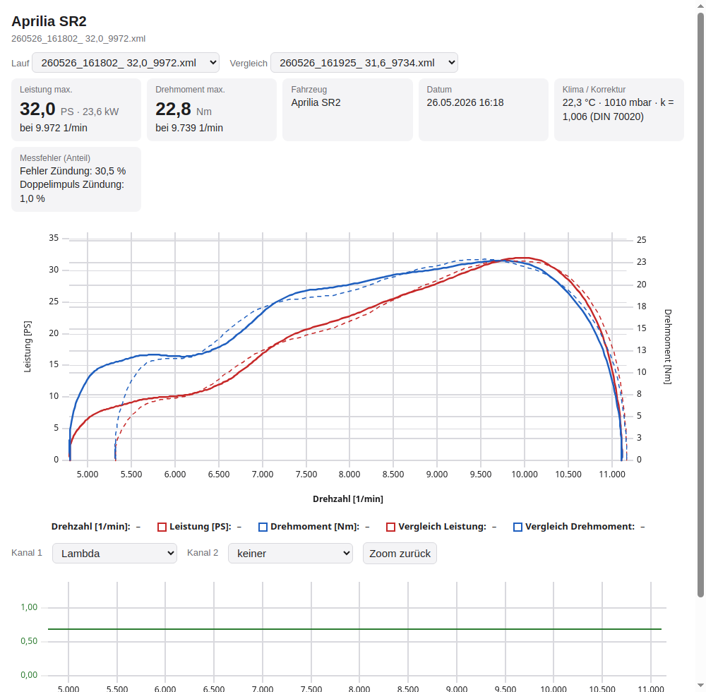

# PyST 1.4.2

Bedienung mit Bildern: [Wiki](https://github.com/chili023/PyST/wiki)

PC-Software für den Leistungsprüfstand: misst, rechnet und wertet aus mit der **PyST-Basis**, dem **Arduino Mega**
(PST 3.x) und dem **STM32 F446** (Nucleo-F446RE, PST-STM32) – ohne Windows und ohne LabVIEW.
Läuft auf **Mac**, **Linux/Raspberry Pi** (und Windows).

- steuert die Messelektronik: Klima lesen (`e`), Messung starten (`m`) und stoppen (`s`)
- Lauf mit **fester Übersetzung**, Start, sobald die Drehzahl nach GO 1 s lang steigt, Ende bei **n Stop** (z.B. 8000 1/min) oder beim Gaswegnehmen (ab *n vom Gas*)
- Prüfstandsdaten: Rollengeber, Rollenumfang, Trägheit, Zündimpulse, Filter, Verlustmoment
- **Ausrollversuch** (Einstellungen › Rolle/Lauf, Gruppe „Verluste – Ausrollversuch“): nach dem Lauf Kupplung ziehen,
  aus dem Ausrollen der Rolle das Verlustmoment bestimmen – Ergebnis Radleistung und Motorleistung getrennt; dazu
  einmalig die **Rollen-Kalibrierung** (Assistent, Rad abgehoben, Verluste der Rolle allein), mit der PyST die
  Verluste in Rolle und Reifen/Kette/Getriebe aufteilt
- Übersetzung einmessen aus Zündsignal oder rusEFI-Drehzahl (Verlauf, getrimmter Mittelwert, von Hand anpassbar),
  live am Drehzahlmesser des Motorrads abgleichen („Live abgleichen …“) oder per **Funkenmessung** in jedem Lauf neu
  bestimmen (Funkenmessung: noch nicht am Prüfstand bestätigt)
- **rusEFI-Steuergerät** als zweite Datenquelle (Einstellungen › ECU), Kanäle frei wählbar und mit jedem Lauf gespeichert
- Live-Anzeige als LIVE-Kacheln (Motor berechnet und gemessen, km/h, Messfrequenz, verlorene Telegramme), Live-Kurve
- **Rechnet exakt wie LabVIEW 3.2.1.** Geprüft an sechs echten Läufen vom 26.05.26: gleiche Pmax auf 0,1 PS, gleiche n(Pmax).
- Speichert jeden Lauf als CSV und JSON (`roh.csv`, `kurve.csv`, `lauf.json`, dazu `rusefi.csv`, `marker.csv`,
  `ereignisse.csv`, falls vorhanden) und als **LabVIEW-XML** `lauf.xml` (öffnet in LabVIEW-Recalc)
- lädt LabVIEW-Läufe und PyST-Läufe zum Vergleich (Überlagerung und Tabelle)
- eingebauter **Simulator**, um ohne Prüfstand zu testen (auch mit Störungen und als alter Mega 3.0.0)
- **Messwerkzeug „Oszi / Dauermessung“**: Dauermessung, Linienschreiber, Software-Trigger auf Störungen,
  Flanken-Ansicht (Logikanalysator) und Geräte-Einstellungen über **PST-Diag 1** (Mega ab 3.1.0, F446 ab 1.1.0)
- **Fehlerkanäle** „Fehler Rolle“, „Fehler Zündung“, „Doppelimpuls Zündung“, „Wert eingefroren“ – auch für alte Läufe
- **Läufe weitergeben**: `.pyst`-Datei (öffnet in PyST) oder **HTML-Ansicht** (öffnet in jedem Browser, offline)
- **Import von Rohmitschnitten** (TeraTerm/Terminal) von Mega und F446

Testablauf für den Vergleich alt/neu: siehe [TESTPLAN.md](TESTPLAN.md).



## Oberfläche

Ausführliche Anleitung zu jeder Funktion: **[PyST-Wiki](https://github.com/chili023/PyST/wiki)**.

| Reiter | Inhalt |
|---|---|
| **Messen** | Kopfzeile Fahrzeug · Setup · Notiz · Auto-Speichern · Status · **Verbinden/Trennen** · **Lauf-Einstellungen …** (Übersetzung, Filter, Start und Ende des Laufs) · **START (F1)** (im Lauf rot: Abbrechen (Esc)). Zeile **SETUP-WERTE** (bis 8 Felder, ändern → als neues Setup speichern oder nur für diesen Lauf; bei unverändertem Setup fragt START „Setup unverändert – Änderungen eintragen?“). Leistungsdiagramm mit unterem Diagramm, „Kurven ▾“, Achsgrenzen, Fähnchen am Cursor je Kurve, große Anweisungen (Klima wird gemessen …, GO bis zum Drehzahlanstieg, in der Messung nichts, am Ende GAS WEG bzw. GAS WEG – KUPPLUNG ZIEHEN) und großes Ergebnis Pmax/Mmax, Legende (Option). Rechts Umgebung (BME280) in einer Zeile, Drehzahl groß, 0 bis 12 **LIVE**-Kacheln je Fahrzeug (ab 5 zweispaltig; Kanal und Balkengrenzen wählbar; mit der Maus im Diagramm die Werte des letzten Laufs am Cursor), Ergebnis. Seitenleiste **Läufe** (Breite am Rand ziehbar, auch nicht angepinnt): 5 Plätze, gesperrt (Schloss) oder rollierend, **＋** holt alte Läufe und Mittelwerte gesperrt ins Diagramm, Haken **Ø automatisch mitteln** neben **＋** (Mittelwert der Läufe im Diagramm mit gleichem Setup, mit Band, nach jedem Lauf neu, belegt keinen Platz, **speichern** legt einen Mittelwert-Lauf an) |
| **Fahrzeuge & Setups** | Fahrzeuge (Hersteller, Modell, Gemischaufbereitung, Motor …) und Setups (Motor, Vergaser, Einspritzung/ECU, Zündung, Antrieb, Ein-/Auslass, Kraftstoff). Kopieren, „Für neue Läufe verwenden“ |
| **Auswertung** | Läufe überlagern wie MegaLogViewer: bis 4 Felder, X-Achse Zeit oder Drehzahl, Cursor mit Maus und ←/→. Laufleiste **ANGEZEIGTE LÄUFE** mit Setup-Spalten (Änderungen gelb), **Mittelwert bilden …**, rechts **Werte am Cursor** und **Setup-Vergleich**. Import (Dateien oder Ordner mit Unterordnern), PDF-Bericht, CSV |
| **Oszi / Dauermessung** | Fehlersuche an Zündung und Rolle: Dauermessung mit Markern (F2), Linienschreiber, Software-Trigger, Ereignisliste, Flanken-Ansicht (PST-Diag 1), Geräte-Einstellungen |
| **Einstellungen** | Unterreiter **Rolle/Lauf** (Prüfstand, Anzeige beim Messen, Lauf, Filter, Klima, Verluste mit Rollen-Kalibrierung und Ausrollversuch) · **Verbindung** (Messboard, Geräte-Einstellungen der Basis, Prüfen, Datenbank) · **Zange** (Kopplung, Aufnahme & Log, Tasten der Zange, Tests, Geräte-Einstellungen) · **Lambda** (Heizung, λ/AFR, AFR-Eingang, Prüfen) · **Analogeingänge** (Eingänge von Basis, F446 und Mega benennen und umrechnen) · **ECU** (rusEFI, .ini, Kanal-Setup) · **Software & Firmware** (Kachel PyST mit installierter/verfügbarer Version, Kundenansicht mit vier Karten, Expertenmodus) · **WiFi** (WLAN der Basis, Steckdosen) |

- Unten die **Statusleiste** mit drei Feldern (PST Basis · PST Zange/Mega · PST/Lambda ECU), dem Knopf
  **PDF-Bericht** (druckt, was gerade im Diagramm steht: Messen bzw. die Felder der Auswertung) und den kleinen
  Knöpfen **☀ ☾ ◐** für Tag, Nacht, Automatisch (auch Menü *Ansicht › Darstellung*). Fenstergröße unter
  *Ansicht › Größe*.
- Menü **Datei**: Öffnen/importieren (Ctrl+O), **Ordner importieren (mit Unterordnern)** (Ctrl+Umschalt+I), Läufe
  weitergeben als `.pyst` (Ctrl+S) oder HTML (Ctrl+H), PDF-Bericht (Ctrl+P), CSV-Export (Ctrl+E). Dateien lassen sich
  auch ins Fenster ziehen.
- Während eines Laufs bleibt die Skalierung wie beim vorherigen Lauf stehen; danach wird neu skaliert.
- Achsgrenzen direkt an den Achsenden: Drehzahl von/bis, PS von/bis, Nm von/bis (z.B. ab 5000 1/min und ab 5 PS);
  fett = fest, grau = automatisch aus den Kurven, „auto“ setzt alles zurück. Gilt auch für den PDF-Bericht.
- Filter in Sekunden (Standard 1,75 s / 0,75 s) passen sich der Messfrequenz an. „Messpunkte (wie LabVIEW)“ für den
  direkten Vergleich mit LabVIEW. LabVIEW-Läufe im Simulator schalten automatisch auf Messpunkte.
- Nm-Achse mit runder Teilung, die PS-Achse wird so gelegt, dass ihre Striche auf denselben Gitterlinien liegen.
- Läufe liegen in `~/PyST/pyst.db`, Messdaten in `~/PyST/messungen/` (Datenordner älterer Versionen werden beim
  ersten Start automatisch übernommen). Fenster und Reiter werden beim Beenden gespeichert; im Auswerter speicherbare
  Layouts. Rechtsklick auf einen Lauf in der Seitenleiste **Läufe**: Platz sperren (Schloss), In Auswertung öffnen,
  Notiz, Farbe, aktuellem Fahrzeug/Setup zuordnen, mit aktuellen Einstellungen neu rechnen, CSV-Export, Löschen.
- **Import** von LabVIEW-XML und PyST-Läufen, auch ganze Ordner mit Unterordnern (Vorschau, schon vorhandene Läufe
  abgewählt, Zuordnung Fahrzeug/Setup, Bericht), **Export** als PDF-Bericht (was im Diagramm steht, mit Referenzen,
  Ø automatisch, Achsgrenzen, Setup-Daten) und CSV (Excel deutsch oder international).
- **Verbinden** in der Kopfzeile von Messen oder unter Einstellungen › Verbindung (Port wählen). Automatisch verbindet
  PyST nur den **Nucleo** (STM32 F446, erkannt am ST-Link) und **Original-Arduino-Boards** (Mega) mit PST-Firmware:
  Es sucht alle 5 s (abschaltbar unter Einstellungen › Verbindung), Abziehen wird erkannt. Die **PyST-Basis** und
  **Mega-Nachbauten** (z. B. mit CH340) verbindest du von Hand. Nach „Trennen“ von Hand bleibt PyST getrennt, nach dem
  Flashen wird wieder gesucht. Reißt die WLAN-Verbindung zur Basis ab (auch bei jedem Neustart der Basis), verbindet
  PyST neu und meldet sich neu an; eine abgelehnte Anmeldung wiederholt es nicht, jeder Fehlversuch verlängert die
  Sperre der Basis (1 bis 60 s).
- **Anzeigen und Diagramme** frei belegbar: Titel ▾ jeder LIVE-Kachel (Kanal wählen, gruppiert nach PST, ECU und Analog),
  „Kurven ▾“ im Leistungs- und im unteren Diagramm (links/rechts, unteres Diagramm ausblendbar). Unter
  Einstellungen › Rolle/Lauf › **Anzeige beim Messen** (auch Menü *Ansicht*): **Ergebnis groß nach dem Lauf** (an),
  **Anweisungen groß (GO, GAS WEG …)** (an), **Legende im Diagramm** (aus).
- **Übersetzung** unter **Lauf-Einstellungen …** oder Einstellungen › Rolle/Lauf: von Hand eintragen,
  **Übersetzung einmessen …** (Quelle Zündabnehmer oder rusEFI, Verlauf über der Messzeit, rote Linie = Mittelwert,
  ziehen/klicken/eintippen zum Anpassen), **Live abgleichen …** (Fenster „Übersetzung live abgleichen“: Drehzahl wie
  am Drehzahlmesser des Motorrads einstellen) oder Übersetzungsart **Funkenmessung (aus Zündung/Rolle jedes Laufs)**.
- **rusEFI** (Einstellungen › ECU): Das Steuergerät wird per USB parallel zum Prüfstand gelesen (5–200 Hz, Standard 50 Hz).
  - Die Kanalnamen stehen nicht im Steuergerät, sondern in der TunerStudio-`.ini` zur jeweiligen Firmware.
    PyST holt sie automatisch vom USB-Laufwerk „RUSEFI“ (`rusefi.ini.7z`) und legt sie unter
    `~/PyST/rusefi_ini/` ab. Alternativ „Datei wählen …“. Passt die Signatur nicht, warnt PyST.
  - Aufgezeichnet werden **nur die gewählten Kanäle** („Kanäle hinzufügen …“ durchsucht die ganze .ini).
    Die Auswahl samt Abtastrate lässt sich als **Kanal-Setup** unter einem Namen speichern und als Datei
    exportieren/importieren.
  - Beim Speichern eines Laufs: Spalten `rusefi_<Kanal>` in `roh.csv` (auf die Prüfstands-Telegramme gelegt),
    Originalabtastung in `rusefi.csv`, Signatur und Einheiten in `lauf.json`. Im Auswerter erscheinen die
    Kanäle in der Gruppe „rusEFI“ (z.B. „TPS (ECU)“).
  - Im Reiter Messen: jeder aufgezeichnete Kanal als LIVE-Kachel (Titel ▾, Gruppe ECU; live und am Cursor der Wert
    des Laufs) und über „Kurven ▾“ bis zu 4 „ECU-Kurven über der Leistung“: ohne eigene Achse über die Leistungskurve
    gelegt (Farbe = Lauf, Punkt-/Strichpunkt-Muster = Kanal, Bereich in der Legende oben links).
  - Zum Entpacken der `.7z` wird `py7zr` benutzt, ersatzweise `bsdtar`/`7z` (Mac und Windows haben `tar` dabei,
    auf Linux ggf. `pip install py7zr` oder `apt install p7zip-full`).
- **Analogeingänge** (Einstellungen › Analogeingänge, Wiki [Analogeingänge](../docs/wiki/Analogeingänge.md)): je Gerät
  (PyST-Basis AI1/AI2 an X6, 0–10 V / 0–5 V / 4–20 mA per Lötbrücke · STM32 F446 ADC1 = PB0, ADC2 = PA1, 0–3,3 V ·
  Arduino Mega A0 … A15, 0–5 V) eine Zeile je Eingang mit Haken, Name, Einheit, Umrechnung (**keine**, **2-Punkt**
  U1 → W1 / U2 → W2, **Faktor/Offset** W = a · U + b; U1 = U2 wird abgefangen), Balkengrenzen, Nachkommastellen,
  Vorlagen (Drucksensor 0,5–4,5 V, 0–5 V linear, Spannungsteiler …) und Spannung/Wert live. Gespeichert in
  `einstellungen.json` (`"analog"`), wirkt sofort.
  - Aktive Kanäle: LIVE-Kachel (Gruppe „Analog“), „Kurven ▾“ im unteren Diagramm, Auswertung und CSV-Export
    („Öldruck (Analog)“ und „AI1 Rohwert (Analog)“).
  - Beim Speichern eines Laufs: Rohwerte in `roh.csv` (Spalten `analog_<Eingang>`, V bzw. mA), die zum Lauf gültige
    Konfiguration in `lauf.json` (`"analog"`). Alte Läufe zeigen ihre damalige Umrechnung; Haken „Gespeicherte Läufe
    mit der aktuellen Umrechnung zeigen“ rechnet neu.
  - Werte: Die Basis meldet AI1/AI2 in `#STAT`, PyST fragt etwa jede Sekunde. Vorschlag für alle Firmwares:
    `#CAP;…;ai=<Eingänge>`, `#AI <hz>` → Zeilen `A;<t_ms>;AI1=1.234;…` (PyST schickt `#AI 10`). Mega 3.1.0 und
    F446 1.1.0 senden noch keine Analogwerte; der Simulator (`SIM:mega`, `SIM`, `SIM:basis`) schon.
- Weitere Messkanäle (später WSB) sind zusätzliche Spalten in `roh.csv` und
  erscheinen automatisch im Auswerter und im CSV-Export.

Noch nicht am Prüfstand bestätigt: Mega- und F446-Flashen aus PyST, Übersetzungsart **Funkenmessung**, Zangentasten im
Fenster „Übersetzung live abgleichen“, Rollen-Kalibrierung mit abgehobenem Rad und Aufteilung der Verluste.

## Ausrollversuch (Einstellungen › Rolle/Lauf)

Bestimmt die Verluste zwischen Motor und Rolle. Damit weist PyST neben der Radleistung die **Motorleistung** aus.
Bedient wird er in der Gruppe „Verluste – Ausrollversuch“ unter Einstellungen › Rolle/Lauf (früher eigener Reiter
„Kalibrierung“). Zwei Messungen:

- **Rollen-Kalibrierung** (Assistent, Rad abgehoben): **einmal** je Prüfstand, neu nur nach Umbau an der Rolle. Misst,
  wie schnell die Rolle von allein ausrollt – die Verluste der Rolle allein (Lager, Luft). Wird als
  Prüfstands-Kalibrierung gespeichert, **nicht** in M0/M1.
- **Ausrollversuch nach dem Lauf** (Kupplung ziehen): misst die Verluste **gesamt** (Rolle, Reifen, Kette,
  Getriebeausgang); „Übernehmen“ trägt sie in M0/M1/m2 ein (Motor = Rad + Verluste). Mit Rollen-Kalibrierung teilt
  PyST sie auf: gesamt = Rolle + **Reifen/Kette/Getriebe** (Differenz).

**Rollen-Kalibrierung – Assistent (Rad abgehoben, nur die Rolle)**

Oben in der Gruppe steht „Rollen-Kalibrierung: vom 09.11.2026, Verlust bei Rolle 1600 1/min (Motor 10960) = 30,0 Nm /
6,8 PS“ bzw. „noch nicht kalibriert“, daneben der Knopf **Rollen-Kalibrierung (Assistent) …**. Ein eigenes Fenster
(nicht modal) führt in fünf Schritten durch die Messung, mit großen Zahlen, die man vom Motorrad aus lesen kann:

1. **Vorbereitung:** Messboard verbunden und Rollendaten da (sonst Knopf „Verbinden“), kurze Erklärung.
2. **Beschleunigen:** Rolle mit dem Motorrad auf die Zieldrehzahl bringen. Groß Rolle [1/min] und km/h, Balken bis
   zum Ziel. Ziel einstellbar (Vorgabe deutlich über der Enddrehzahl: 2,5 × n_ende/i, bei 3000 1/min und i = 6,85
   also 1100 1/min Rolle; gespeichert als `assistent_ziel`). „Weiter“ erst, wenn das Ziel erreicht ist.
3. **Rad von der Rolle:** Gas weg, Rad anheben, die Rolle läuft frei aus (Sicherheitshinweis). **Messung starten**
   geht nur über der Mindestdrehzahl (70 % des Ziels, mindestens 40 % über n_ende), sonst zurück zu Schritt 2 mit
   „zu langsam – nochmal beschleunigen“.
4. **Messung:** Aufzeichnung ab „Messung starten“, Live-Kurve Drehzahl über Zeit. Ende bei n_ende (Rolle × i wie
   unten), Stillstand, Wiederanstieg, ohne Daten oder nach der Höchstdauer (Messzeit); „Beenden und auswerten“ oder
   „Abbrechen“ (auch Esc) jederzeit.
5. **Ergebnis:** Auswertung wie beim Ausrollversuch, nur **ohne Kupplungserkennung**
   (`ausrollen.analyse(..., kupplung=False)`): die Ausrollphase beginnt bei „Messung starten“, ein kurzer Übergang am
   Anfang wird verworfen. Diagramm (neuer Fit, bisherige Kalibrierung gestrichelt) und Werte; **Als
   Rollen-Kalibrierung speichern**, **Nochmal** (zurück zu Schritt 2), **Schließen**.

Gespeichert wird die Kalibrierung für den Prüfstand (nicht je Fahrzeug) in `einstellungen.json` unter
`"rollen_kalibrierung"`: M0, M1, n1, m2, Datum, R², gemessener Bereich und der Ordner der Rohdaten
(`ausrollen.RollenKalibrierung`). Sie bleibt über den Neustart erhalten und steht in den Parametern jedes neuen Laufs
(`rk_m0`, `rk_m1`, `rk_n1`, `rk_m2`, `rk_quelle` in `lauf.json`; ältere Läufe ohne diese Felder laden wie bisher, ohne
Kalibrierung). Die Rohdaten der Messung liegen in `~/PyST/messungen/JJMMTT_HHMMSS_Rollen-Kalibrierung/` (`roh.csv` wie
bei einem Lauf, `lauf.json` mit `"art": "rollen_kalibrierung"`, Parametern, Ende und Ergebnis). Nachrechnen:
`r = storage.load_any(ordner)`, `ausrollen.analyse(r["n_roll"], r["dt"], r["params"], start=0, n_ende=…,
kupplung=False)`. Solange der Assistent offen ist, startet kein Lauf (START, F1, Taste der Zange); während eines
Laufs lässt er sich nicht öffnen.

**Ausrollversuch nach dem Lauf – Ablauf für den Fahrer**

1. In der Gruppe „Verluste – Ausrollversuch“ **Ausrollversuch nach jedem Lauf** einschalten (bleibt gespeichert). Ausgeschaltet
   läuft alles exakt wie bisher.
2. Lauf wie immer. Bei *n Stop* zeigt das Statusfeld in der Kopfzeile **GAS WEG – KUPPLUNG ZIEHEN!**
3. Gas weg und **gleich die Kupplung ziehen**, gezogen halten, nicht bremsen, nicht schalten. Nach dem Laufende
   steht **KUPPLUNG ZIEHEN · ausrollen lassen** (blau) im Statusfeld und mit „Anweisungen groß“ **GAS WEG –
   KUPPLUNG ZIEHEN!** groß über dem Diagramm, bis das Ausrollen fertig ist; die Aufzeichnung läuft weiter.
4. Das Ausrollen endet bei der eingestellten Motordrehzahl (Rolle × i, Vorgabe 3000 1/min, 0 = bis Stillstand),
   nach der Höchstdauer (Vorgabe 120 s), wenn die Drehzahl wieder steigt, keine Daten mehr kommen oder mit
   **Ausrollen beenden (Esc)**. Der Lauf ist dann schon fertig und wird wie immer ausgewertet und gespeichert
   (das Ausrollen steht mit in `roh.csv`, das Ergebnis unter `"ausrollen"` in `lauf.json`, mit Kalibrierung dazu
   `"aufteilung"`).
5. In der Gruppe „Letzter Ausrollversuch“ Kurve und Fit-Güte prüfen. Mit Rollen-Kalibrierung stehen dort gesamt, Rolle
   und Reifen/Kette/Getriebe in Nm und PS (bei Pmax des Laufs, bei n1 und oben) und im Diagramm als drei Kurven
   (gesamt rot, Rolle grün, Reifen/Kette/Getriebe orange). Fällt die Differenz rechnerisch unter 0, steht ein Hinweis
   dabei (Kalibrierung bzw. Ausrollversuch wiederholen). Ohne Kalibrierung: „nur gesamt – Rolle nicht kalibriert“.
6. **Übernehmen** drücken. Erst dann werden M0, M1, n1 und m2 (gesamt) in die Gruppe „Verluste (Werte für die
   Rechnung)“ eingetragen; der Lauf des Versuchs wird damit neu gerechnet. „Markierten Lauf auswerten“ wertet das
   Ausrollen eines gespeicherten Laufs nachträglich aus.

**Formel**

- Ohne Antrieb gilt an der Rolle J · dω/dt = −Mv(n), also Verlustmoment Mv = −J · dω/dt, Verlustleistung
  Pv = Mv · ω (n = Rollendrehzahl, ω = n · 2π/60).
- Modell (wie LabVIEW, um einen quadratischen Anteil erweitert, Vorgabe m2 = 0):
  Mv(n) = M0 + n · (M1 − M0)/n1 + m2 · (n/1000) · ((n − n1)/1000). M0 und M1 bleiben die Werte bei 0 und n1.
- Fit ohne numerische Ableitung: ω(t) = ω0 − 1/J · Σ c_k ∫ φ_k(n) dt mit φ = 1, n/n1, (quadratisch) – lineare
  kleinste Quadrate über alle Messpunkte. n1 = eingestellter Wert (über 100 1/min), sonst die obere Drehzahl
  des Ausrollens.
- Erkennung: ab dem Laufende das Drehzahlmaximum, die Kupplung über das Zündsignal (Motor dreht langsamer als
  Rolle × i) oder ohne Zündsignal über die Verzögerung. Der Übergang am Anfang (Motorbremse, Kupplung schleift)
  und Bremsen am Ende werden verworfen, bis das Modell ω(t) im Randfenster (0,5 s) trifft.
- Messpunkte im Diagramm: lokale Steigung (±0,25 s) → Mv, nach Drehzahl in Klassen gemittelt. Fit-Güte = R² und
  RMS dieser Klassenmittel gegen den Fit.
- Motorleistung = Radleistung + Verlustleistung bei gleicher Rollendrehzahl:
  M_Motor = k · J / i² · a + Mv / i (wie bisher), Radanteil = k · J / i² · a. Ergebnis-Zeile, PDF-Bericht,
  `lauf.json` und die Kanäle „Leistung Rad“ / „Verlustleistung“ im Auswerter weisen beides getrennt aus und
  nennen die Herkunft der Verluste (Ausrollversuch mit Datum und R², oder „von Hand eingetragen“).
- Mit Rollen-Kalibrierung zusätzlich **Reifen an Rolle** = k · J / i² · a + Mv_Rolle / i (die Leistung, die der
  Reifen an die Rolle abgibt) und **Antriebsverlust** (Reifen, Kette, Getriebe) = Motor − Reifen an Rolle bei der
  Drehzahl von Pmax: Ergebniszeile, PDF-Bericht, `lauf.json` (`p_reifen_max_ps`, `antriebsverlust_ps_bei_pmax`,
  `rollen_kalibrierung`) und die Kanäle „Leistung Reifen an Rolle“ / „Antriebsverlust“. Die Kurven Rad und Motor
  bleiben unverändert.
- Aufteilung des Ausrollversuchs: Mv_Reifen/Kette/Getriebe(n) = Mv_gesamt(n) − Mv_Rolle(n) (`ausrollen.aufteilen`),
  immer mit der aktuellen Kalibrierung.

**Grenzen**

- J ist die Rollenträgheit. Die Trägheit von Rad und Getriebeausgang fehlt beim Beschleunigen wie beim Ausrollen.
- Die DIN-70020-Korrektur wirkt wie in LabVIEW nur auf den Radanteil, nicht auf die Verluste.
- Erfasst werden nur Verluste hinter der Kupplung (Rolle, Reifen, Kette, Getriebeausgang), nicht Getriebeeingang,
  Primärtrieb und Kupplung selbst. Die Verluste hängen von Reifendruck, Anpressung und Temperatur ab: nach
  Änderungen neu messen.
- Fehlt der untere Drehzahlbereich, ist M0 hochgerechnet (Hinweis in der Gruppe). Ein quadratischer Anteil
  (m2 ≠ 0) lässt sich im LabVIEW-XML nicht abbilden; dort stehen nur M0/M1.
- Meldungen statt Ergebnis bei: keine Ausrolldaten, zu kurz (unter 3 s), Drehzahlbereich zu klein
  (unter 20 %), Rolle beschleunigt, Kupplung nicht gezogen erkennbar, Verlustmoment negativ.
- Simulator: beide Ports haben dieselbe Rolle (M0 8 Nm, M1 30 Nm bei 1600 1/min, m2 5). Port `SIM:ausrollen`
  (Kupplung 0,8 s nach dem Gaswegnehmen gezogen): dazu Reifen/Kette/Getriebe 4 Nm + 0,08 Nm/(rad/s) an der Rolle.
  Port `SIM:rolle` für die Rollen-Kalibrierung: Haltedrehzahl, Vollgas bis 11500 1/min, 4 s oben halten, dann Rad
  ab; die Rolle läuft allein aus, unter 2000 1/min (Rolle × i) kommt das Rad wieder auf die Rolle und alles beginnt
  von vorn. Ein Auslauf dauert gut 90 s. Kalibrierung mit `SIM:rolle`, dann ein Lauf mit `SIM:ausrollen` ergibt die
  Aufteilung des Simulators (Rolle rund zwei Drittel, Reifen/Kette/Getriebe ein Drittel).

## Oszi / Dauermessung (ab 1.3)



Kurz: **Verbinden → Reiter „Oszi / Dauermessung“ → „● Dauermessung starten“ → bei Bedarf Marker (F2,
z.B. „Kabel bewegt“) → Ereignisse in der Liste doppelklicken → „Dauermessung beenden“** (landet als Lauf
„Dauer“ in den Läufen und in der Auswertung).

- **Dauermessung** unabhängig vom Leistungslauf, ohne Zeitgrenze. Sie wird fortlaufend gesichert
  (`~/PyST/messungen/JJMMTT_hhmmss_Dauermessung/teil_NNNN.csv`, alle 2 s auf die Platte, je Minute ein Abschnitt);
  nach einem Absturz fehlen höchstens Sekunden, der Ordner lässt sich trotzdem importieren.
  Beim Beenden: `roh.csv` + `lauf.json` (+ `marker.csv`, `ereignisse.csv`, `bursts/`).
- **Linienschreiber**: Kanäle frei wählbar („Kanäle …“): Drehzahl Zündung, Drehzahl Rolle, Rolle × Übersetzung,
  Übersetzung, Messfrequenz, AFR, EGT 1/2 und – mit PST-Diag 1 – Flanken je Telegramm, kürzeste/längste Periode,
  verworfene Flanken, Geräte-Flags. Je Einheit ein Feld, Zeitfenster 10 s … alles, Mausrad/Ziehen hält an, „Live“.
- **Software-Trigger** (für alle Geräte, auch alter Mega 3.0.0 – arbeitet nur mit den Telegrammen):
  Rollensprung (> x % vom gleitenden Median), Übersetzungssprung, Zündaussetzer/Timeout, Doppelimpuls
  (Zündung ≈ 2×), eingefrorener Wert, Schwellwert auf einen Kanal. Modi **Auto** (nur Liste),
  **Normal** (Anzeige springt zu jedem Ereignis), **Einzelschuss** (danach angehalten), Vor-/Nachlauf.
  Alle Ereignisse stehen in der Liste (Doppelklick = Stelle anzeigen) und in `ereignisse.csv`.
- **Flanken-Ansicht** (nur Geräte mit PST-Diag 1): Kanal (Zündung/Rolle/beide), Anzahl, Flanke (fallend/steigend/
  beide = Pulsbreite), Trigger % (Periode weicht vom Mittel der 8 vorigen ab), Vorlauf → „Burst anfordern“.
  Oben Logikanalysator-Spuren, unten Periode je Flanke (und Pulsbreite), zwei Cursor mit Δt und 1/Δt.
- **Geräte-Einstellungen …** liest `#GET` und zeigt alle Einstellungen des Geräts (Flanke, Timeouts,
  Doppelimpulsfilter, Sperrzeiten …); „Übernehmen“ (`#SET`, flüchtig), „Im Gerät speichern“ (`#SAVE`,
  Ausgabe wird dafür kurz angehalten), „Standardwerte“ (`#DEFAULTS`). Kein Neu-Flashen nötig.
- Während der Dauermessung schaltet PyST Geräte mit PST-Diag 1 in **Modus D** (Diagnose-Telegramm), danach
  zurück in den Normalmodus. Leistungsläufe laufen wie bisher im Normalmodus (LabVIEW-identisches Telegramm).

**Protokoll** (Spezifikation `docs/04_PST_Diag_1.md`): beim Verbinden sendet PyST `#?`. Antwortet das Gerät
binnen 300 ms mit `#CAP`, sind Modus D, Bursts und Einstellungen verfügbar; sonst (Mega 3.0.0, F446 1.0.0)
nur die normalen Telegramme. Zeilenende `\n`, `\r` oder `\r\n`; unbekannte Zeilen/Felder werden ignoriert.

**Simulator** (Port unter Einstellungen › Verbindung › Port):

| Port | verhält sich wie |
|---|---|
| `SIM` | F446 1.1.0 mit PST-Diag 1, synthetischer Motor |
| `SIM:stoerung` | dasselbe mit Störungen: Doppelimpuls und Aussetzer der Zündung, Rollensprünge, Wackelkontakt |
| `SIM:mega` | Mega-Sketch 3.1.0 mit PST-Diag 1 |
| `SIM:mega300`, `SIM:mega300:stoerung` | alter Mega 3.0.0 ohne `#CAP` (nur Software-Trigger), optional mit Störungen |

Die Störungen sind im Simulator Geräte-Einstellungen (`sim_doppel`, `sim_aussetzer`, `sim_rollensprung`,
`sim_wackel` = Ereignisse pro Minute) und lassen sich im Dialog „Geräte-Einstellungen …“ live ändern.
Mit `ign_lockout_pct` (z.B. 50) filtert der Simulator Doppelimpulse wie die Firmware („verworfen“ zählt mit).

## Inbetriebnahme: Prüfen und Firmware

**Prüfen:** „Alles prüfen“ unter Einstellungen › Verbindung (Gruppe „Prüfen“) bewertet das verbundene Gerät mit
Sollwerten, ohne Terminal. Basis: Takt, Spannungen, Sensoren, Klimawerte, ESP-Link, WLAN, Zange per Funk. Zange per USB:
Firmware, Zähler, Kopplung. Einzeln geht es unter Einstellungen › Zange › **Tests** (Prüfungen der Zange, „Funken zählen“
mit optionaler Sollfrequenz, „Log prüfen“ und bei der Zange per USB „Ein Blitz“, einzelner TRIG-Puls, 1–25 µs) und
Einstellungen › Lambda › **Prüfen** („Lambda prüfen“: Wideband F042 und Heizung). „Protokoll kopieren“ legt das
Ergebnis als Text in die Zwischenablage.

**Einstellungen › Software & Firmware:** flasht Zange (USB-C: Update-Datei über `#UPD`, Erstflash per esptool), Basis-STM32 (USB über den
Bootloader der Basis), Basis-ESP (USB: Update-Datei über `#ESPUPD` und den STM, Erstflash per esptool über die ESP-Brücke),
den Lambda-Controller F042 (über die Basis per CAN), den Arduino Mega (avrdude über den Arduino-Bootloader), den STM32 F446
(Laufwerk NODE_F446RE, st-flash oder DFU) und für die Erstprogrammierung den STM32 per ST-Link an J10. Mega- und
F446-Flashen sind noch nicht am Prüfstand bestätigt.

Quelle ist das öffentliche Firmware-Repo: Branch `firmware` von [chili023/PyST](https://github.com/chili023/PyST)
(`manifest.json` mit Version, Datei, Größe, SHA-256 und Signatur je Ziel). Oben steht „Software und Firmware“ mit der
Quelle („Quelle: GitHub chili023/PyST › firmware · Stand …“), dazu **Jetzt nach Updates suchen** und der Schalter
**Expertenmodus** (PyST merkt sich die Wahl). Eine eigene Datei geht im Expertenmodus; PyST prüft, ob sie zum Ziel passt.

- **PyST (Software)**: Kachel ganz oben (Kunde und Experte) mit installierter und neuester Version aus `main`, dem
  Datenordner und dem Knopf **Release-Seite …** (bei neuer Version **Update laden …**). PyST installiert nichts selbst:
  Update per `git pull` oder ZIP von der Release-Seite.

- **Kundenansicht** (Standard): vier Karten.

  | Karte | Gerät | Knopf |
  |---|---|---|
  | **Basis** | Messplatine PyST (Basis STM32 · Basis-ESP · Lambda) | **Aktualisieren** (nimmt den Basis-ESP mit; den Lambda-Controller F042 flasht man im Expertenmodus) |
  | **Zange** | Funk-Zange am Zündkabel | **Aktualisieren** |
  | **Arduino Mega** | ältere Messplatine PST 3.x | **Flashen** (noch nicht am Prüfstand bestätigt) |
  | **STM32 (F446)** | ältere Messplatine PST-STM32 | **Flashen** (noch nicht am Prüfstand bestätigt) |

  Jede Karte zeigt „✔ erkannt · …“ oder „– nicht angeschlossen“, „installiert“ und „verfügbar“ (mit „neu“, wenn es
  eine neuere Version gibt). Nicht angeschlossene Karten sind ausgegraut (gestrichelter Rand), ihr Knopf ist aus, der
  Tooltip sagt, was zu tun ist. Ports werden dafür nur aufgelistet, nie geöffnet. Ist alles aktuell, steht „Aktuell ✔“ auf dem Knopf. Darunter die Gruppe „Ablauf“ mit
  Fortschritt, **Alle verfügbaren Updates (n) …** und **Abbrechen**.
- **Expertenmodus**: Gruppe „Geräte (Expertenmodus: alle Bausteine einzeln)“, je Zeile Port (nur Arduino Mega und
  STM32 (F446), die anderen sucht PyST selbst), Weg, Datei, auf dem Gerät, verfügbar, Zustand, **Aktualisieren** bzw.
  **Flashen**, **Datei wählen …**, **Erstflash …** (Weg im Tooltip) und der Haken **erzwingen** (auch gleiche oder
  ältere Version bzw. Datei mit ungeprüfter Signatur flashen). Nicht angeschlossene Zeilen sind nur abgeblendet und
  bleiben bedienbar (Erstflash leerer Platinen).

  | Zeile | Weg | Datei | Erstflash … (Weg) |
  |---|---|---|---|
  | Basis STM32 | USB (Update-Datei) | `.pystfw` | ST-Link (SWD) |
  | Basis-ESP | USB über die Basis | `.pystfw` | ESP-Brücke über die Basis |
  | Lambda (F042) | CAN über die Basis | `.bin` | – |
  | Zange | USB an der Zange | `.pystfw` | esptool |
  | Arduino Mega | USB · avrdude (Arduino-Bootloader) | `.hex` | – |
  | STM32 (F446) | Laufwerk, st-flash, DFU | `.bin` | ST-Link oder DFU |

  Darunter:
  - „Eigene Datei (statt Firmware-Repo)“: **Gerät** wählen (die einzelnen Flash-Ziele „Zange per USB (Update-Datei)“,
    „Zange Erstflash per esptool (Build-Ordner)“, „Basis STM32“, „Basis STM32 per ST-Link (Erstprogrammierung)“,
    „Basis-ESP per USB (Update-Datei)“, „Basis-ESP Erstflash per Brücke (Build-Ordner)“, „Lambda (F042) per CAN“,
    „Arduino Mega (PST 3.x)“, „STM32 (F446) per USB“, „STM32 (F446) Erstflash per ST-Link/DFU“), dann Datei bzw.
    Ordner wählen. Erlaubt: `.pystfw` (Basis, Basis-ESP, Zange), `.hex` (Mega), `.bin` (F446, Lambda). Ohne geprüfte
    Signatur nur mit **Version erzwingen / Downgrade erlauben**.
  - „Erstflash (leere oder verkonfigurierte Platine)“: je eine Zeile Basis STM32 (ST-Link (SWD), Gesamtdatei),
    Basis-ESP (ESP-Brücke über die Basis (esptool)), Zange (esptool über USB-C), Arduino Mega (avrdude,
    Arduino-Bootloader, 115200 Bd) und STM32 (F446) (ST-Link (st-flash) oder USB-DFU (BOOT0)), jeweils **Starten …**.
  - „Zange – Update per USB“ mit Warnung und **Aktualisieren**.
  - „Protokoll“ mit **Protokoll kopieren** und **Protokoll speichern …**.

Die folgenden Absätze nennen die Flash-Ziele so, wie sie in der Auswahl **Gerät** unter „Eigene Datei“ heißen. In der
Kundenansicht stecken sie hinter den Karten, im Expertenmodus hinter den Zeilen.

„Basis STM32“ nimmt eine Update-Datei (`.pystfw`, siehe [Firmware-Updates der Basis](#firmware-updates-der-basis)) und braucht
weder Treiber noch Zusatzprogramm (reines Python mit pyserial).
PyST trennt die Verbindung, schickt `#UPDATE`, wartet auf den Bootloader, überträgt mit Fortschrittsanzeige, wartet auf die
neue Anwendung und vergleicht die Version. Steckt die Basis schon im Bootloader, geht es dort weiter. Einstellungen bleiben
erhalten. Bricht die Übertragung ab, bleibt die alte Firmware unberührt oder die Basis wartet im Bootloader: Nochmals flashen.
Es darf nur eine Basis am USB stecken.

„Lambda (F042) per CAN“ nimmt `wideband_image_with_bl.bin` aus dem Release von
[mck1117/wideband](https://github.com/mck1117/wideband) oder die Anwendung allein (25 600 Byte). PyST prüft Größe, Vektortabelle
und Prüfsumme und überträgt nur die Anwendung; Bootloader und Konfiguration des F042 bleiben unberührt. Das geht ab Basis-Firmware
0.2.1 und nur, wenn weder Messung noch Lambda-Heizung laufen. Die Basis bestätigt jeden Block gegen den F042-Bootloader, prüft am
Ende, dass 0x190-Telegramme mit Version 0xA0 wiederkommen, und hält den F042 danach wieder im Reset. Die Sonde bleibt kalt. Abbruch
vor dem Löschen lässt die alte Anwendung stehen; danach wartet der F042-Bootloader und der nächste Versuch holt ihn zurück.

„Zange per USB (Update-Datei)“ nimmt eine `.pystfw` für das Ziel `zange-c3` (ab Zangen-Firmware 0.4.0), auch über
„Herunterladen“ (Manifest-Eintrag `zange`). Reines Python wie bei der Basis: PyST fragt `#UPD INFO` (Version, Schlüssel,
Rollback, Partition), prüft vorab Ziel, Schlüssel, Rollback und Größe, schickt `#UPD BEGIN` mit dem Kopf (die Zange prüft
die Signatur), dann `#UPD DATA` in Blöcken zu 256 Byte (Base64, verlorene Antworten werden wiederholt), `#UPD END` (die
Zange prüft Inhalt und Version) und `#UPD BOOT`. Nach dem Neustart vergleicht PyST die Version und wartet, bis die Zange die
neue Firmware nach 15 s als gültig markiert (`ota=gueltig`). Startet die Zange vorher neu, kehrt sie zur alten Firmware
zurück. Gewertet werden nur Zeilen mit `#UPD;` und `#ERR;UPD;`, das ESP-Log stört nicht. Abbrechen schickt `#UPD ABORT`,
die alte Firmware bleibt. Die Zange sperrt das Update bei Aufnahme, Blitzmodus, Funken in den letzten 5 s und solange sie
mit einer Basis gekoppelt und synchron ist (Fehler 20: Basis ausschalten), ohne USB-Spannung bei Akku unter 3,6 V
(Fehler 21). Fehler 11 heißt Signatur oder Schlüssel passen nicht, 12 Rückfall gesperrt. **Die Zange nie am laufenden
Motor per USB anschließen:** Sie ist dann galvanisch mit dem PC verbunden.

„Zange Erstflash per esptool (Build-Ordner)“ (Expertenmodus: „Erstflash …“ in der Zeile Zange bzw. „Starten …“
in der Gruppe Erstflash) ist der bisherige Weg mit dem ganzen Build (Bootloader, Partitionstabelle, OTA-Daten, App). Ihn braucht jede Zange einmal für 0.4.0, weil sich der Bootloader ändert (App-Rollback), danach geht es
mit der Update-Datei weiter. Ein bis PyST 1.4 unter „Zange“ eingetragener Build-Ordner wandert von selbst in dieses Ziel.

„Basis-ESP per USB (Update-Datei)“ nimmt eine `.pystfw` für das Ziel `basis-esp32c3` (Basis-Firmware ab 0.4.0 mit
`espupd=1` in `#CAP`, Basis-ESP ab 0.4.0), auch über „Herunterladen“ (Manifest-Eintrag `basis_esp`). Der Weg ist derselbe wie
bei der Zange, nur mit dem Präfix `ESPUPD` und über den Messport der Basis (USB-CDC wie die normale Verbindung, nicht der
Brückenport): Der STM reicht jede Zeile an den ESP weiter, PyST wartet bei BEGIN und END bis 12 s, sonst 5 s auf die Antwort
und schickt vorher keine neue Zeile. Über WLAN lehnt die Basis ab (`nur_usb`), PyST sucht ohnehin nur den USB-Port. Nach
`#ESPUPD BOOT` startet nur der ESP neu, die Verbindung bleibt: PyST fragt `#NET`, bis `esp=1`, `esp_neustarts` gestiegen ist
und `esp_fw` die neue Version zeigt, dann `#ESPUPD INFO`, bis die neue Firmware nach 30 s mit stehendem Link `ota=gueltig`
meldet (PyST wartet bis 60 s). Startet der ESP vorher neu, kehrt er zur alten Firmware zurück. Fehler 20: Die Basis misst
(Ausgabe, Burst, Aufnahme der Zange; PyST beendet vorher nur die eigene Ausgabe mit `#RUN 0`), 30: ESP antwortet nicht
(Brücke aktiv?), 31: Antwort zu spät (PyST wiederholt), 32: ESP neu gestartet (auf BOOT normal), 33: Basis-ESP vor 0.4.0.

„Basis-ESP Erstflash per Brücke (Build-Ordner)“ (Expertenmodus: „Erstflash …“ in der Zeile Basis-ESP bzw.
„Starten …“ in der Gruppe Erstflash) ist der bisherige esptool-Weg über die ESP-Brücke (PyST schaltet sie mit
`#ESP BRIDGE 1` ein). Ihn braucht jede neue Platine und jeder Basis-ESP vor 0.4.0 einmal, danach geht es mit der
Update-Datei weiter. Ein bis PyST 1.4 unter „Basis ESP“ eingetragener Build-Ordner wandert von selbst in dieses Ziel.

Eine neue Basis: erst per ST-Link die Gesamtdatei `pyst-basis-gesamt.bin` (Bootloader + Anwendung, an 0x08000000; Expertenmodus
„Erstflash ST-Link …“ in der Zeile Basis STM32), dann den Basis-ESP per Erstflash über die Brücke. PyST nennt die Reihenfolge:
1. STM32 per ST-Link → 2. Basis-ESP per Brücke → 3. Updates per USB → 4. Lambda über die Basis → 5. Zange einmal per
esptool. Das Ziel „Basis STM32 per ST-Link (Erstprogrammierung)“ lehnt die Anwendung allein ab, weil sie ab 0x08008000 gelinkt ist. ST-Link braucht `st-flash` (Mac
`brew install stlink`, Linux `apt install stlink-tools`), `esptool` kommt mit `requirements.txt`.

**Arduino Mega und STM32 (F446)** (noch nicht am Prüfstand bestätigt): Die Dateien liegen unsigniert im Firmware-Repo
(`.hex` für den Mega, `.bin` für den F446). Den Port wählt man im Expertenmodus in der Zeile. Mega: PyST trennt die
Messverbindung und flasht mit `avrdude` über den Arduino-Bootloader (115200 Bd), die Einstellungen im EEPROM bleiben.
PyST sucht `avrdude` im PATH, bei Homebrew, in der Arduino-IDE und bei PlatformIO (sonst Mac `brew install avrdude`,
Linux `apt install avrdude`). F446: PyST kopiert die Datei auf das Laufwerk NODE_F446RE des Nucleo, der ST-Link flasht
selbst und startet neu. Ohne Laufwerk geht es mit `st-flash` oder `dfu-util` an 0x08000000 (DFU: BOOT0 auf 1, Reset,
danach BOOT0 wieder auf 0).

### Firmware-Updates der Basis

Update-Dateien gibt es in zwei Formaten, jeder Bootloader nimmt genau eines:

| Bootloader | Protokoll | Datei | Inhalt |
|---|---|---|---|
| 1.0.0 | 1 | Format 1 | Abbild im Klartext, unsigniert |
| 2.0.0 | 2 | Format 2 | Ed25519-signiert, Nutzdaten AES-256-CTR verschlüsselt |

PyST fragt den Bootloader und sagt vor jeder Übertragung, wenn Datei und Bootloader nicht zusammenpassen. Bootloader 2.0.0
kommt einmal per ST-Link auf die Basis (Gesamtdatei an J10), über USB lässt er sich nicht tauschen. Die Anzeige zeigt zu
jeder Datei Format, Schlüssel und Rollback-Zähler.

Die Signatur prüft PyST vorab, dafür braucht es das Paket `cryptography` aus `requirements.txt`. Bestehende Installationen
holen es mit `pip install -r requirements.txt` nach oder indem man den Ordner `.venv` löscht. Die bekannten öffentlichen
Schlüssel stehen in `pyst/fw_keys.py`:

- **Aus dem Netz** (Firmware-Repo) geladene Dateien brauchen einen bekannten Schlüssel und eine gültige Signatur, die auch zum Eintrag im
  Manifest passt. Sonst lehnt PyST sie ab und löscht sie. Geflasht wird nur auf Knopfdruck.
- **Von Hand** gewählte Dateien: Bei bekanntem Schlüssel muss die Signatur stimmen. Bei unbekanntem Schlüssel geht es mit
  deutlichem Hinweis weiter, dann entscheidet der Bootloader.

Das letzte Wort hat immer der Bootloader. Er prüft beim Start Signatur und Rollback, das dauert einige Sekunden (PyST wartet
bis 30 s), und löscht erst danach den Zwischenspeicher. Eine abgelehnte Datei zerstört nichts: Die Basis startet ihre
vorhandene Firmware wieder. Den Klartext sieht nur der Bootloader, am Ende der Übertragung vergleicht er dessen SHA-256 mit dem
Kopf. PyST kann den Inhalt nicht nachrechnen, die Signatur am PC belegt nur den Kopf der Datei.

„Rückfall gesperrt“ heißt: Die Datei hat einen kleineren Rollback-Zähler als die Firmware auf der Basis. Für Zange und
Basis-ESP gilt dasselbe Format 2 mit Ziel `zange-c3` bzw. `basis-esp32c3`, `load_addr` 0 und je einem eigenen, von der
Schlüsseldatei abgeleiteten AES-Schlüssel; die Regeln für Signatur und Download sind gleich, Inhalt und Rollback prüft das
Gerät selbst. Der Lambda-Controller ist davon nicht betroffen.

**Zange und Basis-ESP: einmal Erstflash, danach Update-Datei.** Beide brauchen einmal den ganzen Build per esptool
(Expertenmodus: „Erstflash …“ in der Zeile Zange bzw. Basis-ESP) mit 0.4.0 oder neuer, weil erst damit Bootloader,
Partitionen und App-Rollback stimmen. Danach kommen Updates nur noch als `.pystfw` über USB (Karte Zange bzw. Basis, Knopf
„Aktualisieren“), signiert und verschlüsselt, mit Probezeit nach dem Neustart (Zange 15 s, Basis-ESP 30 s mit Link). Ältere Firmware
meldet PyST mit diesem Hinweis (Zange: kein `upd=1`, Basis-ESP: Fehler 33).

**Statusleiste:** Das Feld „PST Zange/Mega“ zeigt z. B. „Zange 1: Funk ok … · Akku …“ (grün), „nicht verbunden –
Zange aus oder nicht gekoppelt“ (rot) oder „Zange per USB – nur Auslesen/Testen, nicht am laufenden Motor“ (orange).
Hängt die Basis im Bootloader, steht im Feld „PST Basis“: „im Bootloader – Firmware unter Einstellungen › Software & Firmware aufspielen“.

## PyST-Basis, Funk-Zange und Steckdosen

Lambda-Heizung: Knopf „Lambda ein“ bzw. „Lambda aus“ unter Einstellungen › Lambda (Gruppe „Lambda-Heizung“) oder an der
Zange (Standard T4 lang). „Bereit“ heißt nur
Vorheizen, volle Heizung erst mit Motor (Rolle oder Zündfunken). Ohne Motor schaltet die Basis nach `lambda_off_min` (Standard
3 min) selbst ab, auch wenn PC oder USB ausfallen. Zustand auch in der Statusleiste und unter Einstellungen › Lambda
(„Prüfen: Wideband (F042) und Heizung“).

**Tasten der Zange** (Einstellungen › Zange › Tasten der Zange, Zange ab 0.1.3, Basis ab 0.2.3): Fest in der Firmware und ohne PC nutzbar sind Einschalten, T1
lang aus, T1 + T2 koppeln, T2 lang Blitzmodus und im Blitzmodus Marker, Aufnahme und φ. Sechs Gesten sind außerhalb des Blitzmodus frei
belegbar, Standard: T1 kurz Marker, T2 kurz Aufnahme, T3 kurz Neuer Lauf, T3 lang Übersetzung messen, T4 kurz nichts, T4 lang Lambda.
Das Setup liegt in den PyST-Einstellungen. PyST schickt es beim Verbinden, wenn sich die Zange neu meldet und bei jeder Änderung. Die
Zange speichert es nicht, ohne PC gilt der Standard. Marker heißen im Lauf und in der Aufzeichnung „Marker 1, 2, 3 …“, je Lauf bzw.
Aufzeichnung von vorn; aus dem Log der Zange gelesene zeigen die Taste dazu, z. B. „Marker 1 (Taste T1)“.
- **Neuer Lauf** wirkt wie START. Während eines Laufs, einer Oszi-Aufnahme, einer Prüfung, des Flashens oder mit offenem Dialog gibt
  es einen Hinweis im Band über den Reitern und das Fehlerbild an der Zange. Abbrechen per Taste gibt es nicht.
- **Übersetzung messen** braucht Ruhe und gehaltene Drehzahl: Die Taste startet 5 s Messung, das Band zeigt groß neu und bisher, erst ein
  zweiter Druck innerhalb von 30 s übernimmt den Wert. Bei unruhiger Drehzahl oder doppelt zählender Zange (Abweichung zu rusEFI, oder genau
  das Doppelte bzw. Halbe von bisher) gibt es nichts zu übernehmen, nur eine Meldung. Eine wirklich verdoppelte Übersetzung trägt man im Dialog ein.
- **Im Abgleich** (noch nicht am Prüfstand bestätigt): Solange das Fenster „Übersetzung live abgleichen“ offen ist,
  verstellen die Tasten die Übersetzung (T1 −0,1, T2 +0,1, T3 −0,05, T4 +0,05). Im Blitzmodus der Zange und während
  eines Laufs gilt das nicht. Beim Schließen gilt wieder das eigene Tasten-Setup.

Protokoll: `../docs/04_PST_Diag_1.md` §10. Ohne Hardware vorführbar mit den Simulator-Ports `SIM:basis`,
`SIM:basis:stoerung`, `SIM:basis:ohne`, `SIM:basis:wlan` (TCP-Port mit Anmeldung, Schlüssel vorher über `SIM:basis`
holen) und `SIM:zange` sowie dem Knopf „Demo-Steckdosen (Simulator)“.

- **Verbinden**: Basis per USB von Hand (Einstellungen › Verbindung › Port, dann Verbinden), oder **per WLAN**: Port `tcp://192.168.4.1:2323` (Basis als Access Point)
  bzw. `tcp://<name>.local:2323` (Werkstattnetz, mDNS) – oder Knopf „PC per WLAN verbinden“ unter Einstellungen › WiFi. Ein Abriss der
  WLAN-Verbindung wird erkannt.
- **Anmeldung per WLAN** (Basis ab 0.3.0): USB ist das Koppeln. Beim Verbinden per USB holt PyST den Schlüssel der
  Basis und legt ihn in `~/PyST/schluessel.json` ab (nur für den Benutzer lesbar). Per WLAN meldet sich PyST damit an;
  ohne Schlüssel oder bei falschem Schlüssel steht in der Meldung, was zu tun ist. Fehlversuche sperren die Basis
  immer länger. Der Knopf „Neuer Schlüssel“ (nur per USB) sperrt alle anderen PCs aus.
- **Zange** (Einstellungen › Zange, Kurzfassung im Feld „PST Zange/Mega“ der Statusleiste): Kopfkarten Verbindung,
  Signal, Akku, Sync, Funken, Blitz φ, Log, Firmware. Gruppe „Kopplung“: **Koppeln …** öffnet das Kopplungsfenster
  (an der Zange T1 + T2 gleichzeitig 3 s halten), dazu „Identifizieren“ und „Entkoppeln“. Gruppe „Aufnahme & Log“:
  „● Aufnahme Zange“, **Markieren (F3)** setzt einen Marker (erscheint wie die Tasten der Zange im Oszi und im Lauf),
  „Log nachladen (Lücken)“. Die Gruppe „Geräte-Einstellungen der Zange (per Funk)“ steht direkt auf der Seite:
  „Lesen“ holt, „Übertragen“ schreibt die Zangen-Schlüssel (`imp_per_rev_x10`, `deadtime_us`, `blitz_phi_x10` …),
  „Standardwerte“ trägt die Vorgaben ein (zur Zange erst mit „Übertragen“). Dazu „Zange ausschalten“.
- **Zündstärke** (`ign_peak_mv`): Kanal im Linienschreiber und im Auswerter (Gruppe „Zange“). Mit gekoppelter Zange
  laufen auch Leistungsläufe im Diagnose-Telegramm, damit die Zündstärke mitgespeichert wird.
- **Ereignisse** der Basis (Marker, Zange verbunden/verloren, Steckdose an/aus) stehen in der Oszi-Ereignisliste,
  in `marker.csv`/`ereignisse.csv` von Lauf und Dauermessung und als Linien im Auswerter.
- **Netzwerk** (Einstellungen › WiFi, Gruppe „WLAN der Basis“): WLAN der Basis als Access Point (Kanal, SSID,
  Passwort), im Werkstatt-WLAN oder aus. Für den Access
  Point schlägt PyST ein Passwort vor („Vorschlagen“), ein offenes WLAN wird abgelehnt.
- **Steckdosen** (Einstellungen › WiFi) über die Basis oder **direkt vom PC** (gleiches Netz, ohne Basis): Shelly Gen2/3/4 und Gen1,
  Tasmota, ESPHome. Suchen (mDNS), Hinzufügen (Typ wird erkannt, Einschaltzustand nach Stromausfall = aus,
  Shelly mit Passwort oder ohne Relais wird abgewiesen), Ein/Aus, Leistung, Totmann-Zeit („fällt aus“ = Rückfallzeit,
  laufend erneuert; „bleibt an“), **Automatik**: z.B. Gebläse/Absaugung beim Laufstart (bzw. bei Dauermessung) ein,
  nach dem Ende + Nachlaufzeit aus. Empfohlen: Shelly Plug S/M Gen3; ESPHome kennt keine Rückfallzeit.
  **Komfortfunktion, keine Sicherheitsfunktion, kein Not-Aus.**
- **Zange per USB** (zum Auslesen/Testen, **galvanische Verbindung** – PyST warnt deutlich): Port der Zange unter
  Einstellungen › Verbindung › Port wählen und verbinden (nie automatisch). Oszi/Dauermessung/Burst nur mit Kanal
  Zündung. **Log auslesen … (als Dauermessung)** (Einstellungen › Zange, Gruppe „Aufnahme & Log“) holt das Log der
  Zange und legt es als Dauermessung ab (Läufe/Auswertung), auf Wunsch gleich als `.pyst`; „Log herunterladen …
  (CSV + Bericht)“ speichert es als Datei.

## Fehlerkanäle (ab 1.3)

Für jeden Lauf und jede Dauermessung – auch für alte Läufe und LabVIEW-Dateien – berechnet PyST aus Rolle und Zündung:

| Kanal | Bedeutung |
|---|---|
| Fehler Rolle | Rolle weicht mehr als 5 % vom gleitenden Median (±0,12 s) ab – die Masse der Rolle macht das unmöglich |
| Fehler Zündung | Zündung weicht mehr als 12 % von Rolle × *gleitender* Übersetzung (±1 s) **und** vom eigenen gleitenden Median ab |
| Doppelimpuls Zündung | dabei Zündung ≈ 1,7…2,3 × erwartet |
| Wert eingefroren | Rolle oder Zündung ≥ 1 s exakt gleich, während sich die andere Drehzahl um > 3 % ändert |
| Abweichung Rolle / Zündung | die Abweichung in % (zum Ansehen) |

Weil die Übersetzung gleitend bestimmt wird, gibt ein Vario (stetig veränderliche Übersetzung) keinen Fehlalarm.
Der **Fehleranteil** (% der Telegramme, in denen sich etwas dreht) steht in der Seitenleiste **Läufe** im Reiter
Messen (Spalte „Fehler“, Tooltip mit Details), im PDF-Bericht und in der HTML-Ansicht.

## Läufe weitergeben (ab 1.3)

**Datei → Läufe weitergeben (.pyst) …** (Strg+S): markierte, sichtbare, alle des Fahrzeugs oder alle eines Tages –
als eine `.pyst`-Datei, als Ordner mit je einer `.pyst` pro Lauf oder als HTML-Ansicht.

- **`.pyst`** = ZIP mit `inhalt.json` (Fahrzeug, Setup, Notiz, Farbe, Parameter, Fehleranteile) und je Lauf dem
  Laufordner (`roh.csv`, `lauf.json`, `kurve.csv`, `marker.csv`, `bursts/` … bzw. LabVIEW-XML).
  Öffnen: Datei → Öffnen / importieren, Doppelklick/Kommandozeile `./start_linux.sh datei.pyst` (Windows: `start_windows.bat datei.pyst`)
  oder per **Drag & Drop** ins Fenster. Fahrzeug und Setup werden beim Empfänger angelegt, doppelte Läufe nicht doppelt.
- **HTML-Ansicht** (Strg+H): **eine** Datei (~110–140 KB für 2–4 Läufe), öffnet offline in jedem Browser, auch am Handy,
  hell/dunkel. Oben Pmax (PS/kW), Mmax, Fahrzeug, Datum, Klima/DIN-Korrektur, Fehleranteile; ein Diagramm
  Leistung + Drehmoment über Drehzahl, darunter bis zu zwei zuschaltbare Kanäle (λ/AFR, EGT, Zündung …),
  Werte unter dem Cursor, Zoom (Bereich ziehen) und „Zoom zurück“, Lauf-Auswahl und optional ein Vergleichslauf.
  Die Diagramm-Bibliothek [uPlot](https://github.com/leeoniya/uPlot) 1.6.31 (MIT-Lizenz, `pyst/data/uplot/LICENSE`)
  ist samt Lizenztext eingebettet.



**Nur ansehen:** PyST startet ohne Messelektronik direkt als Auswerter (kein Verbindungsdialog; verbunden wird
nur automatisch, wenn ein Nucleo oder ein Original-Arduino mit PST-Firmware steckt). Für Kunden genügt: PyST installieren, `.pyst`-Datei öffnen –
oder ganz ohne PyST die HTML-Datei.

## Import von Rohmitschnitten

**Datei → Öffnen / importieren** nimmt auch Mitschnitte aus TeraTerm, HTerm & Co. (`.log`, `.txt`, `.csv`) vom
Mega (3.x) und der F446: mit oder ohne Zeitstempel `[yyyy-mm-dd hh:mm:ss.fff]`, Zeilenende `\r` oder `\n`,
mit `v`-/`e`-Antworten davor (Firmware-Version und Klima werden übernommen), auch D-Telegramme.
Weil ein Mitschnitt keine Prüfstandsdaten enthält, fragt PyST Rollengeber, Umfang, Trägheit, Zündimpulse und
Übersetzung ab (vorbelegt mit den aktuellen Einstellungen). Ohne Oberfläche (`pyst recalc mitschnitt.log`) gelten
die PyST-Standardwerte mit Hinweis in `lauf.json`.

## Start

**Mac:** Doppelklick auf `start_mac.command` (beim ersten Mal wird alles eingerichtet), oder im Terminal:

```bash
cd PyST/PyST                   # Ordner mit start_mac.command im Repo PyST
./start_mac.command            # mit Prüfstand
./start_mac.command --sim      # Simulator: spielt den echten Lauf 161802 (26.05.26) ab
./start_mac.command --sim --synth   # Simulator mit synthetischem Motor
```

Der Nucleo erscheint als `/dev/cu.usbmodem…` in der Port-Liste (Einstellungen › Verbindung › Port).

**Windows:** `start_windows.bat` doppelklicken (Python 3 von python.org, „Add to PATH“).

**Messelektronik:** PyST-Basis, PST-STM32-Firmware (Nucleo-F446RE) oder Arduino-Mega-Sketch 3.1.0 (3.0.0 weiter
unterstützt) – wird beim Verbinden erkannt. Installation und Flashen: [../INSTALL.md](../INSTALL.md).

**Raspberry Pi (Raspberry Pi OS 64 bit, Desktop):**

```bash
sudo apt install python3-venv libxcb-cursor0
sudo usermod -aG dialout $USER     # einmalig, danach ab- und wieder anmelden
./start_linux.sh
```

Der Nucleo erscheint als `/dev/ttyACM0`.

## Kommandozeile (ohne Oberfläche)

```bash
./.venv/bin/python -m pyst ports                              # Ports anzeigen
./.venv/bin/python -m pyst run --port SIM --n-stop 8000       # Lauf im Terminal
./.venv/bin/python -m pyst recalc ../*.xml                    # LabVIEW-Läufe nachrechnen
./.venv/bin/python -m pyst compare A.xml B.xml ~/PyST/messungen/*/lauf.json
./.venv/bin/python -m pyst recalc kunde.pyst teraterm.log     # auch .pyst und Rohmitschnitte
./.venv/bin/python -m pyst datei.pyst                         # Oberfläche, Datei gleich in der Auswertung
```

Alle Prüfstandsparameter lassen sich überschreiben, z.B. `--ratio 6.85 --inertia 13.5 --n-min 4000`.

## Bedienung

1. Verbinden: Nucleo und Original-Arduino mit PST-Firmware verbindet PyST selbst. Sonst (PyST-Basis, Mega-Nachbau)
   Port unter Einstellungen › Verbindung › Port wählen → **Verbinden** (dort oder in der Kopfzeile von Messen).
   Die Firmware-Version steht unter Einstellungen › Verbindung bei „Zustand“ und in der Statusleiste.
2. Prüfstand- und Laufdaten prüfen (Einstellungen › Rolle/Lauf bzw. **Lauf-Einstellungen …**). Sie werden in `~/PyST/einstellungen.json` gespeichert.
3. Drehzahl unter *n vom Gas* halten → **START (F1)** (bei unverändertem Setup erst die kurze Nachfrage „Setup
   unverändert – Änderungen eintragen?“: **Unverändert starten** mit Enter/F1, **Übernehmen und starten** nach einer
   Änderung, **Abbrechen**; abschaltbar unter Einstellungen › Rolle/Lauf, die Zangentaste „Neuer Lauf“ fragt nie)
   → **Klima wird gemessen …** (frischer Wert vom BME280/BMP280, höchstens 3 s, sonst gilt der eingetragene Wert;
   entfällt, wenn „vor jedem Lauf vom Sensor lesen“ aus ist) → Statusfeld in der Kopfzeile **GO – Vollgas!** (grün)
4. Vollgas: Sobald die Motordrehzahl **1 s lang steigt** (mindestens 150 1/min, beides unter Lauf-Einstellungen …
   einstellbar), beginnt die Messung am Anfang dieser Sekunde (Statusfeld „Messung …“, gelb). Kommt nach GO 60 s kein
   Anstieg, bricht PyST ab. Ab *n vom Gas* wird auf das Laufende (fallende Drehzahl) geprüft, ab *n Stop* steht
   **GAS WEG!** (rot) im Statusfeld. Mit „Anweisungen groß“ (Standard) steht zusätzlich groß über dem Diagramm:
   **Klima wird gemessen …**, **GO – Vollgas!** bis zum Laufbeginn, während der Messung nichts, am Laufende
   **GAS WEG!** (mindestens 2 s) bzw. mit Ausrollversuch **GAS WEG – KUPPLUNG ZIEHEN!** bis das Ausrollen fertig
   ist. Ohne die Option nur GAS WEG.
5. Danach wird das Ergebnis angezeigt (mit „Ergebnis groß“ Pmax/Mmax groß über dem Diagramm, weg mit Klick, START oder Esc) und
   (Auto-Speichern) unter `~/PyST/messungen/` abgelegt.
6. **Abbrechen (Esc)** jederzeit (der START-Knopf wird im Lauf dazu rot). Mit Ausrollversuch: nach dem Laufende Kupplung ziehen (siehe „Ausrollversuch“);
   Esc beendet dann nur das Ausrollen, der Lauf bleibt.

*n vom Gas* startet den Lauf nicht mehr (seit 1.4.2), es muss aber weiter über der Haltedrehzahl liegen: Sonst
erkennt die Auswertung (wie LabVIEW) bei schwankender Drehzahl zu früh ein „Laufende“.

## Rechenweg (aus LabVIEW 3.2.1 übernommen)

- nRolle = 60 · f_Rolle / Inkr, dT = 1 / Messfrequenz
- Rolle geglättet: Dreieck-Mittelwert, Halbbreite ⌊MA/2⌋; dT: Rechteck, Halbbreite dq
- n = nRolle · i, ω = n · 2π/60, a = zentraler Differenzenquotient über ±dq Punkte
- M = k · J / i² · a + Mv / i, P = ω · M, PS = 0,00135962 · P
- k (DIN 70020) = 1013 / p · √((T + 273,15) / 293,15)
- *n vom Gas* ist nur die Schwelle für die Ende-Erkennung: Der Lauf endet bei der ersten fallenden Drehzahl
  oberhalb von *n vom Gas* (oder bei *n Stop*). Unter der Schwelle wird nichts abgeschnitten. Entfernt wird nur
  der Vorlauf bis zur letzten fallenden Drehzahl unterhalb der Schwelle (das Halten vor dem Gasgeben).
- Laufbeginn (PyST): aufgezeichnet wird ab dem Anfang des Fensters, in dem die Drehzahl 1 s lang robust steigt
  (Theil-Sen-Steigung ≥ 150 1/min pro Fenster, 5 Standardfehler über dem Rauschen, jede Fünftel-Teilstrecke höher als
  die vorige; `runner.anstieg_beginn`).

Details und Quellenhinweise stehen in `pyst/physics.py`.

## Tests

```bash
./.venv/bin/pip install -r requirements-dev.txt          # pytest
./.venv/bin/python -m pytest tests                       # oder: python -m unittest discover -s tests -v
PYST_KUNDEN_LOGS=/pfad/zu/den/mitschnitten python -m pytest tests -k kunden   # echte Mitschnitte, nur lokal
```

## Aufbau

```
pyst/__main__.py  Kommandozeile (ports, run, recalc, compare) und Start der Oberfläche
pyst/physics.py   Auswertung (LabVIEW-identisch)
pyst/link.py      Verbindung (seriell, TCP): Lesethread, Antwortzuordnung, Basis, Zange, STM32-Firmware, Mega-Sketch
pyst/auth.py      Anmeldung am TCP-Port der Basis, Schlüssel, Fehlertexte der Basis
pyst/felder.py    Schlüssel=Wert-Felder und tolerante Zahlen
pyst/bg.py        Gerätebefehle im Hintergrund (Bg, wait_in_thread)
pyst/kv_dialog.py gemeinsamer Dialog für Geräte-Einstellungen
pyst/farben.py    Zustandsfarben der Oberfläche
pyst/runcache.py  begrenzter Speicher geöffneter Läufe
pyst/diag.py      PST-Diag 1: Bursts (Flanken), Software-Trigger/Ereigniserkennung
pyst/oszi.py      Reiter „Oszi / Dauermessung“, Dialog Geräte-Einstellungen
pyst/recorder.py  Dauermessung (fortlaufend in Abschnitten gesichert)
pyst/htmlexport.py HTML-Ansicht zum Weitergeben (uPlot eingebettet)
pyst/share_ui.py  Dialoge Weitergeben und Import von Mitschnitten
pyst/runner.py    Ablauf eines Laufs (mit Ausrollen)
pyst/ausrollen.py Ausrollversuch: Erkennung, Fit des Verlustmoments, Prüfungen (ohne Oberfläche)
pyst/kalib_page.py Gruppe „Verluste – Ausrollversuch“ in Einstellungen › Rolle/Lauf: Rollen-Kalibrierung, Ausrollversuch, Aufteilung
pyst/ausroll_assistent.py Assistent Rollen-Kalibrierung: Rad abgehoben, Verluste der Rolle allein (5 Schritte, nicht modal)
pyst/storage.py   Speichern/Laden (CSV, JSON, LabVIEW-XML, .pyst, Terminal-Mitschnitte)
pyst/lvxml.py     LabVIEW-Datenspeicher lesen/schreiben
pyst/sim.py       Simulator (Firmware + Motor + Rolle, PyST-Basis mit Zange, Zange per USB, Fake-Zange für das Update ZangeUpdSimDevice, Fake-Basis für das ESP-Update BasisEspUpdSimDevice)
pyst/basis.py     PyST-Basis: Parser und Befehle (#ZANGE, #NET, #DOSE, #PAIR, #LOG, #LAMBDA, E;…, L;…)
pyst/plugs.py     WLAN-Steckdosen (Shelly/Tasmota/ESPHome per HTTP, Automatik, Simulator)
pyst/zange.py     Log der Zange -> Dauermessung
pyst/mdns.py      einfaches mDNS (Basis und Steckdosen im Netz finden)
pyst/hw_page.py   Unterreiter „Zange“ und die Gruppen für Lambda und WiFi (Lambda-Heizung, AFR-Eingang, WLAN der Basis, Steckdosen)
pyst/tasten.py    Tasten-Setup der Zange, Neuer Lauf und Übersetzung (ohne Oberfläche); tasten_page.py Gruppe „Tasten der Zange“ (Einstellungen › Zange)
pyst/pruef.py     Prüfungen für die Inbetriebnahme mit #STAT (ohne Oberfläche); pruef_page.py Gruppen „Prüfen“ (Verbindung, Lambda) und „Tests“ (Zange)
pyst/flash.py     Firmware flashen: Prüfung, Befehlszeilen, USB-Update Basis, Zange (#UPD) und Basis-ESP (#ESPUPD, gemeinsamer Ablauf UpdFlasher), F042 per CAN, Arduino Mega (avrdude) und STM32 F446 (Laufwerk NODE_F446RE, st-flash, DFU); flash_page.py Unterreiter „Software & Firmware“ (Kachel PyST, Kundenansicht mit vier Karten, Expertenmodus)
pyst/bootproto.py Bootloader der Basis: Rahmen, Update-Datei Format 1 und 2, auch für die ESP-Ziele (Simulator: sim.py BootSimDevice, BootSim2Device)
pyst/fw_keys.py   Bekannte öffentliche Firmware-Schlüssel, Signaturprüfung am PC
pyst/gui.py       Oberfläche (PySide6 + pyqtgraph): Hauptfenster, Menüs, Einstellungen mit ihren Unterreitern
pyst/messen_page.py Reiter „Messen“: Kopfzeile, Lauf-Einstellungen, SETUP-WERTE, LIVE-Kacheln, Läufe-Seitenleiste, Messlogik
pyst/kacheln.py   gemeinsame Bausteine: Zonenbalken, Wert-Kacheln (LIVE, Werte am Cursor), einklappbare Seitenleiste
pyst/statusleiste.py Statusleiste mit den Feldern PST Basis, PST Zange/Mega, PST/Lambda ECU und Umschalter Tag/Nacht/Auto
pyst/theme.py     Tag- und Nachtmodus: Farben, Stylesheet, Laufarben
pyst/einst_widgets.py kleine Bausteine der Einstellungen (Zustandschip, Kopfkarte, Kippschalter, Hinweis)
pyst/umbruch.py   umbrechende Bedienzeile für schmale Fenster
pyst/ratio_dialog.py Fenster „Übersetzung“: Übersetzung eintragen oder einmessen (Zündabnehmer oder rusEFI)
pyst/abgleich_dialog.py Fenster „Übersetzung live abgleichen“ (Drehzahlmesser, Pfeilknöpfe, Zangentasten)
pyst/rusefi.py    rusEFI-Steuergerät: TunerStudio-Protokoll, .ini, Kanäle
pyst/rusefi_page.py Unterreiter „ECU“: Verbindung zum Steuergerät, .ini, Kanal-Setup
pyst/analog.py    Analogeingänge: Eingänge je Gerät, Umrechnung, A-Zeilen/#STAT, Spalten und Konfiguration der Läufe (ohne Oberfläche)
pyst/analog_page.py Unterreiter „Analogeingänge“: Tabelle je Gerät, Umrechnung, Vorlagen, Live-Werte
pyst/update.py    nach neuer PyST-Version und Firmware suchen (manifest.json im Branch firmware), Download mit Prüfung
pyst/plots.py     Leistungsdiagramm mit ausgerichteten Achsen und Cursor
pyst/viewer.py    Auswerter (MegaLogViewer-Stil)
pyst/laufleiste.py Laufleiste „ANGEZEIGTE LÄUFE“ der Auswertung
pyst/cursorwerte.py rechte Spalte der Auswertung: „Werte am Cursor“ als Kacheln, Pmax/Mmax je Lauf
pyst/mittelwert.py Mittelwert-Lauf: Läufe auf einem Drehzahlraster mitteln (ohne Oberfläche)
pyst/mittelwert_dialog.py Dialog „Mittelwert bilden“ der Auswertung
pyst/lauf_dialog.py Dialog „Setup …“ eines Laufs in der Auswertung (Setup zuordnen/ändern, Notiz)
pyst/db.py        Datenbank Fahrzeuge / Setups / Läufe (SQLite)
pyst/channels.py  Messkanäle eines Laufs (roh + abgeleitet + Zusatzkanäle + Fehlerkanäle)
pyst/report.py    PDF- und CSV-Export
pyst/bericht.py   Inhalt des PDF-Berichts: was im Diagramm steht (Messen bzw. Auswertung, Ø automatisch, Referenzen)
pyst/ordner_import.py Ordner mit Unterordnern importieren: Suche, Vorschau, Duplikate, Zuordnung, Ergebnisbericht
pyst/widgets.py   Anzeigen (live und am Cursor)
pyst/dialogs.py   Eingabemasken Fahrzeug/Setup, Bearbeiten-Dialog
```
