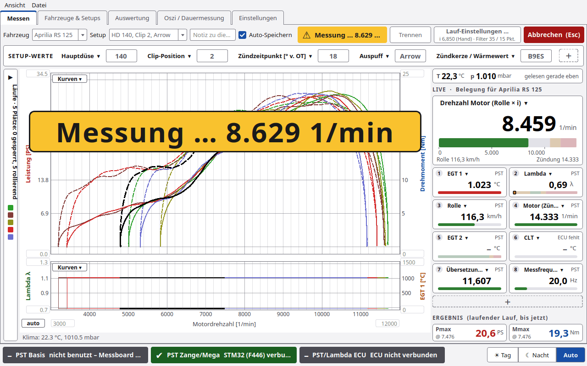
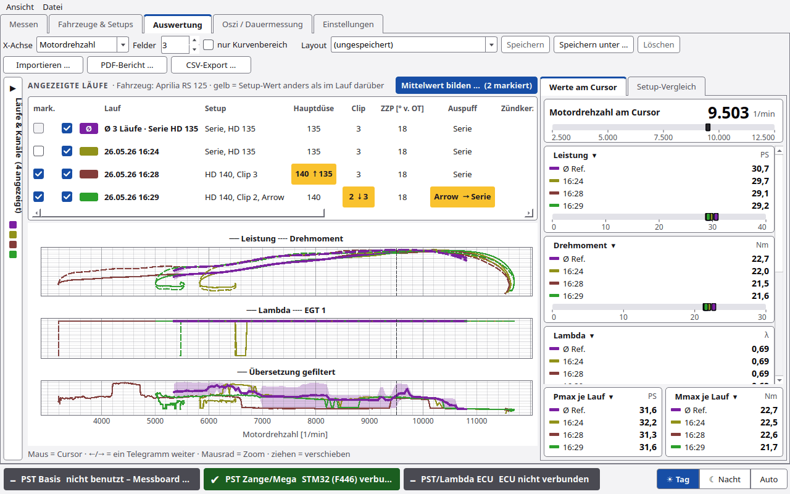
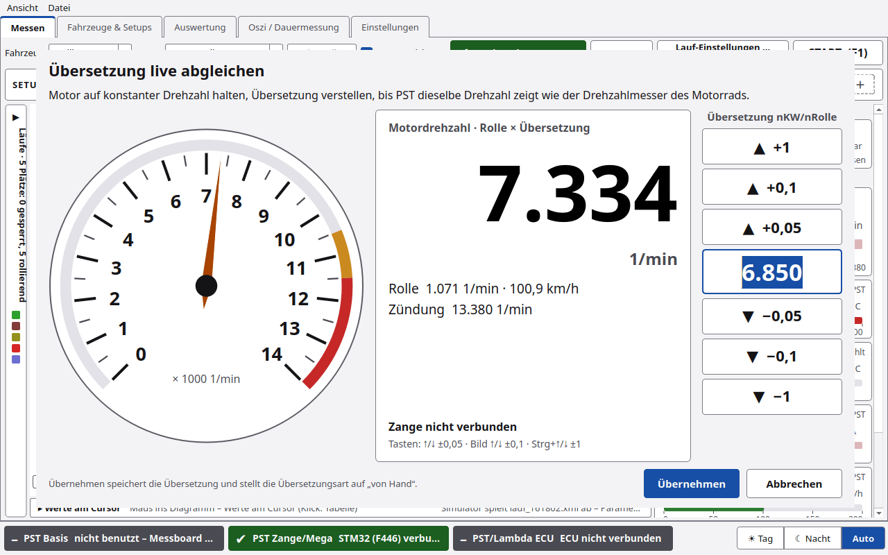
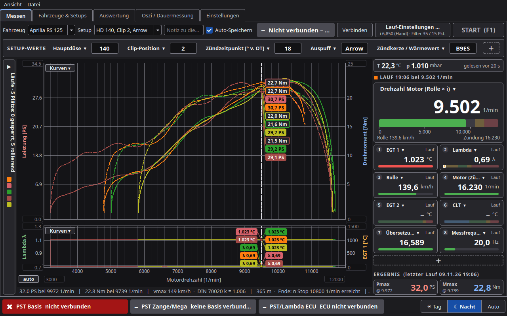
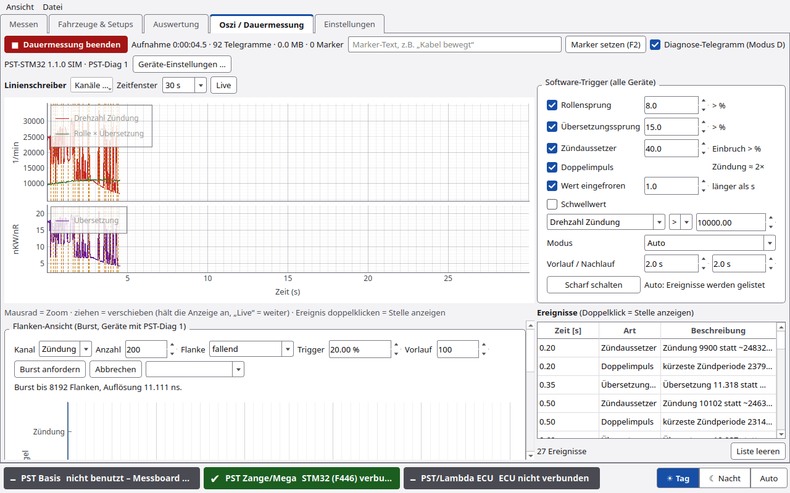

# PyST – Rollenprüfstand: PC-Software & STM32-Messelektronik

Open-Source-Leistungsprüfstand (Rollenprüfstand):

- **PyST 1.4.2** – PC-Software in Python/Qt für **Mac, Linux (Raspberry Pi) und Windows**.
  Rechnet wie LabVIEW 3.2.1 (an echten Läufen geprüft: gleiche Pmax und n(Pmax)), mit Datenbank für
  Fahrzeuge/Setups/Läufe, Auswerter im Stil von MegaLogViewer, PDF/CSV-Export, Import von LabVIEW-Läufen.
- **Neue Oberfläche (1.4.1):** Tag-, Nacht- und Auto-Thema mit geprüftem Kontrast, Statusleiste mit farbigen Feldern
  für Basis, Zange und ECU, Setup-Werte direkt im Messbildschirm, Läufe auf Plätzen mit Schloss, **Mittelwerte aus
  mehreren Läufen** als Referenz, Fenster **„Übersetzung live abgleichen“** mit Drehzahlmesser, Übersetzung auch per
  **Funkenmessung**. Passt auch auf ein MacBook mit 1280 Punkten Breite.
- **Neu in 1.4.2:** alte Läufe und Mittelwerte über **＋** ins Messdiagramm holen, Nachfrage vor START bei
  unverändertem Setup, große Anweisungen (GO, GAS WEG) und großes Ergebnis über dem Diagramm, Fähnchen am Cursor, bis
  12 Live-Felder, **Rollen-Kalibrierung** (einmal mit abgehobenem Rad, teilt den Ausrollversuch in Rolle und
  Reifen/Kette/Getriebe auf) und Unterreiter
  **Software & Firmware** mit der PyST-Version. Siehe [Release Notes 1.4.2](docs/RELEASE_NOTES_1.4.2.md).
- **PyST-Basis mit Funk-Zündzange:** Klima, Lambda, EGT, Funk-Zange mit frei belegbaren Tasten, WLAN, WLAN-Steckdosen
  (Gebläse/Absaugung automatisch), signierte Firmware-Updates direkt aus PyST.
- **PST-STM32-Firmware** – neue Firmware für die Messelektronik auf **STM32F446RE (Nucleo-64)**.
  Spricht das Protokoll des Arduino-Mega-Sketches → läuft mit **LabVIEW 3.2.1**, mit der
  **STM-LabVIEW 0.2.0** (automatisch erkannt) und mit **PyST**.
- **Oszi-/Diagnosemodus [PST-Diag 1](docs/04_PST_Diag_1.md)** (Mega 3.1.0, PST-STM32 1.1.0, PyST 1.3):
  Dauermessung, Linienschreiber, Ereignis-Trigger, Flanken-Ansicht und Geräte-Einstellungen – per Befehl
  umschaltbar, ohne Neu-Flashen; nach jedem Neustart wieder LabVIEW-kompatibel.
- **Läufe weitergeben**: als `.pyst`-Datei oder als einzelne HTML-Datei, die offline in jedem Browser läuft.
- **Arduino-Mega-Sketch 3.1.0** – der bisherige Mega-Aufbau läuft ebenfalls mit PyST; 3.1.0 misst jede
  Periode, meldet 0 Hz nach Signalausfall und hat den Oszi-/Diagnosemodus [PST-Diag 1](docs/04_PST_Diag_1.md).



| Auswertung mit Mittelwert und Setup-Vergleich | Übersetzung live abgleichen |
|---|---|
|  |  |
| **Nacht-Thema, Fähnchen am Cursor** | **Oszi / Dauermessung** |
|  |  |

**Alle Funktionen mit Bildern: [Wiki](https://github.com/chili023/PyST/wiki)** (Kopie im Repo: [docs/wiki](docs/wiki/Home.md)).

## Was läuft womit

| Messelektronik | LabVIEW 3.2.1 | STM-LabVIEW 0.2.0 | PyST |
|---|---|---|---|
| STM32 + PST-STM32-Firmware 1.0 | ✅ am Prüfstand | ✅ Protokoll geprüft¹ | ✅ am Prüfstand |
| STM32 + PST-STM32-Firmware 1.1 | ✅ Format byte-identisch⁴ | ✅ Format byte-identisch⁴ | ✅ + PST-Diag 1 (ab PyST 1.3) |
| Arduino Mega + Sketch 3.0.0 | ✅ (Original) | Arduino-Modus² | ✅ im Simulator geprüft³ |
| Arduino Mega + Sketch 3.1.0 | ✅ Format byte-identisch⁴ | Arduino-Modus² | ✅ + PST-Diag 1 (ab PyST 1.3) |
| PyST-Basis + Funk-Zange (Firmware 0.3.x) | – | – | ✅ ab PyST 1.4, am Prüfstand |
| PyST-Basis + Funk-Zange (Firmware 0.4.0, signierte Updates) | – | – | ✅ ab PyST 1.4.1, im Simulator geprüft⁵ |

¹ 8-Byte-Befehle und 20-Byte-Binärtelegramm per Host-Test gegen die aus LabVIEW rekonstruierte Auswertung.
² Umschalter „Arduino<>STM“ der STM-LabVIEW, nicht getestet.
³ `SIM:mega` bildet den Sketch nach (Umschalten mit `m`, ganze Hz, 61 Hz); am echten Mega noch zu bestätigen.
⁴ Normales Telegramm per Host-Test geprüft (F446: gegen 1.0.0; Mega: zusätzlich im AVR-Simulator gegen
  Arduino `Serial.print`); am echten Gerät mit LabVIEW noch zu bestätigen.
⁵ Update-Format 2 und Zangen-/ESP-Update per USB gegen den Simulator und mit Host-Tests geprüft; an der Hardware noch zu bestätigen.

## Download

Aktuelle Version: **PyST 1.4.2** im Branch `main`. Unter
[Releases](https://github.com/chili023/PyST/releases/tag/v1.4.2) gibt es das ZIP und die Release Notes, oder:

```bash
git clone https://github.com/chili023/PyST.git
```

Update einer vorhandenen Kopie: `git pull` im Ordner, dann wie gewohnt starten. Datenbank und Einstellungen bleiben erhalten.
Firmware der PyST-Basis, der Zange und des Basis-ESP sowie die Mega- und F446-Firmware holt PyST unter
**Einstellungen › Software & Firmware** aus dem Branch [`firmware`](https://github.com/chili023/PyST/tree/firmware).

## Schnellstart

→ Ausführlich: **[INSTALL.md](INSTALL.md)**

```bash
# PyST (Mac/Linux) – richtet sich beim ersten Start selbst ein
cd PyST
./start_mac.command          # Mac   (Linux: ./start_linux.sh, Windows: start_windows.bat)
./start_mac.command --sim    # ohne Hardware: Simulator spielt einen echten Lauf ab
```

STM32 flashen: `firmware/stm32/bin/PST-STM32_v1.1.0.bin` (bisher `PST-STM32_v1.0.0.bin`) auf das Laufwerk **NODE_F446RE** ziehen,
oder ab PyST 1.4.1 aus PyST heraus unter **Einstellungen › Software & Firmware** (auch den Arduino Mega per avrdude).

## Inhalt

```
PyST/            PC-Software (Python 3.9+, PySide6, pyqtgraph)
firmware/stm32/        Firmware STM32F446RE (PlatformIO), fertige .bin in firmware/stm32/bin/
firmware/arduino-mega/ Arduino-Mega-Sketch 3.1.0 (PlatformIO/Arduino IDE), 3.0.0 + Bibliotheken
docs/                  Roadmap, Zündsignal-Diagnose, Firmware-Messung, Protokoll v2, PST-Diag 1
```

## Dokumentation

- **[Wiki](https://github.com/chili023/PyST/wiki)** – alle Funktionen der Oberfläche mit Bildern (Kopie: [docs/wiki](docs/wiki/Home.md))
- [Release Notes 1.4.2](docs/RELEASE_NOTES_1.4.2.md) · [1.4.1](docs/RELEASE_NOTES_1.4.1.md)
- [INSTALL.md](INSTALL.md) – Installation Mac / Linux / Windows, Flashen STM32 und Mega
- [PyST/README.md](PyST/README.md) – Bedienung, Rechenweg, Kommandozeile
- [firmware/stm32/README.md](firmware/stm32/README.md) – Firmware, Protokoll, Anschlussbelegung, Einstellungen
- [PyST/TESTPLAN.md](PyST/TESTPLAN.md) – Vergleichstest alt/neu
- [docs/04_PST_Diag_1.md](docs/04_PST_Diag_1.md) – Oszi-/Diagnosemodus PST-Diag 1 (Befehle, Telegramme, Burst)
- [docs/ROADMAP.md](docs/ROADMAP.md) – Weiterentwicklung (Protokoll v2, rusEFI, Wirbelstrombremse)

## Wichtige Hinweise

- **Filter:** LabVIEW zählt Messpunkte (Mega ≈ 61 Hz, STM32 60 Hz, alte STM-Firmware 20 Hz) – MA/dq 35/15
  bei 20 Hz entsprechen bei 60 Hz 105/45. PyST stellt die Filter standardmäßig in **Sekunden** ein
  (1,75 s / 0,75 s = LabVIEW 35/15 bei 20 Hz) und rechnet sie für jede Messfrequenz um; der Modus
  „Messpunkte (wie LabVIEW)“ bleibt wählbar.
- **Laufbeginn:** Nach START liest PyST das Klima frisch („Klima wird gemessen …“), dann kommt **GO – Vollgas!**;
  die Messung beginnt, sobald die Drehzahl 1 s lang steigt.
- **„n vom Gas“** ist die Schwelle, ab der ein Laufende (fallende Drehzahl) erkannt wird – sie muss über
  der Haltedrehzahl liegen. Den Lauf startet sie nicht mehr.
- PyST steuert den Motor nicht. „n Stop“ beendet nur die Aufzeichnung und zeigt **GAS WEG**.

## Herkunft und Lizenz

PyST ist aus dem Open-Source-Projekt [WildBugChilGru](https://github.com/gruaGit/WildBugChilGru)
(Arduino Mega + LabVIEW) hervorgegangen; Rechenweg und Mega-Protokoll sind daraus übernommen.

GNU General Public License v3 – siehe [LICENSE](LICENSE).
