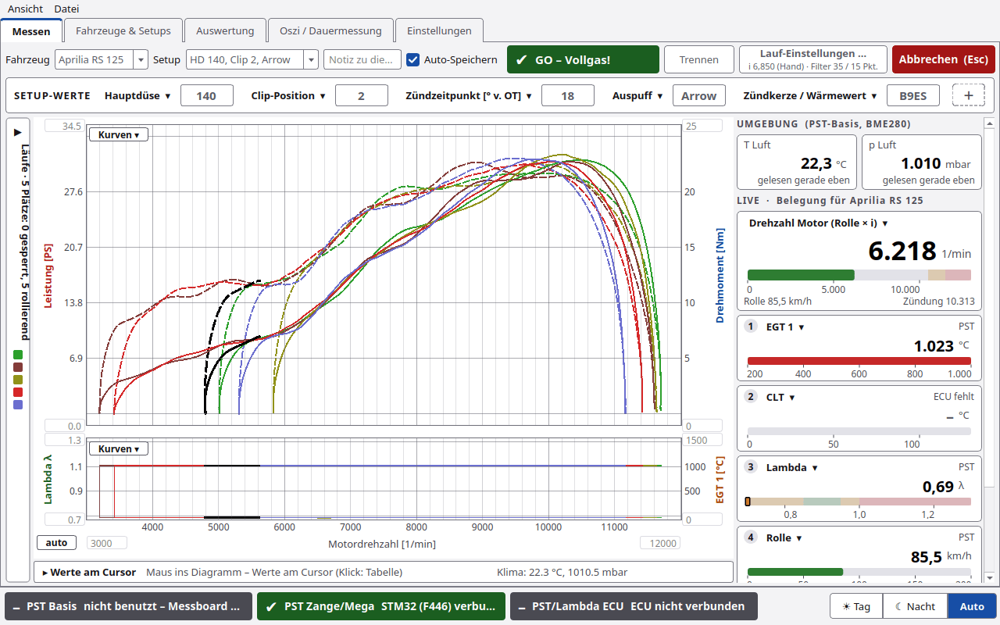

# PyST 1.4.1 – Release Notes

Neue Version des PC-Programms PyST (Mac, Linux/Raspberry Pi, Windows), Stand 09.11.2026.
Sie fasst alles seit **PyST 1.2** zusammen: die Beta 1.3 (Oszi/PST-Diag 1), 1.4 (PyST-Basis mit Funk-Zange) und die
neue Oberfläche von 1.4.1. Alle Funktionen mit Bildern stehen im **[Wiki](https://github.com/chili023/PyST/wiki)**.

## Neu in 1.4.1: die Oberfläche

**Aufbau und Darstellung**
- Fünf Hauptreiter: **Messen**, **Fahrzeuge & Setups**, **Auswertung**, **Oszi / Dauermessung**, **Einstellungen**.
  Die Einstellungen haben sieben Unterreiter: Rolle/Lauf, Verbindung, Zange, Lambda, ECU, Firmware, WiFi.
  ECU und Ausrollversuch („Verluste“) liegen jetzt dort.
- Themen **Tag**, **Nacht** und **Auto** (folgt dem System), umschaltbar unten rechts. Alle Farbpaare sind auf Kontrast
  geprüft, damit die Schrift auch auf iMac und Linux gut lesbar ist.
- **Statusleiste** mit drei farbigen Feldern für PST Basis, PST Zange/Mega und PST/Lambda ECU. Sie zeigen auf einen
  Blick, ob die Zange fehlt, die Basis nicht verbunden ist oder die Lambda-Heizung aus ist.
- Das Fenster passt ab 855 × 651 Punkten, also auch auf ein MacBook mit 1280 Punkten Breite. Bedienzeilen brechen bei
  Bedarf um.

**Messen**
- Kopfzeile mit drei Knöpfen **Trennen | Lauf-Einstellungen … | START**. Während eines Laufs wird START zu
  **Abbrechen (Esc)**.
- **Lauf-Einstellungen …** öffnet ein Fenster mit Übersetzungsart (von Hand oder Funkenmessung), Übersetzung, Filter
  und Laufgrenzen (n vom Gas, n Stop).
- **Setup-Werte** im Messbildschirm: 0 bis 8 Plätze, wählbar über „＋“, zum Beispiel Hauptdüse, Clip, Zündzeitpunkt
  oder Auspuff. Änderungen gelten für den nächsten Lauf. Auf Wunsch fragt PyST vor START nach, ob das Setup stimmt.
- **Live-Kacheln** rechts mit Skala und frei belegbaren Plätzen je Fahrzeug, dazu Umgebung (Temperatur, Luftdruck).
- **Laufliste als ausklappbare Seitenleiste** über dem Diagramm, mit Pin für große Bildschirme. Es gibt 5 Plätze für
  die letzten Läufe; einzelne Plätze lassen sich mit einem Schloss festhalten.
- **Referenz:** Ein Mittelwert aus der Auswertung lässt sich als Referenzkurve laden.

**Übersetzung**
- Neues Fenster **„Übersetzung live abgleichen“** (in den Lauf-Einstellungen). Es zeigt einen Drehzahlmesser, die
  Motordrehzahl als große Zahl sowie Rolle und Zündung. Mit ▲/▼ verstellt man um ±0,05, ±0,1 oder ±1, bis PST
  dieselbe Drehzahl zeigt wie der Drehzahlmesser des Motorrads.
- Feinabstimmung auch mit den **Tasten der Zange**, solange das Fenster offen ist: T1 −0,1, T2 +0,1, T3 −0,05,
  T4 +0,05. Danach gilt wieder das eigene Tasten-Setup. Eine neue Zangen-Firmware ist dafür nicht nötig.
- Neue Übersetzungsart **Funkenmessung**: Die Übersetzung wird am Ende des Laufs aus Zündung und Rolle bestimmt
  (getrimmter Mittelwert, nur oberhalb von 30 % der Rollendrehzahl, ohne Ausrollen).

**Auswertung**
- **Laufleiste** mit Setup-Spalten. Werte, die sich gegenüber dem Lauf darüber geändert haben, sind gelb markiert.
  Notiz und Setup lassen sich nachträglich ändern.
- **Mittelwert bilden …** aus markierten Läufen. Er wird gespeichert und kann in Messen als Referenz dienen.
- **Werte am Cursor** als Kacheln untereinander (Leistung, Drehmoment, Lambda …), dazu Pmax und Mmax je Lauf.

**Firmware (Einstellungen › Firmware)**
- **Kundenmodus:** vier Karten für Basis, Zange, Arduino Mega und STM32 (F446), Firmware aus dem Branch
  [`firmware`](https://github.com/chili023/PyST/tree/firmware).
- **Expertenmodus:** alle Bausteine einschließlich Basis-ESP, Lambda-Controller F042, eigener Dateien und Erstflash.
- Neu flashbar: **Arduino Mega** (avrdude) und **STM32 F446** (Laufwerk NODE_F446RE, st-flash oder dfu-util).
  Mega 3.1.0 und F446 1.1.0 liegen im Branch `firmware`.

**Oszi:** Die Flanken-Ansicht rollt jetzt innerhalb des Reiters, das Fenster wird dadurch nicht mehr höher.

## Aus 1.4: PyST-Basis und Funk-Zange

- **PyST-Basis** per USB oder WLAN (mit Anmeldung) verbinden. Klima (BME280), Lambda-Controller mit Heizung, EGT.
- **Funk-Zündzange:** Akku, Signal, Sync, Funken und Zündstärke. Koppeln, Marker setzen, Blitzmodus, frei belegbares
  **Tasten-Setup** (Marker, Aufnahme, Neuer Lauf, Übersetzung messen, Lambda), Zangen-Log auslesen.
- **WLAN-Steckdosen** (Shelly, Tasmota, ESPHome) mit Automatik, zum Beispiel Gebläse beim Laufstart. Das ist eine
  Komfortfunktion, keine Sicherheitsfunktion.
- **Prüfen:** „Alles prüfen“ bewertet das Gerät mit Sollwerten, ohne Terminal.
- **Firmware-Updates** für Basis-STM32, Basis-ESP, Zange und Lambda F042 (per CAN). Update-Format 2 ist signiert und
  verschlüsselt; PyST prüft die Signatur vorab, Downloads nur mit gültiger Signatur.
- **Ausrollversuch:** Aus dem Ausrollen mit gezogener Kupplung bestimmt PyST das Verlustmoment und weist neben der
  Radleistung die Motorleistung aus.
- **Stabiler und schneller:** Verbinden und Laden halten die Oberfläche nicht mehr an, kaputte Zeilen bringen den
  Lesethread nicht mehr zum Absturz, Einstellungen werden atomar gespeichert, und das Log überdauert Neustarts.

## Aus 1.3 (Beta): Oszi und Diagnose

- **Oszi / Dauermessung** mit Linienschreiber, Software-Trigger auf Störungen, Ereignisliste und Flanken-Ansicht.
  Geräte-Einstellungen laufen über **PST-Diag 1** (Mega ab 3.1.0, PST-STM32 ab 1.1.0).
- **Fehlerkanäle** (Fehler Rolle, Fehler Zündung, Doppelimpuls, Wert eingefroren), auch für alte Läufe.
- **Läufe weitergeben** als `.pyst` oder als HTML-Ansicht, die offline in jedem Browser läuft. Öffnen per Drag & Drop.
- **Import von Rohmitschnitten** (TeraTerm/Terminal) von Mega und F446.

## Update von 1.2

1. Ordner mit `git pull` aktualisieren oder das ZIP neu laden.
2. Wie gewohnt starten (`start_mac.command`, `start_linux.sh`, `start_windows.bat`). Beim ersten Start installiert
   das Skript die neue Abhängigkeit `cryptography` (Internet nötig). Klappt das nicht, den Ordner `PyST/.venv`
   löschen und neu starten.
3. Datenbank, Läufe und Einstellungen in `~/PyST` bleiben erhalten; die Datenbank bekommt beim ersten Start neue
   Spalten. Vor dem Update `~/PyST` zu sichern schadet nicht.
4. macOS meldet nach dem Laden als ZIP eventuell „Malware“ (Gatekeeper), siehe [INSTALL.md](../INSTALL.md).

## Noch nicht an der Hardware bestätigt

- Mega und F446 aus PyST flashen (nur gegen Attrappen getestet).
- Übersetzungsart **Funkenmessung** und die **Zangentasten** im Abgleichfenster (im Simulator geprüft).
- Updates im Format 2 und Firmware 0.4.0 von Basis, Zange und Basis-ESP.

Bitte Rückmeldungen über die [Issues](https://github.com/chili023/PyST/issues).

## Bekannte Einschränkungen

- Mittelwert-Läufe gehen noch nicht in `.pyst`-Dateien mit und stehen nicht in der PDF-Tabelle.
- „Als Hauptzange“ und „Tasten prüfen“ sind ausgegraut, weil die Zangen-Firmware dafür noch keinen Befehl hat.
- PyST steuert den Motor nicht. „n Stop“ zeigt nur **GAS WEG**.
- Die Zange **nie am laufenden Motor per USB anschließen**: Sie ist dann galvanisch mit dem PC verbunden.

## Tests

577 automatische Tests (1 übersprungen) unter Linux mit Python 3 und PySide6, dazu Oberflächen-Rauchtests im
Simulator, in Tag und Nacht und bei 1280 × 800.

Der Stand 1.2 liegt unter dem Tag `v1.2`.
