# PyST 1.4.2 – Release Notes

Neue Version des PC-Programms PyST (Mac, Linux/Raspberry Pi, Windows), Stand 09.11.2026.
Sie setzt die Rückmeldungen aus dem ersten Test der neuen Oberfläche von 1.4.1 um. Alle Funktionen mit Bildern stehen
im **[Wiki](https://github.com/chili023/PyST/wiki)**.

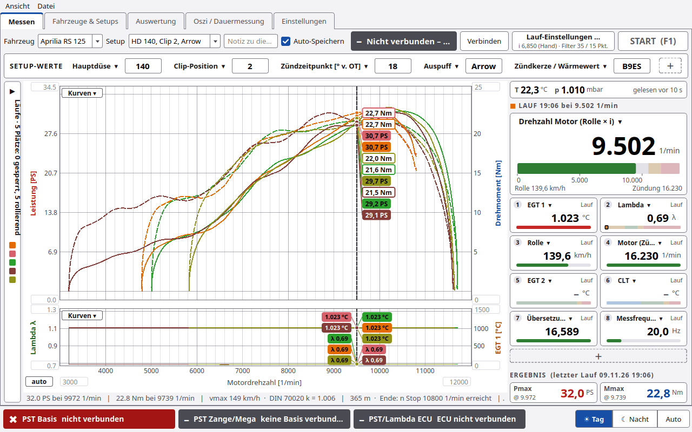

## Neu in 1.4.2

**1. Läufe hinzufügen mit „＋“ (Messen › Seitenleiste Läufe)**
- Der Knopf **＋** oben in der Seitenleiste öffnet das Fenster **Läufe hinzufügen**. Darin stehen alle gespeicherten
  Läufe und Mittelwerte (Ø, fett), wählbar nach Fahrzeug (Standard: das aktuelle, auch „alle Fahrzeuge“), Art (alle /
  nur Messungen / nur Mittelwerte) und mit Suche.
- Die gewählten Läufe liegen danach **gesperrt** (Schloss) auf freien Plätzen im Diagramm. Sind nicht genug Plätze
  frei, sagt PyST das, statt etwas zu verdrängen.
- Der Knopf **Referenz laden …** ist weg. Mittelwerte kommen jetzt ebenfalls über „＋“ ins Diagramm.

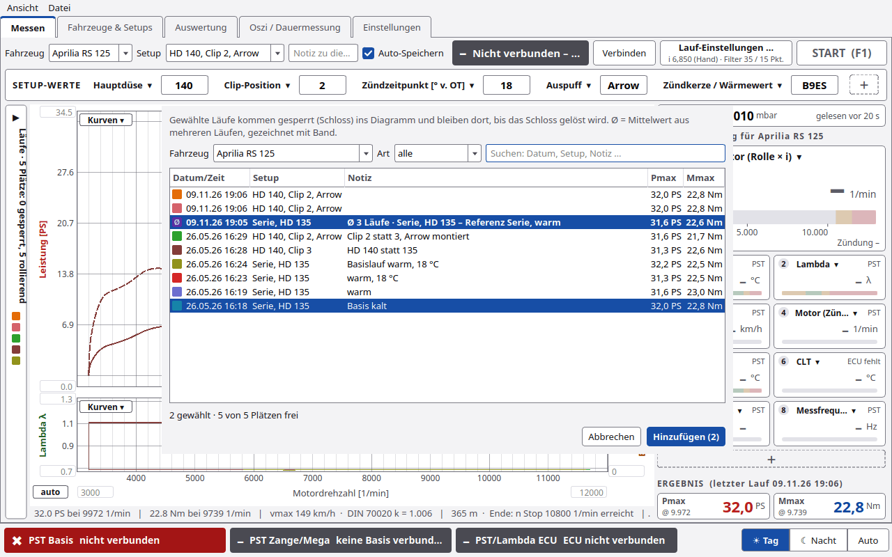

**2. Nachfrage vor START bei unverändertem Setup**
- Ist in SETUP-WERTE nichts geändert, fragt START kurz **„Setup unverändert – Änderungen eintragen?“**. Das Fenster
  zeigt die SETUP-WERTE als Felder.
- Knöpfe: **Abbrechen** · **Übernehmen und starten** (erst nach einer Änderung, die Werte gelten für diesen Lauf) ·
  **Unverändert starten** (Standard, Enter oder F1).
- Sind die SETUP-WERTE schon geändert, startet der Lauf ohne Frage; die Werte gelten für diesen Lauf.
- Der frühere Dialog „Setup geändert“ (Neues Setup speichern / Nur für diesen Lauf) entfällt. Ein neues Setup legt man
  wie bisher mit **Als neues Setup speichern …** in der Zeile SETUP-WERTE an.
- Der Schalter heißt jetzt **Vor START nachfragen, ob sich das Setup geändert hat** (Einstellungen › Rolle/Lauf,
  Standard an). Die Zangentaste **Neuer Lauf** startet immer ohne Nachfrage.

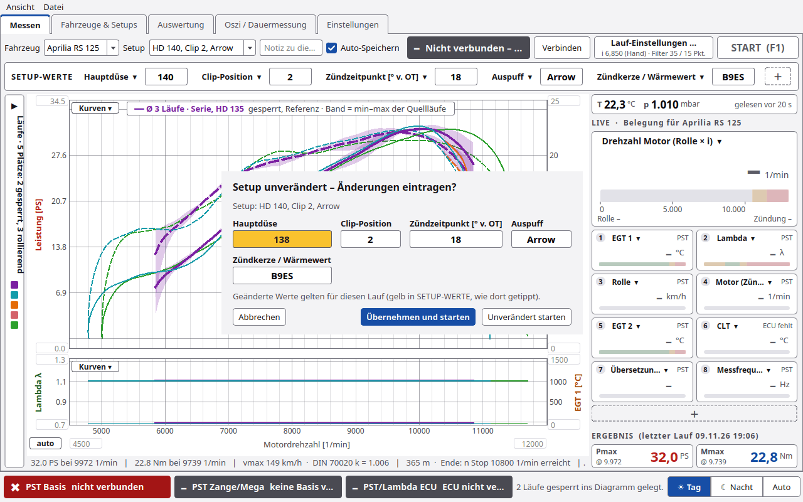

**3. Groß über dem Diagramm**
- **Anweisungen groß** (Standard an): groß und farbig über dem Diagramm, mit dem Grund darunter, immer in derselben
  Schriftgröße (lange Texte brechen um):
  - **GO – Vollgas!** (grün) bis die Messung beginnt (*n vom Gas*), dann ist sie weg.
  - **Während der Messung steht nichts Großes über der Kurve.** Nur das Statusfeld oben zeigt „Messung …“.
  - Am Laufende ohne Ausrollversuch **GAS WEG!** (rot, mindestens 2 s), danach gleich das große Ergebnis.
  - Mit Ausrollversuch **GAS WEG – KUPPLUNG ZIEHEN!** (rot), bis das Ausrollen fertig ist, dann das große Ergebnis.
  - Aus: nur das große „GAS WEG“ wie bisher.
- **Ergebnis groß** (Standard an): nach dem Lauf Pmax und Mmax groß in der Mitte, mit Farbe, Uhrzeit und Setup des
  Laufs. Weg mit START, Klick oder Esc.
- **Legende im Diagramm** (Standard aus): Farbe, Datum/Zeit und Setup bzw. Notiz aller Läufe. Mittelwerte stehen
  immer in der Legende.
- Alle drei unter Einstellungen › Rolle/Lauf › **Anzeige beim Messen** und im Menü **Ansicht**.

| Laufende: GAS WEG | danach das Ergebnis |
|---|---|
| 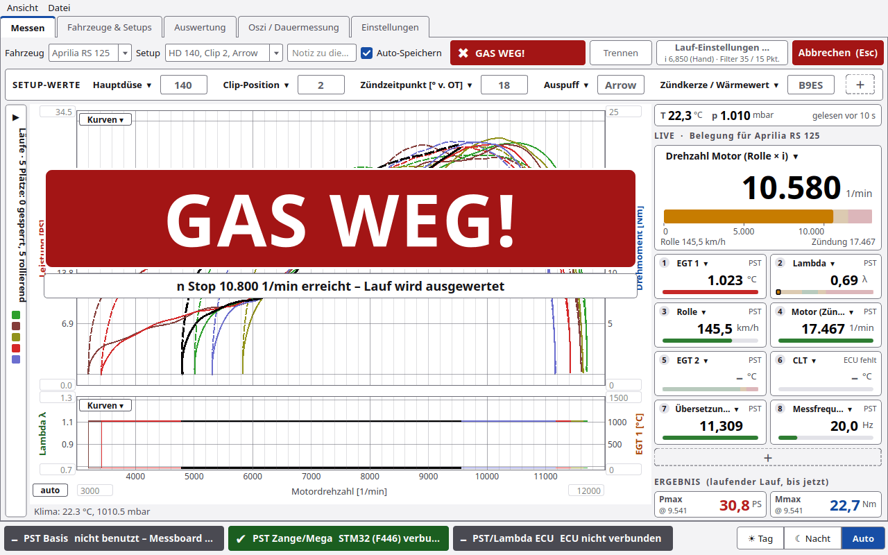 | 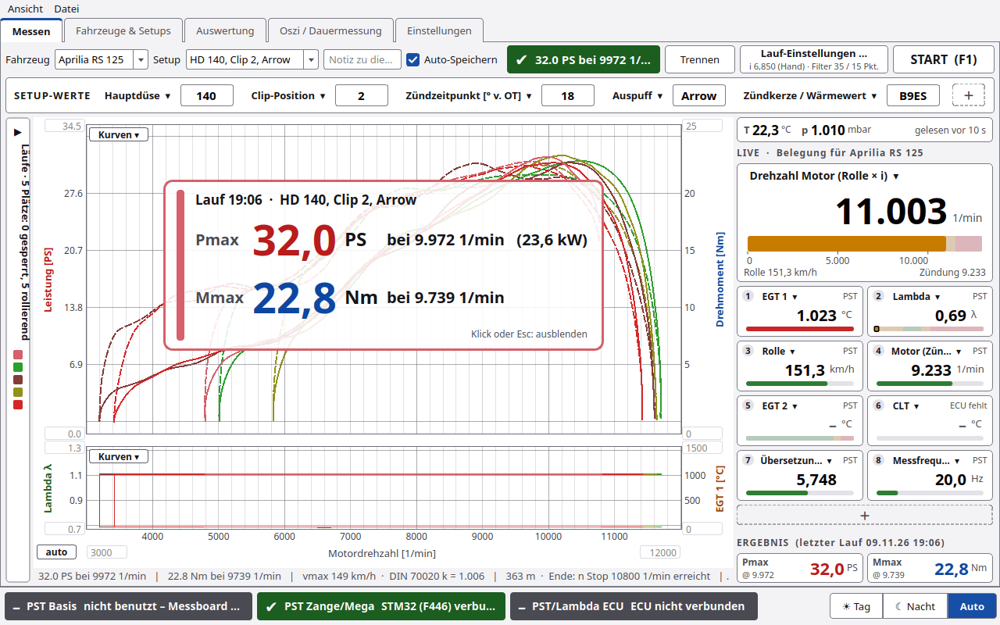 |

**4. Fähnchen am Cursor statt Cursorzeile**
- Die Zeile „Werte am Cursor“ unter dem Diagramm ist weg. Statt dessen zeigt jede Kurve an der Cursor-Drehzahl ein
  Fähnchen mit ihrem Wert in der Farbe des Laufs (gefüllt Leistung, umrandet Drehmoment).
- Die Live-Kacheln rechts zeigen dabei die Werte des letzten Laufs an der Cursor-Drehzahl, oben steht
  „LAUF hh:mm bei n 1/min“. Maus aus dem Diagramm: wieder live.

**5. Rechte Spalte**
- Bis zu **12 Live-Felder** (vorher 5). Ab 5 Feldern stehen sie zweispaltig und kompakt; bei 1280 × 800 passen
  8 Felder ohne Rollen.
- **UMGEBUNG** steht in einer Zeile, **ERGEBNIS** kompakt nebeneinander.

**6. Rollen-Kalibrierung und Aufteilung der Verluste (Einstellungen › Rolle/Lauf, Gruppe „Verluste – Ausrollversuch“)**
- **Einmal** messen, wie schnell die Rolle **von allein** ausrollt: Knopf **Rollen-Kalibrierung (Assistent) …**. Ein
  Fenster führt in fünf Schritten durch den Versuch ohne Leistungslauf: Vorbereitung, Beschleunigen (Rolle auf die
  Zieldrehzahl), Rad von der Rolle, Messung, Ergebnis. Wiederholen nur nach einem Umbau an der Rolle.
- Das Ergebnis (Verluste der Rolle allein: Lager, Luft) wird mit **Als Rollen-Kalibrierung speichern** für den
  Prüfstand abgelegt, nicht je Fahrzeug, mit Datum, R² und Ordner der Rohdaten. Es geht **nicht** in M0/M1.
  Die Gruppe zeigt „Rollen-Kalibrierung: vom …, Verlust bei … 1/min = … Nm / … PS“ bzw. „noch nicht kalibriert“.
- Der **Ausrollversuch nach dem Lauf** (Kupplung ziehen) misst wie bisher die Verluste **gesamt** (Rolle, Reifen,
  Kette, Getriebeausgang); **Übernehmen** trägt sie wie bisher in M0/M1/m2 ein (Motor = Rad + Verluste). Mit
  Rollen-Kalibrierung teilt PyST sie auf: **gesamt = Rolle + Reifen/Kette/Getriebe**, als Tabelle in Nm und PS (bei
  Pmax, bei n1, oben) und als drei Kurven. Fällt der Anteil Reifen/Kette/Getriebe rechnerisch unter 0, steht ein
  Hinweis dabei.
- Im Ergebnis eines Laufs steht mit Kalibrierung zusätzlich **Reifen an Rolle** (Rad + Verlust der Rolle) und der
  **Antriebsverlust** (Motor − Reifen an Rolle): Ergebniszeile, `lauf.json`, PDF-Bericht, Kanäle in der Auswertung.
  Die Kurven Rad und Motor bleiben wie bisher.
- Zum Ausprobieren: Simulator-Port `SIM:rolle` für die Kalibrierung, `SIM:ausrollen` für den Lauf mit Kupplung (beide
  mit derselben Rolle).

| Kalibrierung, Schritt 5: Ergebnis | Ausrollversuch nach dem Lauf: Aufteilung |
|---|---|
| 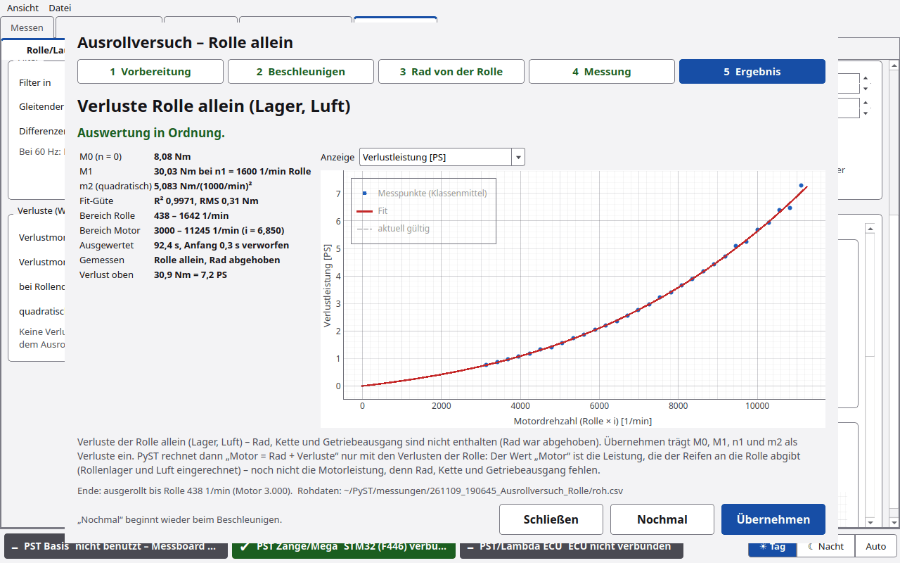 | 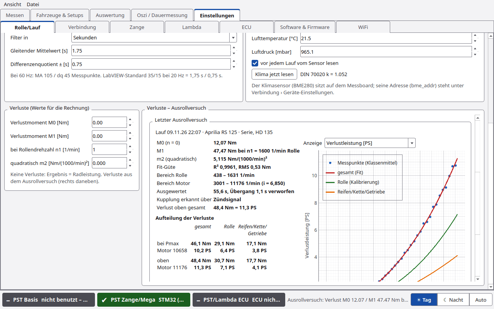 |

**7. Software & Firmware (früher Einstellungen › Firmware)**
- Neue Kachel **PyST (Software)** ganz oben: installierte und verfügbare PyST-Version, Datenordner und Knopf zur
  Release-Seite. PyST installiert sich weiterhin nicht selbst.
- Geräte, die nicht angeschlossen sind, stehen ausgegraut mit gestricheltem Rand; ihr Knopf ist aus und sagt im
  Tooltip, was zu tun ist.
- Die Tabelle im Expertenmodus ist schmaler: ein Knopf **Erstflash …**, der Weg steht im Tooltip.
- Neu im Expertenmodus: **Update-Quelle (Branch)**. Software (Standard `main`) und Firmware (Standard `firmware`) lassen
  sich auf einen anderen Branch stellen, z.B. `release/1.4.2` zum Testen einer Vorabversion. **Branches laden** holt
  die Liste von GitHub, **Standard** stellt zurück. Firmware aus einem anderen Branch wird genauso geprüft wie sonst.

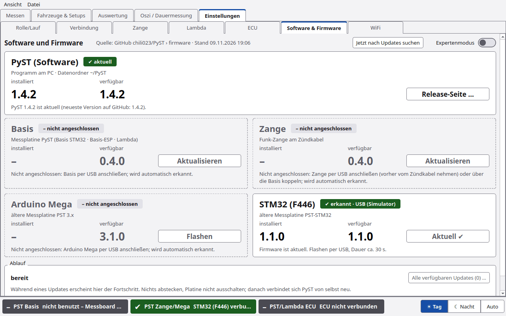

**8. Ø automatisch mitteln (Messen › Lauf-Einstellungen …)**
- Neuer Haken **Ø automatisch mitteln** im Fenster **Lauf-Einstellungen …** (Knopf oben rechts), Abschnitt
  **DIAGRAMM** (auch im Menü **Ansicht**, Standard aus). Er wirkt sofort. Ist er an, mittelt PyST
  die Läufe im Diagramm, die dasselbe Setup haben wie der neueste (mindestens 2, Mittelwerte zählen nicht), und
  zeichnet den Mittelwert dick mit Band min–max, z. B. „Ø 3 Läufe · Serie HD 135 (automatisch)“.
- Er belegt keinen der 5 Plätze, wird nach jedem Lauf, beim Sperren, Ein-/Ausblenden und Löschen von Läufen und beim
  Setup-Wechsel neu gerechnet und nicht von selbst gespeichert. Fähnchen am Cursor und ERGEBNIS (Zeile anklicken)
  zeigen ihn wie andere Kurven.
- Er steht oben in der Seitenleiste Läufe unter **Ø AUTOMATISCH**. **speichern** an seiner Zeile legt einen echten
  Mittelwert-Lauf an (wie Auswertung › Mittelwert bilden), der dann über „＋“ wählbar ist.
- Der wirkungslose Haken „im Messfenster als Referenz anbieten“ im Fenster **Mittelwert bilden** ist weg: jeder
  gespeicherte Mittelwert steht im Fenster „Läufe hinzufügen“.

| Lauf-Einstellungen mit „Ø automatisch mitteln“ | Ø automatisch im Diagramm |
|---|---|
| 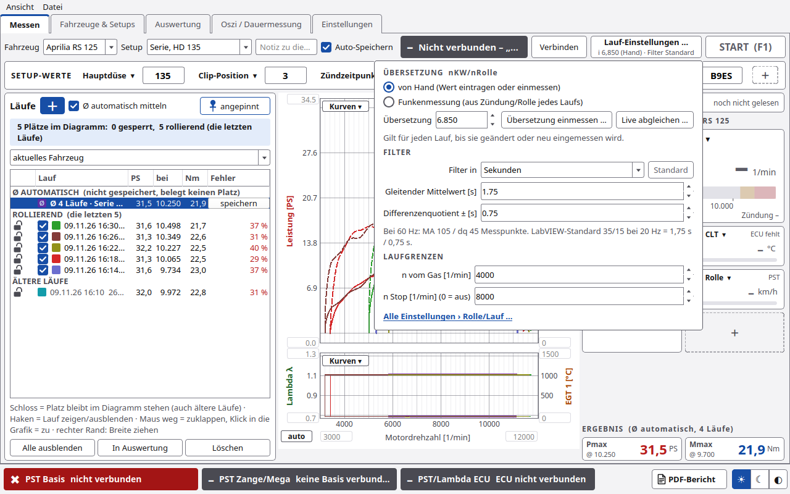 | 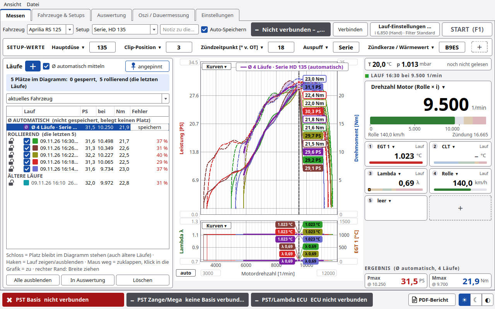 |

**9. Seitenleiste Läufe: Breite ziehen**
- Die Breite der Seitenleiste **Läufe** lässt sich jetzt auch aufgeklappt (nicht angepinnt) ändern: am rechten Rand
  ziehen (Mauszeiger ↔, kleiner Steg in der Mitte). Beim Ziehen klappt die Liste nicht zu.
- Angepinnt zieht man wie bisher am Teiler. Es gibt eine Breite für beide Zustände (240 bis 900 px), PyST merkt sie
  sich (`"laeufe_leiste"` in `einstellungen.json`). Dasselbe gilt für die Seitenleiste „Läufe & Kanäle“ der Auswertung.

**10. Analogeingänge (neuer Unterreiter Einstellungen › Analogeingänge)**
- Oben das **Gerät**: PyST-Basis (AI1/AI2 an X6, 0–10 V, per Lötbrücke 0–5 V oder 4–20 mA), STM32 F446 (ADC1 = PB0,
  ADC2 = PA1, 0–3,3 V) oder Arduino Mega (A0 … A15, 0–5 V). Vorgewählt ist das verbundene Gerät; die anderen bleiben
  bearbeitbar, ihre Live-Werte grau.
- Je Eingang eine Zeile: **Aktiv**, **Name** (z. B. „Öldruck“), **Einheit** (z. B. bar), **Umrechnung**, **Spannung**
  und **Wert** live. Darunter die Umrechnung des markierten Eingangs: **keine (V)**, **2-Punkt** (0,5 V = 0 bar,
  4,5 V = 10 bar, linear) oder **Faktor/Offset** (W = a · U + b), **Balken von / bis**, **Nachkommastellen** und
  **Vorlage ▾** (Drucksensor 0,5–4,5 V, 0–5 V linear, 4–20 mA, Spannungsteiler). U1 = U2 meldet PyST, statt zu rechnen.
  Beim F446 steht in der Spalte Hinweis, welcher Eingang AFR-Eingang sein kann (`afr_src`).
- Gespeichert in `einstellungen.json` (`"analog"`, je Gerät), wirkt sofort.
- Aktive Kanäle stehen in den **Live-Kacheln** (▾ und „＋“, Gruppe **Analog**, mit Name und Einheit), im **unteren
  Diagramm** (Kurven ▾), in der **Auswertung** und im **CSV-Export** („Öldruck (Analog)“, dazu „AI1 Rohwert (Analog)“).
- Läufe: `roh.csv` behält die Rohwerte (`analog_AI1` …, V bzw. mA), `lauf.json` die Umrechnung, die beim Lauf galt
  (`"analog"`). Alte Läufe zeigen ihre damalige Umrechnung; mit dem Haken **Gespeicherte Läufe mit der aktuellen
  Umrechnung zeigen** rechnet PyST sie neu. Läufe ohne Analogwerte laden wie bisher.
- Die Basis meldet AI1/AI2 heute in `#STAT`; PyST fragt etwa jede Sekunde. Für Mega und F446 (und schnellere Werte der
  Basis) schlägt PyST eine Erweiterung von PST-Diag 1 vor: `#CAP;…;ai=<Eingänge>` und `#AI <hz>` für Zeilen
  `A;<t_ms>;AI1=1.234;…`. Der Simulator kann das (`SIM:mega`, `SIM`), die Firmwares noch nicht.

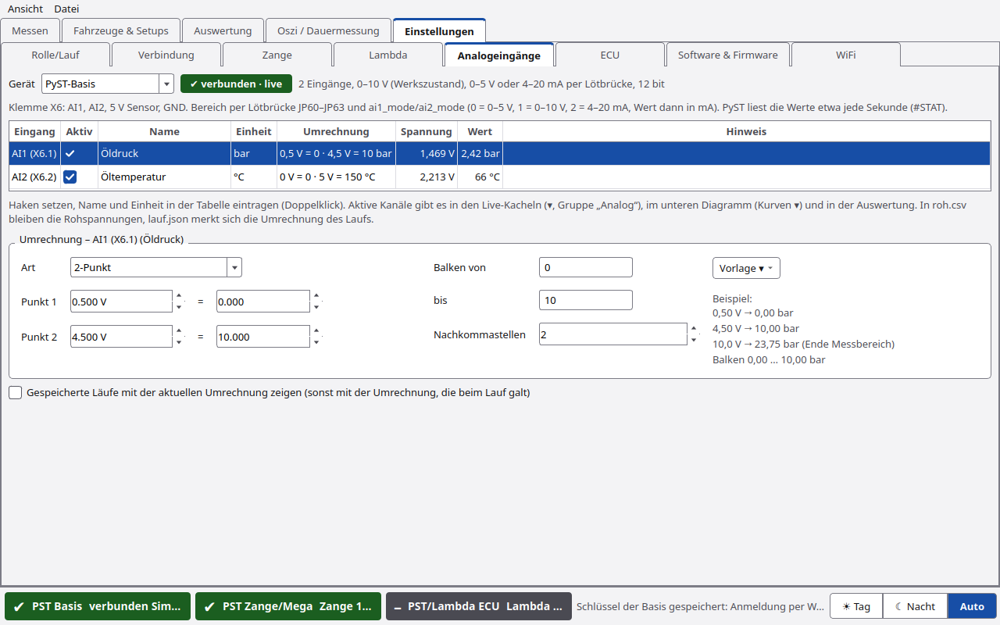

## Hinweise und Annahmen

- **Rollen-Kalibrierung:** Mit abgehobenem Rad misst der Assistent nur die Verluste der Rolle. Sie gelten für den
  Prüfstand (Einstellungen, `"rollen_kalibrierung"` in `einstellungen.json`) und werden bei jedem Lauf in `lauf.json`
  mitgeschrieben (`rk_m0` … `rk_m2`). Ältere Läufe ohne diese Felder laden wie bisher, ohne Aufteilung. Die
  Aufteilung des Ausrollversuchs nutzt immer die **aktuelle** Kalibrierung; die Trägheit von Rad und Getriebe bleibt
  wie bisher unberücksichtigt.
- **Ø automatisch mitteln:** „Dasselbe Setup“ heißt gleiches Fahrzeug, gleiches Setup und gleiche Setup-Werte; ein
  Lauf mit Werten „nur für diesen Lauf“ zählt als anderes Setup. Ein Lauf ohne Auto-Speichern zählt erst nach dem
  Speichern. Gemittelt wird wie in Auswertung › Mittelwert bilden (Raster 50 1/min, oben 300 1/min weg).
- **Analogeingänge:** Mega 3.1.0 und F446 1.1.0 senden noch keine Analogwerte; die Seite und die Umrechnung gehen
  trotzdem, die Werte kommen erst mit einer Firmware, die `#AI` kann. Die Basis liefert sie heute nur etwa einmal je
  Sekunde (`#STAT`), im Lauf gilt der letzte Wert bis zum nächsten. Den Bereich der Basis (0–5 V, 0–10 V, 4–20 mA)
  legen Lötbrücke und `ai1_mode`/`ai2_mode` fest, PyST rechnet mit dem Wert, den die Basis meldet.
- Die neuen Funktionen sind im Simulator und mit automatischen Tests geprüft, **an der Hardware noch nicht**.

## Update von 1.4.1

1. Ordner mit `git pull` aktualisieren oder das ZIP neu laden.
2. Wie gewohnt starten (`start_mac.command`, `start_linux.sh`, `start_windows.bat`). Neue Abhängigkeiten gibt es nicht.
3. Datenbank, Läufe und Einstellungen in `~/PyST` bleiben erhalten. Die neuen Schalter starten mit ihrem Standard
   (Ergebnis groß an, Anweisungen groß an, Legende aus, Nachfrage vor START an, Ø automatisch mitteln aus).
4. Von 1.2 oder älter: zuerst die Hinweise in den [Release Notes 1.4.1](RELEASE_NOTES_1.4.1.md#update-von-12).

## Noch nicht an der Hardware bestätigt

- Rollen-Kalibrierung mit abgehobenem Rad und die Aufteilung der Verluste.
- Analogeingänge der Basis (`#STAT`) mit echtem Sensor.
- Aus 1.4.1: Mega und F446 aus PyST flashen, Übersetzungsart **Funkenmessung**, Zangentasten im Abgleichfenster,
  Updates im Format 2 und Firmware 0.4.0 von Basis, Zange und Basis-ESP.

Bitte Rückmeldungen über die [Issues](https://github.com/chili023/PyST/issues).

## Bekannte Einschränkungen

- Mittelwert-Läufe gehen noch nicht in `.pyst`-Dateien mit und stehen nicht in der PDF-Tabelle.
- Die Dauermessung (Oszi) zeichnet die Analogeingänge noch nicht auf.
- „Als Hauptzange“ und „Tasten prüfen“ sind ausgegraut, weil die Zangen-Firmware dafür noch keinen Befehl hat.
- PyST steuert den Motor nicht. „n Stop“ und die große Anweisung zeigen nur **GAS WEG**.
- Die Zange **nie am laufenden Motor per USB anschließen**: Sie ist dann galvanisch mit dem PC verbunden.

## Tests

Automatische Tests unter Linux mit Python 3 und PySide6, dazu Oberflächen-Rauchtests im Simulator, in Tag und Nacht
und bei 1280 × 800. Stand der Freigabe: 633 Tests bestanden, 1 übersprungen.

Der Stand 1.4.1 liegt unter dem Tag `v1.4.1`.
