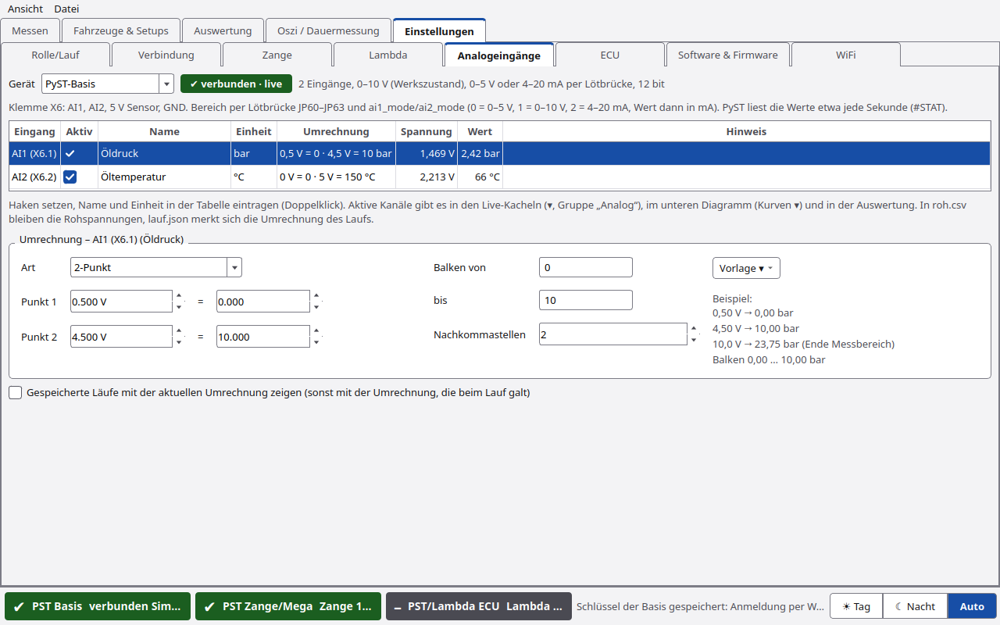
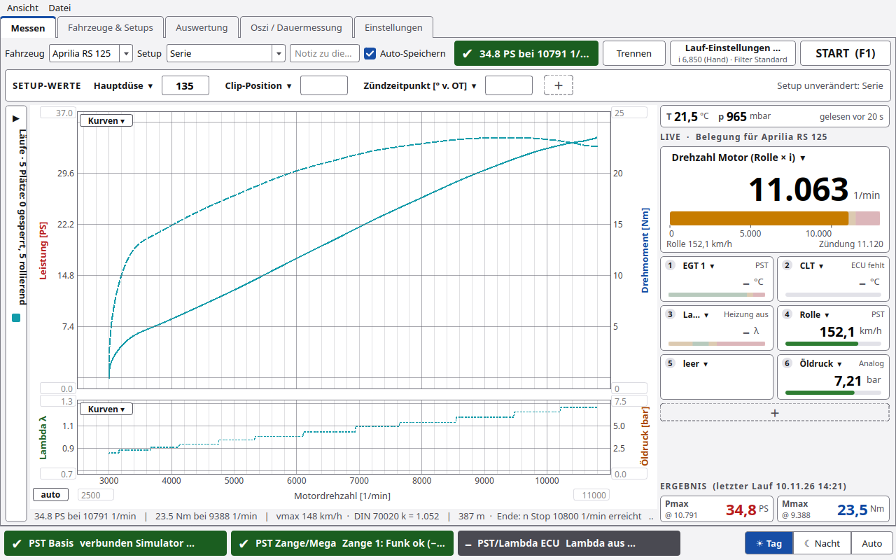

# Analogeingänge

Unter **Einstellungen › Analogeingänge** bekommen die Analogeingänge der Messelektronik einen Namen, eine Einheit und
bei Bedarf eine Umrechnung, zum Beispiel ein Drucksensor von Volt in bar. Aktive Kanäle stehen danach in den
Live-Kacheln, im unteren Diagramm, in der Auswertung und im CSV-Export.

## Eingänge je Gerät

| Gerät | Eingänge | Bereich | Werte heute |
|---|---|---|---|
| **PyST-Basis** | AI1 (X6.1), AI2 (X6.2); X6.3 = 5 V Sensor, X6.4 = GND | Werkszustand 0–10 V (Lötbrücken JP60–JP63 offen, `ai1_mode`/`ai2_mode` = 1). JP60/JP62 zu: 0–5 V (mode 0). Zusätzlich JP61/JP63: 4–20 mA (mode 2, Wert in mA). 12 bit | PyST fragt die Basis etwa einmal je Sekunde (`#STAT`) |
| **STM32 F446** (PST-STM32) | ADC1 = PB0, ADC2 = PA1 | 0–3,3 V ohne Teiler, nicht höher. 12 bit | ab Firmware 1.2.0 zehnmal je Sekunde (`#AI`), 1.1.0 sendet sie nicht |
| **Arduino Mega** (PST 3.x) | A0 … A15 | 0–5 V, 10 bit (Referenz = Versorgung, nominell 5 V) | ab Sketch 3.2.0 zehnmal je Sekunde (`#AI`), 3.1.0 liest sie nicht |

Beim F446 kann ADC1 oder ADC2 der **AFR-Eingang** sein (Einstellungen › Lambda › AFR-Eingang, `afr_src` = 1 bzw. 2). Dann
misst die Firmware dort das AFR. Die Tabelle zeigt das in der Spalte **Hinweis**. Einen eigenen Kanal braucht dieser
Eingang dann nicht; ab 1.2.0 kommt seine Spannung trotzdem mit. Die Lambdasonde der Basis (LSU 4.9 über CAN) und die Thermoelemente sind keine Analogeingänge.

Den Bereich der Basis (0–5 V, 0–10 V, 4–20 mA) legen Lötbrücke und `ai1_mode`/`ai2_mode` fest
(Verbindung › Geräte-Einstellungen der Basis). Beides muss zusammenpassen, denn die Firmware kann die Lötbrücken
nicht lesen.

## Bedienung

| Element | Funktion |
|---|---|
| **Gerät** | PyST-Basis, STM32 F446 oder Arduino Mega. Beim Verbinden wählt PyST das verbundene Gerät. Die anderen bleiben bearbeitbar, ihre Live-Werte bleiben grau („–“) |
| Zustand | „✔ verbunden · live“, „verbunden · keine Analogwerte (Firmware)“ oder „nicht verbunden“ |
| **Aktiv** | Haken: der Kanal steht in Kacheln, Diagramm und Auswertung |
| **Name**, **Einheit** | frei, z. B. „Öldruck“, „bar“ (Doppelklick in die Zelle) |
| **Umrechnung** | Kurzform der Umrechnung, ⚠ wenn sie nicht geht |
| **Spannung**, **Wert** | live, wenn das Gerät verbunden ist und Werte liefert |
| **Hinweis** | fest belegte Eingänge, z. B. AFR-Eingang beim F446 |

Unter der Tabelle steht die **Umrechnung** des markierten Eingangs:

| Art | Rechnung | Beispiel |
|---|---|---|
| **keine (V)** | Wert = Spannung | Spannung direkt anzeigen |
| **2-Punkt** | linear durch zwei Punkte U1 → W1 und U2 → W2 | Drucksensor 0,5 V = 0 bar, 4,5 V = 10 bar |
| **Faktor/Offset** | W = a · U + b | Spannungsteiler 1:3: a = 3, b = 0 |

Bei 2-Punkt mit **U1 = U2** gibt es keine Umrechnung. PyST zeigt dann „U1 und U2 sind gleich“ und keinen Wert.
**Balken von / bis** legen die Grenzen für Kachel und Achse fest. Leer heißt automatisch: bei 2-Punkt W1 … W2, sonst
der umgerechnete Messbereich. Dazu kommen die **Nachkommastellen**. Rechts steht ein **Beispiel** der Umrechnung.

**Vorlage ▾** füllt Umrechnung, Einheit und Balken aus. Name und Haken bleiben:

- Drucksensor 0,5–4,5 V = 0–10 bar bzw. 0–5 bar
- 0–5 V bzw. 0–10 V linear = 0–100 %
- 4–20 mA = 0–10 bar (Basis im Modus 4–20 mA)
- Spannungsteiler 1:3 (Faktor 3)
- Spannung direkt (V)

Jede Änderung speichert PyST sofort in `~/PyST/einstellungen.json` (Eintrag `"analog"`, je Gerät). Sie wirkt sofort.

## Wo die Kanäle erscheinen

- **Messen, Live-Kacheln:** im Menü ▾ einer Kachel und unter „＋“ in der Gruppe **Analog**, mit Name und Einheit. Mit der
  Maus im Diagramm zeigt die Kachel den Wert des letzten Laufs an der Cursor-Drehzahl.
- **Messen, unteres Diagramm:** **Kurven ▾** unten, z. B. „Öldruck (Analog)“ links oder rechts.
- **Auswertung:** Kanäle „Öldruck (Analog)“ (umgerechnet) und „AI1 Rohwert (Analog)“ (Spannung). Sie stehen im CSV-Export.

## Läufe

- `roh.csv` enthält die **Rohwerte** je Eingang in den Spalten `analog_AI1`, `analog_AI2` … (V bzw. mA).
- `lauf.json` merkt sich unter `"analog"` das Gerät, die Einheit der Rohwerte und die **Umrechnung, die beim Lauf
  galt** (alle Eingänge, auch die inaktiven).
- Gespeicherte Läufe zeigen ihre damalige Umrechnung. Mit dem Haken **Gespeicherte Läufe mit der aktuellen Umrechnung
  zeigen** rechnet PyST alte Läufe mit der aktuellen Einstellung neu, z. B. nach einem falsch eingetragenen Sensor.
- Läufe ohne Analogwerte und Läufe aus älteren Versionen laden wie bisher.

## Wie die Werte zu PyST kommen

- **PyST-Basis:** Die Basis misst AI1/AI2 mit 20 Hz und meldet sie in `#STAT` (`ai1=1.234V;ai2=…`). PyST fragt etwa
  einmal je Sekunde, solange die Seite offen ist oder Kanäle der Basis aktiv sind. Im Lauf gilt der letzte Wert für
  alle Telegramme bis zum nächsten, also Stufen im Sekundentakt.
- **Mega ab 3.2.0, F446 ab 1.2.0 (PST-Diag 1 §11):** `#CAP;…;ai=A0,…,A15` bzw. `ai=ADC1,ADC2` nennt die Eingänge,
  `#AI <hz>` schaltet Zeilen `A;<t_ms>;A0=1.234;A1=0.501;…` ein (Spannung an der Klemme in V, `nan` = noch kein
  Wert), `#AI 0` aus. Nach dem Start ist das aus, LabVIEW merkt nichts. PyST schickt `#AI 10`, wenn `#CAP` die
  Eingänge nennt, und `#AI 0` beim Trennen (der F446 startet beim Öffnen des Ports nicht neu). Erkannt wird das an
  `ai=` in `#CAP`, nicht an der Versionsnummer. Im Lauf gilt jeder Wert für die folgenden Telegramme, höchstens 3 s.
- **Simulator:** `SIM:mega` (A0 … A15) und `SIM` (F446, ADC1/ADC2) liefern A-Zeilen nach dem Vorschlag, `SIM:basis`
  liefert AI1/AI2 in `#STAT` wie die echte Basis. Der erste Eingang steigt mit der Drehzahl (wie ein Öldruck), der
  zweite ändert sich langsam.

## Grenzen

- Mega 3.1.0 und F446 1.1.0 senden keine Analogwerte. Die Einstellungen gehen trotzdem, Werte kommen ab Mega 3.2.0
  bzw. F446 1.2.0 (Einstellungen › Software & Firmware).
- Mega: Die Referenz ist die Versorgung des Mega (nominell 5 V, an USB oft 4,7–5,1 V). Für genaue Werte mit
  Faktor/Offset gegen ein Messgerät abgleichen. Auflösung etwa 5 mV.
- Mega im Modus D (Dauermessung): mehr als etwa 30 Zeilen je Sekunde passen mit 16 Kanälen nicht durch 115200 Baud,
  dann fallen A-Zeilen aus (nie Telegramme). PyST fordert 10 je Sekunde an.
- Die Basis liefert die Werte heute nur etwa einmal je Sekunde.
- **Dauermessung** (Oszi) zeichnet die Analogwerte noch nicht auf.

Zurück zu [Einstellungen](Einstellungen.md).
