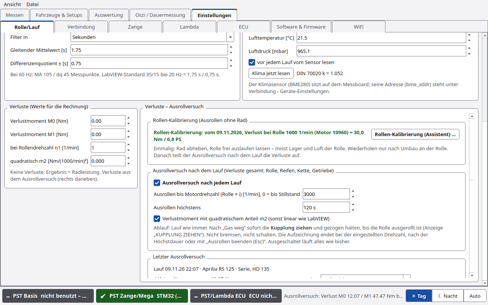
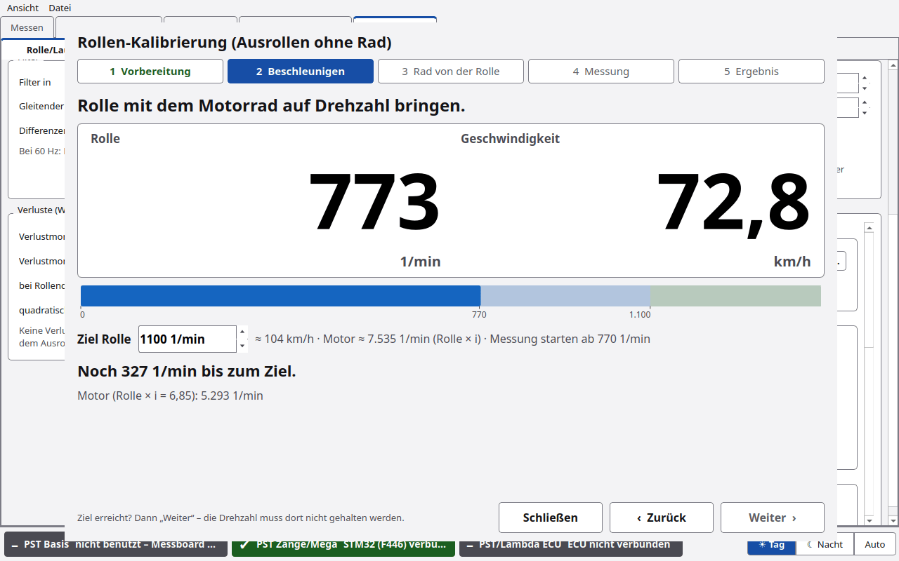
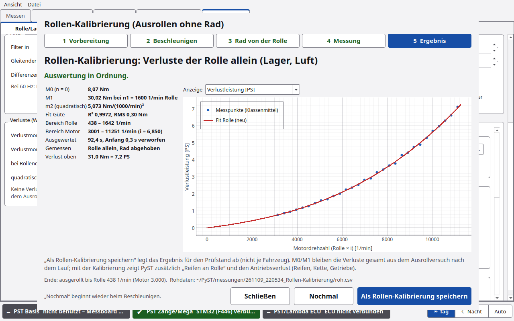
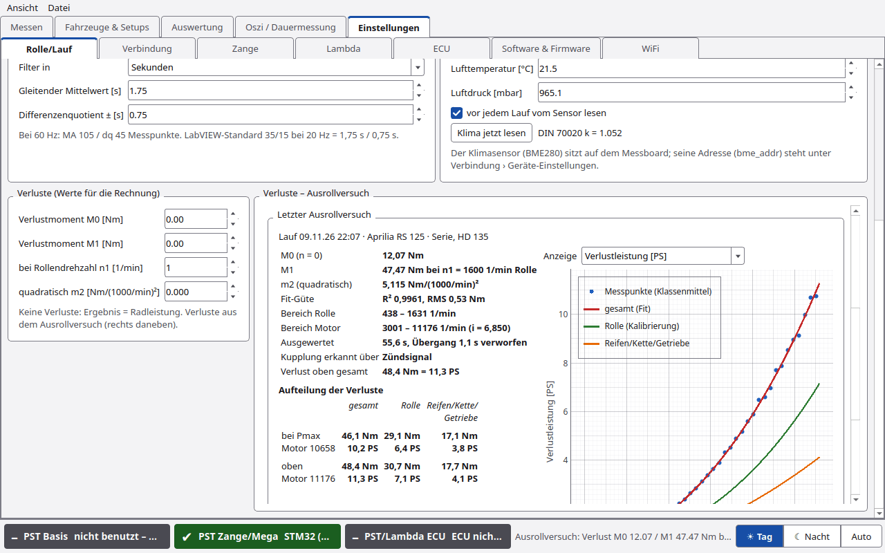

# Ausrollversuch

Der Ausrollversuch bestimmt die **Verluste** zwischen Motor und Rolle. Damit zeigt PyST neben der **Radleistung** auch
die **Motorleistung** (Rad + Verlust). Es gibt zwei Messungen:

| Messung | wann | misst | Ergebnis |
|---|---|---|---|
| **Rollen-Kalibrierung** (Assistent, Rad abgehoben) | **einmal** je Prüfstand, neu nur nach Umbau an der Rolle | Verluste der **Rolle allein** (Lager, Luft) | gespeichert als Rollen-Kalibrierung |
| **Ausrollversuch nach dem Lauf** (Kupplung ziehen) | nach dem Lauf, so oft man will | Verluste **gesamt**: Rolle, Reifen, Kette, Getriebeausgang | Übernehmen → M0/M1/m2 |

Mit Rollen-Kalibrierung teilt PyST den Ausrollversuch nach dem Lauf auf: **gesamt = Rolle + Reifen/Kette/Getriebe**.

Beides steht unter **Einstellungen › Rolle/Lauf**, Gruppe **Verluste – Ausrollversuch** (früher Reiter „Kalibrierung“).

## Rollen-Kalibrierung (Ausrollen ohne Rad)

Oben in der Gruppe steht, ob die Rolle kalibriert ist:

- „Rollen-Kalibrierung: **noch nicht kalibriert**“ – der Ausrollversuch zeigt dann nur die Verluste gesamt, oder
- „Rollen-Kalibrierung: **vom 09.11.2026, Verlust bei Rolle 1600 1/min (Motor 10960) = 30,0 Nm / 6,8 PS**“. Der
  Tooltip nennt M0, M1, n1, m2, R² und den Ordner der Rohdaten.

Der Knopf **Rollen-Kalibrierung (Assistent) …** öffnet ein eigenes Fenster mit fünf Schritten:

1. **Vorbereitung:** Messboard verbunden und Rollendaten kommen? Sonst „Verbinden“.
2. **Beschleunigen:** Rolle mit dem Motorrad auf die Zieldrehzahl bringen. Rolle groß in 1/min und km/h, Balken bis
   zum Ziel. **Ziel Rolle** ist einstellbar und bleibt gespeichert.
3. **Rad von der Rolle:** Gas weg, Rad anheben, Sicherheitshinweis. **Messung starten** geht nur über der
   Mindestdrehzahl, sonst zurück zum Beschleunigen mit „Zu langsam“.
4. **Messung:** Kurve Drehzahl über Zeit. Ende bei der unteren Drehzahl (wie beim Ausrollversuch), bei Stillstand
   oder nach der Höchstdauer; **Beenden und auswerten** oder **Abbrechen** jederzeit.
5. **Ergebnis:** Werte, Diagramm (neuer Fit und die bisherige Kalibrierung gestrichelt), Hinweise.
   **Als Rollen-Kalibrierung speichern**, **Nochmal** oder **Schließen**.

Die Kalibrierung gilt für den **Prüfstand**, nicht je Fahrzeug. Sie geht **nicht** in M0/M1 – die bleiben die
Verluste gesamt aus dem Ausrollversuch nach dem Lauf. Gespeichert wird sie in `einstellungen.json` unter
`"rollen_kalibrierung"` (M0, M1, n1, m2, Datum, R², Ordner der Rohdaten) und bleibt über den Neustart erhalten. Die
Rohdaten liegen in `~/PyST/messungen/JJMMTT_HHMMSS_Rollen-Kalibrierung/` (`roh.csv` wie bei einem Lauf, `lauf.json`
mit `"art": "rollen_kalibrierung"`).

Ausgewertet wird ohne Kupplungserkennung ab „Messung starten“, ein kurzer Übergang am Anfang (Rad noch nicht ganz
frei) wird verworfen. Solange das Fenster offen ist, startet kein Lauf; während eines Laufs lässt es sich nicht
öffnen. Zum Ausprobieren: Simulator-Port `SIM:rolle`.

## Ausrollversuch nach dem Lauf

1. **Ausrollversuch nach jedem Lauf** anhaken.
2. Lauf wie immer. Bei *n Stop* zeigt PyST **GAS WEG – KUPPLUNG ZIEHEN!**.
3. Sofort die **Kupplung ziehen** und gezogen halten, bis die Rolle ausgerollt ist. Anzeige:
   **„KUPPLUNG ZIEHEN – ausrollen lassen …“**. Nicht bremsen, nicht schalten.
4. Die Aufzeichnung endet von selbst:
   - bei der eingestellten Drehzahl („ausgerollt bis … 1/min“),
   - wenn die Rolle steht,
   - wenn die Drehzahl wieder steigt,
   - nach der Höchstdauer,
   - oder mit **Ausrollen beenden (Esc)** (der START-Knopf).
5. PyST wertet aus und zeigt das Ergebnis unter **Letzter Ausrollversuch**, mit Kalibrierung aufgeteilt.
6. Passt das Ergebnis: **Übernehmen**. Erst dann gelten die neuen Verluste (gesamt) in M0/M1/m2.

Ist der Haken aus, läuft alles wie bisher.

### Einstellungen

| Feld | Standard | Bedeutung |
|---|---|---|
| **Ausrollversuch nach jedem Lauf** | aus | nach jedem Lauf ausrollen lassen |
| **Ausrollen bis Motordrehzahl (Rolle × i) [1/min], 0 = bis Stillstand** | 3000 | untere Grenze (gilt auch für die Kalibrierung) |
| **Ausrollen höchstens** | 120 s | Höchstdauer |
| **Verlustmoment mit quadratischem Anteil m2 (sonst linear wie LabVIEW)** | an | Fit mit m2 oder nur linear |

## Letzter Ausrollversuch

| Element | Funktion |
|---|---|
| Quelle und Meldung | welcher Lauf (oder die Kalibrierung), ob die Auswertung geklappt hat, Hinweise |
| Werte | M0, M1, n1, m2, die Güte des Fits und „Verlust oben gesamt“ |
| **Aufteilung der Verluste** | nur mit Rollen-Kalibrierung: gesamt, Rolle und Reifen/Kette/Getriebe in Nm und PS bei Pmax des Laufs, bei n1 und oben. Ohne Kalibrierung steht dort „nur gesamt – Rolle nicht kalibriert“ |
| **Anzeige** | **Verlustleistung [PS]** oder **Verlustmoment an der Rolle [Nm]** |
| Diagramm | über der Motordrehzahl Rolle × i: Messpunkte (blau), **gesamt (Fit)** (rot), **Rolle (Kalibrierung)** (grün), **Reifen/Kette/Getriebe** = Differenz (orange), aktuell gültige Verluste M0/M1 (grau gestrichelt). Die Legende zeigt nur, was da ist |
| **Markierten Lauf auswerten** | Ausrollphase des in der Laufliste (Reiter Messen) markierten Laufs auswerten |
| **Übernehmen** | Verluste **gesamt** (M0, M1, n1, m2) in die Verlust-Felder eintragen. Gilt für neue Läufe und den ausgewerteten Lauf |
| **Als Rollen-Kalibrierung speichern** | statt „Übernehmen“, wenn das Ergebnis von der Rollen-Kalibrierung kommt (Rad abgehoben) |

**Differenz unter 0:** Verliert die Rolle laut Kalibrierung in einem Drehzahlbereich mehr als alles zusammen beim
Ausrollversuch, steht ein Hinweis „Reifen/Kette/Getriebe rechnerisch negativ (Rolle … 1/min)“ mit der Bitte, die
Kalibrierung bzw. den Ausrollversuch zu wiederholen (Rolle umgebaut, anders warm?). Die orange Kurve zeigt dann den
gerechneten Wert, in der Legende steht „(unter 0: Hinweis)“, in der Tabelle „(< 0)“.

Darunter: **Aktuell gültige Verluste**. Die Werte stehen nach „Übernehmen“ in **Verluste (Werte für die Rechnung)**
mit der Quelle („Verluste: Ausrollversuch … Ergebnis = Motorleistung (Rad + Verluste).“). Ändert man sie von Hand,
steht dort „von Hand eingetragen“. Sind alle Verluste 0, steht dort „Keine Verluste: Ergebnis = Radleistung.“

## Ergebnis eines Laufs

Mit Verlusten zeigt das Statusfeld „Motor … PS bei … 1/min · Rad … PS“, die Ergebniszeile „Motor … PS bei … 1/min |
Rad … PS bei … 1/min“. Mit Rollen-Kalibrierung kommt dazu:

- **Reifen an Rolle** = Rad + Verlust der Rolle: die Leistung, die der Reifen an die Rolle abgibt (die Rolle
  verbraucht beim Beschleunigen ja selbst Lager- und Luftverluste),
- **Antriebsverlust** (Reifen, Kette, Getriebe) = Motor − Reifen an Rolle, bei der Drehzahl von Pmax.

Das steht in der Ergebniszeile, in `lauf.json` (`"ergebnis"`: `p_reifen_max_ps`, `antriebsverlust_ps_bei_pmax`,
`rollen_kalibrierung`; beim Ausrollversuch `"ausrollen"` › `"aufteilung"`), im PDF-Bericht und in der Auswertung als
Kanäle „Leistung Reifen an Rolle“ und „Antriebsverlust“ (neben „Leistung Rad“ und „Verlustleistung“). Ohne Verluste
M0/M1 heißt die erste Zahl der Ergebniszeile dann „Rad …“. Die Kurven Rad und Motor bleiben unverändert.

Nach einem Ausrollversuch mit Kalibrierung zeigt das Band oben kurz „Ausrollversuch: Rolle … + Reifen/Kette/Getriebe
… PS bei Pmax“, die Statusleiste die ganze Zeile.

## Wann klappt es nicht?

PyST verwirft den Versuch mit einer Meldung, wenn

- die Ausrollphase zu kurz ist (unter 3 s),
- der Drehzahlbereich zu klein ist (unter 20 % der Anfangsdrehzahl bzw. 100 1/min an der Rolle),
- die Rolle nicht verzögert,
- die Kupplung nicht erkennbar gezogen war (nur nach dem Lauf),
- das Verlustmoment negativ herauskommt.

## Experten

Ohne Antrieb gilt an der Rolle J · dω/dt = −Mv(n) mit

Mv(n) = M0 + n · (M1 − M0) / n1 + m2 · (n/1000) · ((n − n1)/1000)

(n = Rollendrehzahl). Auswertung:

1. **Ausrollphase:** vom Laufende (bzw. dem Drehzahlmaximum danach) bis zur unteren Drehzahl, zum Stillstand, zum
   Wiederanstieg oder zum Ende der Daten. Bei der Rollen-Kalibrierung ab „Messung starten“.
2. **Kupplung:** mit Zündsignal die erste Stelle, ab der die Zünddrehzahl dauerhaft unter 85 % von Rolle × i fällt.
   Ohne Zündsignal beginnt die Suche am Drehzahlmaximum. Danach werden immer 0,3 s verworfen und weiter, bis die
   Verzögerung stetig ist (höchstens 8 s Übergang). Bei der Rollen-Kalibrierung entfällt die Kupplungserkennung.
3. **Fit ohne numerische Ableitung:** ω(t) = ω0 − 1/J · Σ c_k · ∫ φ_k(n(t)) dt, lineare kleinste Quadrate über alle
   Messpunkte. Die Integrale mitteln das Rauschen.
4. **Anzeige und Güte:** lokale Steigung → Mv, nach Rollendrehzahl in Klassen gemittelt. R² und RMS [Nm] der
   Klassenmittel gegen den Fit.

**Aufteilung:** Mv_Reifen/Kette/Getriebe(n) = Mv_gesamt(n) − Mv_Rolle(n), beide über der Rollendrehzahl.

**Leistung:** Radleistung = Anteil aus der Rollenbeschleunigung (k · J/i² · a), Motorleistung = Radleistung + Verlust
gesamt (Mv/i), Reifen an Rolle = Radleistung + Verlust der Rolle (Mv_Rolle/i). Die DIN-Korrektur k gilt nur für den
Radanteil. Die Rollen-Kalibrierung steht in den Parametern jedes Laufs (`rk_m0`, `rk_m1`, `rk_n1`, `rk_m2`,
`rk_quelle`); alle 0 = nicht kalibriert. Siehe [Rechenweg](Rechenweg.md).

**Grenze:** J ist die Rollenträgheit, wie in der Leistungsrechnung. Die Trägheit von Rad und Getriebeausgang ist nicht
enthalten. Ihr Anteil wird beim Beschleunigen wie beim Ausrollen gleich vernachlässigt.

Zum Ausprobieren: Simulator-Ports `SIM:rolle` (Kalibrierung) und `SIM:ausrollen` (Lauf mit Kupplung), beide mit
derselben Rolle ([Erste Schritte](Erste-Schritte.md#simulator-ports)).
