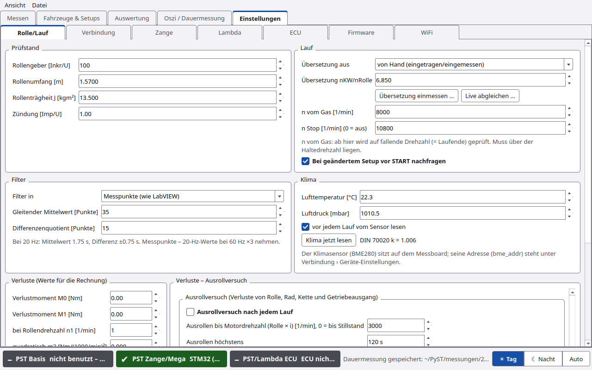

# Ausrollversuch

Der Ausrollversuch bestimmt die **Verluste** von Rolle, Rad, Kette und Getriebeausgang. Damit zeigt PyST neben der
**Radleistung** auch die **Motorleistung** (Rad + Verlust).

Er steht unter **Einstellungen › Rolle/Lauf**, Gruppe **Verluste – Ausrollversuch** (früher Reiter „Kalibrierung“).

## Ablauf am Prüfstand

1. **Ausrollversuch nach jedem Lauf** anhaken.
2. Lauf wie immer. Bei *n Stop* zeigt PyST **GAS WEG – KUPPLUNG ZIEHEN!**.
3. Sofort die **Kupplung ziehen** und gezogen halten, bis die Rolle ausgerollt ist. Anzeige:
   **„KUPPLUNG ZIEHEN – ausrollen lassen …“**. Nicht bremsen, nicht schalten.
4. Die Aufzeichnung endet von selbst:
   - bei der eingestellten Drehzahl („ausgerollt bis … 1/min“),
   - wenn die Rolle steht,
   - wenn die Drehzahl wieder steigt,
   - nach der Höchstdauer,
   - oder mit **Ausrollen beenden (Esc)** (der START-Knopf).
5. PyST wertet aus und zeigt das Ergebnis unter **Letzter Ausrollversuch**.
6. Passt das Ergebnis: **Übernehmen**. Erst dann gelten die neuen Verluste.

Ist der Haken aus, läuft alles wie bisher.

## Einstellungen

| Feld | Standard | Bedeutung |
|---|---|---|
| **Ausrollversuch nach jedem Lauf** | aus | nach jedem Lauf ausrollen lassen |
| **Ausrollen bis Motordrehzahl (Rolle × i) [1/min], 0 = bis Stillstand** | 3000 | untere Grenze |
| **Ausrollen höchstens** | 120 s | Höchstdauer |
| **Verlustmoment mit quadratischem Anteil m2 (sonst linear wie LabVIEW)** | an | Fit mit m2 oder nur linear |

## Letzter Ausrollversuch

| Element | Funktion |
|---|---|
| Quelle und Meldung | welcher Lauf, ob die Auswertung geklappt hat |
| Werte | M0, M1, n1, m2 und die Güte des Fits |
| **Anzeige** | **Verlustleistung [PS]** oder **Verlustmoment an der Rolle [Nm]** |
| Diagramm | Messpunkte (blau), Fit (rot), aktuell gültige Verluste (grau), über der Motordrehzahl Rolle × i |
| **Markierten Lauf auswerten** | Ausrollphase des in der Laufliste (Reiter Messen) markierten Laufs auswerten |
| **Übernehmen** | M0, M1, n1 und m2 in die Verlust-Felder eintragen. Gilt für neue Läufe und den ausgewerteten Lauf |

Darunter: **Aktuell gültige Verluste**.

Die Werte stehen danach in **Verluste (Werte für die Rechnung)** mit der Quelle („Verluste: Ausrollversuch … Ergebnis
= Motorleistung (Rad + Verluste).“). Ändert man sie von Hand, steht dort „von Hand eingetragen“. Sind alle Verluste 0,
steht dort „Keine Verluste: Ergebnis = Radleistung.“

## Ergebnis im Messbildschirm

Mit Verlusten zeigt das Statusfeld „Motor … PS bei … 1/min · Rad … PS“, die Zeile unter dem Diagramm „Motor … PS bei … 1/min | Rad … PS bei … 1/min“. In der Auswertung gibt es dann zusätzlich die Kanäle „Leistung Rad“ und „Verlustleistung“.

## Wann klappt es nicht?

PyST verwirft den Versuch mit einer Meldung, wenn

- die Ausrollphase zu kurz ist (unter 3 s),
- der Drehzahlbereich zu klein ist (unter 20 % der Anfangsdrehzahl bzw. 100 1/min an der Rolle),
- die Rolle nicht verzögert,
- die Kupplung nicht erkennbar gezogen war,
- das Verlustmoment negativ herauskommt.

## Experten

Ohne Antrieb gilt an der Rolle J · dω/dt = −Mv(n) mit

Mv(n) = M0 + n · (M1 − M0) / n1 + m2 · (n/1000) · ((n − n1)/1000)

(n = Rollendrehzahl). Auswertung:

1. **Ausrollphase:** vom Laufende (bzw. dem Drehzahlmaximum danach) bis zur unteren Drehzahl, zum Stillstand, zum
   Wiederanstieg oder zum Ende der Daten.
2. **Kupplung:** mit Zündsignal die erste Stelle, ab der die Zünddrehzahl dauerhaft unter 85 % von Rolle × i fällt.
   Ohne Zündsignal beginnt die Suche am Drehzahlmaximum. Danach werden immer 0,3 s verworfen und weiter, bis die
   Verzögerung stetig ist (höchstens 8 s Übergang).
3. **Fit ohne numerische Ableitung:** ω(t) = ω0 − 1/J · Σ c_k · ∫ φ_k(n(t)) dt, lineare kleinste Quadrate über alle
   Messpunkte. Die Integrale mitteln das Rauschen.
4. **Anzeige und Güte:** lokale Steigung → Mv, nach Rollendrehzahl in Klassen gemittelt. R² und RMS [Nm] der
   Klassenmittel gegen den Fit.

**Grenze:** J ist die Rollenträgheit, wie in der Leistungsrechnung. Die Trägheit von Rad und Getriebeausgang ist nicht
enthalten. Ihr Anteil wird beim Beschleunigen wie beim Ausrollen gleich vernachlässigt.

**Leistung:** Radleistung = Anteil aus der Rollenbeschleunigung (k · J/i² · a), Motorleistung = Radleistung + Verlust
(Mv/i). Die DIN-Korrektur k gilt nur für den Radanteil. Siehe [Rechenweg](Rechenweg.md).

Zum Ausprobieren: Simulator-Port `SIM:ausrollen` ([Erste Schritte](Erste-Schritte.md#simulator-ports)).
