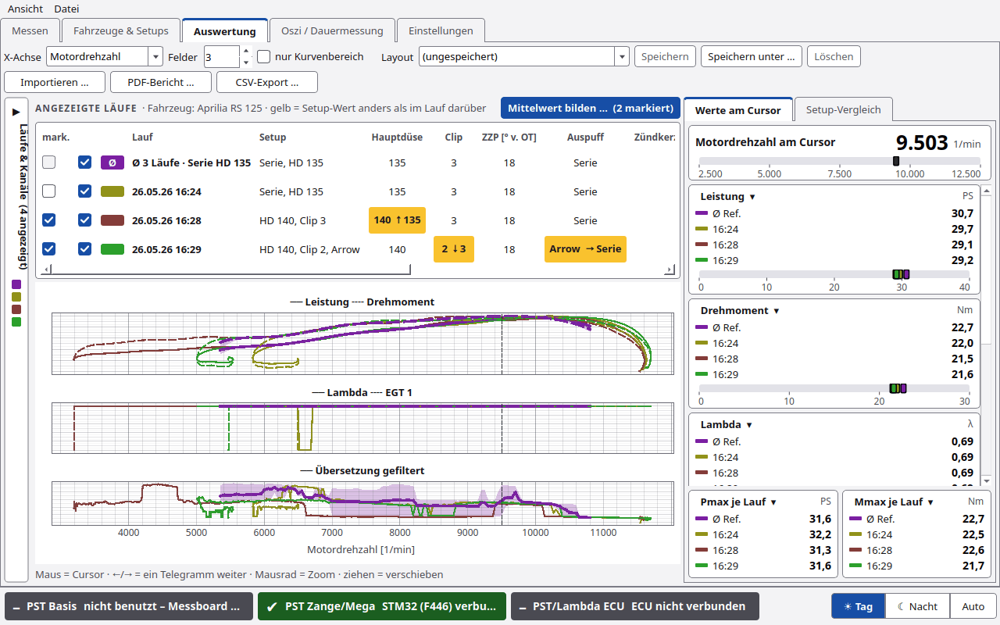
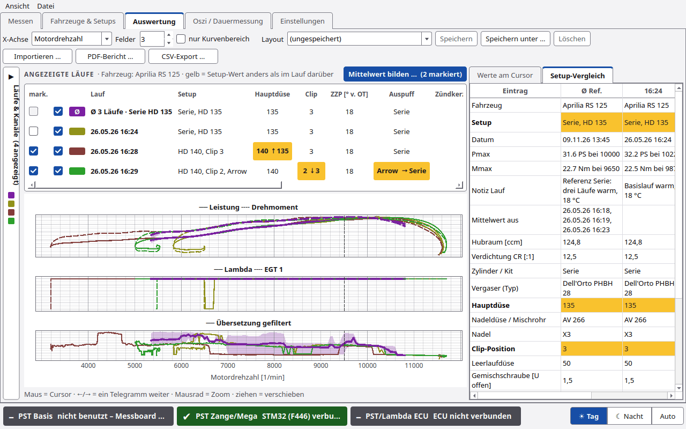
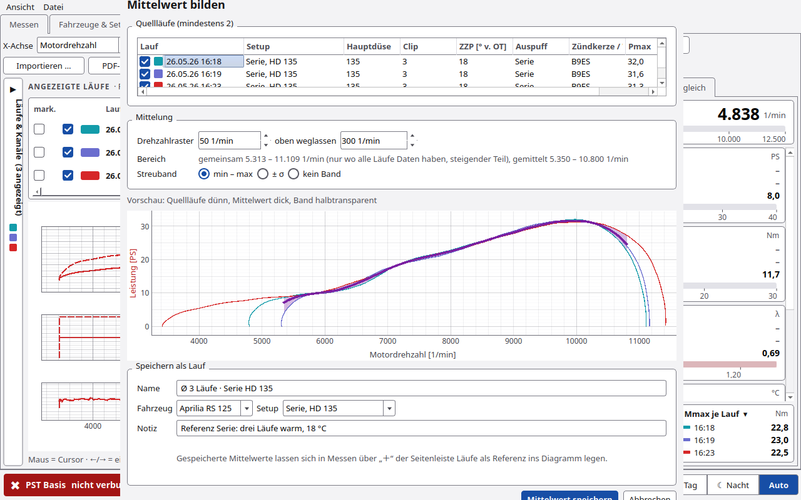
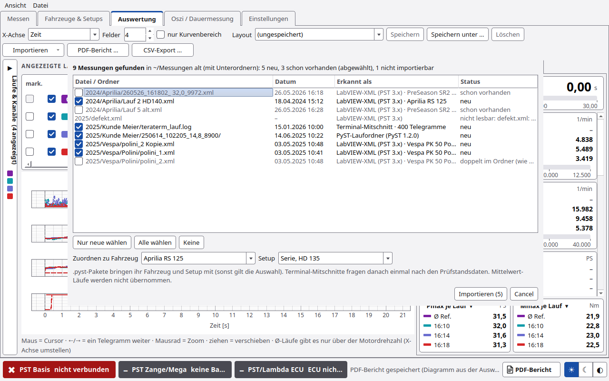
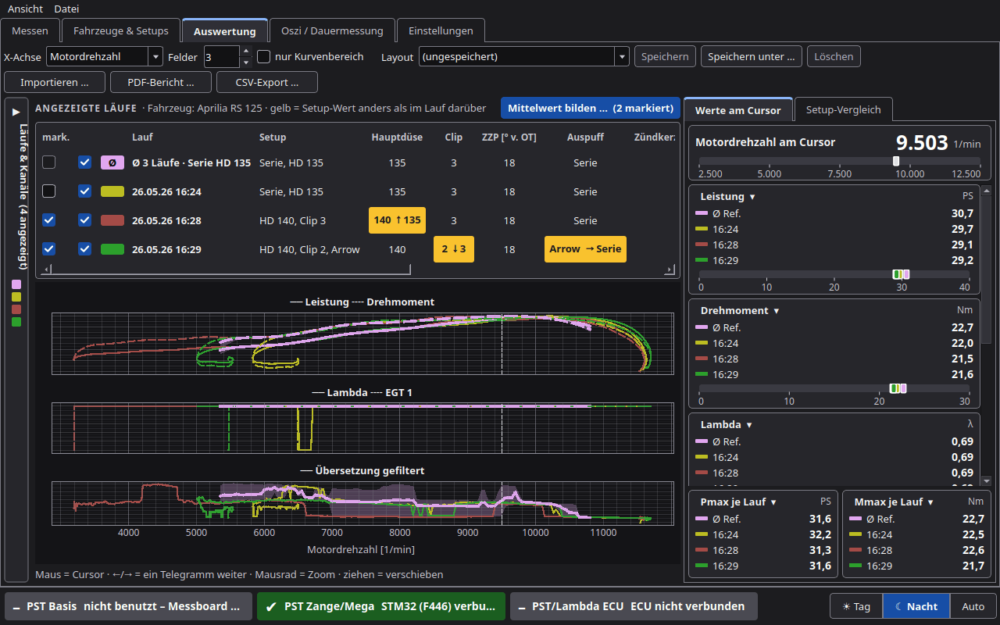

# Auswertung

Im Reiter **Auswertung** legt man Läufe übereinander wie in MegaLogViewer, liest Werte am Cursor ab, vergleicht
Setups und bildet Mittelwerte.

## Kopfzeile

| Element | Funktion |
|---|---|
| **X-Achse** | **Zeit** oder **Motordrehzahl** |
| **Felder** | 1 bis 4 Diagramme untereinander |
| **nur Kurvenbereich** | nur den ausgewerteten Teil des Laufs zeigen (ohne Vorlauf und Ausrollen) |
| **Layout** | gespeicherte Anordnung von Feldern und Kanälen. „(ungespeichert)“ zeigt eine Änderung. Knöpfe **Speichern**, **Speichern unter …**, **Löschen** |
| **Importieren** | **Dateien …**: einzelne Dateien holen, siehe [Läufe weitergeben](Läufe-weitergeben.md). **Ordner mit Unterordnern …**: ganze Sammlungen alter Messungen auf einmal, siehe [unten](#ordner-importieren) |
| **PDF-Bericht …** | Bericht vom Diagramm in Messen (Läufe, Referenzen, Ø automatisch). Die Felder der Auswertung druckt der Knopf **PDF-Bericht** unten rechts in der Statusleiste, solange dieser Reiter offen ist |
| **CSV-Export …** | markierter Lauf als CSV. Bei einem Mittelwert: gemittelte Kurven plus min/max/σ |

## Seitenleiste „Läufe & Kanäle“ (links)

### Läufe auswählen

| Element | Funktion |
|---|---|
| **Fahrzeug** | **alle Fahrzeuge**, **ohne Fahrzeug** oder ein Fahrzeug |
| Sortierung | **nach Datum** oder **nach Setup** |
| **Hinzufügen ↓** | markierte Läufe in die Auswertung |
| **Fahrzeug bearbeiten …** | Fahrzeug des Laufs bearbeiten |

### In der Auswertung (Häkchen = anzeigen)

Liste der Läufe in der Auswertung. Knöpfe **Entfernen**, **Alle entfernen**, **Bearbeiten …**.

Rechtsklick: **Setup und Notiz des Laufs …**, **Fahrzeug / Setup bearbeiten …**, **Setup zuordnen** › (Setup wählen
oder **Neues Setup …**), **Aus der Auswertung entfernen**.

### Kanäle je Feld

Für **Feld 1** bis **Feld 4** wählt man die Kanäle (Leistung, Drehmoment, Drehzahlen, Lambda, EGT, Fehlerkanäle,
ECU-Kanäle …).

## Laufleiste „ANGEZEIGTE LÄUFE“

Über den Diagrammen steht je Lauf eine Zeile:

| Spalte | Inhalt |
|---|---|
| **mark.** | Lauf markieren (für Mittelwert, CSV) |
| **anzeigen** + Farbe | Lauf zeigen oder ausblenden |
| **Lauf** | Datum, Uhrzeit, Name |
| **Setup** | Name des Setups |
| Schnellwert-Spalten | die Felder der Zeile SETUP-WERTE des Fahrzeugs (z. B. Hauptdüse, Clip, ZZP) |
| **Pmax**, **Mmax** | Höchstwerte |
| **Notiz (direkt änderbar)** | Notiz anklicken und ändern |
| **Setup …** | Setup des Laufs öffnen. Bei einem Mittelwert steht hier **Quellen ▾** (Liste der Quellläufe) |
| **✕** | Lauf aus der Auswertung nehmen |

Ein Wert, der sich gegenüber dem Lauf darüber geändert hat, ist **gelb** und zeigt einen Pfeil, z. B. „140 ↑ 135“.

Ab 5 Läufen klappt die Leiste zu kleinen Chips zusammen.

## Diagramme

- **Cursor:** Maus bewegen oder ← / → (ein Telegramm weiter).
- **Mausrad:** zoomen. **Ziehen:** verschieben.
- Ein Lauf: je Kanal eine Farbe. Mehrere Läufe: je Lauf eine Farbe, je Kanal eine Linienart.
- Mittelwerte haben eine eigene Farbe (violett) und eine dicke Linie.

## Rechte Seite

### Werte am Cursor

- Kachel **Motordrehzahl am Cursor**.
- Je Kanal eine Kachel mit den Werten aller Läufe.
- **Pmax je Lauf** und **Mmax je Lauf**.

### Setup-Vergleich

Alle Setup-Felder der angezeigten Läufe nebeneinander. Unterschiede sind gelb.

## Setup des Laufs …

Das Fenster zeigt **Setup dieses Laufs** mit allen Feldern. Felder, die sich gegenüber dem vorigen Lauf geändert haben,
sind gelb. Dazu **Notiz zum Lauf** und **Als neues Setup kopieren …**. Wird das Setup auch von anderen Läufen benutzt,
warnt PyST, denn eine Änderung gilt dann für alle diese Läufe.

## Mittelwert bilden

Mehrere Läufe mit demselben Setup mitteln. Das glättet Streuung von Lauf zu Lauf.

1. In der Laufleiste mindestens 2 Läufe unter **mark.** anhaken.
2. **Mittelwert bilden …  (n markiert)** drücken.

| Bereich | Inhalt |
|---|---|
| **Quellläufe** | mindestens 2, einzelne kann man abhaken. Gelbe Warnung, wenn die Setups verschieden sind |
| **Drehzahlraster** | Standard 50 1/min |
| **oben weglassen** | Standard 300 1/min (Ende der Kurve, wo die Läufe auseinanderlaufen) |
| **Bereich** | gemeinsamer Drehzahlbereich, steigender Teil der Kurve |
| **Streuband** | **min – max**, **± σ** oder **kein Band** |
| Vorschau | Mittelwert mit Band |
| **Speichern als Lauf** | **Name** (Vorschlag z. B. „Ø 3 Läufe · Serie HD 135“), **Fahrzeug**, **Setup**, **Notiz** |
| **Mittelwert speichern** / **Abbrechen** | |

Der Mittelwert ist danach ein eigener Lauf. In [Messen](Messen.md#läufe-hinzufügen) holt man ihn über **＋** in der
Seitenleiste Läufe (Art „nur Mittelwerte“) gesperrt ins Diagramm. Dort steht er als dicke Linie mit Streuband und dient
als Referenz für jeden neuen Lauf. Das gilt für jeden gespeicherten Mittelwert; den früheren Haken „im Messfenster als
Referenz anbieten“ gibt es seit 1.4.2 nicht mehr.

**Schneller in Messen:** Der Haken [Ø automatisch mitteln](Messen.md#ø-automatisch-mitteln) oben in der Seitenleiste Läufe (Messen, neben **＋**)
mittelt die Läufe im Diagramm mit gleichem Setup selbst, nach jedem Lauf neu. **speichern** an seiner Zeile legt
denselben Mittelwert-Lauf an wie dieser Dialog (Band min–max, Raster 50 1/min, oben 300 1/min weg).

**Grenzen (Stand 1.4.2):**

- Mittelwerte kommen nicht in `.pyst`-Dateien. Im PDF-Bericht stehen sie seit 1.4.2 mit Band und Quellläufen.
- Für Mittelwerte gibt es keine Rohdaten-CSV (nur die gemittelten Kurven).
- Einen Mittelwert kann man nicht noch einmal mitteln.

## Export

| Weg | Ergebnis |
|---|---|
| **PDF-Bericht …** (Ctrl+P) | Bericht vom Diagramm in Messen: Diagramm wie angezeigt, Tabelle mit Läufen, Referenzen und Ø automatisch, Klima, Setup. Immer in Tag-Farben, siehe [Messen › PDF-Bericht](Messen.md#pdf-bericht) |
| Knopf **PDF-Bericht** (Statusleiste) | im Reiter Auswertung: die Felder der Auswertung mit den angezeigten Läufen |
| **CSV-Export …** (Ctrl+E) | markierter Lauf. Trennzeichen Semikolon, öffnet in Excel/LibreOffice |
| Weitergeben (Ctrl+S, Ctrl+H) | siehe [Läufe weitergeben](Läufe-weitergeben.md) |

## Ordner importieren

Alte Messungen liegen oft in vielen Ordnern. **Importieren › Ordner mit Unterordnern …** (oder **Datei › Ordner
importieren (mit Unterordnern) …**, Ctrl+Umschalt+I) durchsucht einen Ordner samt Unterordnern und holt alles auf
einmal.

| Gefunden wird | erkannt als |
|---|---|
| `*.xml` der alten Software (LabVIEW 3.2.1, PST 3.x) | **LabVIEW-XML (PST 3.x)**, mit Fahrzeug/Titel aus der Datei |
| Ordner mit `lauf.json` (auch von älteren PyST-Versionen) | **PyST-Laufordner (PyST 1.2.0)** bzw. **PyST-Dauermessung**. Ein Ordner ist **ein** Lauf: `lauf.xml`, `roh.csv` usw. darin zählen nicht extra |
| `*.pyst` | **.pyst-Paket** (ein oder mehrere Läufe, bringt Fahrzeug und Setup mit) |
| `*.log`, `*.txt`, `*.csv` mit Telegrammen | **Terminal-Mitschnitt** |
| Ordner mit `mittelwert.json` | wird angezeigt, aber nicht übernommen (Quellläufe importieren und neu mitteln) |

Andere Dateien und versteckte Ordner übergeht PyST. Danach kommt die **Vorschau**:

| Element | Funktion |
|---|---|
| Liste | Haken, **Datei / Ordner** (relativ zum gewählten Ordner), **Datum**, **Erkannt als**, **Status** |
| Status | **neu**, **schon vorhanden** (steht schon in der Datenbank), **doppelt im Ordner** (dieselbe Messung liegt zweimal da), **nicht lesbar: …** |
| Haken | neue Messungen sind gewählt, Duplikate nicht (man kann sie trotzdem wählen), Unlesbares lässt sich nicht wählen |
| **Nur neue wählen** / **Alle wählen** / **Keine** | Auswahl auf einmal |
| **Zuordnen zu Fahrzeug** / **Setup** | Standard: das aktuelle Fahrzeug und Setup. `.pyst`-Pakete behalten ihr eigenes |
| **Importieren (n)** | übernimmt die gewählten Messungen |

Sind Terminal-Mitschnitte dabei, fragt PyST **einmal** nach den Prüfstandsdaten (wie beim
[Rohmitschnitt](Läufe-weitergeben.md#rohmitschnitt)); sie gelten für alle Mitschnitte. Suche und Import zeigen einen
Fortschritt mit **Abbrechen**. Am Ende steht ein Bericht: **Importiert**, **Übersprungen** und **Fehler**, unter
„Details“ jede Datei mit Grund. Die Läufe stehen danach in Messen in der Liste Läufe und hier unter „Läufe & Kanäle“.

**Schon vorhanden** heißt: gleicher Name und gleiche Quelle, Datum höchstens 2 Minuten auseinander, derselbe Ordner
wie ein Lauf der Datenbank, oder eine Datei mit genau demselben Inhalt (auch umbenannt, z. B. „Lauf 5 alt.xml“).
**Doppelt im Ordner** heißt: dieselbe Datei liegt im gewählten Ordner mehrmals (gleicher Inhalt), nur die erste ist
gewählt. Den Ordner `~/PyST/messungen` selbst noch einmal zu importieren legt also nichts doppelt an.

## Nachtansicht

Siehe [Darstellung](Darstellung.md).

## Experten

- Mittelung: PyST legt alle Quellläufe auf ein gemeinsames Drehzahlraster und mittelt je Rasterpunkt. Das Band ist
  min/max oder die Standardabweichung je Punkt.
- Die Auswertung rechnet Läufe mit den beim Lauf gespeicherten Parametern. Neu rechnen mit den aktuellen Einstellungen
  geht in Messen per Rechtsklick (**Mit aktuellen Einstellungen neu rechnen**).
- Läufe mit Verlusten (M0/M1/m2 ≠ 0) haben zusätzlich die Kanäle „Leistung Rad“ und „Verlustleistung“. „Leistung“ ist dann die Motorleistung ([Ausrollversuch](Ausrollversuch.md)).
