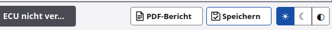
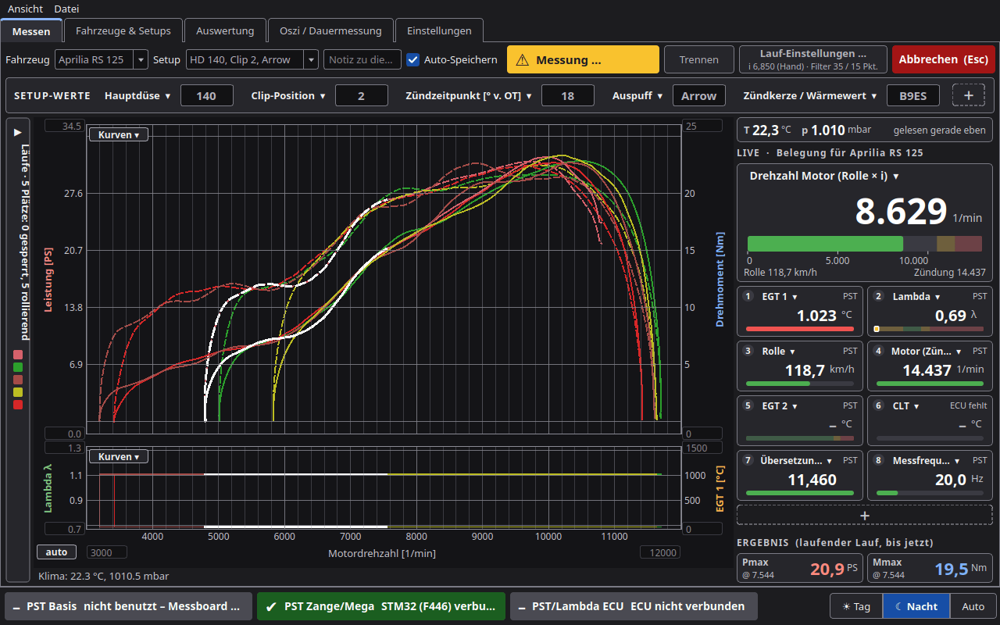
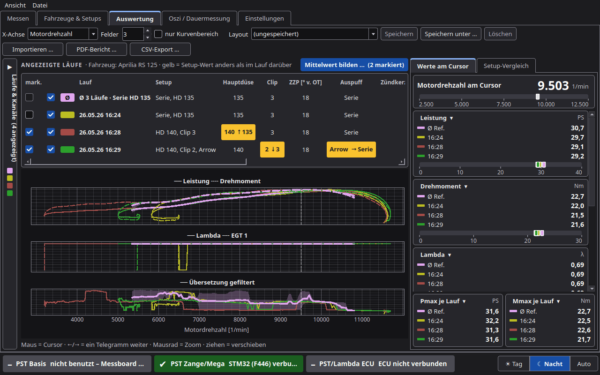

# Darstellung

## Tag, Nacht, Automatisch

PyST hat ein helles und ein dunkles Thema.

| Wahl | Wirkung |
|---|---|
| **☀ Tag (hell)** | helle Flächen, dunkle Schrift. Gut bei Tageslicht in der Werkstatt |
| **☾ Nacht (dunkel)** | dunkle Flächen, helle Schrift |
| **Automatisch (wie das System)** | folgt dem Farbschema des Betriebssystems. Kennt PyST das Schema nicht, gilt Tag. Das ist der Standard |

Umschalten:

- Menü **Ansicht › Darstellung**, oder
- die drei kleinen Knöpfe **☀ ☾ ◐** unten rechts in der Statusleiste: ☀ = Tag, ☾ = Nacht, ◐ = Automatisch. Die
  gewählte Darstellung ist blau hinterlegt, der Tooltip nennt sie. Links daneben die Knöpfe **PDF-Bericht** (siehe
  [Messen](Messen.md#pdf-bericht)) und **Lauf speichern** (siehe [Messen](Messen.md#lauf-speichern-unten-rechts)).

Der Wechsel wirkt sofort, auch auf Diagramme und Kacheln.

## Kontrast

Beide Themen halten feste Kontrastwerte ein (WCAG 2.x):

| Element | Kontrast mindestens |
|---|---|
| Fließtext | 7 : 1 |
| Nebentext, Achsen | 4,5 : 1 |
| Bedienelemente, Rahmen, Kurven | 3 : 1 |

Laufarben passt PyST je Thema in der Helligkeit an (mindestens 3,2 : 1 gegen die Diagrammfläche), der Farbton bleibt.

Der **PDF-Bericht** ist immer in Tag-Farben, damit er gut druckt.

## Fenstergröße

PyST ist für **1480 × 880** Punkte gebaut und passt laut Release-Notizen ab **855 × 651** Punkten.

Menü **Ansicht › Größe (wirkt nach Neustart)**:

| Wahl | Wirkung |
|---|---|
| **Automatisch (an Bildschirm anpassen)** | Standard. Ist der Bildschirm kleiner als 1480 × 880, verkleinert PyST alles passend (höchstens auf 60 %) |
| **100 %**, **90 %**, **80 %**, **70 %** | feste Größe |

Nach der Wahl fragt PyST „Größe gespeichert. Jetzt neu starten?“. Später geht das mit **Ansicht › Jetzt neu starten**.

Ist der Bildschirm kleiner als 1480 × 880, startet PyST maximiert. Größe und Position des Fensters speichert PyST beim
Beenden und stellt sie beim nächsten Start wieder her.

Bei schmalem Fenster brechen die Kopfzeilen und Gruppen in mehrere Zeilen um.

## Experten

- Der Faktor für „Automatisch“ ist min(1, Breite/1480, Höhe/880), begrenzt auf 0,6 bis 1,5. PyST startet sich dafür
  einmal mit `QT_SCALE_FACTOR` neu.
- Die Einstellungen stehen in `einstellungen.json`: `thema` (tag, nacht, auto) und `ui_scale` (auto oder Faktor).
- Schriftgrößen: Fließtext 13 px, Achsen 12 px.
