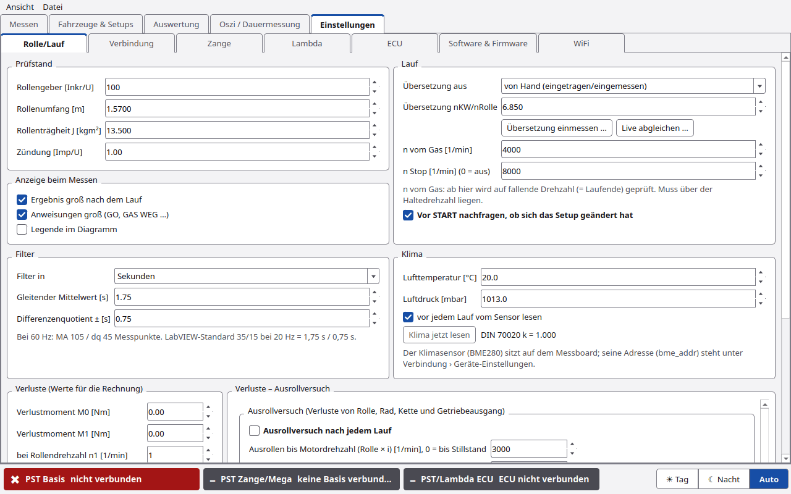
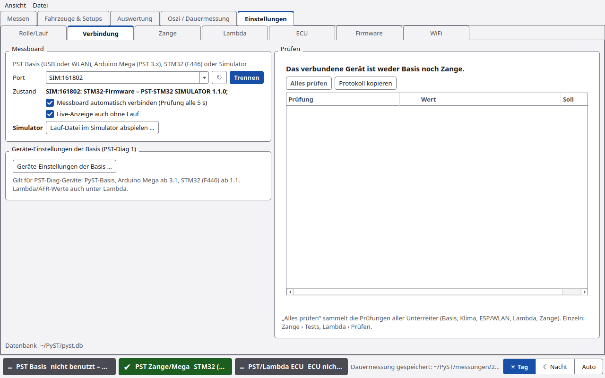
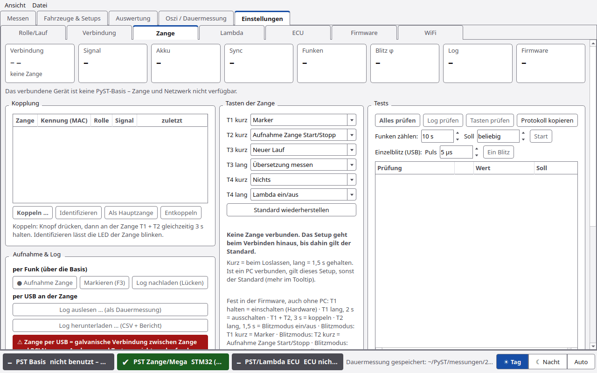
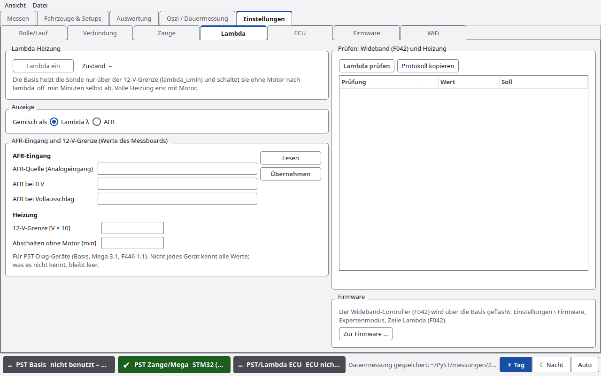
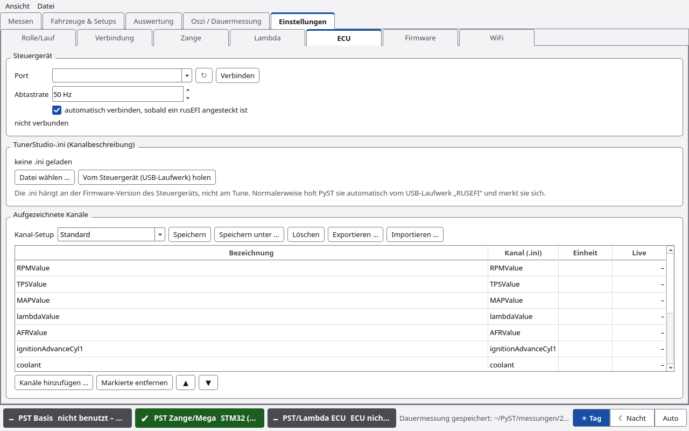
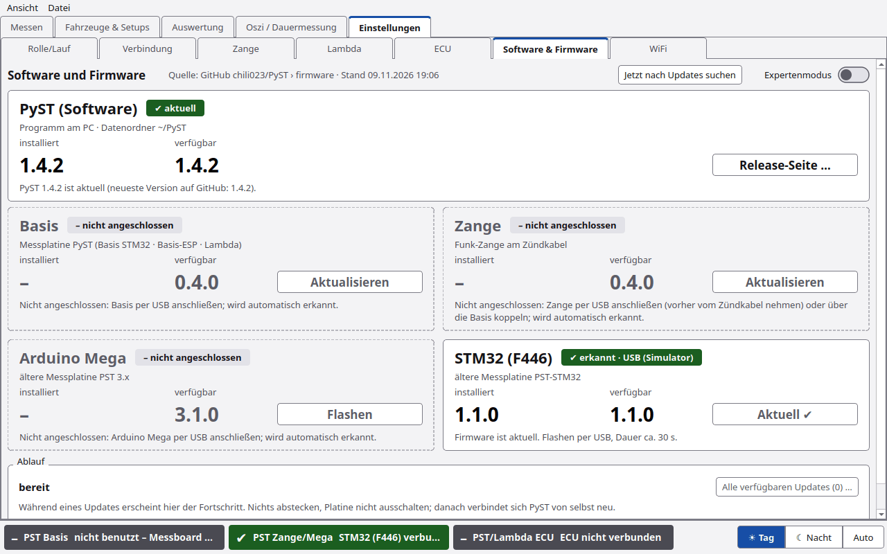
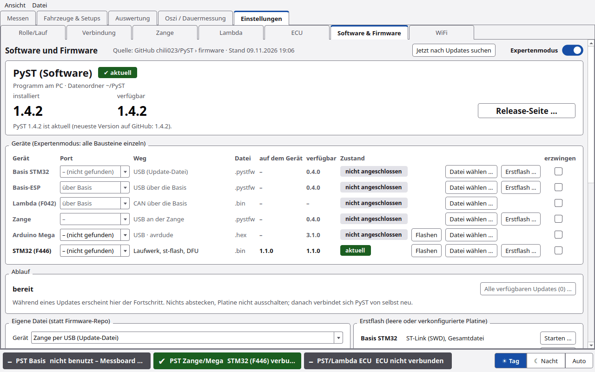
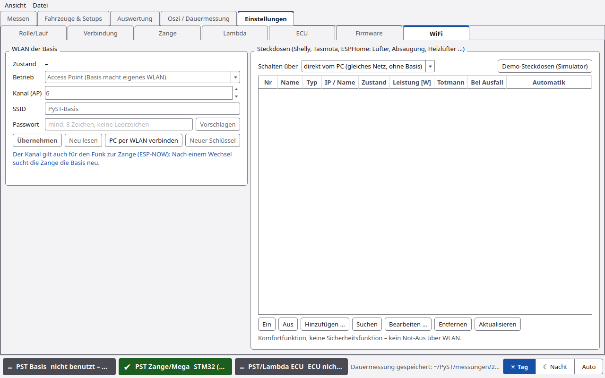

# Einstellungen

Der Reiter **Einstellungen** hat sieben Unterreiter:

**[Rolle/Lauf](#rollelauf)** · **[Verbindung](#verbindung)** · **[Zange](#zange)** · **[Lambda](#lambda)** ·
**[ECU](#ecu)** · **[Software & Firmware](#software--firmware)** · **[WiFi](#wifi)**

Alle Einstellungen speichert PyST sofort in `~/PyST/einstellungen.json`.

---

## Rolle/Lauf

### Prüfstand

| Feld | Standard | Bedeutung |
|---|---|---|
| Rollengeber [Inkr/U] | 100 | Impulse des Rollengebers je Umdrehung |
| Rollenumfang [m] | 1,57 | für die Geschwindigkeit |
| Rollenträgheit J [kgm²] | 13,5 | Trägheitsmoment der Rolle |
| Zündung [Imp/U] | 1 | Zündimpulse je Kurbelwellenumdrehung |

### Lauf

| Feld | Bedeutung |
|---|---|
| **Übersetzung aus** | **von Hand (eingetragen/eingemessen)** oder **Funkenmessung (jeder Lauf)**, siehe [Übersetzung](Übersetzung.md) |
| **Übersetzung nKW/nRolle** | Wert bzw. Startwert (Standard 6,85). Knöpfe **Übersetzung einmessen …** und **Live abgleichen …** |
| **n vom Gas [1/min]** | Standard 4000. Ab hier prüft PyST auf fallende Drehzahl (= Laufende). Muss über der Haltedrehzahl liegen |
| **n Stop [1/min] (0 = aus)** | Standard 8000. Ab hier GAS WEG |
| **Vor START nachfragen, ob sich das Setup geändert hat** | Ist in SETUP-WERTE nichts geändert, zeigt START kurz das Fenster „Setup unverändert – Änderungen eintragen?“ (Standard: an). Die Zangentaste „Neuer Lauf“ fragt nie. Siehe [Messen](Messen.md#start-nachfrage) |

### Anzeige beim Messen

Unter der Gruppe Prüfstand. Dieselben Schalter stehen im Menü **Ansicht**.

| Schalter | Standard | Wirkung |
|---|---|---|
| **Ergebnis groß nach dem Lauf** | an | nach dem Lauf Pmax und Mmax groß über dem Diagramm (weg mit START, Klick oder Esc) |
| **Anweisungen groß (GO, GAS WEG …)** | an | Laufzustand für den Fahrer groß über dem Diagramm: GO – Vollgas!, GAS WEG, KUPPLUNG ZIEHEN … Aus: nur das große „GAS WEG“ |
| **Legende im Diagramm** | aus | Legende aller Läufe (Farbe, Datum/Zeit, Setup bzw. Notiz). Mittelwerte stehen immer in der Legende |

Bilder und Einzelheiten: [Messen](Messen.md#statusfeld).

### Filter

| Feld | Bedeutung |
|---|---|
| **Filter in** | **Sekunden** (passt sich der Messfrequenz an) oder **Messpunkte (wie LabVIEW)** |
| Gleitender Mittelwert [s] bzw. [Punkte] | glättet die Rollendrehzahl. Standard 1,75 s |
| Differenzenquotient ± [s] bzw. [Punkte] | Fenster für die Beschleunigung. Standard 0,75 s |

Darunter steht, was das bei der aktuellen Messfrequenz bedeutet, z. B. „Bei 60 Hz: MA 105 / dq 45 Messpunkte.
LabVIEW-Standard 35/15 bei 20 Hz = 1,75 s / 0,75 s.“ Details: [Rechenweg](Rechenweg.md).

### Klima

| Feld | Bedeutung |
|---|---|
| Lufttemperatur [°C], Luftdruck [mbar] | für die Korrektur nach DIN 70020 |
| **vor jedem Lauf vom Sensor lesen** | BME280 der Messelektronik beim START lesen (Standard: an) |
| **Klima jetzt lesen** | sofort lesen |
| „DIN 70020 k = …“ | Korrekturfaktor zu den eingetragenen Werten |

Der Klimasensor (BME280) sitzt auf dem Messboard. Seine Adresse (`bme_addr`) steht unter Verbindung ›
Geräte-Einstellungen.

### Verluste (Werte für die Rechnung)

Verlustmoment **M0 [Nm]**, **M1 [Nm]**, **bei Rollendrehzahl n1 [1/min]** und **quadratisch m2 [Nm/(1000/min)²]**.
Darunter steht, woher die Werte kommen (Ausrollversuch, Ausrollversuch Rolle allein oder von Hand). Rechts daneben
die Gruppe **Verluste – Ausrollversuch** mit dem Haken **Ausrollversuch nach jedem Lauf** und dem Knopf
**Ausrollversuch (Assistent) …** (ohne Lauf: Rad abheben, nur die Rolle auslaufen lassen). Beides ist unter
[Ausrollversuch](Ausrollversuch.md) beschrieben.

---

## Verbindung

### Messboard

PST Basis (USB oder WLAN), Arduino Mega (PST 3.x), STM32 (F446) oder Simulator.

| Element | Funktion |
|---|---|
| **Port** | serieller Port, `tcp://…` für die Basis per WLAN oder `SIM…` für den Simulator. Eintippen geht auch |
| **↻** | Ports neu suchen |
| **Verbinden** / **Trennen** | |
| **Zustand** | z. B. Firmware-Version und Messfrequenz |
| **Messboard automatisch verbinden (Prüfung alle 5 s)** | Standard: an. Gilt für STM32 (F446, Nucleo) und Original-Arduino-Mega. Die PyST-Basis verbindet man von Hand |
| **Live-Anzeige auch ohne Lauf** | Live-Kacheln auch zwischen den Läufen (Standard: an) |
| Simulator: **Lauf-Datei im Simulator abspielen …** | LabVIEW-XML oder `lauf.json` abspielen |

### Geräte-Einstellungen der Basis (PST-Diag 1)

**Geräte-Einstellungen der Basis …** öffnet den Dialog aus [Oszi und Dauermessung](Oszi-und-Dauermessung.md#geräte-einstellungen-pst-diag-1)
(Messfrequenz, Flanken, Filter, AFR-Eingang, BME280 …). Gilt für PST-Diag-Geräte: PyST-Basis, Arduino Mega ab 3.1,
STM32 (F446) ab 1.1.

### Prüfen

| Knopf | Funktion |
|---|---|
| **Alles prüfen** | alle Prüfungen der Unterreiter: Basis, Klima, ESP/WLAN, Lambda, Zange |
| **Protokoll kopieren** | Ergebnis als Text in die Zwischenablage (für Fragen im Forum oder an den Entwickler) |

Tabelle **Prüfung / Wert / Soll**, farbig nach OK, Warnung, Fehler. Einzeln: Zange › Tests, Lambda › Prüfen.

### Datenbank

Ganz unten steht der Pfad der Datenbank.

---

## Zange

Alles zur Funk-Zündzange. Ausführlich unter [PyST-Basis und Zange](PyST-Basis-und-Zange.md).

| Bereich | Inhalt |
|---|---|
| Kopfkarten | Verbindung, Signal, Akku, Sync, Funken, Blitz φ, Log, Firmware |
| **Kopplung** | Tabelle Zange, Kennung (MAC), Rolle, Signal, zuletzt. Knöpfe **Koppeln …**, **Identifizieren**, **Als Hauptzange** (gesperrt), **Entkoppeln** |
| **Aufnahme & Log** | per Funk: **● Aufnahme Zange**, **Markieren (F3)**, **Log nachladen (Lücken)**. Per USB: **Log auslesen … (als Dauermessung)**, **Log herunterladen … (CSV + Bericht)** |
| **Tasten der Zange** | Belegung der Tasten |
| **Tests** | **Alles prüfen**, **Log prüfen**, **Tasten prüfen** (gesperrt), **Protokoll kopieren**, Funken zählen, Einzelblitz |
| **Geräte-Einstellungen der Zange (per Funk)** | Zündsignal, Probe-Eingang, Blitz, Funk & Gerät. Knöpfe **Lesen**, **Übertragen**, **Standardwerte**, **Zange ausschalten** |

---

## Lambda

### Lambda-Heizung

Knopf **Lambda ein** / **Lambda aus** und **Zustand** (heizt, bereit mit Restzeit, aus, Grund). Ist die Bordspannung zu
niedrig, steht „12-V-Spannung zu niedrig: Sonde heizt nicht (lambda_umin).“

### Anzeige

**Gemisch als** **Lambda λ** oder **AFR**.

### AFR-Eingang und 12-V-Grenze (Werte des Messboards)

| Feld | Bedeutung |
|---|---|
| AFR-Quelle (Analogeingang) | Eingang des AFR-Signals |
| AFR bei 0 V | AFR am unteren Ende |
| AFR bei Vollausschlag | AFR am oberen Ende |
| 12-V-Grenze [V × 10] | Heizung nur über dieser Bordspannung (110 = 11,0 V) |
| Abschalten ohne Motor [min] | ohne Motor schaltet die Basis die Sonde nach so vielen Minuten aus |

Knöpfe **Lesen** und **Übernehmen**.

### Prüfen: Wideband (F042) und Heizung

**Lambda prüfen** und **Protokoll kopieren**.

### Firmware

Der Wideband-Controller (F042) wird über die Basis geflasht: Einstellungen › Software & Firmware, Expertenmodus,
Zeile Lambda (F042). Knopf **Zur Firmware …**.

---

## ECU

Anbindung eines rusEFI-Steuergeräts. Die ECU-Kanäle laufen bei jedem Lauf mit und stehen in Messen und Auswertung zur
Verfügung.

### Steuergerät

| Element | Funktion |
|---|---|
| **Port**, **↻**, **Verbinden** | wie beim Messboard |
| **Abtastrate** | Standard 50 Hz |
| **automatisch verbinden, sobald ein rusEFI angesteckt ist** | |
| Zustand | z. B. „nicht verbunden“ |

### TunerStudio-.ini (Kanalbeschreibung)

Die .ini hängt an der Firmware-Version des Steuergeräts, nicht am Tune. Normalerweise holt PyST sie automatisch vom
USB-Laufwerk „RUSEFI“ und merkt sie sich.

| Knopf | Funktion |
|---|---|
| **Datei wählen …** | .ini von Hand laden |
| **Vom Steuergerät (USB-Laufwerk) holen** | .ini vom Laufwerk „RUSEFI“ |

### Aufgezeichnete Kanäle

Aufgezeichnet und gezeigt werden nur die gewählten Kanäle.

| Element | Funktion |
|---|---|
| **Kanal-Setup** | gespeicherte Kanalauswahl. **Speichern**, **Speichern unter …**, **Löschen**, **Exportieren …**, **Importieren …** |
| Tabelle | **Bezeichnung**, **Kanal (.ini)**, **Einheit**, **Live** |
| **Kanäle hinzufügen …** | alle Kanäle der .ini mit Suche, angehakt = aufzeichnen |
| **Markierte entfernen**, **▲**, **▼** | Liste bearbeiten |

In der Statusleiste steht z. B. „ECU nicht verbunden“, „ECU verbunden – keine passende .ini“, „ECU: .ini passt nicht zur
Firmware“.

---

## Software & Firmware

Früher hieß der Unterreiter „Firmware“. Ganz oben steht die Kachel **PyST (Software)** mit der installierten und der
verfügbaren Version von PyST (aus GitHub, Branch `main`), dazu der Datenordner und der Knopf **Release-Seite …**
(bei einer neuen Version **Update laden …**). Installiert wird nichts, das Update macht man mit `git pull` oder dem
ZIP von der Release-Seite.

Darunter die Firmware der Basis, der Zange, des Arduino Mega und des STM32 (F446). Geräte, die nicht angeschlossen
sind, stehen ausgegraut mit gestricheltem Rand und „– nicht angeschlossen“; ihr Knopf ist aus und sagt im Tooltip,
was zu tun ist. Ausführlich unter [Firmware und Updates](Firmware-und-Updates.md).

---

## WiFi

### WLAN der Basis

| Element | Funktion |
|---|---|
| **Zustand** | aktueller WLAN-Zustand der Basis |
| **Betrieb** | **Access Point (Basis macht eigenes WLAN)**, **Im Werkstatt-WLAN anmelden** oder **WLAN aus** |
| **Kanal (AP)** | 1–13, Standard 6 |
| **SSID** | Standard „PyST-Basis“ |
| **Passwort** | mindestens 8 Zeichen, keine Leerzeichen. **Vorschlagen** trägt ein zufälliges Passwort ein. Ein offenes WLAN gibt es nicht |
| **Übernehmen**, **Neu lesen** | an die Basis senden bzw. lesen |
| **PC per WLAN verbinden** | statt USB über TCP (Port 2323). PyST meldet sich mit dem Schlüssel an, den es beim letzten USB-Verbinden geholt hat |
| **Neuer Schlüssel** | nur per USB: die Basis vergibt einen neuen Schlüssel. Andere PCs müssen dann einmal per USB verbinden |

Der Kanal gilt auch für den Funk zur Zange (ESP-NOW). Nach einem Wechsel sucht die Zange die Basis neu.

### Steckdosen

WLAN-Steckdosen (Shelly, Tasmota, ESPHome) für Lüfter, Absaugung, Heizlüfter. Ausführlich unter
[PyST-Basis und Zange](PyST-Basis-und-Zange.md#wlan-steckdosen).

> ⚠️ Komfortfunktion, keine Sicherheitsfunktion – kein Not-Aus über WLAN.

## Experten

- `einstellungen.json` wird atomar geschrieben: ein Absturz beim Speichern lässt die alte Datei stehen.
- Der zuletzt offene Reiter und Unterreiter werden gespeichert.
- Kanal-Setups der ECU liegen in `einstellungen.json` unter `rusefi` und lassen sich als Datei weitergeben.
