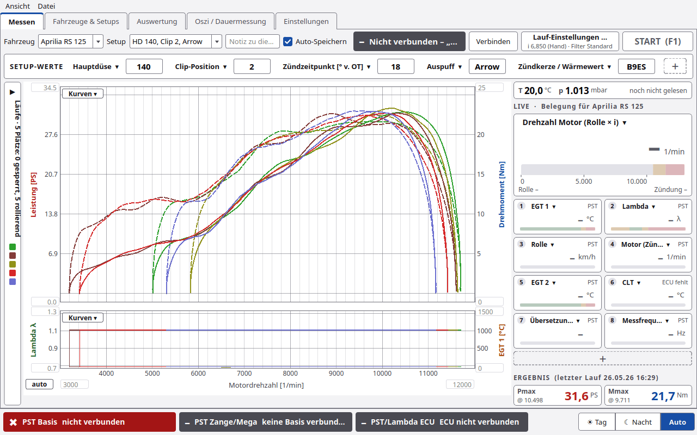
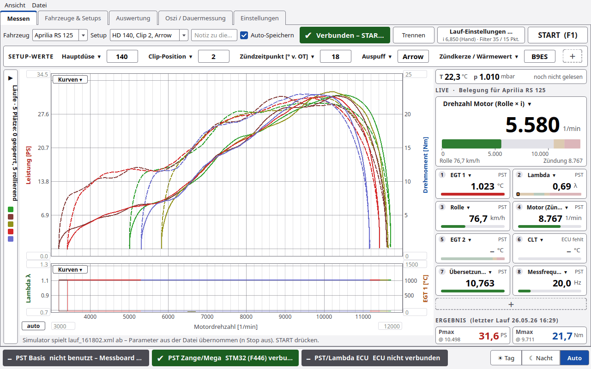
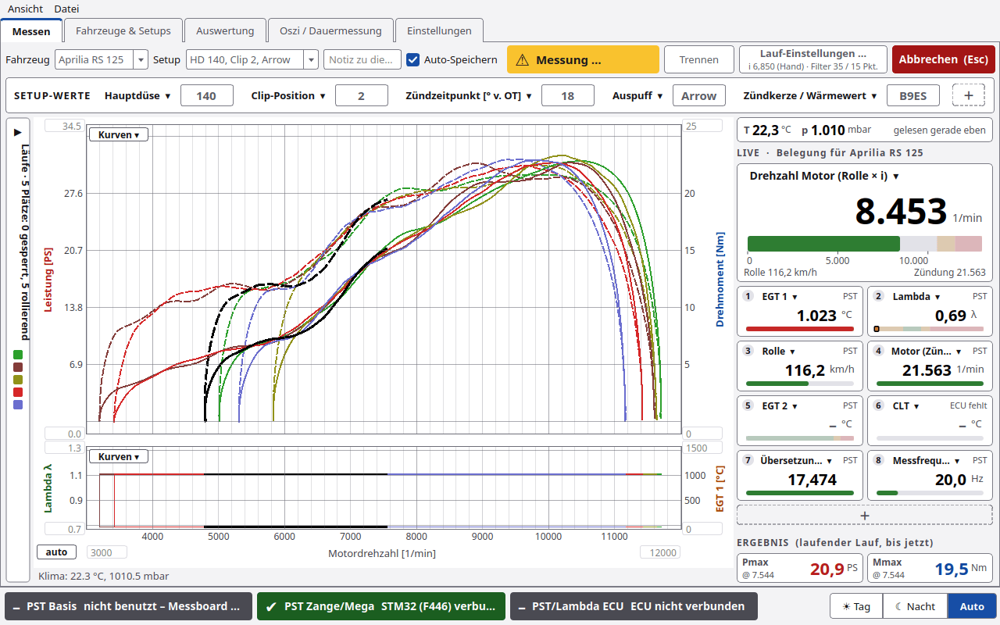

# Erste Schritte

## 1. Ohne Hardware: Simulator

```bash
./start_mac.command --sim          # Linux: ./start_linux.sh --sim, Windows: start_windows.bat --sim
```

PyST verbindet sich dann mit dem Port **`SIM:161802`**. Der Simulator spielt einen echten Lauf vom 26.05.26 ab.
Die Prüfstandsdaten kommen aus der Datei, *n Stop* ist dabei aus. Unter dem Diagramm steht
„Simulator spielt lauf_161802.xml ab – Parameter aus der Datei übernommen (n Stop aus). START drücken.“

Mit `--sim --synth` läuft statt dessen ein synthetischer Motor (Port `SIM`).
Weitere Simulator-Ports wählt man unter **Einstellungen › Verbindung › Port** (siehe unten, Experten).

## 2. Mit dem Prüfstand verbinden



1. Messelektronik per USB anstecken (PyST-Basis, Arduino Mega mit PST 3.x oder STM32 F446).
2. **STM32 (F446, Nucleo) und Arduino Mega** sucht PyST alle 5 s und verbindet sich selbst
   („Messboard automatisch verbunden – START drücken (F1)“). Abschaltbar unter **Einstellungen › Verbindung**.
   Erkannt werden der ST-Link des Nucleo und Original-Arduino-Boards an ihrer USB-Kennung.
3. Die **PyST-Basis** (und Mega-Nachbauten mit anderem USB-Chip) verbindet man von Hand: Port unter
   **Einstellungen › Verbindung › Port** wählen, dann im Reiter **Messen** oder dort **Verbinden**.
4. Das Feld neben den Knöpfen wird grün: **„Verbunden – START drücken“**. Die Statusleiste unten zeigt, welches
   Gerät verbunden ist.

Hat man von Hand **Trennen** gedrückt, verbindet PyST nicht von selbst wieder. Nach dem Flashen sucht PyST wieder.
Die Basis per WLAN verbindet man unter **Einstellungen › WiFi** mit **PC per WLAN verbinden**.



## 3. Prüfstand einstellen (einmal)

Unter **Einstellungen › Rolle/Lauf** eintragen:

| Feld | Bedeutung |
|---|---|
| Rollengeber [Inkr/U] | Striche des Rollengebers je Umdrehung |
| Rollenumfang [m] | für km/h |
| Rollenträgheit J [kgm²] | Trägheit der Rolle |
| Zündung [Imp/U] | Zündimpulse je Kurbelwellenumdrehung |
| Übersetzung nKW/nRolle | Motordrehzahl ÷ Rollendrehzahl, siehe [Übersetzung](Übersetzung.md) |
| n vom Gas [1/min] | Schwelle für das Laufende, **muss über der Haltedrehzahl liegen** |
| n Stop [1/min] (0 = aus) | ab hier zeigt PyST **GAS WEG** und beendet die Kurve |

Die Filter in Sekunden (Standard 1,75 s / 0,75 s) passen sich der Messfrequenz selbst an.
Details: [Einstellungen](Einstellungen.md#rollelauf).

## 4. Fahrzeug und Setup wählen

Im Reiter **Fahrzeuge & Setups** ein Fahrzeug und ein Setup anlegen, dann im Reiter **Messen** oben unter
*Fahrzeug* und *Setup* auswählen. Jeder Lauf wird diesem Fahrzeug und Setup zugeordnet.
Siehe [Fahrzeuge und Setups](Fahrzeuge-und-Setups.md).

## 5. Der erste Lauf

1. Motor im Messgang **unter** *n vom Gas* halten.
2. **START (F1)** drücken. Ist das Setup unverändert, fragt PyST kurz „Setup unverändert – Änderungen eintragen?“:
   nichts umgebaut → **Unverändert starten** (Enter oder F1), sonst die neuen Werte eintragen und **Übernehmen und
   starten**. Abschaltbar, siehe [Messen](Messen.md#start-nachfrage).
3. PyST liest das Klima (wenn eingeschaltet) und zeigt **„GO – Vollgas!“** (grün), auch groß über dem Diagramm.
4. Vollgas. Über *n vom Gas* verschwindet das große GO, im Statusfeld steht **„Messung …“** (gelb), die Live-Kurve
   wächst schwarz bzw. weiß mit.
5. Bei *n Stop* erscheint **GAS WEG** (rot), groß über dem Diagramm. Gas weg.
6. PyST wertet aus. Pmax und Mmax stehen groß über dem Diagramm (weg mit Klick oder Esc), außerdem im Feld oben
   (z. B. „32.0 PS bei 10000 1/min“), unter dem Diagramm und rechts unten unter **ERGEBNIS**. Mit **Auto-Speichern**
   landet der Lauf sofort in der Datenbank.

**Abbrechen (Esc)** geht jederzeit (derselbe Knopf wie START, im Lauf rot).



Weiter: [Messen](Messen.md) · [Auswertung](Auswertung.md)

## Experten

### Simulator-Ports

| Port | Verhalten |
|---|---|
| `SIM:161802` | echter Lauf 26.05.26 16:18 (Standard für `--sim`) |
| `SIM` | synthetischer Motor, F446 1.1.0 mit PST-Diag 1 |
| `SIM:stoerung` | dasselbe mit Störungen an Zündung und Rolle |
| `SIM:ausrollen` | nach dem Lauf Kupplung gezogen (für den [Ausrollversuch](Ausrollversuch.md)) |
| `SIM:rolle` | Rad wird abgehoben, Rolle läuft frei aus (für die Rollen-Kalibrierung im [Ausrollversuch](Ausrollversuch.md)) |
| `SIM:mega` | Arduino-Mega-Sketch 3.1.0 mit PST-Diag 1 |
| `SIM:mega300`, `SIM:mega300:stoerung` | alter Mega 3.0.0 ohne Diagnose, optional mit Störungen |
| `SIM:basis` | PyST-Basis mit gekoppelter Funk-Zange und Steckdosen |
| `SIM:basis:stoerung` | Basis mit Paketverlust und Zangen-Abbrüchen |
| `SIM:basis:ohne` | Basis ohne Zange (Koppeln vorführen) |
| `SIM:basis:wlan` | Basis am TCP-Port mit Anmeldung (Schlüssel vorher über `SIM:basis` holen) |
| `SIM:zange` | Zange direkt per USB |

Eine beliebige LabVIEW-XML oder PyST-`lauf.json` spielt **Einstellungen › Verbindung › Lauf-Datei im Simulator
abspielen …** ab (Port `SIM:<Pfad>`), ebenso `--replay datei.xml` auf der Kommandozeile.
LabVIEW-Läufe stellen die Filter dabei auf *Messpunkte*.
