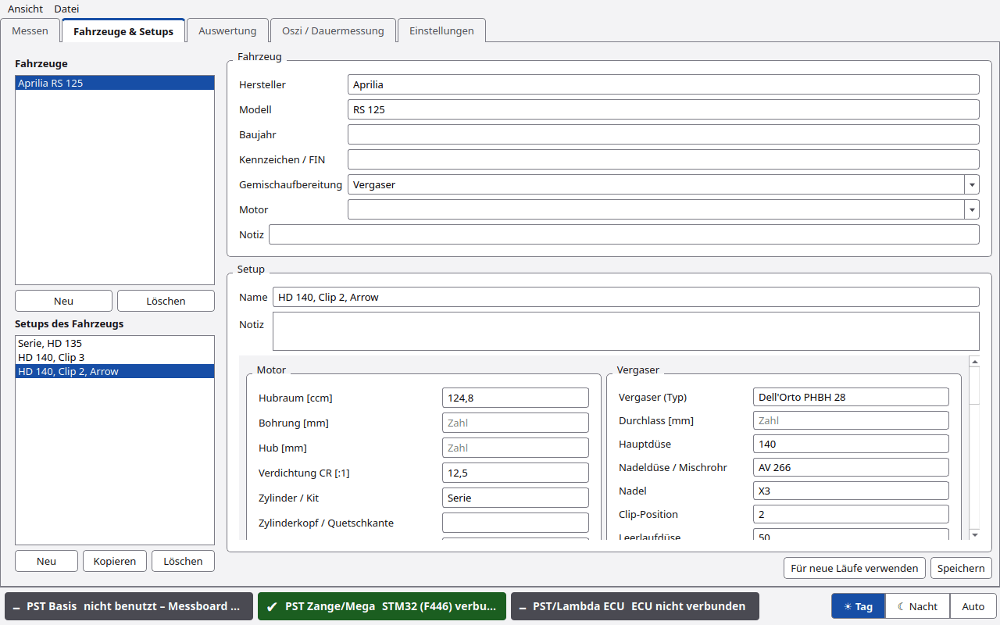

# Fahrzeuge und Setups

Jeder Lauf gehört zu einem **Fahrzeug** und einem **Setup**. Ein Setup ist der Stand des Motors beim Lauf:
Düsen, Zündung, Übersetzung, Auspuff usw. So sieht man später in der [Auswertung](Auswertung.md), was sich zwischen zwei
Läufen geändert hat.

## Aufbau des Reiters

| Bereich | Inhalt |
|---|---|
| **Fahrzeuge** (links oben) | Liste aller Fahrzeuge, Knöpfe **Neu** und **Löschen** |
| **Setups des Fahrzeugs** (links unten) | Setups des gewählten Fahrzeugs, Knöpfe **Neu**, **Kopieren** und **Löschen** |
| **Fahrzeug** (rechts oben) | Felder des Fahrzeugs |
| **Setup** (rechts) | Name, Notiz und alle Setup-Felder |
| **Für neue Läufe verwenden** | Fahrzeug und Setup im Reiter Messen auswählen |
| **Speichern** | Änderungen speichern |

## Fahrzeug-Felder

| Feld | Werte |
|---|---|
| Hersteller | Text |
| Modell | Text |
| Baujahr | Text |
| Kennzeichen / FIN | Text |
| Gemischaufbereitung | Vergaser, EFI (rusEFI), EFI (Serie), sonstige |
| Motor | 2-Takt, 4-Takt, Elektro |
| Notiz | Text |

Die **Gemischaufbereitung** bestimmt, welche Gruppe die Zeile SETUP-WERTE in [Messen](Messen.md#setup-werte) anbietet:
bei Vergaser die Vergaser-Felder, bei EFI die Felder „Einspritzung / ECU“.

## Setup-Felder

| Gruppe | Felder |
|---|---|
| Motor | Hubraum [ccm], Bohrung [mm], Hub [mm], Verdichtung CR [:1], Zylinder / Kit, Zylinderkopf / Quetschkante, Steuerzeiten (Ein/Üb/Aus bzw. Nocke), Kühlung (Luft / Wasser / Öl/Luft) |
| Vergaser | Vergaser (Typ), Durchlass [mm], Hauptdüse, Nadeldüse / Mischrohr, Nadel, Clip-Position, Leerlaufdüse, Gemischschraube [U offen], Schieber, Schwimmerstand |
| Einspritzung / ECU | ECU, Tune-Datei / Kalibrierung, Einspritzdüse [ccm/min], Kraftstoffdruck [bar], Drosselklappe [mm], λ-Ziel Volllast |
| Zündung | Zündung (Typ), Zündzeitpunkt [° v. OT], Zündkerze / Wärmewert |
| Antrieb | Primärübersetzung, Sekundär / Endübersetzung, Gang (Messgang), Variomatik, Rollengewichte [g], Kupplung / Federn, Gegendruckfeder, Riemen / Kette, Reifen / Luftdruck |
| Ein- und Auslass | Luftfilter, Ansaugstutzen / Membran, Auspuff, Krümmer / Dämpfer |
| Kraftstoff | Kraftstoff, Öl / Mischung |

Leere Felder sind erlaubt. Es zählt nur, was man einträgt.

## Typischer Ablauf

1. **Neu** unter Fahrzeuge. Es erscheint ein Fahrzeug „Neu“. Felder ausfüllen, **Speichern**.
2. **Neu** unter Setups. Name (z. B. „Serie HD 135“) und Werte eintragen, **Speichern**.
3. **Für neue Läufe verwenden**. Im Reiter Messen sind Fahrzeug und Setup jetzt gewählt.
4. Für die nächste Änderung: Setup **Kopieren** (fragt nach dem Namen, Vorschlag „… (Kopie)“), einen Wert ändern,
   **Speichern**.

Schneller geht es direkt im Messbildschirm: Wert in der Zeile **SETUP-WERTE** ändern und **Als neues Setup
speichern …**. Siehe [Messen](Messen.md#setup-werte).

## Löschen

- **Löschen** unter Fahrzeuge: „Fahrzeug mit allen Setups löschen? Läufe bleiben erhalten.“
- **Löschen** unter Setups: „Setup löschen? Läufe bleiben erhalten.“

Die Läufe bleiben also in der Datenbank. Sie stehen dann in der Auswertung unter „ohne Fahrzeug“.

## Setup eines Laufs nachträglich ändern

In der [Auswertung](Auswertung.md) per Rechtsklick auf einen Lauf: **Setup und Notiz des Laufs …**, **Setup zuordnen**
oder **Fahrzeug / Setup bearbeiten …**. In Messen per Rechtsklick: **Aktuellem Fahrzeug/Setup zuordnen**.

## Experten

- Die Daten liegen in der SQLite-Datenbank `~/PyST/pyst.db`.
- Je Fahrzeug speichert PyST außerdem: die Plätze der Zeile SETUP-WERTE, die Belegung der Live-Kacheln mit
  Balkengrenzen und die gesperrten Plätze im Messdiagramm.
- Beim Import einer `.pyst`-Datei legt PyST Fahrzeug und Setup an, wenn es sie noch nicht gibt
  ([Läufe weitergeben](Läufe-weitergeben.md)).
