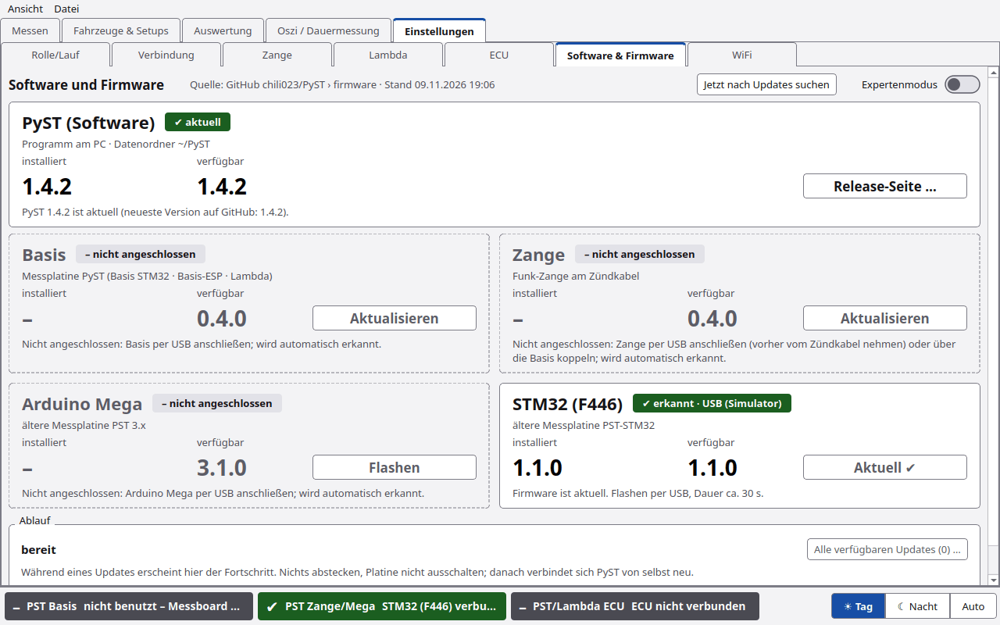
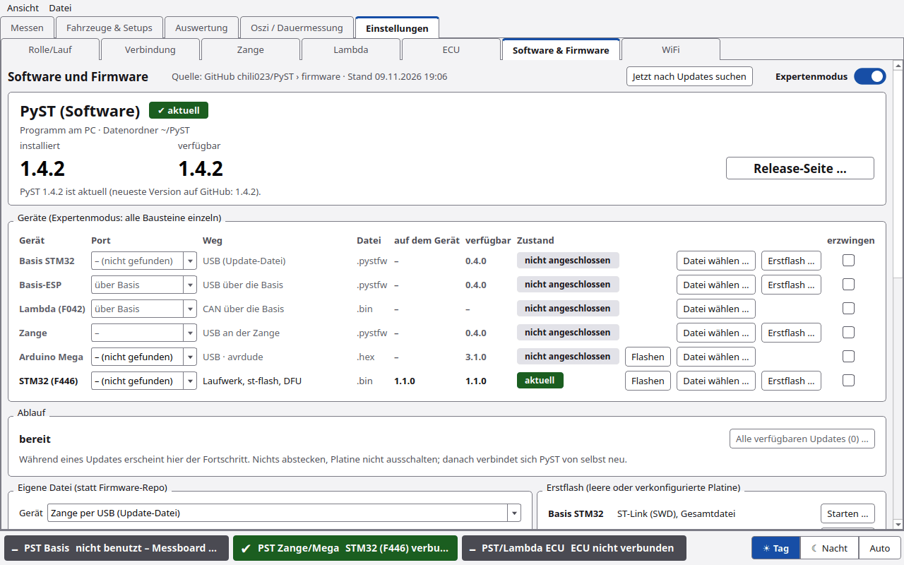

# Firmware und Updates

Unter **Einstellungen › Software & Firmware** (bis 1.4.1: „Firmware“) zeigt PyST die eigene Version und spielt die
Firmware der Messelektronik auf. Quelle der Firmware ist das öffentliche Firmware-Repo: **GitHub chili023/PyST ›
firmware** (Branch `firmware`). Alternativ geht eine eigene Datei.

> ⚠️ **Die Zange nie am laufenden Motor per USB anschließen.** Die Zange ist dann galvanisch mit dem PC verbunden,
> Zündspannung kann PC und Zange zerstören. Vorher vom Zündkabel nehmen.

## Kopf

| Element | Funktion |
|---|---|
| **Software und Firmware** | Überschrift, daneben die Quelle („Quelle: GitHub chili023/PyST › firmware · Stand …“) |
| **Jetzt nach Updates suchen** | neueste PyST-Version und Firmware-Repo neu lesen |
| **Expertenmodus** | Schalter zwischen Kundenansicht und Expertenansicht. PyST merkt sich die Wahl |

## PyST (Software)

Die Kachel ganz oben, in der Kundenansicht wie im Expertenmodus:

| Teil | Inhalt |
|---|---|
| Kopf | „✔ aktuell“, „Update verfügbar: …“ oder „✔ installiert“ (neueste Version nicht abrufbar, z. B. ohne Netz) |
| Unterzeile | „Programm am PC · Datenordner ~/PyST“ |
| **installiert** / **verfügbar** | Version dieses PyST und die neueste Version auf GitHub (Branch `main`) |
| Knopf | **Release-Seite …**, bei einer neuen Version **Update laden …**. Beide öffnen nur die Release-Seite im Browser |

PyST installiert sich nicht selbst. Update: im PyST-Ordner `git pull` oder das ZIP von der Release-Seite laden und
entpacken. Datenbank und Einstellungen in `~/PyST` bleiben erhalten. Siehe [Installation](Installation.md#update).

## Kundenansicht

Vier Karten. Jede zeigt, was erkannt bzw. installiert ist und was verfügbar ist, dazu einen großen Knopf. Ist alles
aktuell, steht auf dem Knopf „Aktuell ✔“.

| Karte | Gerät | Knopf |
|---|---|---|
| **Basis** | Messplatine PyST (Basis STM32 · Basis-ESP · Lambda) | **Aktualisieren**. Der Basis-ESP wird automatisch mit aktualisiert. Den Lambda-Controller (F042) flasht man nur im Expertenmodus |
| **Zange** | Funk-Zange am Zündkabel | **Aktualisieren**. Zange per USB anschließen – vorher vom Zündkabel nehmen |
| **Arduino Mega** | ältere Messplatine PST 3.x | **Flashen** ⚠️ *noch nicht am Prüfstand bestätigt* |
| **STM32 (F446)** | ältere Messplatine PST-STM32 | **Flashen** ⚠️ *noch nicht am Prüfstand bestätigt* |

Oben auf jeder Karte steht, ob das Gerät erkannt ist („✔ erkannt · …“ oder „– nicht angeschlossen“). Ein Hinweis „neu“
zeigt eine neuere Version. **Nicht angeschlossene Geräte** sind ausgegraut: gestrichelter Rand, nur die verfügbare
Version, der Knopf ist aus. Sein Tooltip und die Zeile darunter sagen, was zu tun ist, z. B. „Basis per USB
anschließen“. PyST sieht alle 2 s nach, solange der Unterreiter offen ist; die Ports werden dabei nur aufgelistet,
nicht geöffnet.

### Ablauf

Zeigt Fortschritt und Zustand („bereit“). **Alle verfügbaren Updates (n) …** spielt alle offenen Updates nacheinander
auf. **Abbrechen** bricht ab.

## Welches Gerät, welcher Weg?

Der **Expertenmodus** zeigt alle Bausteine einzeln:

| Baustein | Weg | Datei | Erstflash … (Weg im Tooltip) |
|---|---|---|---|
| **Basis STM32** | USB (Update-Datei) | `.pystfw` | ST-Link (SWD) |
| **Basis-ESP** | USB über die Basis | `.pystfw` | ESP-Brücke über die Basis |
| **Lambda (F042)** | CAN über die Basis | `.bin` | – |
| **Zange** | USB an der Zange | `.pystfw` | esptool |
| **Arduino Mega** | USB · avrdude (Arduino-Bootloader) | `.hex` | – |
| **STM32 (F446)** | Laufwerk, st-flash, DFU | `.bin` | ST-Link oder DFU |

Je Zeile: Port (nur für Mega und F446, die anderen sucht PyST selbst), Weg, Format, Version im Gerät („auf dem
Gerät“), verfügbare Version, Zustand, Knopf **Aktualisieren** bzw. **Flashen** (nur, wenn es geht), **Datei wählen …**,
ggf. **Erstflash …** (der Weg steht im Tooltip) und ein Haken **erzwingen** (auch gleiche oder ältere Version bzw.
Datei mit ungeprüfter Signatur flashen). Nicht angeschlossene Geräte sind nur abgeblendet; Erstflash und eigene Datei
gehen trotzdem.

### Eigene Datei (statt Firmware-Repo)

**Gerät** wählen, Datei wählen. Erlaubt: `.pystfw` (Basis, Basis-ESP, Zange), `.hex` (Mega), `.bin` (F446, Lambda).
Die Signatur wird geprüft. Ohne geprüfte Signatur nur mit **Version erzwingen / Downgrade erlauben**.

### Erstflash (leere oder verkonfigurierte Platine)

| Gerät | Weg | Knopf |
|---|---|---|
| Basis STM32 | ST-Link (SWD), Gesamtdatei | **Starten …** |
| Basis-ESP | ESP-Brücke über die Basis (esptool) | **Starten …** |
| Zange | esptool über USB-C | **Starten …** |
| Arduino Mega | avrdude, Arduino-Bootloader, 115200 Bd | **Starten …** |
| STM32 (F446) | ST-Link (st-flash) oder USB-DFU (BOOT0) | **Starten …** |

**Inbetriebnahme einer neuen Basis:** 1. STM32 per ST-Link → 2. Basis-ESP per Brücke → 3. Updates per USB →
4. Lambda über die Basis → 5. Zange einmal per esptool.

### Zange – Update per USB

Eigene Gruppe mit Warnung und Knopf **Aktualisieren**.

### Protokoll

Alle Schritte als Text. **Protokoll kopieren** und **Protokoll speichern …**.

## Arduino Mega

⚠️ *Noch nicht am Prüfstand bestätigt.*

PyST flasht über **avrdude** und den Arduino-Bootloader. avrdude muss installiert sein. PyST sucht es im PATH, bei
Homebrew, in der Arduino-IDE (1.x und 2.x) und bei PlatformIO. Fehlt es: Arduino-IDE oder PlatformIO installieren,
Linux `apt install avrdude`, Mac `brew install avrdude`.

## STM32 (F446)

⚠️ *Noch nicht am Prüfstand bestätigt.*

Nucleo-64 (F446RE) per USB anstecken. PyST kopiert die Datei auf das Laufwerk **NODE_F446RE**. Der ST-Link flasht
selbst und startet neu. Ohne Laufwerk geht es mit st-flash oder dfu-util (DFU: Jumper BOOT0). st-flash fehlt?
Mac `brew install stlink`, Linux `apt install stlink-tools`.

## Signaturprüfung (allgemein)

PyST prüft jede Firmware, bevor sie aufgespielt wird:

- **Aus dem Firmware-Repo:** Die Datei muss mit einem bekannten Schlüssel gültig signiert sein. Größe und Prüfsumme
  (SHA-256) müssen zum Manifest passen. Sonst lehnt PyST die Datei ab.
- **Eigene Datei:** Ist sie mit einem bekannten Schlüssel signiert, muss die Signatur stimmen. Dateien mit unbekanntem
  Schlüssel gehen nur mit dem Haken **erzwingen**.
- **Das letzte Wort hat der Bootloader des Geräts.** Er prüft selbst und kann eine Datei auch dann ablehnen, wenn PyST
  sie durchgelassen hat.

## Statusleiste

Hängt die Basis im Bootloader, zeigt die Statusleiste „im Bootloader – Firmware unter Einstellungen › Software &
Firmware aufspielen“.

## PyST selbst aktualisieren

Beim Start prüft PyST, ob es eine neue PyST-Version gibt, und meldet das („Neue PyST-Version … verfügbar“). Die
Kachel **PyST (Software)** zeigt installierte und verfügbare Version (siehe oben). Installiert wird nichts. Update siehe
[Installation](Installation.md#update).

## Experten

- Basis und Zange haben einen eigenen Bootloader. `.pystfw` ist das Update-Format dafür.
- Der F042 meldet nur sein Protokoll, keine Version. Geprüft wird nach dem Update.
- Der Expertenmodus enthält den früheren Inhalt dieses Unterreiters (eine Zeile je Ziel) unter „Eigene Datei“.
