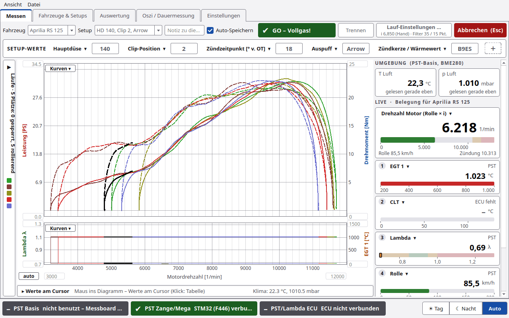

> Diese Seiten sind eine Kopie des [GitHub-Wikis](https://github.com/chili023/PyST/wiki) (Stand PyST 1.4.1).

# PyST 1.4.1 – Wiki

PyST ist die PC-Software zum Rollenprüfstand. Sie läuft auf **Mac**, **Linux** (auch Raspberry Pi) und **Windows**.
PyST liest die Messelektronik, rechnet Leistung und Drehmoment wie LabVIEW 3.2.1, speichert jeden Lauf in einer
Datenbank und hilft beim Vergleichen von Setups.

> ⚠️ **PyST steuert den Motor nicht.** Erreicht der Motor *n Stop*, zeigt PyST nur **GAS WEG** – Gas wegnehmen
> muss der Fahrer. Die Funk-Zange **nie per USB anschließen, während der Motor läuft** (galvanische Verbindung zum PC).

## Was PyST kann

| Bereich | Kurz |
|---|---|
| **Messen** | Lauf starten (F1), Live-Kurve, Live-Kacheln, „GAS WEG“-Hinweis, Ergebnis Pmax/Mmax, 5 Plätze im Diagramm mit Schloss, Referenzkurve |
| **Übersetzung** | von Hand eintragen, einmessen, live mit dem Drehzahlmesser abgleichen, Funkenmessung nach jedem Lauf |
| **Fahrzeuge & Setups** | Datenbank mit Fahrzeugen und Setups (Motor, Vergaser/ECU, Zündung, Antrieb …), Setup-Werte direkt im Messbildschirm ändern |
| **Auswertung** | Läufe überlagern wie in MegaLogViewer, bis zu 4 Felder, Werte am Cursor, Setup-Vergleich, Mittelwert aus mehreren Läufen, PDF- und CSV-Export |
| **Weitergeben** | `.pyst`-Datei (öffnet in PyST) oder HTML-Datei (öffnet in jedem Browser, offline) |
| **Oszi / Dauermessung** | Fehlersuche an Zündung und Rolle: Linienschreiber, Software-Trigger, Ereignisliste, Flanken-Ansicht |
| **Ausrollversuch** | Verluste von Rolle, Rad, Kette bestimmen, dann Motorleistung neben der Radleistung |
| **PyST-Basis & Zange** | Funk-Zündzange mit Tasten, Lambda-Heizung, WLAN, WLAN-Steckdosen |
| **Firmware** | Basis, Zange, Arduino Mega und STM32 (F446) aus PyST heraus aktualisieren |
| **Darstellung** | Tag, Nacht oder Auto, Fenstergröße einstellbar |

## Hauptreiter

| Reiter | Seite im Wiki |
|---|---|
| Messen | [Messen](Messen.md), [Übersetzung](Übersetzung.md) |
| Fahrzeuge & Setups | [Fahrzeuge und Setups](Fahrzeuge-und-Setups.md) |
| Auswertung | [Auswertung](Auswertung.md), [Läufe weitergeben](Läufe-weitergeben.md) |
| Oszi / Dauermessung | [Oszi und Dauermessung](Oszi-und-Dauermessung.md) |
| Einstellungen | [Einstellungen](Einstellungen.md) mit den Unterreitern Rolle/Lauf, Verbindung, Zange, Lambda, ECU, Firmware, WiFi |

Weitere Seiten: [Installation](Installation.md) · [Erste Schritte](Erste-Schritte.md) · [Ausrollversuch](Ausrollversuch.md) ·
[Firmware und Updates](Firmware-und-Updates.md) · [PyST-Basis und Zange](PyST-Basis-und-Zange.md) ·
[Darstellung](Darstellung.md) · [Kommandozeile](Kommandozeile.md) · [Rechenweg](Rechenweg.md) · [Fehlersuche](Fehlersuche.md)

## Neu in 1.4.1

- **Neue Reiterstruktur:** fünf Hauptreiter. Die Einstellungen haben sieben Unterreiter. Der frühere Hauptreiter
  *ECU* ist jetzt **Einstellungen › ECU**, der frühere Reiter *Kalibrierung* (Ausrollversuch) steckt in
  **Einstellungen › Rolle/Lauf** als Gruppe „Verluste – Ausrollversuch“.
- **Tag-, Nacht- und Auto-Thema**, umschaltbar unten rechts oder im Menü *Ansicht › Darstellung*.
- **Statusleiste mit drei farbigen Feldern:** PST Basis · PST Zange/Mega · PST/Lambda ECU.
- **Messen:** Kopfzeile mit *Verbinden/Trennen*, *Lauf-Einstellungen …* und *START (F1)*. Im Lauf wird START rot
  zu *Abbrechen (Esc)*. Zeile **SETUP-WERTE** direkt unter der Kopfzeile. Rechts Live-Kacheln je Fahrzeug.
  Läufe als ausklappbare Seitenleiste, **5 Plätze** im Diagramm mit **Schloss**, **Referenz laden …**.
- **Übersetzung:** Fenster **„Übersetzung live abgleichen“** mit Drehzahlmesser und Schritten ±0,05 / ±0,1 / ±1,
  Bedienung auch mit den Zangentasten. Neue Übersetzungsart **Funkenmessung**.
- **Auswertung:** Laufleiste „ANGEZEIGTE LÄUFE“ mit Setup-Spalten und gelb markierten Änderungen,
  **Mittelwert bilden …**, Werte am Cursor als Kacheln.
- **Firmware:** Kundenansicht mit vier Karten und Expertenmodus. Neu: Arduino Mega (avrdude) und STM32 F446 flashen.

### Noch nicht am Prüfstand bestätigt

- Mega und F446 aus PyST flashen.
- Übersetzungsart **Funkenmessung**.
- **Zangentasten** im Fenster „Übersetzung live abgleichen“.

Diese Funktionen sind nur im Simulator bzw. mit Tests geprüft. Rückmeldungen bitte über die
[Issues](https://github.com/chili023/PyST/issues).
