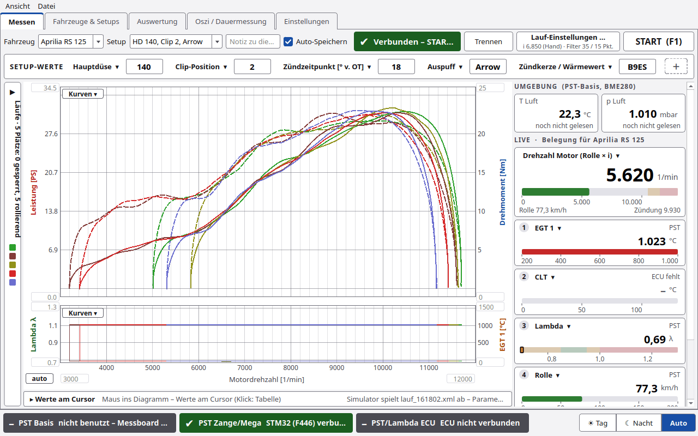
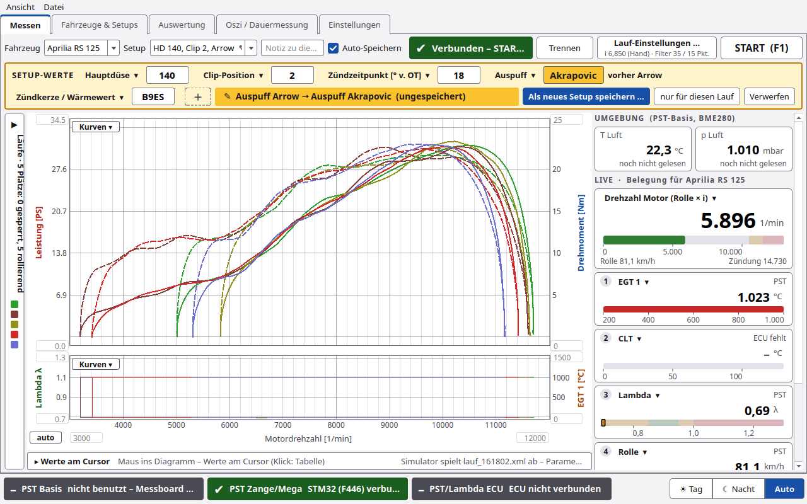

# Messen

Der Reiter **Messen** ist der Arbeitsplatz am Prüfstand: Lauf starten, Kurve live sehen, Ergebnis ablesen.

> ⚠️ PyST steuert den Motor nicht. **GAS WEG** ist nur ein Hinweis. Gas wegnehmen muss der Fahrer.

## Kopfzeile

| Element | Funktion |
|---|---|
| **Fahrzeug** | Fahrzeug für die nächsten Läufe |
| **Setup** | Setup des Fahrzeugs. Bei ungespeicherten Änderungen steht hier „✎ geändert“ |
| **Notiz** | „Notiz zu diesem Lauf (z.B. Änderung gegenüber vorher)“, wird mit dem Lauf gespeichert |
| **Auto-Speichern** | Lauf nach dem Ende sofort in die Datenbank schreiben |
| Statusfeld | Zustand und Anweisung an den Fahrer (Tabelle unten) |
| **Verbinden / Trennen** | Messboard verbinden oder trennen |
| **Lauf-Einstellungen …** | kleines Fenster mit Übersetzung, Filter und Laufgrenzen. Darunter steht kurz, was gilt, z. B. „i 6,850 (Hand) · Filter 35 / 15 Pkt.“ |
| **START  (F1)** | Lauf starten. Im Lauf wird der Knopf rot: **Abbrechen  (Esc)**, beim Ausrollen **Ausrollen beenden (Esc)** |

### Statusfeld

| Text | Bedeutung |
|---|---|
| Nicht verbunden – „Verbinden“ drücken | kein Messboard |
| Verbunden – START drücken (F1) | bereit |
| GO – Vollgas! | Lauf gestartet, Motor noch unter *n vom Gas* |
| Messung … 1/min | Kurve wird aufgenommen |
| GAS WEG! | *n Stop* erreicht oder Laufende erkannt |
| GAS WEG – KUPPLUNG ZIEHEN! | dasselbe, wenn danach der Ausrollversuch läuft |
| KUPPLUNG ZIEHEN – ausrollen lassen … | Ausrollversuch läuft |
| „32.0 PS bei 10000 1/min“ | Ergebnis. Mit Verlusten: „Motor … PS bei … 1/min · Rad … PS“ |

Bei *n Stop* erscheint zusätzlich 2 s lang ein großes **GAS WEG**-Band über dem Diagramm mit dem Grund
(„n Stop … 1/min erreicht – Lauf wird ausgewertet“). Findet PyST nach 120 s kein Laufende, bricht es ab
(„Kein Laufende nach 120 s – abgebrochen“).

Vor dem Start prüft PyST die Werte: *n Stop* muss größer als *n vom Gas* sein, Übersetzung, Rollengeber,
Zündimpulse, Trägheit und Filter müssen größer als 0 sein. Sonst kommt eine Meldung und der Lauf startet nicht.

## Lauf-Einstellungen …

Ein kleines Fenster mit den Werten, die man zwischen zwei Läufen am häufigsten ändert. Es zeigt dieselben Felder wie
**Einstellungen › Rolle/Lauf** und ist im Lauf gesperrt.

| Abschnitt | Felder |
|---|---|
| **ÜBERSETZUNG  nKW/nRolle** | Auswahl **von Hand (Wert eintragen oder einmessen)** oder **Funkenmessung (aus Zündung/Rolle jedes Laufs)**. Feld **Übersetzung** (bei Funkenmessung heißt es **Startwert**). Knöpfe **Übersetzung einmessen …** und **Live abgleichen …**. Siehe [Übersetzung](Übersetzung.md) |
| **FILTER** | **Filter in** Sekunden oder Messpunkte (wie LabVIEW), die zwei Filterwerte, Knopf **Standard** (1,75 s / 0,75 s) |
| **LAUFGRENZEN** | **n vom Gas [1/min]** und **n Stop [1/min] (0 = aus)** |
| Link | **Alle Einstellungen › Rolle/Lauf …** |

## SETUP-WERTE

Direkt unter der Kopfzeile stehen bis zu 8 Werte des aktuellen Setups, Standard: Hauptdüse, Clip-Position,
Zündzeitpunkt.

| Bedienung | Wirkung |
|---|---|
| Wert anklicken und ändern | Wert gilt für die nächsten Läufe |
| **＋** | weiteren Platz anlegen |
| Titel des Platzes anklicken | Feld wählen. Gruppen: Vergaser (bei EFI: Einspritzung / ECU), Zündung, Antrieb, Ein- und Auslass, **Weitere Felder**, außerdem **leer lassen** und **Platz entfernen** |

Die Auswahl der Plätze speichert PyST je Fahrzeug.

Nach einer Änderung wird die Zeile gelb. Am Wert steht „vorher X“, daneben „✎ … (ungespeichert)“. Knöpfe:

| Knopf | Wirkung |
|---|---|
| **Als neues Setup speichern …** | öffnet das Setup-Fenster mit allen Werten und einem Namensvorschlag |
| **nur für diesen Lauf** | Werte nur im nächsten Lauf speichern, kein neues Setup |
| **Verwerfen** | alte Werte zurück |

Drückt man START mit ungespeicherten Werten, fragt PyST („Setup geändert“): **Neues Setup speichern …**,
**Nur für diesen Lauf** oder **Abbrechen**. Abschaltbar mit **Bei geändertem Setup vor START nachfragen**
(Einstellungen › Rolle/Lauf). Startet man mit der Zangentaste, fragt PyST nicht. Die Werte gelten dann nur für diesen
Lauf. Wählt man ein anderes Setup, sind ungespeicherte Werte verworfen.

## Rechte Spalte

### UMGEBUNG  (PST-Basis, BME280)

Kacheln **T Luft** und **p Luft** mit dem Alter des Werts („noch nicht gelesen“, „gelesen gerade eben“, „vor x min“,
„von Hand eingetragen“). PyST liest das Klima nur zwischen den Läufen: beim START, von Hand und im Leerlauf alle 5 min,
solange der Reiter Messen offen ist.

### LIVE · Belegung für &lt;Fahrzeug&gt;

| Teil | Inhalt |
|---|---|
| große Drehzahlkachel | Quelle wählbar: **Drehzahl Motor (Rolle × i)**, **Drehzahl Motor (Zündung)**, **Drehzahl Motor (ECU)**. Darunter Rolle km/h und Zündung. Balken 0–13000, gelb ab 10500, rot ab 11500 |
| 5 kleine Kacheln | Standard: EGT 1, CLT (ECU), Lambda, Rolle km/h, leer |

- **Titel anklicken:** Kanal wählen. Kanäle der PST: Motor (Rolle × i), Motor (Zündung), Rolle km/h, EGT 1/2,
  Lambda/AFR, Übersetzung Zündung/Rolle, Übersetzung ECU/Rolle, Messfrequenz. Dazu die Kanäle der ECU.
- **Rechtsklick:** **Balkengrenzen …** (von/bis und bis zu 4 Bereiche gut, Warnung, Fehler, kalt) oder
  **Standardgrenzen**.
- Alles gilt je Fahrzeug. Ohne ECU steht „ECU fehlt“.

### ERGEBNIS

**Pmax @ n** und **Mmax @ n** des laufenden, letzten, markierten oder Referenzlaufs.

## Diagramm

- Leistung und Drehmoment über der Motordrehzahl, darunter optional ein zweites Diagramm.
- **Kurven ▾** oben: **Unteres Diagramm anzeigen** und ECU-Kurven über der Leistung (jeweils Maximum).
- **Kurven ▾** unten: Belegung links/rechts mit Lambda / AFR (Board), EGT 1/2 (Board) oder ECU-Kanälen.
- **Achsgrenzen:** Zahl eintragen + Enter = fest, Feld leer = automatisch. Knopf **auto** setzt alle Achsen zurück.
- **▸ Werte am Cursor:** klappt eine Tabelle mit den Werten an der Mausposition auf. **Spalten …** wählt die Spalten.
- Im Lauf bleibt die Skalierung fest, damit die Kurve nicht springt.

## Läufe (Seitenleiste)

Am rechten Rand des Diagramms steht eine schmale Leiste „Läufe · 5 Plätze: x gesperrt, y rollierend“. Mit der Maus
darauf (300 ms) klappt die Liste auf. **Anpinnen** hält sie offen.

**Die 5 Plätze:** Im Diagramm stehen höchstens 5 Läufe je Fahrzeug. Gesperrte Plätze (Schloss) bleiben. Die übrigen
Plätze rollieren: der neueste Lauf verdrängt den ältesten nicht gesperrten.

| Element | Funktion |
|---|---|
| Filter | **alle**, **aktuelles Fahrzeug**, **aktuelles Setup** |
| **Referenz laden …** | Mittelwert als Referenz auf einen gesperrten Platz legen (siehe unten) |
| Gruppen | **GESPERRT**, **ROLLIEREND** (die letzten n), **ÄLTERE LÄUFE** |
| Spalten | Schloss, Lauf, PS, bei, Nm, Fehler |
| Schloss anklicken | Platz sperren bzw. lösen. Ältere Läufe holt man mit dem Schloss ins Diagramm |
| Häkchen | Lauf im Diagramm zeigen oder ausblenden |
| Doppelklick | Lauf in der Auswertung öffnen |
| **Alle ausblenden** | alle Häkchen weg |
| **In Auswertung** | markierte Läufe in die Auswertung |
| **Löschen** | Läufe löschen, **auch die Messdateien** |

**Rechtsklick auf einen Lauf:** **Platz sperren (Schloss)** / **Schloss lösen**, **In Auswertung öffnen**,
**Notiz bearbeiten …**, **Farbe ändern …**, **Aktuellem Fahrzeug/Setup zuordnen**, **Mit aktuellen Einstellungen neu
rechnen** (Klima des Laufs bleibt), **CSV-Export …**, **Löschen …**.

### Referenz laden …

Zeigt die Mittelwerte, bei denen „im Messfenster als Referenz anbieten“ angehakt ist (siehe
[Auswertung](Auswertung.md#mittelwert-bilden)). Mit **weitere … (n nicht angebotene Mittelwerte zeigen)** erscheinen
auch die anderen. **Als Referenz laden** legt den Mittelwert auf einen gesperrten Platz. Er erscheint als dicke Linie
mit Streuband.

## Tasten

| Taste | Wirkung |
|---|---|
| F1 | START |
| Esc | Lauf abbrechen bzw. Ausrollen beenden |
| F3 | Marker (Zange), im ganzen Programm |

## Gespeichert je Lauf

Im Datenordner unter `messungen/` je Lauf: `roh.csv` (Rohdaten), `lauf.json` (alle Parameter), `kurve.csv`
(gerechnete Kurve), `lauf.xml` (LabVIEW-Format, Filter in Punkten), bei ECU `rusefi.csv`, dazu Marker und Ereignisse.
Ein PNG legt PyST nicht mehr an.

## Experten

- Nach einem WLAN-Abriss zur Basis verbindet PyST selbst wieder und meldet sich neu an. Eine abgelehnte Anmeldung
  wiederholt es nicht.
- **Laufende:** erste Verzögerung oberhalb *n vom Gas* oder *n Stop*. Der Vorlauf bis zur letzten Verzögerung unter
  *n vom Gas* wird abgeschnitten. Details: [Rechenweg](Rechenweg.md).
- Die Spalte **Fehler** zeigt den Anteil gestörter Messpunkte (Rolle, Zündung, Doppelimpuls, eingefrorener Wert).
  Siehe [Fehlersuche](Fehlersuche.md).
- **Neu rechnen** nimmt die aktuellen Prüfstands-, Filter- und Verlustwerte und das gespeicherte Klima des Laufs.
