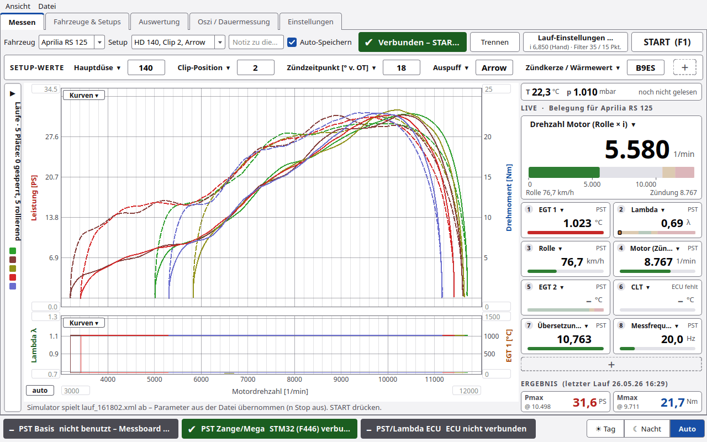
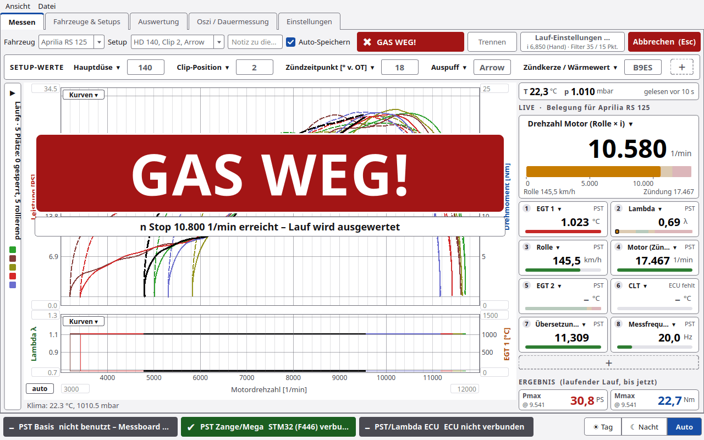
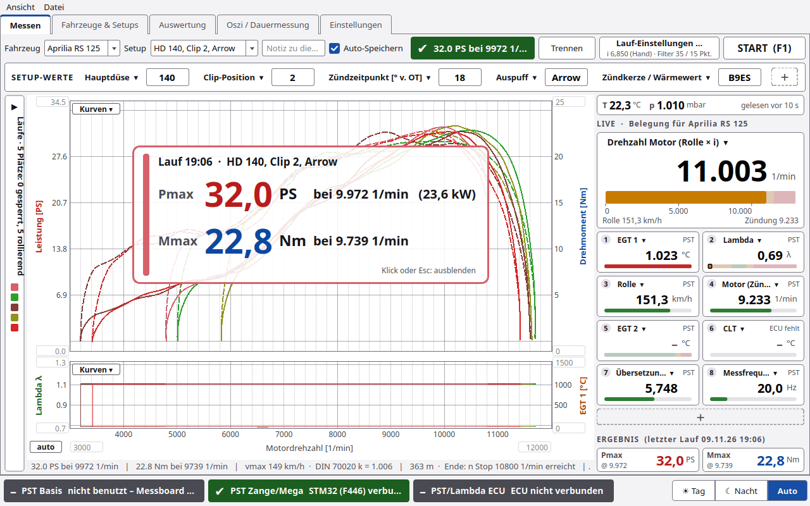
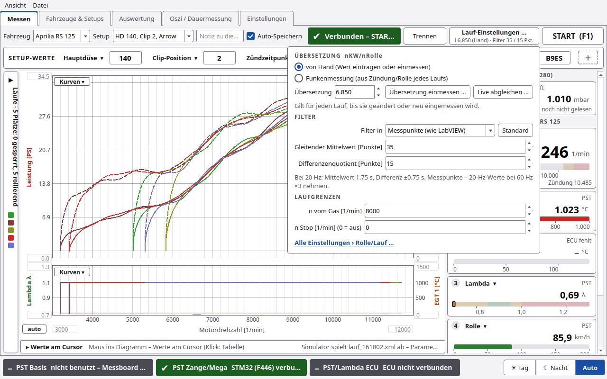
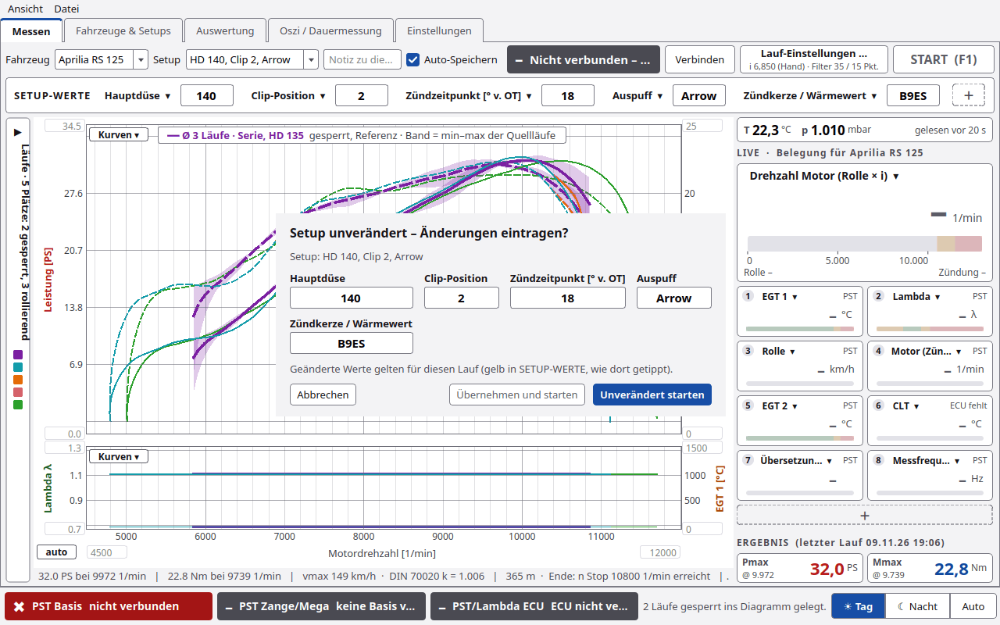
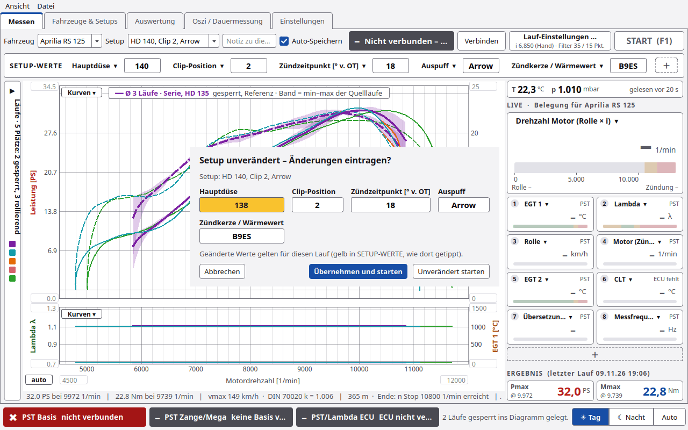
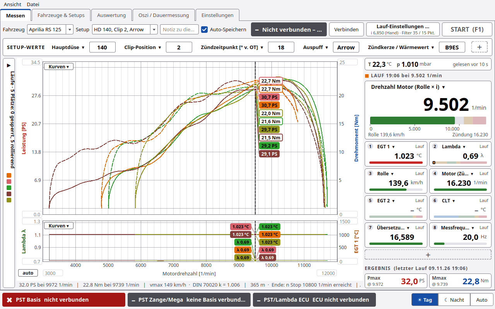
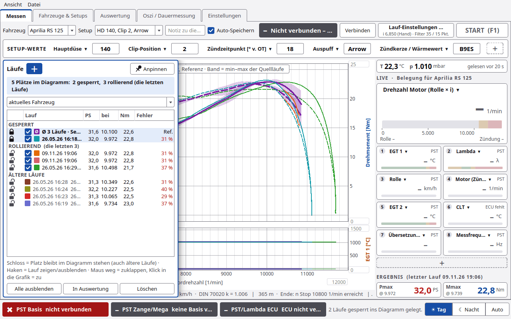
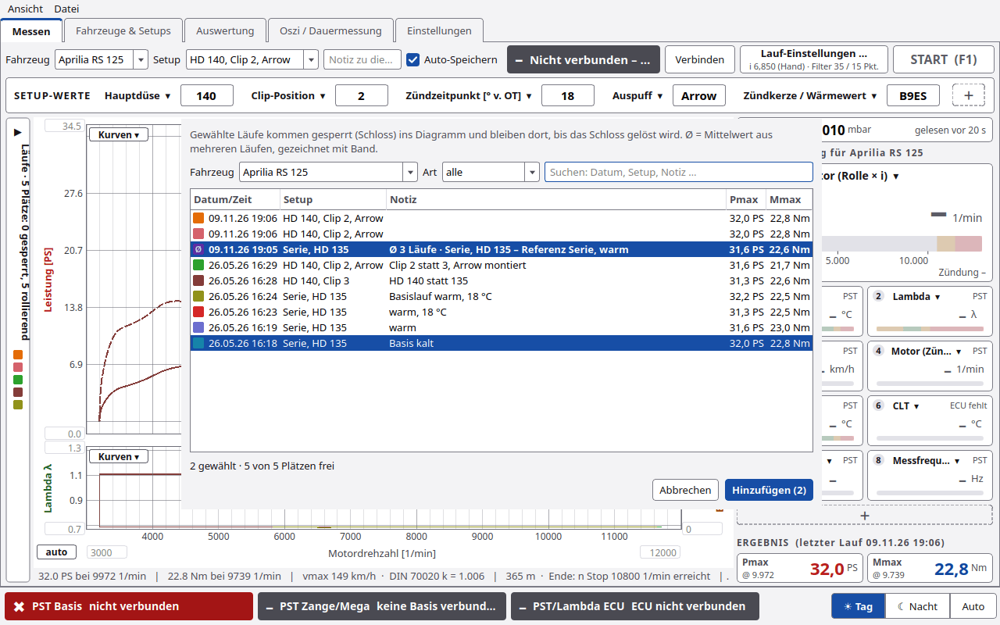

# Messen

Der Reiter **Messen** ist der Arbeitsplatz am Prüfstand: Lauf starten, Kurve live sehen, Ergebnis ablesen.

> ⚠️ PyST steuert den Motor nicht. **GAS WEG** ist nur ein Hinweis. Gas wegnehmen muss der Fahrer.

## Kopfzeile

| Element | Funktion |
|---|---|
| **Fahrzeug** | Fahrzeug für die nächsten Läufe |
| **Setup** | Setup des Fahrzeugs. Bei ungespeicherten Änderungen steht hier „✎ geändert“ |
| **Notiz** | „Notiz zu diesem Lauf (z.B. Änderung gegenüber vorher)“, wird mit dem Lauf gespeichert |
| **Auto-Speichern** | Lauf nach dem Ende sofort in die Datenbank schreiben |
| Statusfeld | Zustand und Anweisung an den Fahrer (Tabelle unten) |
| **Verbinden / Trennen** | Messboard verbinden oder trennen |
| **Lauf-Einstellungen …** | kleines Fenster mit Übersetzung, Filter und Laufgrenzen. Darunter steht kurz, was gilt, z. B. „i 6,850 (Hand) · Filter 35 / 15 Pkt.“ |
| **START  (F1)** | Lauf starten, bei unverändertem Setup erst mit kurzer [Nachfrage](#start-nachfrage). Im Lauf wird der Knopf rot: **Abbrechen  (Esc)**, beim Ausrollen **Ausrollen beenden (Esc)** |

### Statusfeld

| Text | Bedeutung |
|---|---|
| Nicht verbunden – „Verbinden“ drücken | kein Messboard |
| Verbunden – START drücken (F1) | bereit |
| GO – Vollgas! | Lauf gestartet, Motor noch unter *n vom Gas* |
| Messung … 1/min | Kurve wird aufgenommen |
| GAS WEG! | *n Stop* erreicht oder Laufende erkannt |
| GAS WEG – KUPPLUNG ZIEHEN! | dasselbe, wenn danach der Ausrollversuch läuft |
| KUPPLUNG ZIEHEN – ausrollen lassen … | Ausrollversuch läuft |
| „32.0 PS bei 10000 1/min“ | Ergebnis. Mit Verlusten: „Motor … PS bei … 1/min · Rad … PS“ |

**Anweisungen groß** (Standard an): Die Texte des Statusfelds stehen im Lauf zusätzlich sehr groß über dem Diagramm,
in derselben Farbe (GO grün, Messung gelb, GAS WEG rot, KUPPLUNG ZIEHEN gelb), darunter der Grund
(„n Stop … 1/min erreicht – Lauf wird ausgewertet“). GAS WEG bleibt mindestens 2 s stehen. Ist die Option aus,
erscheint wie bisher nur das große **GAS WEG**. Findet PyST nach 120 s kein Laufende, bricht es ab
(„Kein Laufende nach 120 s – abgebrochen“).

**Ergebnis groß** (Standard an): Nach dem Lauf stehen **Pmax** und **Mmax** mit Drehzahl groß über dem Diagramm,
mit Farbe, Uhrzeit und Setup des Laufs. Weg mit START, Klick darauf oder Esc.

Beide Optionen und **Legende im Diagramm** (Standard aus) schaltet man unter Einstellungen › Rolle/Lauf ›
**Anzeige beim Messen** oder im Menü **Ansicht**.

Vor dem Start prüft PyST die Werte: *n Stop* muss größer als *n vom Gas* sein, Übersetzung, Rollengeber,
Zündimpulse, Trägheit und Filter müssen größer als 0 sein. Sonst kommt eine Meldung und der Lauf startet nicht.

## Lauf-Einstellungen …

Ein kleines Fenster mit den Werten, die man zwischen zwei Läufen am häufigsten ändert. Es zeigt dieselben Felder wie
**Einstellungen › Rolle/Lauf** und ist im Lauf gesperrt.

| Abschnitt | Felder |
|---|---|
| **ÜBERSETZUNG  nKW/nRolle** | Auswahl **von Hand (Wert eintragen oder einmessen)** oder **Funkenmessung (aus Zündung/Rolle jedes Laufs)**. Feld **Übersetzung** (bei Funkenmessung heißt es **Startwert**). Knöpfe **Übersetzung einmessen …** und **Live abgleichen …**. Siehe [Übersetzung](Übersetzung.md) |
| **FILTER** | **Filter in** Sekunden oder Messpunkte (wie LabVIEW), die zwei Filterwerte, Knopf **Standard** (1,75 s / 0,75 s) |
| **LAUFGRENZEN** | **n vom Gas [1/min]** und **n Stop [1/min] (0 = aus)** |
| Link | **Alle Einstellungen › Rolle/Lauf …** |

## SETUP-WERTE

Direkt unter der Kopfzeile stehen bis zu 8 Werte des aktuellen Setups, Standard: Hauptdüse, Clip-Position,
Zündzeitpunkt.

| Bedienung | Wirkung |
|---|---|
| Wert anklicken und ändern | Wert gilt für die nächsten Läufe |
| **＋** | weiteren Platz anlegen |
| Titel des Platzes anklicken | Feld wählen. Gruppen: Vergaser (bei EFI: Einspritzung / ECU), Zündung, Antrieb, Ein- und Auslass, **Weitere Felder**, außerdem **leer lassen** und **Platz entfernen** |

Die Auswahl der Plätze speichert PyST je Fahrzeug.

Nach einer Änderung wird die Zeile gelb. Am Wert steht „vorher X“, daneben „✎ … (ungespeichert)“. Knöpfe:

| Knopf | Wirkung |
|---|---|
| **Als neues Setup speichern …** | öffnet das Setup-Fenster mit allen Werten und einem Namensvorschlag |
| **nur für diesen Lauf** | Werte nur im nächsten Lauf speichern, kein neues Setup |
| **Verwerfen** | alte Werte zurück |

Drückt man START mit geänderten Werten, startet der Lauf ohne Rückfrage. Die Werte gelten dann nur für diesen Lauf
(wie **nur für diesen Lauf**). Ein neues Setup legt man mit **Als neues Setup speichern …** an. Wählt man ein anderes
Setup, sind ungespeicherte Werte verworfen.

### START-Nachfrage

Ist in SETUP-WERTE **nichts** geändert, fragt PyST beim START kurz: **„Setup unverändert – Änderungen eintragen?“**.
Das Fenster zeigt den Namen des Setups und die belegten SETUP-WERTE als Felder. Hat man am Motorrad etwas umgebaut
und es noch nicht eingetragen, ändert man es gleich hier.

| Knopf | Wirkung |
|---|---|
| **Unverändert starten** | Standard (Enter oder F1): der Lauf startet mit dem Setup, wie es ist |
| **Übernehmen und starten** | erst aktiv, wenn ein Feld geändert ist; dann ist es der Standard (Enter). Die neuen Werte stehen danach gelb in SETUP-WERTE und gelten für diesen Lauf |
| **Abbrechen** (Esc) | kein Lauf |

- Die Zangentaste **Neuer Lauf** startet immer ohne Nachfrage.
- Ohne Fahrzeug oder ohne belegte SETUP-WERTE fragt PyST nicht.
- Abschaltbar mit **Vor START nachfragen, ob sich das Setup geändert hat** (Einstellungen › Rolle/Lauf, Standard an).

## Rechte Spalte

### UMGEBUNG  (PST-Basis, BME280)

Eine schmale Zeile **T … °C  p … mbar** mit dem Alter des Werts („noch nicht gelesen“, „gelesen gerade eben“, „vor x min“,
„von Hand eingetragen“). PyST liest das Klima nur zwischen den Läufen: beim START, von Hand und im Leerlauf alle 5 min,
solange der Reiter Messen offen ist.

### LIVE · Belegung für &lt;Fahrzeug&gt;

| Teil | Inhalt |
|---|---|
| große Drehzahlkachel | Quelle wählbar: **Drehzahl Motor (Rolle × i)**, **Drehzahl Motor (Zündung)**, **Drehzahl Motor (ECU)**. Darunter Rolle km/h und Zündung. Balken 0–13000, gelb ab 10500, rot ab 11500 |
| 0 bis 12 kleine Kacheln | Standard: EGT 1, CLT (ECU), Lambda, Rolle km/h, leer. **＋** am Ende fügt einen Platz an |

- **Titel anklicken:** Kanal wählen oder **Platz entfernen**. Kanäle der PST: Motor (Rolle × i), Motor (Zündung),
  Rolle km/h, EGT 1/2, Lambda/AFR, Übersetzung Zündung/Rolle, Übersetzung ECU/Rolle, Messfrequenz. Dazu die Kanäle
  der ECU.
- Bis 4 Plätze stehen die Kacheln untereinander, ab 5 Plätzen zweispaltig und kompakt (kurzer Titel, Zahl groß,
  dünner Balken ohne Skala). Bei 1280×800 passen so 8 Plätze ohne Rollen.
- UMGEBUNG und die Drehzahl bleiben oben stehen, die kleinen Kacheln rollen, wenn sie nicht alle passen.

- **Maus im Diagramm** (kein Lauf aktiv): Die Kacheln zeigen die Werte des neuesten Laufs an der Cursor-Drehzahl,
  oben steht dann „LAUF 16:29 bei 9.500 1/min“ statt LIVE. Maus aus dem Diagramm: wieder live.
- **Rechtsklick:** **Balkengrenzen …** (von/bis und bis zu 4 Bereiche gut, Warnung, Fehler, kalt) oder
  **Standardgrenzen**.
- Alles gilt je Fahrzeug. Ohne ECU steht „ECU fehlt“.

### ERGEBNIS

**Pmax** und **Mmax** nebeneinander in einer Zeile (Drehzahl klein darunter) des laufenden, letzten, markierten oder Referenzlaufs.

## Diagramm

- Leistung und Drehmoment über der Motordrehzahl, darunter optional ein zweites Diagramm.
- **Kurven ▾** oben: **Unteres Diagramm anzeigen** und ECU-Kurven über der Leistung (jeweils Maximum).
- **Kurven ▾** unten: Belegung links/rechts mit Lambda / AFR (Board), EGT 1/2 (Board) oder ECU-Kanälen.
- **Achsgrenzen:** Zahl eintragen + Enter = fest, Feld leer = automatisch. Knopf **auto** setzt alle Achsen zurück.
- **Werte am Cursor:** Steht die Maus im Diagramm, zeigt jede Kurve an der Cursor-Drehzahl ein kleines Fähnchen mit
  ihrem Wert („31,6 PS“, „22,7 Nm“, „λ 0,92“) in der Farbe des Laufs, gefüllt für Leistung, umrandet für Drehmoment.
  Läufe gleicher Farbe teilen sich ein Fähnchen; bei vielen Läufen werden die Fähnchen kleiner und stehen links und
  rechts vom Cursor.
  Die frühere Zeile „▸ Werte am Cursor“ unter dem Diagramm gibt es nicht mehr; die Werte aller Kanäle des letzten
  Laufs stehen beim Zeigen in den Live-Kacheln rechts (siehe oben).
- **Legende im Diagramm** (Option, Standard aus): Farbe, Datum/Zeit und Setup bzw. Notiz jedes Laufs oben links.
  Referenzen (Mittelwert) stehen immer in der Legende, mit dem Hinweis auf das Band („Band = min–max der Quellläufe“).
- Unter dem Diagramm steht eine schmale Ergebniszeile (Pmax, Mmax, vmax, DIN-Faktor, Strecke, Grund für das
  Laufende). Ist sie zu lang, zeigt der Tooltip den ganzen Text.
- Im Lauf bleibt die Skalierung fest, damit die Kurve nicht springt.

## Läufe (Seitenleiste)

Am linken Rand des Diagramms steht eine schmale Leiste „Läufe · 5 Plätze: x gesperrt, y rollierend“. Mit der Maus
darauf (300 ms) klappt die Liste auf. **Anpinnen** hält sie offen.

**Die 5 Plätze:** Im Diagramm stehen höchstens 5 Läufe je Fahrzeug. Gesperrte Plätze (Schloss) bleiben. Die übrigen
Plätze rollieren: der neueste Lauf verdrängt den ältesten nicht gesperrten.

| Element | Funktion |
|---|---|
| **＋** (oben neben „Läufe“) | **Läufe hinzufügen …**: alte Läufe oder Mittelwerte gesperrt ins Diagramm legen (siehe [unten](#läufe-hinzufügen)) |
| Filter | **alle**, **aktuelles Fahrzeug**, **aktuelles Setup** |
| Gruppen | **GESPERRT**, **ROLLIEREND** (die letzten n), **ÄLTERE LÄUFE** |
| Spalten | Schloss, Lauf, PS, bei, Nm, Fehler |
| Schloss anklicken | Platz sperren bzw. lösen. Ältere Läufe holt man mit dem Schloss ins Diagramm |
| Häkchen | Lauf im Diagramm zeigen oder ausblenden |
| Doppelklick | Lauf in der Auswertung öffnen |
| **Alle ausblenden** | alle Häkchen weg |
| **In Auswertung** | markierte Läufe in die Auswertung |
| **Löschen** | Läufe löschen, **auch die Messdateien** |

**Rechtsklick auf einen Lauf:** **Platz sperren (Schloss)** / **Schloss lösen**, **In Auswertung öffnen**,
**Notiz bearbeiten …**, **Farbe ändern …**, **Aktuellem Fahrzeug/Setup zuordnen**, **Mit aktuellen Einstellungen neu
rechnen** (Klima des Laufs bleibt), **CSV-Export …**, **Löschen …**.

### Läufe hinzufügen

Der Knopf **＋** oben in der Seitenleiste öffnet das Fenster **Läufe hinzufügen**. Darin stehen alle gespeicherten
Läufe und Mittelwerte, neueste zuerst.

| Element | Funktion |
|---|---|
| **Fahrzeug** | Standard: das aktuelle Fahrzeug. **alle Fahrzeuge** zeigt auch Läufe anderer Fahrzeuge (Spalte Setup mit Fahrzeugname) |
| **Art** | **alle**, **nur Messungen**, **nur Mittelwerte** |
| Suche | „Suchen: Datum, Setup, Notiz …“ |
| Liste | Datum/Zeit, Setup, Notiz, Pmax, Mmax. Mittelwerte stehen fett mit **Ø**. Läufe, die schon gesperrt im Diagramm liegen, sind grau mit Schloss und nicht wählbar |
| Statuszeile | z. B. „2 gewählt · 3 von 5 Plätzen frei“ |
| **Hinzufügen (n)** / **Abbrechen** | gewählte Läufe übernehmen bzw. schließen |

Mehrere Läufe wählt man mit Strg oder Umschalt, ein Doppelklick nimmt einen Lauf direkt. Die gewählten Läufe liegen
danach **gesperrt** (Schloss) auf freien Plätzen und bleiben dort, bis man das Schloss löst. Ein Lauf, der gerade
rollierend im Diagramm steht, wird dabei gesperrt. Wählt man mehr Läufe, als Plätze frei sind, sagt PyST das, und
**Hinzufügen** bleibt gesperrt: zuerst in der Liste „Läufe“ ein Schloss lösen.

**Mittelwerte als Referenz:** Ein Mittelwert (siehe [Auswertung](Auswertung.md#mittelwert-bilden)) erscheint als dicke
Linie mit Streuband und steht immer in der Legende („gesperrt, Referenz · Band = min–max der Quellläufe“). In der Liste
„Läufe“ steht in der Spalte Fehler „Ref.“. Den früheren Knopf **Referenz laden …** gibt es nicht mehr.

## Tasten

| Taste | Wirkung |
|---|---|
| F1 | START (in der START-Nachfrage: **Unverändert starten**) |
| Esc | großes Ergebnis ausblenden, sonst Lauf abbrechen bzw. Ausrollen beenden |
| F3 | Marker (Zange), im ganzen Programm |

## Gespeichert je Lauf

Im Datenordner unter `messungen/` je Lauf: `roh.csv` (Rohdaten), `lauf.json` (alle Parameter), `kurve.csv`
(gerechnete Kurve), `lauf.xml` (LabVIEW-Format, Filter in Punkten), bei ECU `rusefi.csv`, dazu Marker und Ereignisse.
Ein PNG legt PyST nicht mehr an.

## Experten

- Nach einem WLAN-Abriss zur Basis verbindet PyST selbst wieder und meldet sich neu an. Eine abgelehnte Anmeldung
  wiederholt es nicht.
- **Laufende:** erste Verzögerung oberhalb *n vom Gas* oder *n Stop*. Der Vorlauf bis zur letzten Verzögerung unter
  *n vom Gas* wird abgeschnitten. Details: [Rechenweg](Rechenweg.md).
- Die Spalte **Fehler** zeigt den Anteil gestörter Messpunkte (Rolle, Zündung, Doppelimpuls, eingefrorener Wert).
  Siehe [Fehlersuche](Fehlersuche.md).
- **Neu rechnen** nimmt die aktuellen Prüfstands-, Filter- und Verlustwerte und das gespeicherte Klima des Laufs.
