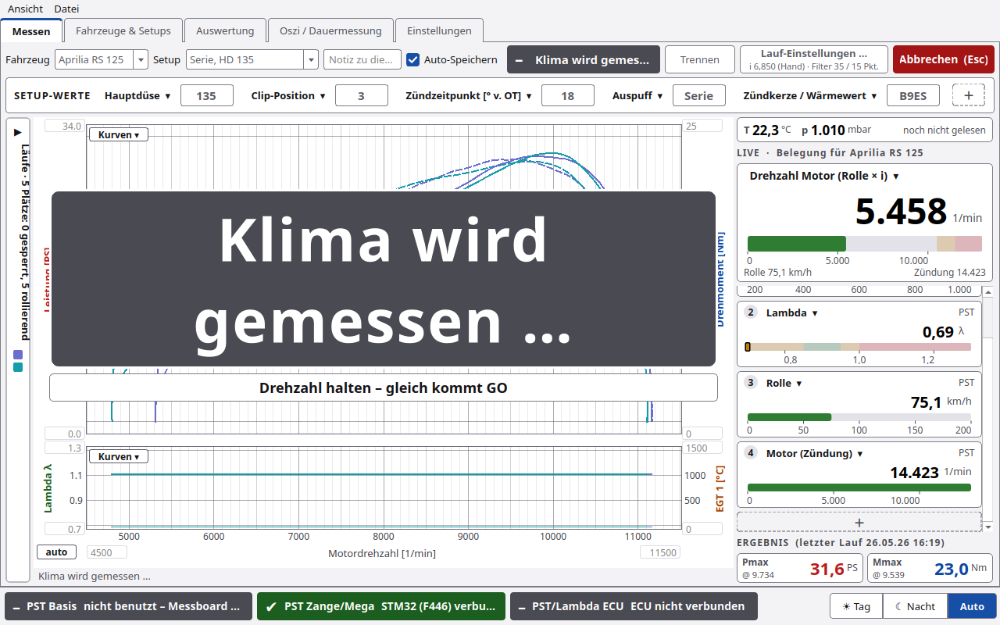
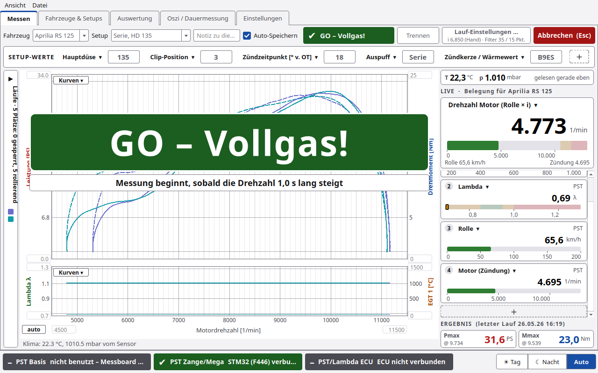
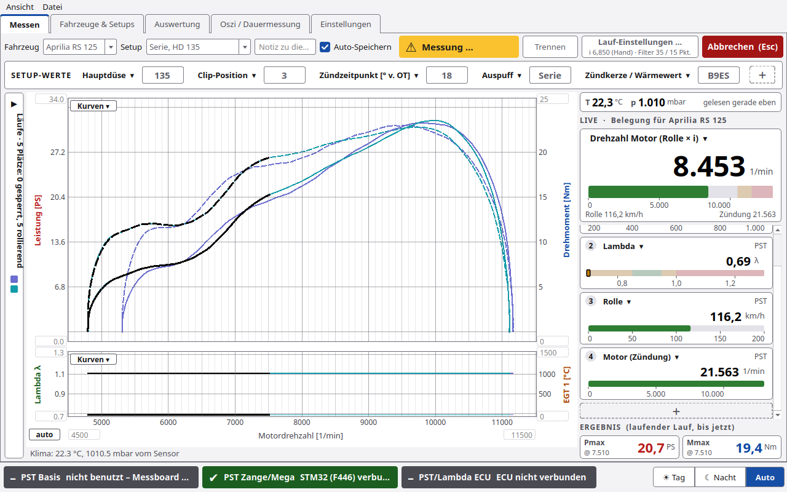
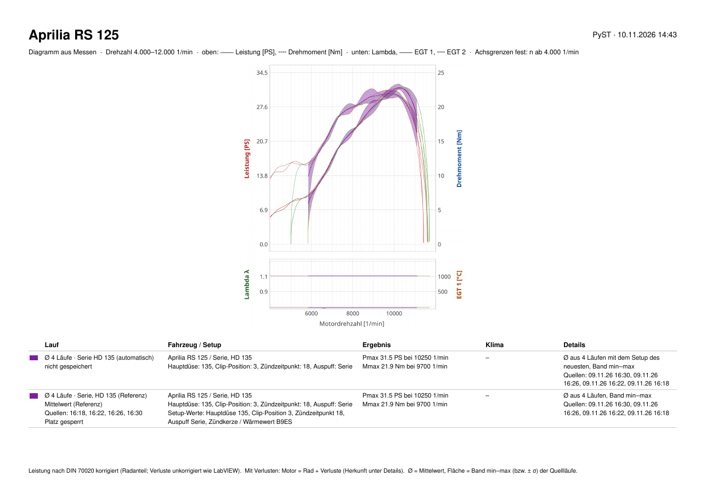

# Messen

Der Reiter **Messen** ist der Arbeitsplatz am Prüfstand: Lauf starten, Kurve live sehen, Ergebnis ablesen.

> ⚠️ PyST steuert den Motor nicht. **GAS WEG** ist nur ein Hinweis. Gas wegnehmen muss der Fahrer.

## Kopfzeile

| Element | Funktion |
|---|---|
| **Fahrzeug** | Fahrzeug für die nächsten Läufe |
| **Setup** | Setup des Fahrzeugs. Bei ungespeicherten Änderungen steht hier „✎ geändert“ |
| **Notiz** | „Notiz zu diesem Lauf (z.B. Änderung gegenüber vorher)“, wird mit dem Lauf gespeichert |
| **Auto-Speichern** | Lauf nach dem Ende sofort in die Datenbank schreiben |
| Statusfeld | Zustand und Anweisung an den Fahrer (Tabelle unten) |
| **Verbinden / Trennen** | Messboard verbinden oder trennen |
| **Lauf-Einstellungen …** | kleines Fenster mit Übersetzung, Filter sowie Start und Ende des Laufs. Darunter steht kurz, was gilt, z. B. „i 6,850 (Hand) · Filter 35 / 15 Pkt.“ |
| **START  (F1)** | Lauf starten, bei unverändertem Setup erst mit kurzer [Nachfrage](#start-nachfrage). Im Lauf wird der Knopf rot: **Abbrechen  (Esc)**, beim Ausrollen **Ausrollen beenden (Esc)** |

### Statusfeld

| Text | Bedeutung |
|---|---|
| Nicht verbunden – „Verbinden“ drücken | kein Messboard |
| Verbunden – START drücken (F1) | bereit |
| Klima wird gemessen … | gleich nach START: PyST liest Temperatur und Luftdruck frisch vom Sensor (grau, höchstens 3 s) |
| GO – Vollgas! | bereit zum Lauf – Vollgas geben. Die Messung beginnt, sobald die Drehzahl 1 s lang steigt |
| Messung · 9.500 1/min | Kurve wird aufgenommen. Ist das Feld schmal (1280 px), steht nur „Messung …“ |
| GAS WEG! | *n Stop* erreicht oder Laufende erkannt |
| GAS WEG – KUPPLUNG ZIEHEN! | dasselbe, wenn danach der Ausrollversuch läuft |
| KUPPLUNG ZIEHEN · ausrollen lassen · … 1/min | Ausrollversuch läuft (schmal: „KUPPLUNG ZIEHEN …“) |
| „32.0 PS bei 10000 1/min“ | Ergebnis. Mit Verlusten: „Motor … PS bei … 1/min · Rad … PS“ |

**Anweisungen groß** (Standard an): Was der Fahrer gerade tun muss, steht sehr groß über dem Diagramm, darunter der
Grund. Die Schrift ist immer gleich groß (sie richtet sich nur nach der Breite des Diagramms); ein längerer Text bricht
um.

| Zeitpunkt | groß über dem Diagramm |
|---|---|
| gleich nach START | **Klima wird gemessen …** (grau), darunter „Drehzahl halten – gleich kommt GO“. Nur mit **vor jedem Lauf vom Sensor lesen** |
| danach bis zum Laufbeginn | **GO – Vollgas!** (grün), darunter „Messung beginnt, sobald die Drehzahl 1,0 s lang steigt“ |
| Messung (ab dem Drehzahlanstieg) | nichts – die Kurve bleibt frei. Das Statusfeld oben zeigt „Messung …“ |
| Laufende, ohne Ausrollversuch | **GAS WEG!** (rot), „n Stop … 1/min erreicht – Lauf wird ausgewertet“. Steht mindestens 2 s, danach gleich das große Ergebnis |
| Laufende, mit [Ausrollversuch](Ausrollversuch.md) | **GAS WEG – KUPPLUNG ZIEHEN!** (rot), darunter „ausrollen lassen … 1/min“, bis das Ausrollen fertig ist. Dann das große Ergebnis |

Ist die Option aus, erscheint wie bisher nur das große **GAS WEG**. Steigt die Drehzahl nach GO 60 s lang nicht, bricht
PyST ab („Kein Drehzahlanstieg nach 60 s – abgebrochen“). Findet es 120 s nach dem Laufbeginn kein Laufende, ebenso
(„Kein Laufende nach 120 s – abgebrochen“).

### Ablauf eines Laufs

1. **START** (F1, bzw. Zangentaste **Neuer Lauf**). Bei unverändertem Setup kommt erst die
   [START-Nachfrage](#start-nachfrage).
2. **Klima wird gemessen …**: PyST fordert eine frische Messung vom Klimasensor (BME280/BMP280 auf der Basis) an und
   nimmt nur einen Wert, der nach dem START gemessen wurde. Antwortet der Sensor nicht innerhalb von 3 s, rechnet der
   Lauf mit den eingetragenen Werten; im Ergebnis steht dann „Klima: eingetragener Wert … (kein Sensorwert)“. Ist
   **vor jedem Lauf vom Sensor lesen** (Einstellungen › Rolle/Lauf › Klima) aus, entfällt dieser Schritt.
3. **GO – Vollgas!**: Jetzt Vollgas geben.
4. **Laufbeginn:** Steigt die Motordrehzahl (Rolle × Übersetzung) **1 s lang** durchgehend und um mindestens
   **150 1/min**, beginnt die Messung. Die Kurve beginnt am **Anfang** dieser Sekunde, es geht nichts verloren. Was
   davor war (Halten), gehört nicht zum Lauf. Beide Werte stehen unter **Lauf-Einstellungen …** › LAUF
   (**Start: steigt über [s]**, **Start: Anstieg mind. [1/min]**).
5. **Messung:** GO verschwindet, über der Kurve steht nichts.
6. **Laufende:** Ab *n vom Gas* prüft PyST auf fallende Drehzahl (Gas weg) bzw. endet bei *n Stop* – **GAS WEG!**,
   danach das große Ergebnis.

| GO – Vollgas! | Messung |
|---|---|
|  |  |

*n vom Gas* startet den Lauf nicht mehr. Es ist nur noch die Drehzahl, ab der PyST auf fallende Drehzahl (= Laufende)
prüft.

**Ergebnis groß** (Standard an): Nach dem Lauf (nach GAS WEG bzw. nach dem Ausrollen) stehen **Pmax** und **Mmax**
mit Drehzahl groß über dem Diagramm, mit Farbe, Uhrzeit und Setup des Laufs. Weg mit START, Klick darauf oder Esc.

Beide Optionen und **Legende im Diagramm** (Standard aus) schaltet man unter Einstellungen › Rolle/Lauf ›
**Anzeige beim Messen** oder im Menü **Ansicht**.

Vor dem Start prüft PyST die Werte: *n Stop* muss größer als *n vom Gas* sein, Übersetzung, Rollengeber,
Zündimpulse, Trägheit und Filter müssen größer als 0 sein. Sonst kommt eine Meldung und der Lauf startet nicht.

## Lauf-Einstellungen …

Ein kleines Fenster mit den Werten, die man zwischen zwei Läufen am häufigsten ändert. Es zeigt dieselben Felder wie
**Einstellungen › Rolle/Lauf** und ist im Lauf gesperrt.

| Abschnitt | Felder |
|---|---|
| **ÜBERSETZUNG  nKW/nRolle** | Auswahl **von Hand (Wert eintragen oder einmessen)** oder **Funkenmessung (aus Zündung/Rolle jedes Laufs)**. Feld **Übersetzung** (bei Funkenmessung heißt es **Startwert**). Knöpfe **Übersetzung einmessen …** und **Live abgleichen …**. Siehe [Übersetzung](Übersetzung.md) |
| **FILTER** | **Filter in** Sekunden oder Messpunkte (wie LabVIEW), die zwei Filterwerte, Knopf **Standard** (1,75 s / 0,75 s) |
| **LAUF  Start und Ende** | **Start: steigt über [s]** (Standard 1,0) und **Start: Anstieg mind. [1/min]** (Standard 150): nach GO beginnt der Lauf, sobald die Drehzahl so lange und so viel steigt. **n vom Gas [1/min]**: ab hier wird auf fallende Drehzahl (= Laufende) geprüft. **n Stop [1/min] (0 = aus)** |
| Link | **Alle Einstellungen › Rolle/Lauf …** |

## SETUP-WERTE

Direkt unter der Kopfzeile stehen bis zu 8 Werte des aktuellen Setups, Standard: Hauptdüse, Clip-Position,
Zündzeitpunkt.

| Bedienung | Wirkung |
|---|---|
| Wert anklicken und ändern | Wert gilt für die nächsten Läufe |
| **＋** | weiteren Platz anlegen |
| Titel des Platzes anklicken | Feld wählen. Gruppen: Vergaser (bei EFI: Einspritzung / ECU), Zündung, Antrieb, Ein- und Auslass, **Weitere Felder**, außerdem **leer lassen** und **Platz entfernen** |

Die Auswahl der Plätze speichert PyST je Fahrzeug.

Nach einer Änderung wird die Zeile gelb. Am Wert steht „vorher X“, daneben „✎ … (ungespeichert)“. Knöpfe:

| Knopf | Wirkung |
|---|---|
| **Als neues Setup speichern …** | öffnet das Setup-Fenster mit allen Werten und einem Namensvorschlag |
| **nur für diesen Lauf** | Werte nur im nächsten Lauf speichern, kein neues Setup |
| **Verwerfen** | alte Werte zurück |

Drückt man START mit geänderten Werten, startet der Lauf ohne Rückfrage. Die Werte gelten dann nur für diesen Lauf
(wie **nur für diesen Lauf**). Ein neues Setup legt man mit **Als neues Setup speichern …** an. Wählt man ein anderes
Setup, sind ungespeicherte Werte verworfen.

### START-Nachfrage

Ist in SETUP-WERTE **nichts** geändert, fragt PyST beim START kurz: **„Setup unverändert – Änderungen eintragen?“**.
Das Fenster zeigt den Namen des Setups und die belegten SETUP-WERTE als Felder. Hat man am Motorrad etwas umgebaut
und es noch nicht eingetragen, ändert man es gleich hier.

| Knopf | Wirkung |
|---|---|
| **Unverändert starten** | Standard (Enter oder F1): der Lauf startet mit dem Setup, wie es ist |
| **Übernehmen und starten** | erst aktiv, wenn ein Feld geändert ist; dann ist es der Standard (Enter). Die neuen Werte stehen danach gelb in SETUP-WERTE und gelten für diesen Lauf |
| **Abbrechen** (Esc) | kein Lauf |

- Die Zangentaste **Neuer Lauf** startet immer ohne Nachfrage.
- Ohne Fahrzeug oder ohne belegte SETUP-WERTE fragt PyST nicht.
- Abschaltbar mit **Vor START nachfragen, ob sich das Setup geändert hat** (Einstellungen › Rolle/Lauf, Standard an).

## Rechte Spalte

### UMGEBUNG  (PST-Basis, BME280)

Eine schmale Zeile **T … °C  p … mbar** mit dem Alter des Werts („noch nicht gelesen“, „gelesen gerade eben“, „vor x min“,
„von Hand eingetragen“). PyST liest das Klima nur zwischen den Läufen: nach jedem START frisch („Klima wird gemessen
…“), von Hand und im Leerlauf alle 5 min, solange der Reiter Messen offen ist.

### LIVE · Belegung für &lt;Fahrzeug&gt;

| Teil | Inhalt |
|---|---|
| große Drehzahlkachel | Quelle wählbar: **Drehzahl Motor (Rolle × i)**, **Drehzahl Motor (Zündung)**, **Drehzahl Motor (ECU)**. Darunter Rolle km/h und Zündung. Balken 0–13000, gelb ab 10500, rot ab 11500 |
| 0 bis 12 kleine Kacheln | Standard: EGT 1, CLT (ECU), Lambda, Rolle km/h, leer. **＋** am Ende fügt einen Platz an |

- **Titel anklicken:** Kanal wählen oder **Platz entfernen**. Kanäle der PST: Motor (Rolle × i), Motor (Zündung),
  Rolle km/h, EGT 1/2, Lambda/AFR, Übersetzung Zündung/Rolle, Übersetzung ECU/Rolle, Messfrequenz. Dazu die Kanäle
  der ECU.
- Bis 4 Plätze stehen die Kacheln untereinander, ab 5 Plätzen zweispaltig und kompakt (kurzer Titel, Zahl groß,
  dünner Balken ohne Skala). Bei 1280×800 passen so 8 Plätze ohne Rollen.
- UMGEBUNG und die Drehzahl bleiben oben stehen, die kleinen Kacheln rollen, wenn sie nicht alle passen.

- **Maus im Diagramm** (kein Lauf aktiv): Die Kacheln zeigen die Werte des neuesten Laufs an der Cursor-Drehzahl,
  oben steht dann „LAUF 16:29 bei 9.500 1/min“ statt LIVE. Maus aus dem Diagramm: wieder live.
- **Rechtsklick:** **Balkengrenzen …** (von/bis und bis zu 4 Bereiche gut, Warnung, Fehler, kalt) oder
  **Standardgrenzen**.
- Alles gilt je Fahrzeug. Ohne ECU steht „ECU fehlt“.

### ERGEBNIS

**Pmax** und **Mmax** nebeneinander in einer Zeile (Drehzahl klein darunter) des laufenden, letzten, markierten oder Referenzlaufs
bzw. des automatischen Mittelwerts, wenn seine Zeile markiert ist.

## Diagramm

- Leistung und Drehmoment über der Motordrehzahl, darunter optional ein zweites Diagramm.
- **Kurven ▾** oben: **Unteres Diagramm anzeigen** und ECU-Kurven über der Leistung (jeweils Maximum).
- **Kurven ▾** unten: Belegung links/rechts mit Lambda / AFR (Board), EGT 1/2 (Board) oder ECU-Kanälen.
- **Achsgrenzen:** Zahl eintragen + Enter = fest, Feld leer = automatisch. Knopf **auto** setzt alle Achsen zurück.
- **Werte am Cursor:** Steht die Maus im Diagramm, zeigt jede Kurve an der Cursor-Drehzahl ein kleines Fähnchen mit
  ihrem Wert („31,6 PS“, „22,7 Nm“, „λ 0,92“) in der Farbe des Laufs, gefüllt für Leistung, umrandet für Drehmoment.
  Läufe gleicher Farbe teilen sich ein Fähnchen; bei vielen Läufen werden die Fähnchen kleiner und stehen links und
  rechts vom Cursor.
  Die frühere Zeile „▸ Werte am Cursor“ unter dem Diagramm gibt es nicht mehr; die Werte aller Kanäle des letzten
  Laufs stehen beim Zeigen in den Live-Kacheln rechts (siehe oben).
- **Legende im Diagramm** (Option, Standard aus): Farbe, Datum/Zeit und Setup bzw. Notiz jedes Laufs oben links.
  Referenzen (Mittelwert) stehen immer in der Legende, mit dem Hinweis auf das Band („Band = min–max der Quellläufe“),
  ebenso der automatische Mittelwert („… (automatisch)“, siehe [Ø automatisch mitteln](#ø-automatisch-mitteln)).
- Unter dem Diagramm steht eine schmale Ergebniszeile (Pmax, Mmax, vmax, DIN-Faktor, Strecke, Grund für das
  Laufende). Ist sie zu lang, zeigt der Tooltip den ganzen Text.
- Im Lauf bleibt die Skalierung fest, damit die Kurve nicht springt.

### PDF-Bericht

Der Knopf **PDF-Bericht** unten rechts in der Statusleiste (neben ☀ ☾ ◐) druckt genau das, was gerade im Diagramm zu
sehen ist. Dasselbe machen **Datei › PDF-Bericht der sichtbaren Läufe …** (Ctrl+P) und der Knopf **PDF-Bericht …** der
Auswertung. PyST fragt nach dem Dateinamen (Vorschlag `Leistungsmessung.pdf`) und öffnet den Bericht danach.

| Im Bericht | woher |
|---|---|
| Kopf | Fahrzeug, Datum und eine Zeile „Diagramm aus Messen · Drehzahl 4.000–12.000 1/min · oben: … · unten: … · Achsgrenzen …“ |
| Diagramm | wie angezeigt: dieselben Achsgrenzen, Kurven oben und unten, Bänder der Mittelwerte. Immer in Tag-Farben |
| **Ø automatisch** | „Ø 4 Läufe · Serie HD 135 (automatisch)“ mit Pmax/Mmax und den Quellläufen, wenn der Haken an ist |
| Referenzen | gespeicherte Mittelwerte im Diagramm mit Pmax/Mmax, Band und Quellläufen |
| Läufe | die angehakten Läufe auf den Plätzen (gesperrte mit „Platz gesperrt“), mit Fahrzeug/Setup, Setup-Werten, Klima, Ergebnis, Übersetzung und Filter |
| Letzter Lauf | eine eben gemessene, noch nicht gespeicherte Kurve |

Passt die Tabelle nicht auf die erste Seite, geht sie auf der nächsten weiter. Ist der Reiter **Auswertung** offen,
druckt der Knopf in der Statusleiste deren Felder (X-Achse, Kanäle je Feld) mit den dort angezeigten Läufen, der Kopf
sagt dann „Diagramm aus der Auswertung“.

## Läufe (Seitenleiste)

Am linken Rand des Diagramms steht eine schmale Leiste „Läufe · 5 Plätze: x gesperrt, y rollierend“. Mit der Maus
darauf (300 ms) klappt die Liste auf. **Anpinnen** hält sie offen.

**Breite:** Aufgeklappt zieht man am rechten Rand der Liste (Mauszeiger ↔, kleiner Steg in der Mitte), angepinnt am
Teiler zwischen Liste und Diagramm. Beim Ziehen klappt die Liste nicht zu. Es gilt eine Breite für beide Zustände
(240 bis 900 px), PyST merkt sie sich.

**Die 5 Plätze:** Im Diagramm stehen höchstens 5 Läufe je Fahrzeug. Gesperrte Plätze (Schloss) bleiben. Die übrigen
Plätze rollieren: der neueste Lauf verdrängt den ältesten nicht gesperrten.

| Element | Funktion |
|---|---|
| **＋** (oben neben „Läufe“) | **Läufe hinzufügen …**: alte Läufe oder Mittelwerte gesperrt ins Diagramm legen (siehe [unten](#läufe-hinzufügen)) |
| **Ø automatisch mitteln** (neben **＋**) | Mittelwert der Läufe im Diagramm mit gleichem Setup, ohne Platz zu belegen (siehe [unten](#ø-automatisch-mitteln)). Standard aus, wirkt sofort, auch im Menü **Ansicht** |
| Filter | **alle**, **aktuelles Fahrzeug**, **aktuelles Setup** |
| Gruppen | **Ø AUTOMATISCH** (nur mit Haken [Ø automatisch mitteln](#ø-automatisch-mitteln)), **GESPERRT**, **ROLLIEREND** (die letzten n), **ÄLTERE LÄUFE** |
| Spalten | Schloss, Lauf, PS, bei, Nm, Fehler |
| Schloss anklicken | Platz sperren bzw. lösen. Ältere Läufe holt man mit dem Schloss ins Diagramm |
| Häkchen | Lauf im Diagramm zeigen oder ausblenden |
| Doppelklick | Lauf in der Auswertung öffnen |
| **Alle ausblenden** | alle Häkchen weg |
| **In Auswertung** | markierte Läufe in die Auswertung |
| **Löschen** | markierte Läufe (anklicken, mit Strg/Umschalt mehrere) nach Rückfrage löschen, **auch die Messdateien**. Ohne Markierung passiert nichts. Rückt danach ein älterer Lauf auf den freien Platz nach, ist das kein Fehler |

**Rechtsklick auf einen Lauf:** **Platz sperren (Schloss)** / **Schloss lösen**, **In Auswertung öffnen**,
**Notiz bearbeiten …**, **Farbe ändern …**, **Aktuellem Fahrzeug/Setup zuordnen**, **Mit aktuellen Einstellungen neu
rechnen** (Klima des Laufs bleibt), **CSV-Export …**, **Löschen …**.

### Läufe hinzufügen

Der Knopf **＋** oben in der Seitenleiste öffnet das Fenster **Läufe hinzufügen**. Darin stehen alle gespeicherten
Läufe und Mittelwerte, neueste zuerst.

| Element | Funktion |
|---|---|
| **Fahrzeug** | Standard: das aktuelle Fahrzeug. **alle Fahrzeuge** zeigt auch Läufe anderer Fahrzeuge (Spalte Setup mit Fahrzeugname) |
| **Art** | **alle**, **nur Messungen**, **nur Mittelwerte** |
| Suche | „Suchen: Datum, Setup, Notiz …“ |
| Liste | Datum/Zeit, Setup, Notiz, Pmax, Mmax. Mittelwerte stehen fett mit **Ø**. Läufe, die schon gesperrt im Diagramm liegen, sind grau mit Schloss und nicht wählbar |
| Statuszeile | z. B. „2 gewählt · 3 von 5 Plätzen frei“ |
| **Hinzufügen (n)** / **Abbrechen** | gewählte Läufe übernehmen bzw. schließen |

Mehrere Läufe wählt man mit Strg oder Umschalt, ein Doppelklick nimmt einen Lauf direkt. Die gewählten Läufe liegen
danach **gesperrt** (Schloss) auf freien Plätzen und bleiben dort, bis man das Schloss löst. Ein Lauf, der gerade
rollierend im Diagramm steht, wird dabei gesperrt. Wählt man mehr Läufe, als Plätze frei sind, sagt PyST das, und
**Hinzufügen** bleibt gesperrt: zuerst in der Liste „Läufe“ ein Schloss lösen.

**Mittelwerte als Referenz:** Ein Mittelwert (siehe [Auswertung](Auswertung.md#mittelwert-bilden)) erscheint als dicke
Linie mit Streuband und steht immer in der Legende („gesperrt, Referenz · Band = min–max der Quellläufe“). In der Liste
„Läufe“ steht in der Spalte Fehler „Ref.“. Den früheren Knopf **Referenz laden …** gibt es nicht mehr.

### Ø automatisch mitteln

Mit dem Haken **Ø automatisch mitteln** oben in der Seitenleiste Läufe (neben **＋**) oder im Menü **Ansicht** mittelt
PyST selbst. Der Haken wirkt sofort:

- **Welche Läufe:** alle Läufe, die gerade im Diagramm stehen (Häkchen an) und **dasselbe Setup** haben wie der
  neueste davon. Gleiches Setup heißt: gleiches Fahrzeug, gleiches Setup und gleiche Setup-Werte. Ein Lauf mit Werten
  „nur für diesen Lauf“ (z. B. HD 138 statt 135) zählt als anderes Setup. Mittelwerte werden nicht mitgemittelt.
- **Ab 2 Läufen.** Sonst steht in der Liste „noch keine 2 Läufe mit gleichem Setup im Diagramm“.
- **Darstellung** wie ein gespeicherter Mittelwert: dicke Linie mit Streuband (min–max), in der Legende
  „Ø 4 Läufe · Serie HD 135 (automatisch)“.
- **Kein Platz:** Der automatische Mittelwert belegt keinen der 5 Plätze. Er steht ganz oben in der Liste unter
  **Ø AUTOMATISCH**.
- **Immer aktuell:** PyST rechnet ihn nach jedem neuen Lauf neu, ebenso beim Sperren oder Lösen eines Schlosses, beim
  Ein- und Ausblenden, beim Löschen und beim Wechsel des Setups. Ein Lauf ohne Auto-Speichern zählt erst, wenn er
  gespeichert ist.
- **ERGEBNIS und Fähnchen:** Die Fähnchen am Cursor zeigen auch den Mittelwert. Wer seine Zeile anklickt, sieht rechts
  unter ERGEBNIS seine Pmax und Mmax („ERGEBNIS (Ø automatisch, 4 Läufe)“).
- **Nicht gespeichert:** Der automatische Mittelwert ist nur eine Anzeige. **speichern** in seiner Zeile (oder
  Rechtsklick › **Als Mittelwert-Lauf speichern**) macht daraus einen echten Mittelwert-Lauf, wie
  [Auswertung › Mittelwert bilden](Auswertung.md#mittelwert-bilden) ihn anlegt: Name wie vorgeschlagen, Fahrzeug und
  Setup des neuesten Laufs, Notiz mit den Quellläufen, Band min–max. Danach steht er über **＋** zur Wahl.

## Tasten

| Taste | Wirkung |
|---|---|
| F1 | START (in der START-Nachfrage: **Unverändert starten**) |
| Esc | großes Ergebnis ausblenden, sonst Lauf abbrechen bzw. Ausrollen beenden |
| F3 | Marker (Zange), im ganzen Programm |

## Gespeichert je Lauf

Im Datenordner unter `messungen/` je Lauf: `roh.csv` (Rohdaten), `lauf.json` (alle Parameter), `kurve.csv`
(gerechnete Kurve), `lauf.xml` (LabVIEW-Format, Filter in Punkten), bei ECU `rusefi.csv`, dazu Marker und Ereignisse.
Ein PNG legt PyST nicht mehr an.

## Experten

- Nach einem WLAN-Abriss zur Basis verbindet PyST selbst wieder und meldet sich neu an. Eine abgelehnte Anmeldung
  wiederholt es nicht.
- **Laufbeginn:** Die Drehzahl gilt als steigend, wenn im Fenster (1 s) drei Dinge zugleich stimmen: die robuste
  Steigung (Median aller Punktpaare) ergibt mindestens 150 1/min, sie liegt deutlich über dem Messrauschen im Fenster
  (5-fache Unsicherheit), und jedes Fünftel des Fensters liegt höher als das vorige. Halten mit Rauschen oder einzelne
  Ausreißer starten so keinen Lauf.
- **Laufende:** erste Verzögerung oberhalb *n vom Gas* oder *n Stop*. Der Vorlauf bis zur letzten Verzögerung unter
  *n vom Gas* wird abgeschnitten (seit dem neuen Laufbeginn meist nichts mehr). Details: [Rechenweg](Rechenweg.md).
- `lauf.json` enthält `klima_quelle` („Sensor 14:30:05“ bzw. „eingetragen (kein Sensorwert)“ / „eingetragen (Sensor
  aus)“), `klima_zeit` und `laufbeginn`.
- Die Spalte **Fehler** zeigt den Anteil gestörter Messpunkte (Rolle, Zündung, Doppelimpuls, eingefrorener Wert).
  Siehe [Fehlersuche](Fehlersuche.md).
- **Neu rechnen** nimmt die aktuellen Prüfstands-, Filter- und Verlustwerte und das gespeicherte Klima des Laufs.
