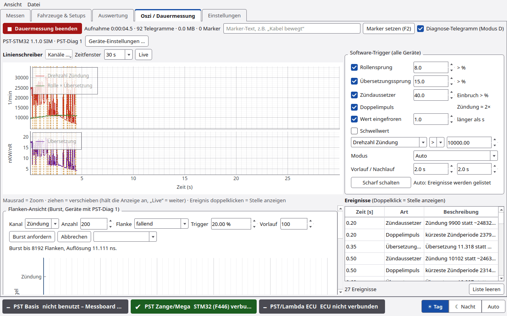

# Oszi und Dauermessung

Der Reiter **Oszi / Dauermessung** macht die Messelektronik zum Messwerkzeug. Typische Frage: Ist das Zündsignal oder
der Rollengeber gestört? Die Dauermessung läuft unabhängig von einem Leistungslauf.

## Kopfzeile

| Element | Funktion |
|---|---|
| **●  Dauermessung starten** / **■  Dauermessung beenden** | Aufzeichnung ohne Zeitgrenze. PyST schreibt laufend in Abschnitten auf die Platte |
| Anzeige daneben | „keine Aufzeichnung“ bzw. Dauer und Umfang der Aufzeichnung |
| Marker-Text | z. B. „Kabel bewegt“ |
| **Marker setzen (F2)** | Marker mit Text an der aktuellen Stelle |
| **Diagnose-Telegramm (Modus D)** | Gerät sendet zusätzlich Flanken je Telegramm, kürzeste/längste Periode, verworfene Flanken und Flags. Nur Geräte mit PST-Diag 1. Normale Läufe sind davon unabhängig |
| Geräteanzeige + **Geräte-Einstellungen …** | Einstellungen der Messelektronik (siehe unten) |

Eine beendete Dauermessung steht danach in der Laufliste und in der Auswertung, mit der Notiz „Dauermessung“.

## Linienschreiber

| Element | Funktion |
|---|---|
| **Kanäle …** | Kanäle wählen. Je Einheit ein eigenes Feld |
| **Zeitfenster** | 10 s, 30 s, 1 min, 5 min, 30 min, alles |
| **Live** | Anzeige läuft wieder mit |

Mausrad = Zoom. Ziehen = verschieben (hält die Anzeige an, **Live** = weiter). Marker erscheinen als senkrechte Linien.

**Kanäle:** Drehzahl Zündung, Drehzahl Rolle, Rolle × Übersetzung, Übersetzung, Messfrequenz, AFR, EGT 1, EGT 2.
Mit PST-Diag 1 zusätzlich: Flanken Zündung, Flanken Rolle, Zündung kürzeste/längste Periode, Rolle kürzeste/längste
Periode, Zündung verworfen, Rolle verworfen, Geräte-Flags, Zündstärke (mV, über die Zange).
Standard: Drehzahl Zündung, Rolle × Übersetzung, Übersetzung.

## Software-Trigger (alle Geräte)

Funktioniert mit jeder Messelektronik, auch mit dem alten Mega 3.0.0.

| Ereignis | Schwelle (Standard) |
|---|---|
| **Rollensprung** | > 8 % |
| **Übersetzungssprung** | > 15 % |
| **Zündaussetzer** | Einbruch > 40 % |
| **Doppelimpuls** | Zündung ≈ 2× |
| **Wert eingefroren** | länger als 1 s |
| **Schwellwert** | Kanal, > oder <, Wert (Standard Drehzahl Zündung > 10000) |

| Einstellung | Bedeutung |
|---|---|
| **Modus Auto** | Anzeige läuft weiter, Ereignisse werden nur gelistet |
| **Modus Normal** | Anzeige springt bei jedem Ereignis auf die Stelle |
| **Modus Einzelschuss** | wie Normal, danach angehalten bis **Scharf schalten** |
| **Vorlauf / Nachlauf** | Zeit vor und nach dem Ereignis (Standard je 2 s) |

Meldet das Gerät selbst einen Fehler (z. B. Datenverlust), erscheint das als „Gerät meldet“.

## Ereignisse

Liste aller Ereignisse mit Zeit und Art. **Doppelklick** zeigt die Stelle im Linienschreiber. **Liste leeren** löscht
die Liste (nicht die Aufzeichnung). Auch Zange und Steckdosen tragen hier Ereignisse ein.

## Flanken-Ansicht (Burst, Geräte mit PST-Diag 1)

Wie ein Logikanalysator: das Gerät nimmt eine Folge von Flanken auf und schickt sie an PyST.

| Feld | Bedeutung |
|---|---|
| **Kanal** | Zündung, Rolle oder beide |
| **Anzahl** | Flanken (Standard 200) |
| **Flanke** | fallend, steigend oder beide (Pulsbreite) |
| **Trigger** | Periode weicht mehr als x % vom Mittel der 8 vorigen ab (Standard 20 %, 0 = sofort) |
| **Vorlauf** | Flanken vor dem Trigger (Standard 100) |
| **Burst anfordern** / **Abbrechen** | Aufnahme starten bzw. abbrechen |
| Liste | frühere Bursts dieser Sitzung |

Zwei Cursor (rot/blau) ziehen, PyST zeigt die Zeitdifferenz.

## Geräte-Einstellungen (PST-Diag 1)

Einstellungen der Messelektronik ändern, ohne neu zu flashen. Änderungen wirken sofort, aber nur bis zum Ausschalten.

| Knopf | Wirkung |
|---|---|
| **Neu lesen** | Werte aus dem Gerät lesen |
| **Übernehmen** | geänderte Werte senden (flüchtig) |
| **Im Gerät speichern** | dauerhaft ablegen |
| **Standardwerte** | Werkseinstellung |
| **Schließen** | |

Für die PyST-Basis gibt es denselben Dialog unter **Einstellungen › Verbindung › Geräte-Einstellungen der Basis …**.

## Experten

- Dauermessung: Ordner `messungen/JJMMTT_HHMMSS_Dauermessung/`. Während der Messung `teil_NNNN.csv` in Abschnitten,
  beim Beenden zu `roh.csv` zusammengefasst. Dazu `marker.csv`, `ereignisse.csv` und `bursts/burst_NNN.csv`.
- Im Speicher hält die Anzeige höchstens 30 min, auf der Platte steht alles. Die Ereignisliste hält höchstens
  20 000 Einträge.
- Die Befehle der Geräte-Einstellungen sind `#GET`, `#SET`, `#SAVE`, `#DEFAULTS`. Beim F446 geht `#SAVE` nur bei
  angehaltener Ausgabe, PyST hält sie dafür kurz an.
- Ohne PST-Diag 1 (z. B. Mega 3.0.0) sind Modus D und die Flanken-Ansicht gesperrt.
