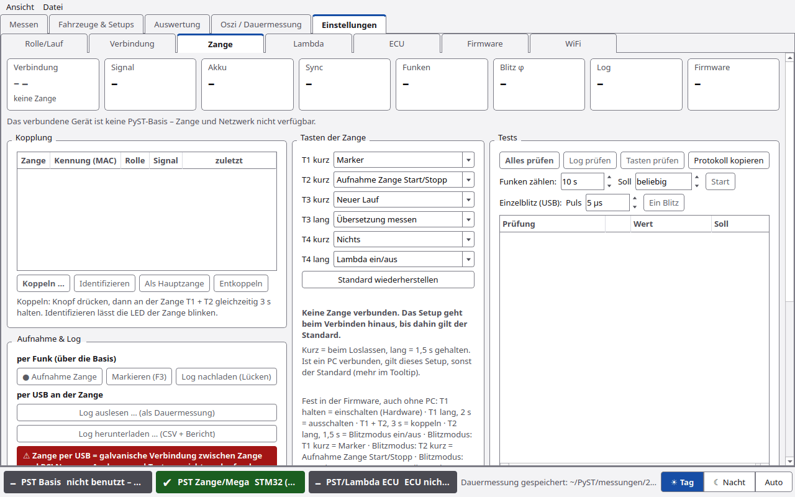
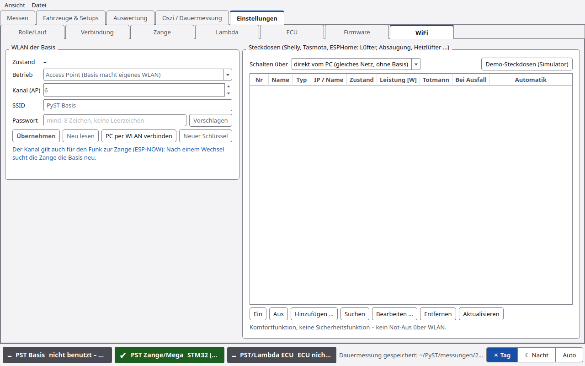

# PyST-Basis und Zange

Die **PyST-Basis** ist die neue Messplatine (STM32 mit Basis-ESP und Lambda-Controller). Sie spricht per USB oder WLAN
mit PyST und per Funk mit der **Funk-Zündzange**. Die Zange sitzt am Zündkabel, misst die Zündung und hat vier Tasten
(T1 bis T4), mit denen der Fahrer PyST bedienen kann.

Alles zur Zange steht unter **Einstellungen › Zange**, WLAN und Steckdosen unter **Einstellungen › WiFi**, die
Lambda-Heizung unter **Einstellungen › Lambda**.

> ⚠️ **Zange per USB = galvanische Verbindung zwischen Zange und PC!** Nur zum Auslesen und Testen – nicht am
> laufenden Motor messen. Zündspannung kann PC und Zange zerstören. PyST verbindet eine Zange am USB deshalb **nie
> automatisch**. Es zeigt nur einen Hinweis in der Statusleiste.

## Kopfkarten

Oben acht Karten: **Verbindung**, **Signal**, **Akku**, **Sync**, **Funken**, **Blitz φ**, **Log**, **Firmware**.

## Kopplung

Tabelle der gekoppelten Zangen: **Zange**, **Kennung (MAC)**, **Rolle**, **Signal**, **zuletzt**.

| Knopf | Funktion |
|---|---|
| **Koppeln …** | Kopplungsfenster der Basis öffnen (30 s). An der Zange **T1 + T2 gleichzeitig 3 s** halten |
| **Identifizieren** | die Zange lässt ihre LED blinken |
| **Als Hauptzange** | ausgegraut: die Basis-Firmware hat dafür noch keinen Befehl. Bis dahin ist die erste verbundene Zange die Hauptzange |
| **Entkoppeln** | gewählte Zange aus der Kopplungsliste der Basis löschen |

## Aufnahme & Log

### per Funk (über die Basis)

| Knopf | Funktion |
|---|---|
| **● Aufnahme Zange** | Aufnahme in der Zange starten bzw. stoppen |
| **Markieren (F3)** | Marker setzen. F3 gilt im ganzen Programm |
| **Log nachladen (Lücken)** | die Zange schickt fehlende Log-Blöcke über die Basis nach |

### per USB an der Zange

| Knopf | Funktion |
|---|---|
| **Log auslesen … (als Dauermessung)** | Log auslesen und als Dauermessung (und `.pyst`) speichern |
| **Log herunterladen … (CSV + Bericht)** | ganzes Log als CSV, dazu ein Bericht mit allen Starts der Zange |

Dazu ein roter Hinweis mit der USB-Warnung.

**Zange per USB verbinden:** unter **Einstellungen › Verbindung** den Port der Zange wählen und **Verbinden**. Die
Statusleiste zeigt dann „Zange per USB – nur Auslesen/Testen, nicht am laufenden Motor“.

## Tasten der Zange

Kurz = beim Loslassen, lang = 1,5 s gehalten. Ist ein PC verbunden, gilt dieses Setup, sonst der Standard.

| Geste | Standard |
|---|---|
| T1 kurz | Marker |
| T2 kurz | Aufnahme Zange Start/Stopp |
| T3 kurz | Neuer Lauf |
| T3 lang | Übersetzung messen |
| T4 kurz | Nichts |
| T4 lang | Lambda ein/aus |

Wählbare Aktionen: **Nichts**, **Marker**, **Aufnahme Zange Start/Stopp**, **Neuer Lauf**, **Übersetzung messen**,
**Lambda ein/aus**. **Standard wiederherstellen** setzt alles zurück. Liegt eine Aktion auf zwei Gesten, weist PyST
darauf hin.

**Fest in der Firmware, auch ohne PC:**

| Geste | Wirkung |
|---|---|
| T1 halten | einschalten |
| T1 lang, 2 s | ausschalten |
| T1 + T2, 3 s | koppeln |
| T2 lang, 1,5 s | Blitzmodus ein/aus |
| Blitzmodus: T1 kurz | Marker |
| Blitzmodus: T2 kurz | Aufnahme Zange Start/Stopp |
| Blitzmodus: T3/T4 kurz | φ −/+ 0,5 °KW |
| Blitzmodus: T3/T4 lang | φ −/+ 5 °KW |

**Voraussetzung:** Zange ab Firmware 0.1.3, Basis ab 0.2.3.

**Wie es wirkt:**

- **Neuer Lauf** startet einen Lauf wie START, aber ohne Rückfrage zum Setup. Abbrechen geht nur am PC.
- **Übersetzung messen:** Drehzahl halten, Taste startet 5 s Messung, ein zweiter Druck innerhalb von 30 s übernimmt den
  Wert. Siehe [Übersetzung](Übersetzung.md#5-zangentaste-übersetzung-messen).
- Neuer Lauf und Übersetzung brauchen PyST, Lambda braucht die Basis. Fehlt das, zeigt die Zange das Fehlerbild
  (3 × lang).
- Ein breites Band über den Reitern zeigt dem Fahrer, was passiert („Neuer Lauf gestartet“, „Übersetzung wird gemessen,
  Drehzahl halten …“).

**Gesperrt** sind Neuer Lauf und Übersetzung, wenn: Firmware wird geflasht, Messboard nicht verbunden, ein Lauf läuft
schon, Oszi-Aufnahme läuft, Prüfung läuft, ein Dialog ist offen, oder die Übersetzung wird gerade gemessen. Das Band
zeigt dann den Grund.

Im Fenster **Übersetzung live abgleichen** verstellen die Tasten die Übersetzung (⚠️ *noch nicht am Prüfstand
bestätigt*), siehe [Übersetzung](Übersetzung.md#mit-den-zangentasten).

## Tests

| Element | Funktion |
|---|---|
| **Alles prüfen** | Funkverbindung, Akku, Zeitabgleich, Funken, Log |
| **Log prüfen** | Zange per USB: Log auslesen und auf Zeilenarten, Funken und Neustarts prüfen |
| **Tasten prüfen** | ausgegraut: kommt mit einer Zangen-Firmware, die jeden Tastendruck an PyST meldet. Bis dahin: Tasten der Zange, Rückmeldung über die LED |
| **Protokoll kopieren** | Ergebnis in die Zwischenablage |
| **Funken zählen:** Dauer (Standard 10 s), **Soll** (Hz, „beliebig“ = nur messen), **Start** | zählt die Funken und vergleicht mit der erwarteten Zündfrequenz |
| **Einzelblitz (USB):** Puls (1–25 µs, Standard 5 µs), **Ein Blitz** | löst einen Blitz aus |

> ⚠️ Einzelblitz: Nicht in die LED schauen. Mit kurzem Puls beginnen und U_DS am Blitzkopf messen: über 24 V sofort
> aufhören.

## Geräte-Einstellungen der Zange (per Funk)

| Gruppe | Felder |
|---|---|
| **Zündsignal** | Zündimpulse/U × 10, Totzeit nach Funke [µs], Plausibilität min [%], Plausibilität max [%], Verstärkung (AGC): aus / ein / automatisch |
| **Probe-Eingang** | Probe benutzen (nein/ja), Flanke: Laden (steigend) / Funke (fallend) |
| **Blitz** | Blitzmodus: aus / Trigger / Funken, Verstellung φ [°KW], Pulsdauer [µs] (1–25) |
| **Funk & Gerät** | Statusmeldungen [1/s], Sendeleistung |

| Knopf | Funktion |
|---|---|
| **Lesen** | Werte von der Zange holen |
| **Übertragen** | Werte zur Zange schicken |
| **Standardwerte** | Standardwerte eintragen. Zur Zange gehen sie erst mit **Übertragen** |
| **Zange ausschalten** | |

## Lambda-Heizung

Unter **Einstellungen › Lambda**: **Lambda ein** / **Lambda aus**. Die Basis heizt die Sonde nur über der 12-V-Grenze
und schaltet sie ohne Motor nach einer einstellbaren Zeit aus. Die Statusleiste zeigt „Lambda heizt“, „Lambda bereit ·
aus in m:ss“, „Lambda aus“ oder „Lambda: 12 V zu niedrig“. Details: [Einstellungen](Einstellungen.md#lambda).

## WLAN der Basis

Unter **Einstellungen › WiFi**. Die Basis macht ein eigenes WLAN (Access Point), meldet sich im Werkstatt-WLAN an oder
hat WLAN aus. **PC per WLAN verbinden** verbindet PyST über TCP statt USB. Dazu muss der PC einmal per USB verbunden
gewesen sein, denn dabei holt PyST den Schlüssel für die Anmeldung. Details: [Einstellungen](Einstellungen.md#wifi).

Nach einem WLAN-Abriss verbindet PyST selbst wieder und meldet sich neu an. Eine abgelehnte Anmeldung wiederholt es
nicht (Statusleiste: „Anmeldung an der Basis gescheitert“).

## WLAN-Steckdosen

Lüfter, Absaugung, Heizlüfter schalten. Bis zu 8 Steckdosen.

> ⚠️ **Komfortfunktion, keine Sicherheitsfunktion – kein Not-Aus über WLAN.**

| Element | Funktion |
|---|---|
| **Schalten über** | **die Basis** oder **direkt vom PC (gleiches Netz, ohne Basis)** |
| **Demo-Steckdosen (Simulator)** | vier simulierte Steckdosen auf diesem PC (Shelly Gen2, Shelly Gen1, Tasmota, ESPHome) |
| Tabelle | Nr, Name, Typ, IP / Name, Zustand, Leistung [W], Totmann, Bei Ausfall, Automatik |
| **Ein**, **Aus** | gewählte Steckdose schalten |
| **Hinzufügen …**, **Bearbeiten …**, **Entfernen** | Steckdose anlegen, ändern, löschen |
| **Suchen** | Steckdosen im Netz suchen |
| **Aktualisieren** | Zustand und Leistung neu lesen |

### Steckdose anlegen

| Feld | Bedeutung |
|---|---|
| Nummer | 1–8 |
| Name | z. B. Gebläse, Absaugung, Heizlüfter |
| Typ | Shelly Gen2/3/4 (RPC), Shelly Gen1, Tasmota, ESPHome (Web-Server) |
| IP / Name | Adresse der Steckdose |
| Relais-Kanal, ESPHome Switch-ID, ESPHome Leistungs-Sensor | nur bei „direkt vom PC“ |
| **Bei Ausfall von PyST/Basis** | **fällt aus (z.B. Heizlüfter)** oder **bleibt an (z.B. Absaugung, Lüfter)** |
| **Totmann-Zeit** | Rückfallzeit (5–3600 s) |
| **Automatik** | **beim Laufstart ein**, **während der Dauermessung ein** |
| **Nachlaufzeit** | so lange bleibt die Steckdose nach dem Laufende an |

„fällt aus“: Einschalten immer mit Rückfallzeit (Totmann), wird laufend erneuert. ESPHome kennt keine Rückfallzeit –
dort nur zyklisch erneuert.

## Statusleiste

| Feld | Beispiele |
|---|---|
| **PST Basis** | „verbunden USB · FW … · 60 Hz“, „nicht verbunden“, „im Bootloader – …“, „nicht benutzt – Messboard Arduino Mega“ |
| **PST Zange/Mega** | „Zange 1: Funk ok (… dBm) · Akku … V“, „Funk schwach“, „laden!“, „kein Sync“, „keine Basis verbunden“, „nicht verbunden – Zange aus oder nicht gekoppelt“. Mit Mega oder F446: deren Zustand |
| **PST/Lambda ECU** | Lambda-Heizung und rusEFI, z. B. „Lambda heizt · ECU verbunden · 50 Hz“, „ECU nicht verbunden“ |

## Experten

- Die Zange hält das Tasten-Setup nur im RAM und startet mit dem Standard. PyST schickt es beim Verbinden, bei jedem
  neuen „Zange verbunden“, nach einem Neustart der Zange und bei jeder Änderung neu.
- Nach Neuer Lauf und Übersetzung erwartet die Zange eine Antwort (LED-Muster). Bleibt sie aus, zeigt sie das
  Fehlerbild.
- Der WLAN-Kanal gilt auch für den Funk zur Zange (ESP-NOW). Nach einem Wechsel sucht die Zange die Basis neu.
- Steckdosen: Beim Hinzufügen setzt PyST den Einschaltzustand nach Stromausfall auf „aus“. Shelly mit Passwort wird
  erkannt, aber nicht unterstützt. Geräte ohne Relais werden abgewiesen.
- Netzwerk- und Funkzugriffe laufen im Hintergrund, die Oberfläche hängt dabei nicht.
