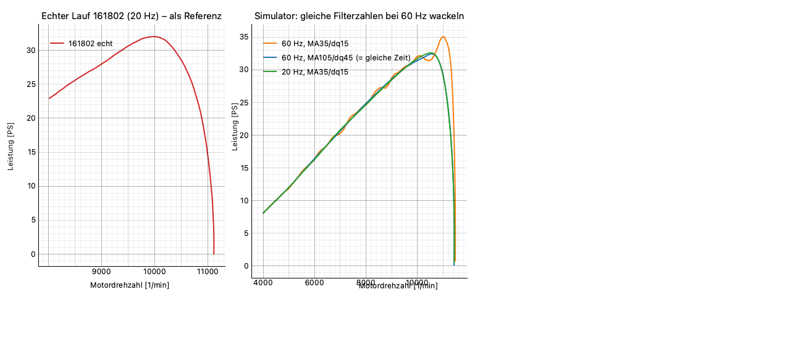

# Rechenweg

PyST rechnet Leistung und Drehmoment wie die LabVIEW-Prüfstandssoftware **3.2.1**. Der Rechenweg ist aus den
Blockdiagrammen rekonstruiert. Mit denselben Parametern und Filtern liefert PyST dieselben Kurven wie LabVIEW.

## Kurz für den Anwender

- PyST misst, wie schnell die Rolle beschleunigt. Aus Beschleunigung und Trägheit der Rolle folgt das Drehmoment.
- Die **Übersetzung** rechnet von der Rolle auf den Motor um. Sie geht quadratisch ein.
- Zwei **Filter** glätten die Messung: der gleitende Mittelwert (MA) die Rollendrehzahl, der Differenzenquotient (dq)
  die Beschleunigung. Größere Filter = glattere, aber trägere Kurve.
- Das **Klima** korrigiert auf Normbedingungen nach DIN 70020.
- Mit **Verlusten** (aus dem [Ausrollversuch](Ausrollversuch.md)) zeigt PyST die Motorleistung, sonst die Radleistung.

## Formeln

| Größe | Formel |
|---|---|
| Rollendrehzahl je Telegramm | nRolle = 60 · f_Rolle / Inkr |
| Zeitschritt | dT = 1 / Messfrequenz |
| Rolle gefiltert | gleitender Mittelwert, **Dreieck**, Halbbreite ⌊MA/2⌋ |
| dT gefiltert | **Rechteck**, Halbbreite dq |
| Motordrehzahl | n = nRolle_gefiltert · i |
| Winkelgeschwindigkeit | ω = n · 2π/60 |
| Beschleunigung | a[j] = (ω[j+k] − ω[j−k]) / (2 k · dT_gefiltert[j]), k = min(dq, j, N−1−j) |
| Drehmoment | M = k_DIN · J / i² · a + Mv(nRolle) / i |
| Leistung | P = ω · M, PS = 0,00135962 · P |
| DIN 70020 | k_DIN = (1013 / p) · √((T + 273,15) / 293,15) |
| Verlustmoment | Mv(n) = M0 + n · (M1 − M0) / n1 + m2 · (n/1000) · ((n − n1)/1000) |

- i = Übersetzung nKW/nRolle, J = Rollenträgheit, p in mbar (absolut, ohne Dampfdruck), T in °C.
- Die DIN-Korrektur wirkt nur auf den Radanteil, nicht auf die Verluste.
- m2 = 0 ist linear wie LabVIEW. Mv(0) = M0 und Mv(n1) = M1 bleiben auch mit m2 erhalten.
- Radleistung = Anteil aus der Rollenbeschleunigung, Motorleistung = Radleistung + Verlust.

## Anfang und Ende der Kurve

- **Ende:** *n vom Gas* ist nur die Schwelle für die Ende-Erkennung. Die Kurve endet an der ersten Stelle, an der die
  Drehzahl fällt (a ≤ 0) und n über *n vom Gas* liegt.
- **n Stop** (Erweiterung von PyST): der Lauf endet auch, sobald n ≥ *n Stop*. 0 = aus, wie LabVIEW.
- **Anfang:** Bei *n vom Gas* wird nichts abgeschnitten. Entfernt wird nur der Vorlauf: PyST sucht von hinten die letzte
  Stelle mit a < 0 und n < *n vom Gas*. Danach beginnt die Kurve, also mit dem Beschleunigen nach dem Halten.

## Filter in Sekunden oder Messpunkten

LabVIEW zählt die Filter in **Messpunkten**. Die alte Elektronik misst mit 20 Hz, die neue mit 60 Hz. Dieselbe Zahl
Messpunkte bedeutet bei 60 Hz nur ein Drittel der Zeit. Deshalb rechnet PyST standardmäßig in **Sekunden**:

MA = round(MA_s · Messfrequenz), dq = round(dq_s · Messfrequenz)

| Einstellung | 20 Hz | 60 Hz |
|---|---|---|
| Standard 1,75 s / 0,75 s | 35 / 15 Punkte (= LabVIEW-Standard) | 105 / 45 Punkte |

Umschalten unter **Einstellungen › Rolle/Lauf › Filter › Filter in** (Sekunden / Messpunkte (wie LabVIEW)) oder in
**Lauf-Einstellungen …**. Bei Messpunkten gilt: 20-Hz-Werte bei 60 Hz × 3 nehmen.

LabVIEW-Läufe (XML) bringen ihre Filter in Messpunkten mit und rechnen damit identisch.

## Fehlerkanäle

PyST bewertet jeden Lauf (und jede Dauermessung) auf Störungen von Rolle und Zündung:

| Kanal | Bedeutung |
|---|---|
| **Fehler Rolle** | Rolle weicht mehr als 5 % vom gleitenden Median ab. Das ist wegen der Masse der Rolle physikalisch unmöglich, also eine Störung |
| **Fehler Zündung** | Zündung weicht mehr als 12 % von Rolle × gleitender Übersetzung **und** vom eigenen gleitenden Median ab. Kupplung oder Vario allein lösen nichts aus |
| **Doppelimpuls Zündung** | Zündung etwa doppelt so hoch wie erwartet (1,7- bis 2,3-fach) |
| **Wert eingefroren** | Rolle oder Zündung hängt mindestens 1 s, obwohl sich die andere Drehzahl ändert |
| **Abweichung Rolle**, **Abweichung Zündung** | Abweichung in % |

Die Spalte **Fehler** in der Laufliste zeigt den Anteil gestörter Telegramme. Unter 30 1/min wird nicht bewertet, das
erste Telegramm auch nicht.

## Experten

- Rolle gefiltert: vorne MA-mal nRolle[1] aufgefüllt, danach die ersten MA entfernt. dT gefiltert: vorne (2dq+1)-mal
  dT[1] aufgefüllt. So wie in LabVIEW.
- Übersetzung aus der Zündung: getrimmter Mittelwert von nZündung/nRolle (je 10 % oben und unten weg), auf 3 Stellen
  gerundet.
- Vergleich mit LabVIEW: `python -m pyst recalc lauf.xml` bzw. `compare`, siehe [Kommandozeile](Kommandozeile.md).
- Quelle: `pyst/physics.py` (Rechnung), `pyst/channels.py` (Fehlerkanäle), `pyst/ausrollen.py` (Verluste).
