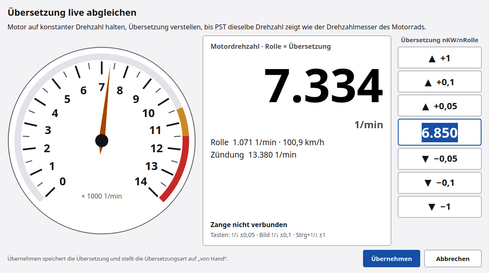
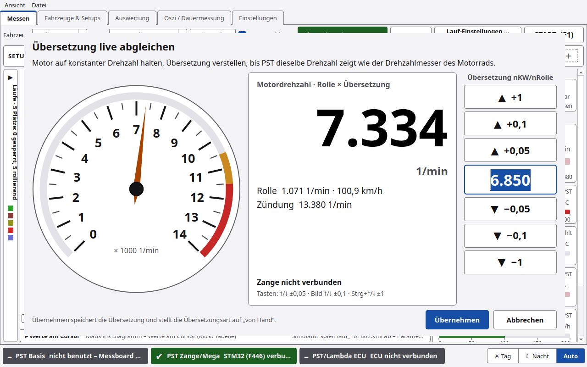

# Übersetzung

Die **Übersetzung i = nKW / nRolle** rechnet die Rollendrehzahl in die Motordrehzahl um. Sie geht quadratisch in das
Drehmoment ein (M = J/i² · a). Ein falscher Wert verschiebt also die ganze Kurve. Ändert sich der Gang, die Kette oder
der Reifen, muss die Übersetzung neu.

Es gibt zwei Arten, zu wählen unter **Lauf-Einstellungen …** oder **Einstellungen › Rolle/Lauf**:

| Art | Bedeutung |
|---|---|
| **von Hand (Wert eintragen oder einmessen)** | ein fester Wert für alle Läufe |
| **Funkenmessung (aus Zündung/Rolle jedes Laufs)** | PyST misst die Übersetzung in jedem Lauf neu. Der eingetragene Wert ist dann nur der **Startwert** |

## 1. Von Hand eintragen

Wert in das Feld **Übersetzung** eintragen (Lauf-Einstellungen oder Rolle/Lauf). Fertig.

## 2. Einmessen

**Übersetzung einmessen …** öffnet das Fenster **Übersetzung**.

| Element | Funktion |
|---|---|
| **Eingestellte Übersetzung nKW/nRolle** | Wert, der gerade gilt |
| **Einmessen – Quelle der Motordrehzahl** | **Zündabnehmer (Messboard)** oder **rusEFI (Drehzahl vom Steuergerät)** |
| **Messdauer** | Standard 5 s |
| Tabelle und Diagramm | Messwerte. Die rote Linie ist der Wert, den man übernimmt: ziehen, klicken oder eintippen |
| **Messen** | Motor bei konstanter Drehzahl halten, dann drücken |
| **Mittelwert** | rote Linie auf den Mittelwert setzen |
| **Messwert übernehmen** | Wert speichern |
| **Schließen** | Fenster zu |

PyST warnt, wenn Zündabnehmer und rusEFI um mehr als 3 % auseinanderliegen oder die Messwerte stark streuen.

## 3. Live abgleichen

Für Fahrzeuge ohne sauberes Zündsignal: man stellt die Übersetzung so ein, dass PyST dieselbe Drehzahl zeigt wie der
Drehzahlmesser des Fahrzeugs. **Live abgleichen …** öffnet das Fenster **„Übersetzung live abgleichen“**. Es bleibt
neben dem Hauptfenster offen.

| Element | Funktion |
|---|---|
| Drehzahlmesser | „Motordrehzahl · Rolle × Übersetzung“. Skala wie die Drehzahlkachel des Fahrzeugs (Standard 14000) |
| Zeile darunter | Rolle 1/min · km/h und Zündung |
| **▲ +1 / +0,1 / +0,05** | Übersetzung größer. Gedrückt halten wiederholt |
| **▼ −0,05 / −0,1 / −1** | Übersetzung kleiner |
| **Übernehmen** | Wert speichern, Art wird **von Hand** |
| **Abbrechen** / Esc | alter Wert zurück |

Der Wert bleibt zwischen 0,5 und 50.

**Tastatur:** ↑/↓ ±0,05 · Bild ↑/↓ ±0,1 · Strg + ↑/↓ ±1.

### Mit den Zangentasten

⚠️ *Noch nicht am Prüfstand bestätigt.*

Solange das Fenster offen ist, verstellen die Tasten der Funk-Zange die Übersetzung:

| Taste | Wirkung |
|---|---|
| T1 | −0,1 |
| T2 | +0,1 |
| T3 | −0,05 |
| T4 | +0,05 |

Kurz und lang drücken wirken gleich. Die übrigen Funktionen des eigenen Tasten-Setups (Aufnahme, Neuer Lauf, Lambda …)
sind so lange aus, danach gilt wieder das eigene Setup. Im Blitzmodus der Zange und während eines Laufs verstellen die
Tasten nichts. Das Fenster zeigt „Zange nicht verbunden“ bzw. „Lauf läuft – Übersetzung erst danach verstellen“. Das Fenster
selbst lässt sich im Lauf nicht öffnen.

## 4. Funkenmessung

⚠️ *Noch nicht am Prüfstand bestätigt.*

Mit **Funkenmessung (aus Zündung/Rolle jedes Laufs)** nimmt PyST am Ende jedes Laufs das Verhältnis Zündung/Rolle,
wertet den Lauf damit aus und übernimmt den Wert als neuen Startwert. Genommen werden nur Messpunkte vor dem Ausrollen
mit einer Rollendrehzahl von mindestens 30 % des Maximums. Von diesen nimmt PyST einen getrimmten Mittelwert
(je 10 % der Werte oben und unten weg), wie beim Einmessen.

Bis zum Laufende rechnen Live-Kurve, Laufbeginn (Drehzahlanstieg) und Laufgrenzen (*n vom Gas*, *n Stop*) mit dem eingetragenen Startwert.
Ist das Zündsignal nicht brauchbar, rechnet PyST mit dem eingestellten Wert.

Voraussetzung: **Zündung [Imp/U]** stimmt (Einstellungen › Rolle/Lauf).

## 5. Zangentaste „Übersetzung messen“

Mit dem [Tasten-Setup](PyST-Basis-und-Zange.md#tasten-der-zange) kann eine Zangentaste **Übersetzung messen** auslösen
(Standard: T3 lang). Erster Druck: PyST misst 5 s. Zweiter Druck innerhalb von 30 s: Wert übernehmen.

PyST lehnt den Wert ab, wenn

- die Drehzahl nicht ruhig war,
- er mehr als 3 % von rusEFI abweicht,
- er etwa doppelt oder halb so groß ist wie der alte Wert (Zündimpulse falsch eingestellt?).

## Experten

- Die Funkenmessung rechnet: i = nZündung / nRolle mit nZündung = 60 · fZündung / (Imp/U).
- Im Live-Kanal **Übersetzung Zündung/Rolle** bzw. **Übersetzung ECU/Rolle** sieht man das Verhältnis laufend
  (Kachel in [Messen](Messen.md#rechte-spalte)).
- Die Übersetzung steht in jedem gespeicherten Lauf. **Mit aktuellen Einstellungen neu rechnen** in der Laufliste
  nimmt die aktuelle Übersetzung.
